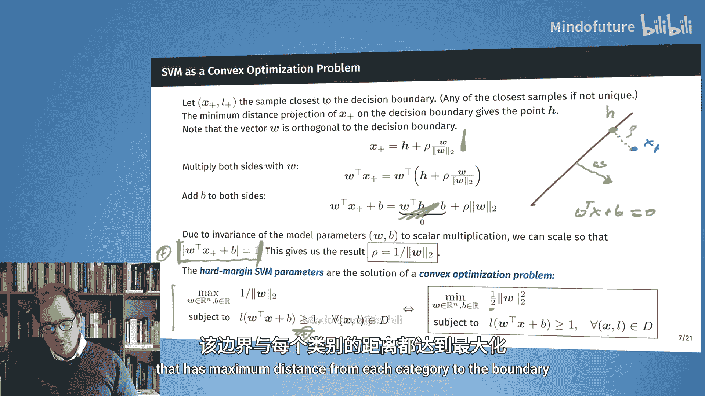

# 【凯尔大学】机器学习优化方法 ｜ Optimization Methods For Machine Learning And Engineering 2021 p32 P32_9.1_线性分类 -BV1C6SwBqEp7_p32-

Welcome to a new lecture in the course of optimization the methodsth for Ma learning and engineering。

 today we will talk about a classification support vector machines and the reproducing kernelnel Hilbert space。

And the lecture is structure as follows， first of all we will see linear classification and then we make the extension to nonlinear classification and we will see how kernels are helping us in having efficient nonlinear classification and then we will see some of the theoretical background that is very important today in machine learning that reproducing kernel Hi space。

Let's jump right into the object classification。There's a lot of history with respect to classification and many scientific disciplines。

ha created taxonomies to somehow structure their field。

 this has started really early already Aristotle， the Greek philosopher has developed an taxonomy for the entire world where he first classified everything into the living things and the non-living things and then the living things were classified into animals and plants and then the animals were classified into the humans and the other animals and so on and he created a taxonomy that encompassed the whole world and from today's perspective we would say this was also a mey taxonomy。

 so Mey is an abbreviation。It stands for mutually exclusive but completely Exive。

And that defines that the taxonomy encompasses the entire domain and all the sub definitionfinitions that were created。

 they span the entire domain， so there's nothing left out and all the categories are disjoint。

And this is nice and this is a property that you also want to have in， for example。

 when you prepare a talk that is you want to have disjoint categories of elements that you talk about and these Mey category or Mey properties are something you can think about in many also nonscientific applications。

Okay but this classification of the world and the classification of botany and the animals。

 it was continued and today's system it essentially stems from California Lie who defined a five level hierarchy to classify all plants and animals today we have a couple more levels。

 but essentially what he defined is still in use and what is also still in use is the binomial naming scheme for giving Latin names to species。

And the species is dennoted by agus， which is larger。TheClas of or class has a specific meaning。

 but it's a certain group of animals that somehow belong together that are in the Gaos and then the species is added and then makes the precise definition here it's boa consual or the Gaos consuous to species。

And then we can go up the chain， so it belongs to the family of Boide。

 and the order are the Klammatta， so the serpents， the class of the reptiia and so on。

 and we go up the chain until we end up basically with animals or living things that have a ascent nucleus。

And well it's good to have a classification with such many levels because there are an estimated8 to 87 million species on Earth。

 many of them we don't know about， we haven't classified， we haven't given a name to them。But the。

So it's good to have this hierarchy， so there is no like overcrowding。

 but we also have to see that how the levels are defined， this is somewhat arbitrary。

 obviously there are good reasons。Why they were defined the way they are， but to some extent。

 nature and evolution doesn't consider that now it might be the right time to。Create a nugos。

 is something， this is an emerging property and there are also areas where the levels you see here are not as clear cut as people might want to make you believe。

Okay， now today classification is the name of the game。

 but we want to do this automatically and with machine learning。

 so we want to take a look at data and based on the data classified。

The example we have here is one for binary classification where I have elements of just two different categories or classes and here we consider to have only two classes plus one and minus one and well obviously we can map to that even if our categories are red and green。

 I could still map them to plus one at minus1 and this has some advantages in the mathematics that we will develop to have these class labels。

So all the data that we consider， it is the training data is in a big set D and it contains twoples of the features of the objects that have been observed and the ground roof class label。

 so here the feature vector is X or XI with I between one and small D so a small D is the size of our training data set。

And here we always have the feature vector， X and then the ground roof label added。And。

In this first part of the lecture， we are using so-called linear classification。

 which is well quite simple type of classification。

 we just multiply all the features in the feature vector with a weight W and at some intercept or offset on top and then the question is whether for this formula which has to be zero exactly on the classification boundary and if for this formula we end up with a positive number for our particular XI。

Then we classify the whole thing as。Plus one， and if we end up on the negative side。

 then it is minus well。So in the classification， we are not so much concerned with the actual numerical value that comes out of the term W transpo x plus being。

 but only the sign， whether we end up on the positive or on the negative side of that。😊，Okay。

 and in the picture on the right hand side where we have the orange glass， it's plus one。

 the negative class， it's minus-1， and here the boundary in the middle。

 so in this particular case the boundary it crosses like the zero position if we imagine the zero would be there。

 but since we can also have an offset， the linear classification could also lie somehow like this in our space okay。

And then overall， we have a very simple test to see whether a classification was done correctly。

 we can take our element XI plug it into the evaluation term and multiply the entire thing by the ground truth label。

 the ground truth label which is plus one or minus1。

And depending on now consider the case that the ground ho is plus one。

So we want to have the term here in brackets， so this evaluation term。

 we want to have it also positive so that the entire thing is larger than zero if however we want the graphith label is minus1。

 then we want the evaluation term also to be negative so that the entire thing is larger than zero and therefore this is a very easy test to check whether well our predicted label lies on the correct side of the boundary。

And so here this sign operator here， we consider this to only return either minus1 or plus one。

 depending on。Which side the term ends up？Okay now we now see a first algorithm that can do the training of a linear classifier。

 so we give this algorithm our training data， it will turn the crank and come up exactly with a weights vector W and an offset B for us to be used in a linear classifier now so the procedure down here。

 this is actually the general linear classifier and on top we have a special training routine which is the petton。

The perseron is a type of neural network we encountered that already in a previous lecture。

But a single layer per seton actually it's just a linear classifier。And what happens here is that。

We randomly select。our training samples that are misclassified and then adjust the weights or the parameters of our linear classifier to make an improvement。

So initially we set the weights to zero and also the weight vector we set to zero。

The weight vector MP P is set to zero。And then we loop over a big while loop。And this Y loop。

 it only ends as soon as all our samples have been correctly classified。

And so this is a shorthand here， Gamma D， and it contains the indices of all the samples that were misclassified that are not in accordance to this little check that we saw on the previous slide。

Okay， and as long as we have misclassified samples， we will randomly select one of them。

And then use the feature vector from this sample and also the ground roof label to notch our weights into the correct direction。

So。If then， our。Training samples are linearly separable。

 we know that this procedure will converge in a finite number of steps and to give us the weight vector to W and offset B to perfectly classify the training samples。

If our training samples are not linear release at proper， so if I cannot find a linear。

Decision boundary to separate the true perfectly。Then this training algorithm。

 it will loop infinite indefinitely。And I need to have some other argument to break out of the loop and say。

 well， maybe I cannot improve further。嗯。What is important， furthermore。

 is that the weights or the model parameters are invariant to scar multiplication。So。

What does that mean， imagine that I have C larger than zero， so some scalr。

And I'm multiplying both the W and the offset with C。 So S is done here。

Then I can just pull that out and we will see that the entry side。

 meaning the sign of the overall term will not change by having a positive scalar multiplied on front。

 so therefore the W and the B are invariant to this scaling。

And that is good for us because imagine that we have to do millions and millions of iterations of this perceptton training。

That means we might run into numerical issues when the W becomes very large。

 but by having this invariance to a scalar multiplication。

 we can just find C in such a way that we normalize W to a certain length and this then avoids running into these numerical issues。

Okay now let's apply the perceptron on an example data and here we are using a very famous dataset which is the ES data by W F。

 he originally used that in his 1936 paper， he was one of the first ever to use linear classification or to think about this in formal terms and the EIS data was used then and is still today one of the classic benchmark dataset sets in use。

So here we have several species of ears and they differ in the size of the flower petals。

 so the length and the width， and we can put that into two dimensions for the features and here you see that for two particular species of ir。

 we can find a linear classifier that separates the two classes。

The perceptton therefore convers and the perceptton gives us a classifier that does his job perfectly。

 however， every time we run the perceptton algorithm， we will get a different result。

And so here you see the two red lines on the left hand figure and the differences can be quite dramatic and so there is no way to tell the perceptton who maybe even further improve。

 the has found here because as soon as all these output are correctly classified。

 the perceptron will just stop。Okay so every time we run the perceptron algorithm we have slightly different results and maybe the results are not very robust。

 so because all the flower instances we encounter are randomized somehow and therefore it is likely that eventually we run into Setoa of the giineical ears that end up here on the wrong side of the classification that we found what we would prefer here is to say well why don't we put the classification boundary。

 the decision boundary right in the middle。And therefore。

 we are more robust to these random perturbations， and this idea is at the very core of the so called support vector machine。

So the support vector machine was developed in the early 90s and you see here Bza is the first author of the paper。

 but actually the genius and I think it's the last author of the paper is Blaimirvanik。

 who will developed the main body of the theory of learning theory and also support vector machines specifically。

So what does the support vector machine do， we explicitly consider the distance between the decision boundary and the first training example that is closest to the decision boundary。

 could be also several of them so in this particular case here we see that we have several of the samples that have more or less the same distance to the decision boundary。

Okay， and the nice advantage of this is now that we are robust and the S for M doesn't depend on some random algorithm。

But training the SVM is actually solving a convex optimization problem。

 and we know that we have achieved the perfect result independently of the ordering of the training samples or similarly。

What we look at here is the so called hard margin SVN。

 which means that we don't allow outliers to be on the wrong side of the border。

There is also a version called soft margint SVM where we allow misclassified outliers in and we make a tradeoff to allow maybe a simpler classification boundary in exchange for a couple of misclassified examples。

 but here for just for the exposition， we only consider the H margin SVM。

OkayAnd the formula that you see here on the left hand side， it is still incomplete。

 so it refers to the distance between the classificationification boundary and the samples were。

 but it doesn't make explicit how the rule and how the training examples and under way it's w how they interre。

 so this is still an incomplete formula and we will now develop this a little further and in the end have actually an optimization problem that we can put into the algorithms that were developed in the previous lectures。

Okay。Now consider that we have exactly one sample that is closest to the decision boundary so that doesn't have to be unique。

 but for now consider we have exactly one that is closest to the decision boundary and then so let's say the decision boundary is somewhere here and our closest sample is here and so then we have a distance between the decision boundary in our sample you might also recall the projection theorem that we heard about in the context of vectorspaces so all of this applies here。

And now we have some position H。On the decision boundary。

 that is the point that is closest to our x or x plus and actually we want to to minimize or we can describe the distance here between our age and our。

X plus and here so here we have our distance row here in between。O。Now。

We note that our vector Dw so we have our decision boundary is defined as a w transpoposedse x as b equals to zero and we note thatwW is actually orthogonal to the decision boundary。

 so if we take our W and put it somewhere here on this line so we transpose it and put it somewhere here on this line。

 then our W vector would actually be orthogonal。And。And we can now use this property。

 And so what we do is， first of all， we say that W divided by。

W the Euclideanome so here we are still in Euclidean space， this guy here。

 this is a vector that is orthogonal to the decision boundary and it has the length1 and therefore when we multiply this vector of length 1 by rh then this exactly brings us from H to our x plus and this is why this formula here holds2 and we are starting with that。

And now we develop this a little further， we multiply both sides with W and expand a little bit。

 and then we add B as well to both sides， and then we will find out that we have WH plus B。

On the right hand side， and this is exactly zero。Because we know that H lies on the decision boundary。

In addition。For the left hand side， we have a W transposed x plus B。And now， because of the。

Invariance to scaling， we can now scale the left hand side so that the left hand side has a norm of exactly one。

not the norm but a length of exactly one so here this guy here， just by definition。

 just by using the freedom of having a scaling to the W， we can define by definition。

 define the left hand side to be exactly one。And this gives us our entry site the rh equals one over the Euclidean norm of w。

And that's great because now we can just plug it in and have some optimization problem that can be solved one over the norm of W subject to a couple of constraints。

And so here in the constraints， we encounter one more effect that we wanted the W transpo x plus plus b equal to one。

 so here we have this guy。And I'm editing a mark。And this guy is exactly plugged in here or this is the same but represented in the optimization problem because we know that x plus is closest to the decision boundary and therefore this just says that for the element that is closest to the decision boundary we want we want the result of the classification term to be exactly one there。

Okay。Now on the left hand side， we still have a maximization term。

 and we would prefer canonical minimization， so therefore we rewrite this a little bit and we can just replace one over W the Euclidean norm of w by just the Euclidean norm of w to transform it into a minimization problem that would be equivalent so that it has the same optr and then we can also just square it and then we end up with something that is mathematically nicer。

 we are adding here again a scaling factor， we end up with one and half the squared norm of w and this is the optimization problem that we need for optimizing or finding the best linear classifier in terms of the SVM。

So then when we go back here to our UIS plants， we just run this convex optimization problem and we find a classificationification boundary that is exactly in the middle between the two categories and that has maximum distance from each category to the boundary。

