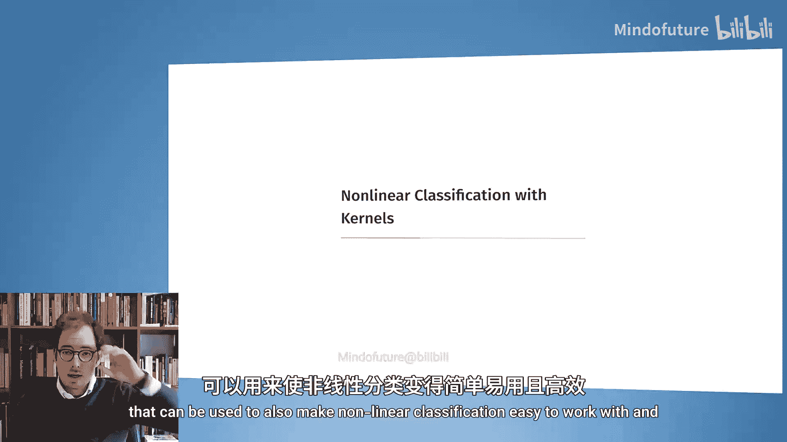
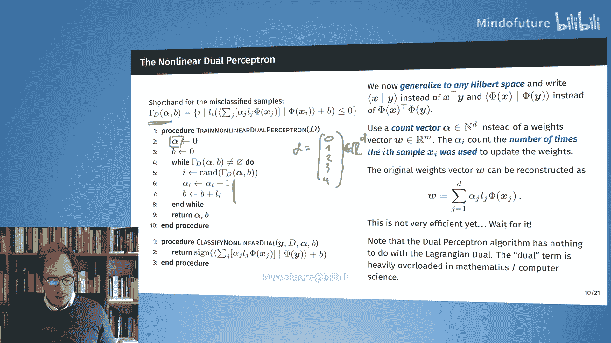
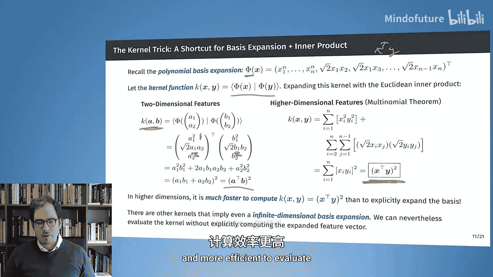
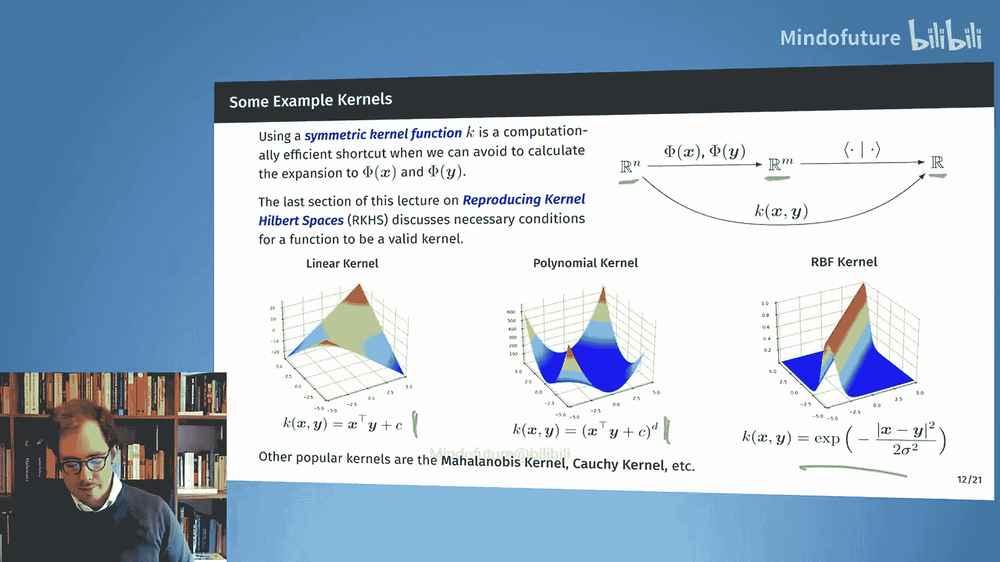
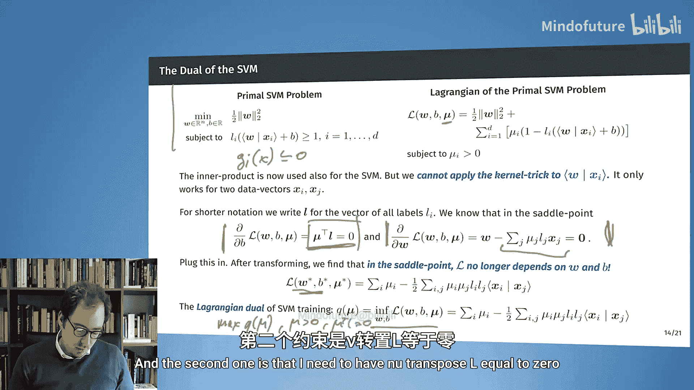
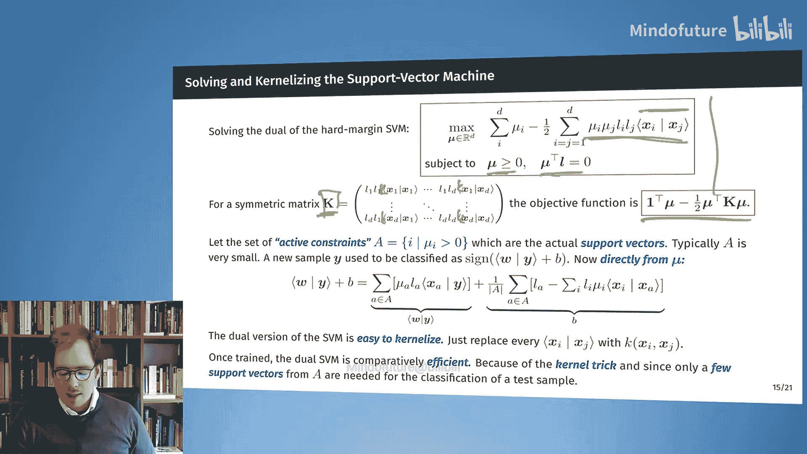

# 【凯尔大学】机器学习优化方法 ｜ Optimization Methods For Machine Learning And Engineering 2021 p33 P33_9.2_基于核函数的非线性分类 -BV1C6SwBqEp7_p33-

Okay。That's all I think well but there are cases where linear classification is not enough。

 there are cases where we also want to classifylinely and then it gets a little bit more complicated but in the end we will also have a lot more powerful classifiers and there are some tricks that can be used to also make nonlinearar classification easy to work with and efficient。

So first of all， look here at the above picture where we have the red class of elements lying on a circle and the entire thing is embedded in a space and surrounded by all the blue examples and it becomes immediately clear that we cannot linear。

 linearly separate the two。嗯。嗯。There are other examples where linear separation is really difficult。

 for example， the so called XO problem here I have one class。In two areas and I have， I don't know。

Let me backtrack the XO problem actually could be solved by linear classification。

 but I mean what we have here be that should be motivation enough so we would like also to have a classifier to exactly separate here the blue from the red circles and by lifting the entire space into a higher dimension this can actually be found so this is shown on the lower image here we make a nonlinearar transformation when the end or the points they end up on like a bathtub shape and then we can run here。

We can have a separating hyperplane that perfectly separates the red from the blue dots in the three dimensional space。

There's a nice theorem by cover， which says that in a complex pattern classification problem。

When we cast it to a higher dimensional space， normally linear nearly。

 there is a larger likelihood that I can find a perfect linear separation。

And and this is what we are using here。 So originally our features， they are in well。

 let's say our features are in a。Low dimensional space here。

 the n dimensional vectors of real numbers， and we are mapping that to a very high dimensional space or still of real numbers RN。

And。So in principle， we could also have different spaces， for example。

 we could have all kinds of graphs as input or molecules as input or something like that。

 which are difficult to represent in RN， but for now consider that all our features are our real numbers。

Okay， and we want this transformation into the expanded。Feature space。

 we want it to be nonlinear and we also want it to be injective。So what does injective mean。

 let's imagine I have here my original space， I'm calling it X。

 and I have my expanded feature space and I'm calling that H。

And when I now take two different examples。And map them from the original feature space to the expanded feature space。

I want them to end up in two different positions in the expanded feature space。

 so what doesn't make sense is to for example， take all my original samples and map that to the same point in a high dimensional space then I wouldn't help my classifier so we wanted to be a linear transformation so that finding the。

Linear separation is helped， and we also want it to be an injective mapping。

So down here we see two examples， you can imagine many。

 many different basis expansions that are possible。

 so this is also a little bit of feature engineering。

 you can imagine many different types of basis expansion here we see tool the polynomial and the Gaussian basis expansion and later we will see a couple of examples that have proven useful and that are used over and over again also from the literature。

Okay。Now we can train our perceptron in a nonlinear fashion。So again。

 we have a shorthand for our misclassified samples。

And the training algorithm and it hasn't actually changed a lot the only thing that changed is that every time we are looking at a feature vector from our training data。

 we first lift that into the higher dimensional space we' are doing the basis expansion and also our W now our W has become larger so now the W is in ourM。

And before that it was in our end and so also here we do the expansion and then when we do the classification。

 we want to classify an example， then again we need to expand the training example the test sample into the high dimensional space。

Mightiply it by the weights W and at the offset。Okay。Well。

This algorithm that you see here is actually。Working nicely and as expected。

And if we had infinite computational time and resources available， then that we could end here。

The problem is that we don't have infinite time and computational resources。

 and we would quickly run into problems。So before neural networks。

 all kinds of different classifiers were used， for example， on the endless data set。

And also the Partceptron and later the SVM were also applied on the MIS dataset。And there。

 the features that are available to us are essentially a 28 by 28 grayscale image for every little number in handwriting。

So here we select one of these numbers and we have a 28 by 28 image in grayscale and we want to use that for classification。

Now， if we were to， for example， use the polynomial basis expansion。

 this would blow up immediately from 28 by 28 to how much is that over 300，000 parameters。

Or features for a single hundredwritten number。And that would be not efficient at all so we kind of work with that and especially back in the '80s and '90s people are not able to work with dimension litties that were that high。

So what can be done is to reduce the dimensionality to say I take the number and I' am counting the number of black pixels in the upper left quadrant or something like that to get to a lower dimensional description feature vector。

 and then I can do the the lifting。But there's even a better way and the better way is called a kernel and the kernel allows us to use exactly the classification in a very high dimensional feature space without having to compute the full vector there。

O。But before we can apply the kernel， we have to modify our Partceptment algorithm and write it down in a dual fashion。

The term dual is heavily， heavily overloaded in computer science。

 so the dual Patzeton it has nothing to do with the Lagoian dual。

 but still it's an established term and therefore we are using it here。

Now before we had a big feature vector or a big weights， vector w。

And we were updating that in every iteration。And now we don't have that any longer。

 now what we do instead is we count for each of the training samples。

 how often we were using that particular training sample in order to find a linear classifier that perfectly separates our decision boundaries。

And so here we have our a。And the alpha is essentially it's a big vector。

And it contains natural numbers that essentially account for how often I use the first sample。

 for how often I use the second sample， how often I use the first sample and so on。

And when we then encounter a misclassified sample， we are just increasing the counter here。

 so we are just increasing the counter here， do nothing else， and therefore we are no longer in RM。

 but this alpha，This alpha is actually in RD。This is element of RD where D is the size of the training data set。

Okay， and now for the shorthand of misclassified samples。

 well this has become a little bit more complicated because essentially what we have here is we reconstruct in every step our W。

 the W is the the well the。

the weight vector and also when we now classify every example here again we have our W reconstructed。

 so in this formulation it's not very helpful to be using this idea of counting the training samples。

 however this will enable us some further simplifications in the future。Okay。

Now we come to the kernelary trick， the kernelary trick says that we have a polynomial basis expansion first and then we put this polynomial basis expansion into an inner product so here we have our phi and we first expand therefore in the higher dimensional basis。

And then plug the entire thing into this inner product here so before before we had just written x transposed y。

 so this is the Euclidean in product， but in general and now we generalize a little bit in general we can be also another hber spaces where we have a different inner products and therefore we now write it in the general way。

And the big insight is that instead of first expanding everything in the very。

 very high dimensional feature space and then compressing everything into a single scalar。

 we can take a shortcut。Let's look at a very small example。

 let's look at one particular corner based on well expanding through the polynomials。So we here have。

 first of all， an expansion into a basis。That instead of a1 and A2 uses a1 squared。

 then the square of a1 times a2 and then a2 is squared so this has to be squared and this also has to be squared。

And now I can use the Euclidean product for the two， end up with a formula and so on。

 and then I can simplify in the end and in the end I end up with a trans postse B squared。

Now for just having two vectors， this is not yet a big improvement。

 however you have to imagine what happens when I am in when I have say 100。

Features in our Richmonment space。When I then do the polynomial expansion and I consider every feature squared。

 but also the multiplication of any combination of two features， then it becomes very。

 very high dimensional。But still， in the end， I can compress everything down to a formula of this shape。

And therefore， by considering the basis expansion immediately together with an inner product。

I sometimes find shortcuts where I don't have to do all the computation and I immediately take the shortcut。

And there are even cases where I'm only looking them at the kernel。And from looking at the kernel。

 I can infer that there exists some high dimensional basis expansion with an inner product。

But I don't actually care that much and there are even cases where their basis expansion would have to be infinite dimensional where no there exists。

 a basis expansion with an inner product that gives me the kernel。

But it would be infinite dimensional， I couldn't actually work with that in a computer。

 but the kernel actually immediately tells me what the shortcut is and this is then more and more efficient tool to evaluate。

Okay， so here's a picture to explain this， I can either go from the original feature space by the basis expansion 2 Rm。

And compress it back down， or immediately I take the group the shortcut of the kernel function。

And for the kernel function， we will be a little bit more formal about what the kernel is in the section on reproducing kernel lip spaces here we only consider the kernel function to be symmetric。

And well， there are well known cons。And in many cases， what you do in practice。

you take one existing kernel that you know that is well performing and maybe has the properties you're looking for。

So the linear kernel， that's pretty obvious， the polynomial kernel is what we just saw with the extension here of some scy。

But there are also things like the RBF kernel， this basically has the shape U of a Gaussian and well it gives me a distance measure essentially between two0s。

The other popular kernels， we cannot have a full list here。

 but this is just for you to understand why the kernel is advantageous and why we want to bring everything in a form where it can be kernelized。

And to whole business。😊，Of writing down the dual version of the。

Pceptton algorithm was only to be able to kernelize it。

嗯。So if we look at the original dual version here of the perceptron algorithm。

What we see is that the basis expansion is only used for our feature vectors from the data。

 So here we have the basis expansion in every case。

The feature expansion is for some data element and what we don't do is feature expansion。

 for example， of w， bigW， this is what we want to avoid。And before doing the dualization。

 we had a term that set。W transpose times x。 that is difficult to lift in a higher dimensional space。

 But now in the dualized form， we only have the。We have only the features from the actual data being put into the basis expansion and now we can use that。

Because now we can transform this a little further in such a way that I only have here immediately the inner product of two of these basis expansions and I can replace that with a corner。

So originally we had an inner product that looked a little bit more complicated。

 but just by looking at the axiomons of the inner product。

 we know that we can pull out here the sum and the alpha J and the LJ。And well， this then。

Results in a form that can be criminalized。And we have done that on the left hand side here again we have al gamma which tells us which are the misclassified samples and not much else has changed。

 the only difference is that now in no place do we require to explicitly write down the expanded feature space that might be really really difficult to work with。

Okay， so victory， we are using nonlinear expansion。

 but we don't actually have to write down the expanded feature vector。

 and hence we can do nonlinear classification efficiently or more efficiently。What now。

 so what what is next， so we could work on ending the dualwellity gap or we could work on freeing all the variables or we could bend genetic algorithms。

Or we could try to support all the vector machines well， let's try that。

So let's pick that and see whether we can also kernelize the support vector machine so that we can well use non nonlinear classification in efficient way and have the advantage to maximize or to robustify the distance from the data to the decision boundary and also to not be depending on the order of the data in our training zone。

Okay， so in order to kernelize the support vector machine。

 we also first have to dualize that but this dual it is now back the Lagoian dual that we are used to and so we have the prim SVM problem as it was stated a couple of slides prior and well we know how to make the Lagoian dual of that。

 we are inventing an additional Lagoian multiplier here the vector。

And to have this added term for our inequality constraints。

 we have to also transform that a little bit because for the inequality constraints。

 we want this to be GI of x smaller or equal to zero so we translate a little bit and get up with this formulation。

Okay。And here again， we would like to kernelize， but we don't want to use the basis expansion for W。

 so we don't want to see this W at all actually。And now by working with the Lahorrian duall。

We can simplify。And get rid of this W。So first of all， for the Laorian。

 we know that we are looking for a saddle point so we can derive by B and we can also derive by W。

 and we know that the result should be zero or should be the zero vector in the saddle point。

And this gives us two interesting things， for example。

 we will know that new transposedse L should be zero， and here L I consider that to be the vector。

 the column vector of all the labels of all the training data。

And the other thing is I know that I want to have w equal to this sum over here。嗯。ok。And。

This we can plug in so this we can plug in back into the original dual and now there are a couple of technical steps that we will not completely show on the slides and that are also not relevant for the exam。

 but after some technical steps I can simplify the Lagoian by plugging in these two results and we will see that in the end the Lagogoian。

In the set point is independent from W andB so in general， the Lagoian， it depends on WNB。

Because there are also here arguments of the Lagoian， however。

 in the saddle point when I have arrived at the saddle point， then the value of the Lagoian。

Will be independent of W andB if I consider these previous insights and so here I have a new Lagoian that is in the saddle point only depending on new。

And that's great because I can now simplify the definition of the La originian dual。

 so this is the original La originian dual and now I can just leave out the infe part because I know the entire thing is independent from W1B。

 but I still need to consider these constraints so these two constraints here are。

Particularly this constraint here， I still have to keep that in mind when I'm selecting my mu So now I still have the freedom to selecting the mu。

 So now I'm doing here the maximization of Q and。Q over mu and here I need to consider two constraints。

 the first constraint is that mu has to be larger than zero because it's for inequality constraints and the second one is that I need to have new trans post added equal to zero。

Okay。Now this is actually the entire magic account。

 so this is the definition of the hard margin SVM in the dual form and because we have strong duality。

 we can show that this gives me perfect results， I don't have a duality gap。

And we can simplify a little more， we can simplify by putting this expression here as a big square matrix multiplication。

So we make a matrix that is actually。A symmetric matrix。

And the objective function it simplifies to that， so we know how to solve quadratic optimization problems。

 also the two constraints that we have here they don't bother us that much。

We only have to ensure that the matrix K is。Is semi definite。Or positives semi be definite。

And that we have to check sometimes also a matrix is positive semideinite， but for numerical issues。

 well we can show that the matrix is positive semideinite by looking at the eigenvalues。

And especially the smallest of the eigenvalue， and that has to be positive。

But sometimes the smallest aigvalue is really small， it's close to zero。

 but then with numerical issues ends up on the negative side。

 so it's minus1 to the power of negative 15 or something like that。

And then some of the algorithms will reject this matrix K。

So sometimes we have to nudge that a little bit， help it a little bit but。Well in general。

 when we have this metric K and everything is numerically precise。

 then we just verify its positive semidefinite， and then we know that the entire thing here is a convex optimization problem because here I have something convex that I'm minimizing or here negative。

 some convex term but since I'm maximizing the whole thing works out fine。

 and this is an optimization problem that we already know how to solve。Now。

And this now is also a version of the optimization problem that we can kernelize because here we only have inner products between the data samples or the feature vectors from all samples。

And so the only thing that we need to change in order to switch from a linear classification problem to a nonlinear classification problem is we plug in our current function when we compute this symmetric matrix k here。

 so this is the only place where we need to be adding something。And then we get back our resultss。

 which are the moon。And。The we are then actually the support vectors。

Because there are only a couple of these every move corresponds to one sample。

 and only a couple of these movie will be positive。And all other ones would be zero。

And we now only need to consider the positive moon when we are doing the actual classification of a new sample that we get in。

therefore， it's efficient， so it's good to kernelize that is efficiency for nonlinear classification。

And once we have that result， it's efficient to evaluate because we only need to consider a small subset of the samples that are actually impacting us with the support factors that are closest to the decision boundary。

And here we can reconstruct the original term in a product of W and Epsilon， which and Y。

 which would here also receive then the。Bas expansion。

 if we choose to or then we would have for the basis expansion here。

 we would have a very high dimensional。嗯。W， which we don't want to have。

 I'm calling a W prime and here we would have the basis expansion of Y。

And this is essentially what we would get。And by kernelizing， we can have exactly the same effect。

and then also the B can be reconstructed and actually I can reconstruct the B from only one of the support vectors。

 however here I sum and then average also because numerically it's a little bit more stable to do that。

Okay， how does this head us？And now we have the kernelronal SVM and we have seen a couple of kernels。

 let's choose two different types of ears now we have Eve Equiola and Eveica and we have the raw data that appears in the paper of Fisher from 1936。

But by selecting these two species of ears， we will see that they are much closer to one another and we would not be able to find a linear classification that perfectly separates the two classes。

So we go for nonlinear classification， and here which was an RBF kernel with a sigma。

 which is a hyperparameter for the kernel sigma equals to one。

And by plugging everything in and solving the convex optimization problem from the previous slide。

 we get out a classifier that perfectly classifies between the two and here it gets a little bit complicated in the middle when the two classes nearly intersect so here the decision boundary。

 so the boundary where we have here exactly，Zero when we plug everything into the decision formula。

This becomes more complicated。With the soft margin SVM， which we haven't shown here。

 we can have additional parameters to fiddle with where we can have a trade off between having a simpler。

Decision boundary， and we make the trade off with a couple of misclassified training supplement。Okay。

That's it so now you know how the SVM works and with the tools made available in the lecture。

 you know how to construct the training algorithm for the SVM really from scratch and to apply that and make it also efficient and actually it is not much different from the big machine learning packages that you would normally use now you are able to do that from scratch and to some extent we are also doing that in the exercise。

Okay。This brings us to the last section on reproducing Coronal Hbar spaces。

