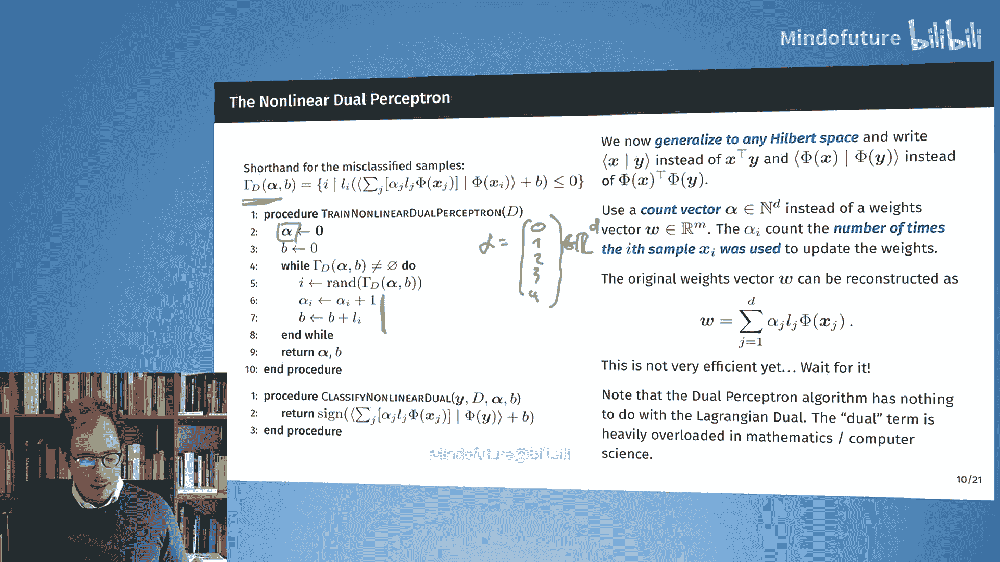
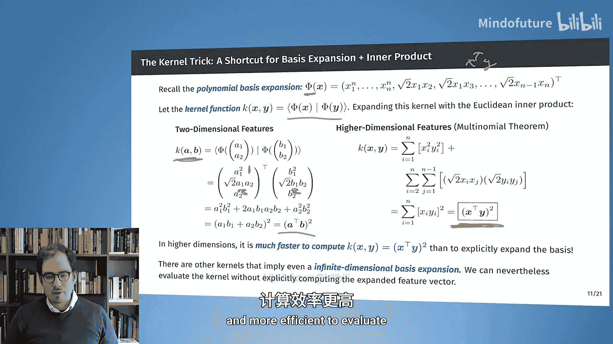
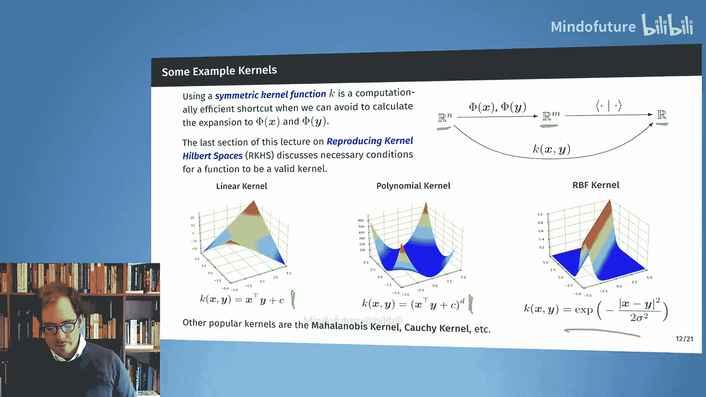
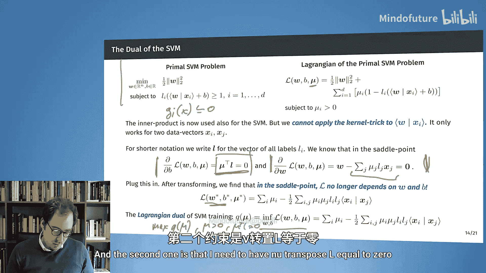
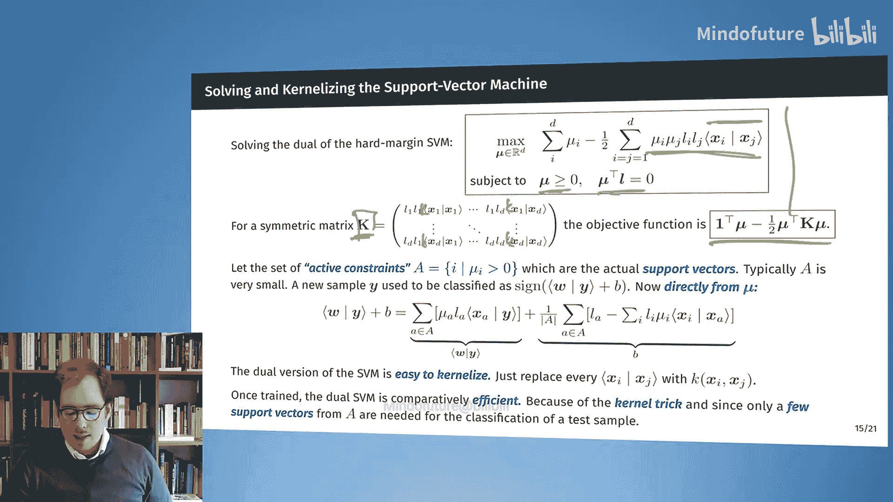

# 机器学习优化方法：9.2：基于核函数的非线性分类 🧠

在本节课中，我们将要学习如何将线性分类器（如感知机和SVM）扩展到非线性分类问题。核心思想是通过一个非线性映射，将原始特征空间转换到一个更高维的空间，从而使得数据在新的空间中线性可分。我们将重点介绍“核技巧”，它允许我们在不显式计算高维映射的情况下，高效地进行非线性分类。

## 线性分类的局限性

上一节我们介绍了线性分类器。然而，线性分类并非总是足够。

存在一些情况，我们也希望进行非线性分类，这会变得稍微复杂一些，但最终我们将得到更强大的分类器。有一些技巧可以用来使非线性分类易于处理且高效。

首先，请看上面的图片。图中红色类别的元素分布在一个圆环上，整个圆环被嵌入一个空间，并被所有蓝色样本包围。这立刻表明，我们无法线性地分离这两类数据。

还有其他例子，线性分离确实非常困难。例如，所谓的“异或”问题。这里我有一个类别分布在两个区域。不过，让我回溯一下，异或问题实际上可以通过线性分类解决。但我的意思是，我们这里的例子应该足以作为动机。我们希望有一个分类器能精确地将蓝色圆圈与红色圆圈分开。通过将整个空间提升到更高维度，这实际上是可以实现的。下图展示了这一点：我们进行一个非线性变换，点最终分布在一个类似浴缸的形状上，然后我们可以在三维空间中找到一个分离超平面，完美地将红点和蓝点分开。

Cover有一个很好的定理指出，在一个复杂的模式分类问题中，当我们将其投射到更高维空间时，通常线性分离的可能性更大。这正是我们在这里使用的原理。

## 特征空间映射

最初，我们的特征位于一个低维空间，比如实数的n维向量空间 `R^n`，我们将其映射到一个非常高维的空间 `R^M`。

原则上，我们也可以有不同的输入空间，例如，我们可以有各种图或分子作为输入，这些很难用 `R^n` 表示。但目前，我们假设所有特征都是实数。

我们希望这种到扩展特征空间的变换是非线性的，并且是单射的。单射意味着什么？想象一下，我有原始空间 `X` 和扩展特征空间 `H`。当我取两个不同的样本，将它们从原始特征空间映射到扩展特征空间时，我希望它们在扩展特征空间中处于两个不同的位置。将所有原始样本映射到高维空间的同一点是没有意义的，那对分类器没有帮助。因此，我们希望它是一个线性变换，以帮助找到线性分离，并且希望它是一个单射映射。

下图展示了两个例子。你可以想象许多不同的基扩展是可能的，这也是一种特征工程。你可以想象许多不同类型的基扩展，这里我们看到两个：多项式基扩展和高斯基扩展。稍后我们将看到一些被证明有用且在文献中反复使用的例子。

## 非线性感知机训练

现在我们可以以非线性方式训练感知机。同样，我们有一个误分类样本的简写符号。

训练算法实际上没有太大变化，唯一改变的是，每次我们查看训练数据中的一个特征向量时，我们首先将其提升到更高维空间（进行基扩展）。同时，我们的权重向量 `w` 现在变大了，`w` 现在在 `R^M` 中，而之前它在 `R^n` 中。因此，在这里我们也进行扩展。然后，当我们进行分类时，要对一个样本进行分类，我们同样需要将测试样本扩展到高维空间，乘以权重 `w` 并加上偏移量 `b`。

这个算法运行良好，符合预期。如果我们有无限的计算时间和资源，那么我们可以到此为止。

问题在于我们没有无限的时间和计算资源，并且会很快遇到问题。在神经网络之前，使用了各种不同的分类器，例如在MNIST数据集上。感知机和后来的SVM也应用于MNIST数据集。在那里，我们可用的特征本质上是每个手写数字的28x28灰度图像。

这里我们选择其中一个数字，我们有一个28x28的灰度图像，我们想用它进行分类。现在，如果我们使用多项式基扩展，这会立即从28x28膨胀到超过300,000个参数或特征，这对于单个手写数字来说效率极低。我们很难处理如此高的维度，尤其是在80年代和90年代，人们无法处理那么高的维度。

可以做的事情是降低维度，例如，我取数字并计算左上象限中黑色像素的数量，以得到较低维度的特征向量描述，然后我可以进行提升。但有一个更好的方法，称为核函数。核函数允许我们在非常高维的特征空间中进行精确分类，而无需在那里计算完整的向量。

## 对偶形式与核技巧

但在应用核函数之前，我们必须修改感知机算法，并以对偶形式重写它。“对偶”一词在计算机科学中被严重重载，对偶感知机与拉格朗日对偶无关，但它是一个既定术语，因此我们在这里使用它。

之前我们有一个大的特征向量或大的权重向量 `w`，我们在每次迭代中更新它。现在我们不再那样做，取而代之的是，我们为每个训练样本计数，记录我们使用该特定训练样本来寻找完美分离决策边界的线性分类器的次数。

因此，我们有了向量 `α`。`α` 本质上是一个大向量，它包含自然数，分别记录我使用第一个样本的次数、使用第二个样本的次数等等。当我们遇到误分类样本时，我们只是在这里增加计数器，不做其他事情。因此，我们不再处于 `R^M` 中，而是这个 `α` 实际上在 `R^D` 中，其中 `D` 是训练数据集的大小。

现在，对于误分类样本的简写，这变得稍微复杂一些，因为本质上我们在这里做的是在每一步重建我们的 `w`。`w` 是权重向量。同样，当我们现在对每个样本进行分类时，我们再次重建 `w`。在这种表述中，使用计数训练样本的想法并不是很有帮助，然而，这将使我们能够在未来进行进一步的简化。

现在我们来到核技巧。核技巧说的是，我们首先进行多项式基扩展，然后将这个多项式基扩展放入内积中。这里我们有映射函数 `φ`，我们首先在更高维基中进行扩展，然后将整个东西代入这个内积中。之前我们只写了 `x^T y`，这是欧几里得内积。但现在我们稍微推广一下，一般来说，我们也可以在其他希尔伯特空间中，那里有不同的内积，因此我们现在以一般方式书写。

关键的见解是，与其先将所有东西扩展到非常高维的特征空间，然后再将所有东西压缩成一个标量，我们可以走一条捷径。让我们看一个非常小的例子，看一个基于多项式扩展的特定角。首先，我们有一个基扩展，它使用 `a1^2`、`a1` 和 `a2` 的乘积、以及 `a2^2`。然后我可以对两者使用欧几里得内积，得到一个公式，最后我可以简化，最终得到 `(a^T b)^2`。

对于只有两个向量的情况，这还不是一个大的改进。然而，你必须想象当我在 `R^100` 中有100个特征时会发生什么。当我进行多项式扩展，并考虑每个特征的平方以及任意两个特征的乘积组合时，它会变得非常高维。但最终，我仍然可以将所有东西压缩成这种形状的公式。因此，通过同时考虑基扩展和内积，我有时可以找到不需要进行所有计算的捷径，并立即采用捷径。

甚至有些情况下，我只关注核函数。通过观察核函数，我可以推断出存在某个具有内积的高维基扩展，但我实际上并不太关心。甚至有些情况下，基扩展必须是无限维的，存在一个能给我核函数的基扩展，但它将是无限维的，我实际上无法在计算机中使用它，但核函数立即告诉我捷径是什么，并且这是评估起来越来越高效的工具。

这里有一张图来解释这一点：我可以从原始特征空间通过基扩展到 `R^M`，然后再压缩回来；或者我立即采用核函数的捷径。

对于核函数，我们将在关于再生核希尔伯特空间的部分中更正式地讨论核是什么。在这里，我们只考虑核函数是对称的。有许多众所周知的核函数。在许多实践中，你采用一个已知性能良好且可能具有你所需属性的现有核函数。

以下是几个常见的核函数：
*   **线性核**：`k(x, y) = x^T y`。这很明显。
*   **多项式核**：`k(x, y) = (x^T y + c)^d`。这是我们刚才看到的扩展，带有一些常数 `c` 和次数 `d`。
*   **径向基函数核**：`k(x, y) = exp(-γ ||x - y||^2)`。这基本上具有高斯的形状，它本质上给了我两个向量之间的距离度量。

还有其他流行的核函数，我们无法在此列出完整列表，但这只是为了让你理解为什么核函数是有利的，以及为什么我们希望将所有东西都写成可以核化的形式。编写感知机算法的对偶版本的全部目的就是为了能够核化它。

## 核化感知机

如果我们看感知机算法的原始对偶版本，我们看到基扩展仅用于来自数据的特征向量。这里我们在每种情况下都有基扩展。特征扩展是针对某些数据元素的，我们不做的，例如，是对大权重向量 `w` 进行特征扩展，这正是我们想要避免的。在进行对偶化之前，我们有一个项是 `w^T x`，这很难提升到高维空间。但现在在对偶形式中，我们只有来自实际数据的特征被放入基扩展中，现在我们可以利用这一点。

因为现在我们可以进一步转换它，使得我在这里只有两个基扩展的内积，并且我可以用核函数替换它。最初我们有一个看起来更复杂的内积，但仅仅通过观察内积的公理，我们知道我们可以在这里提取出求和、`α_j` 和 `l_j`。这导致了一种可以核化的形式。我们在左侧完成了这个操作，再次有了指示哪些是误分类样本的 `γ`，其他没有太大变化。唯一的区别是，现在在任何地方我们都不需要显式地写出可能非常难以处理的扩展特征空间。

很好，我们正在使用非线性扩展，但实际上不必写出扩展的特征向量，因此我们可以高效或更高效地进行非线性分类。

## 核化支持向量机

那么接下来呢？我们可以研究对偶间隙，或者释放所有变量，或者尝试遗传算法。或者我们可以尝试支持向量机。让我们选择这个，看看是否也能核化支持向量机，以便我们能够高效地使用非线性分类，并具有最大化或鲁棒化数据到决策边界距离的优势，同时不依赖于训练数据集中数据的顺序。

为了核化支持向量机，我们也必须首先将其对偶化，但这个对偶现在是我们熟悉的拉格朗日对偶。因此，我们有几页前提到的原始SVM问题，我们知道如何构造它的拉格朗日对偶，我们在这里引入一个额外的拉格朗日乘子向量 `μ`。

为了处理不等式约束的附加项，我们也必须稍微转换一下，因为对于不等式约束，我们希望 `g_i(x) ≤ 0`，所以我们稍微转换一下，得到这个公式。

这里再次，我们希望核化，但我们不想对 `w` 使用基扩展，所以我们实际上根本不想看到这个 `w`。现在，通过使用拉格朗日对偶，我们可以简化并摆脱这个 `w`。

首先，对于拉格朗日函数，我们知道我们正在寻找一个鞍点，所以我们可以对 `b` 求导，也可以对 `w` 求导，并且我们知道在鞍点结果应为零或零向量。这给了我们两个有趣的结果：例如，我们知道 `μ^T l` 应该为零，这里 `l` 我视为所有训练数据标签的列向量。另一件事是，我知道我希望 `w` 等于这里的这个和。

我们可以将其代入，插回原始对偶中。现在有几个技术步骤，我们不会在幻灯片上完全展示，这些也与考试无关，但在一些技术步骤之后，我可以通过代入这两个结果来简化拉格朗日函数。我们将看到，最终在鞍点处的拉格朗日函数值与 `w` 和 `b` 无关。一般来说，拉格朗日函数依赖于 `w` 和 `b`，因为它们是拉格朗日函数的参数。然而，当我到达鞍点时，拉格朗日函数的值将独立于 `w` 和 `b`，如果我考虑之前的见解。因此，这里我有一个新的拉格朗日函数，在鞍点处仅依赖于 `μ`。

这很棒，因为我现在可以简化拉格朗日对偶的定义。这是原始的拉格朗日对偶，现在我可以省略关于 `w` 和 `b` 的下确界部分，因为我知道整个东西独立于 `w` 和 `b`，但我仍然需要考虑这些约束。特别是这个约束，在选择 `μ` 时，我仍然必须牢记它。现在我仍然有选择 `μ` 的自由。现在我在这里对 `μ` 进行 `Q(μ)` 的最大化，这里我需要考虑两个约束：第一个约束是 `μ` 必须大于零，因为这是针对不等式约束的；第二个是我需要满足 `μ^T l = 0`。

现在这实际上是全部魔法所在。这是硬间隔SVM在对偶形式中的定义，并且由于我们有强对偶性，我们可以证明这给了我完美的结果，我没有对偶间隙。

我们可以再简化一点，通过将这个表达式写成一个大的矩阵乘法来简化。我们构造一个实际上是对称矩阵的矩阵 `K`。目标函数简化为那个形式，我们知道如何解决二次优化问题。这里的两个约束也不会太困扰我们。我们只需要确保矩阵 `K` 是半正定的。

有时我们必须检查一个矩阵是否半正定，但对于数值问题，我们可以通过查看特征值来证明矩阵是半正定的，特别是最小的特征值，它必须是正的。但有时最小的特征值非常小，接近零，但由于数值问题最终变为负值，比如 `-1e-15` 之类的，那么一些算法会拒绝这个矩阵 `K`。有时我们必须稍微调整一下，帮它一点忙。但一般来说，当我们有这个矩阵 `K` 并且一切数值精确时，我们只需验证它是半正定的，然后我们知道整个问题是一个凸优化问题，因为这里我有一个凸函数要最小化（或者在这里是负的凸项，但由于我在最大化，所以整体没问题），这是一个我们已经知道如何解决的优化问题。

现在，这也是一个我们可以核化的优化问题版本，因为这里我们只有数据样本或所有样本的特征向量之间的内积。因此，为了从线性分类问题切换到非线性分类问题，我们唯一需要改变的是，在计算这个对称矩阵 `K` 时，插入我们的核函数。所以这是我们唯一需要添加东西的地方。然后我们得到结果，即 `μ` 向量。然后这些实际上就是支持向量，因为只有少数几个 `μ` 是正的，每个 `μ` 对应一个样本，所有其他的 `μ` 都为零。现在，当我们对收到的新样本进行实际分类时，我们只需要考虑正的 `μ`。

因此，它是高效的。所以核化对于非线性分类是高效的。一旦我们有了结果，评估也是高效的，因为我们只需要考虑一小部分实际影响我们的样本，即最接近决策边界的支持向量。

在这里，我们可以重建原始项 `w^T φ(y)`，如果我们选择这样做，那么对于基扩展，我们将有一个非常高维的 `w'`，这是我们不想要的，而这里我们将有 `y` 的基扩展。这本质上就是我们会得到的。通过核化，我们可以获得完全相同的效果。然后 `b` 也可以被重建，实际上我可以仅从其中一个支持向量重建 `b`，但这里我求和然后取平均，因为在数值上这样做更稳定一些。

## 核化SVM示例

这给我们带来了什么？现在我们有了核化SVM，并且我们已经看到了几种核函数。让我们选择两种不同类型的鸢尾花，现在我们有山鸢尾和变色鸢尾，我们有来自Fisher 1936年论文的原始数据。但通过选择这两个物种，我们会发现它们彼此更接近，我们将无法找到一个完美分离这两个类别的线性分类。

因此，我们转向非线性分类，这里使用了一个带有超参数 `σ=1` 的RBF核。通过将所有东西代入并解决上一张幻灯片的凸优化问题，我们得到一个完美分类这两个类别的分类器。在中间，当两个类别几乎相交时，这里变得有点复杂，决策边界（即当我们把所有东西代入决策公式时恰好为零的边界）变得更加复杂。对于软间隔SVM（我们这里没有展示），我们可以有额外的参数来调整，我们可以在拥有更简单的决策边界和容忍一些误分类训练样本之间进行权衡。

## 总结

本节课中我们一起学习了非线性分类的核心思想。我们了解到，通过将数据映射到高维空间，可以使原本线性不可分的数据变得线性可分。为了高效地实现这一点，我们引入了核技巧。我们详细探讨了如何将感知机和SVM算法转化为对偶形式，并最终核化它们，从而避免了显式计算高维映射的巨大开销。这使得我们能够利用强大的非线性分类器（如使用RBF核的SVM）来处理复杂的现实世界数据，同时保持计算的可管理性。现在你知道了SVM的工作原理，并且利用本讲座提供的工具，你知道了如何从头开始构建SVM的训练算法并应用它，使其高效运行。实际上，这与你现在通常使用的大型机器学习包没有太大区别，现在你能够从头开始做到这一点，并且在某种程度上，我们也在练习中这样做。

这把我们带到了关于再生核希尔伯特空间的最后一节。