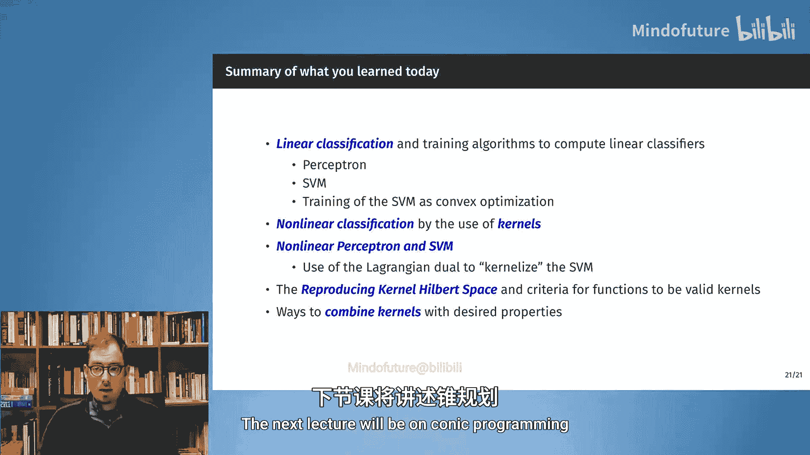

# 【凯尔大学】机器学习优化方法 ｜ Optimization Methods For Machine Learning And Engineering 2021 p34 P34_9.3_再生核希尔伯特空间 -BV1C6SwBqEp7_p34-

This is the third part for today's lecture on the reproducing Chme Hilbert space。A complicated name。

 but very important in machine learning today。First of all。

 let's see now the formal definition of what we understand as a kernel function， so a function K。

It's a kernel if and only if it is symmetric， and if there exists some Hber based H and a map P。

Where if we first do the feature expansion by Phi and then take the inner product from the。

Hilbit space H， then we exactly recover this current here。And the X well so the original features。

 this doesn't have to be a real feature space， so here we can also have nominal entries， for example。

 red， blue and green like zip codes， something that has no real order and or other complicated objects like for example。

 graphs or other things that are difficult to describe is just a single vector。

All of these could also be in our set Big X， and we can have a valid kernel over that。

Now what we want to show is that a certain kernel actually has these properties and in one of the direction it's really easy so if we have the mapping file and also the inner product。

 then we can just construct the kernel and we know it has to be a kernel。

 it fulfills these properties。The other direction is a little bit more complicated。

 so if we have a kernel function that is already compressed。

How can we show that there exists a Phi and some inner product that exactly reconstructs our？

And this is what we are talking about in this section of the course， but first of all。

 let's see a couple more consequences and properties that that kernels have before we then go into this part of looking at an individual function K and seeing whether it is indeed kernel。

So。Let's apply the current function to pairs from a data set。

And this gives us a kernel matrix or a gam matrix， and this actually corresponds also to the gam matrix that we had seen in the course on vector spaces。

 so now if we here have our points y1 to yn we can construct an n by N matrix where we have the kernelized entries for every combination of points in our data set and this matrix K it has some importance for us。

And we can prove a couple of things for this matrix K， first of all。

 if the kernel function or if small K is an extra kernel function。

 then the gram matrix will always be positive semi definite。And we can show this in just three lines。

 and furthermore it will be a symmetrica and the symmetry it just follows immediately from the symmetry of small K。

 the kernel function。O。No。Consider that we have a function， small K at hand。

And here we have these x and the big x could be some actual vector space。

 or it could be just a set of nominal entries。And what we now do is we partially evaluate this kernel function small K。

With just one entry so the kernel function small K it takes two arguments and we just give it one arguments。

 so now this y here is fixed and it still requires this second argument dot。

So by partially evaluating， we get a new function that takes only a single input argument。

So this K of y and dot， we can now see it as a function with a single argument that goes in the place of the dot。

And the Y is now a fixed scalr or a fixed entry from bigx。And okay， so similar things。

 you've probably seen that in your studies of computer science。

 so many functional programming languages， they also do the same。

And you might know this under the name of carrying。

 but this partial evaluation it's actually quite common。

And now what we say is that the feature expansion with the file。The future expansion with the Phi。

 we now take for it the partial evaluation of our function KY。

Okay and now something really funny happens because originally our feature expansion。

 it went from some low dimensional feature space to some really high dimensional feature space。

 and so here with D a lot bigger than N。So this originally happened。

And now we do something different。 So now we take our。Feature。

 which we now call from the feature space big X。And now we also do this expansion。

 but we do the expansion to a function space。Because now the result of here。

 the filehi is a function。And。So this is our expansion。

And we now have to also define an inner product。And we already have seen inner products for function spaces。

 so for example， the L2 space that was considered in the course on vector spaces。

 and now actually we could choose many inner products that could work on the functions going from X to R so these guys here。

These guys here， these are all the functions going from x to R。

And so there are many inner products that we could choose， but we choose a very particular one。

And what we do is we choose an in product where if we take two expanded。Feature vector。

Which are then these partially evaluated functions， KX dot and KY dot。

Then we define the inner product to be actually here at the kernel。

 this is a design choice and this will prove to be very useful。Okay。

 but this is so far not yet a full fledged vector space。

Because we might only have a finite number of elements in our set pickX。

And that would mean we only have a finite number of partially evaluated kernel functions。

And that is not an actual vector space， but we need a vector space。

 so we need it to be a vector space so that it can be hubber space for the current。Okay。

 but now what we do is we take。These these expanded。These expanded feature vectors。

And see them only as the basis for the vector space that we are going to construct。

And the vector space we are going to construct here it' called G。

And it contains all the linear combinations or the Fine combinations。Of no linear combinations so。

 so the weighted sums。Of all the。Of all the partially evaluated functions that we could generate from our big X。

And now this is a true vector space， so we can take the functions and we can add them and we can multiply them with a scalar and so on and by saying okay。

 all the guys coming from big X， they are just the basis。And we well。

 and it generates a full vector space， then this is the vector space we're going to work on。

And also the inner product that we've seen up here。So this inner a product。

We're also extending it to work on this full fledged vector space G。Because here。

 then we also have just the weighted linear combinations or the weighted sums of the entries。

 and this just translates over and away that in the end we have a weighted combination of our kernel function evaluated at the basis coming from the original bigX。

Okay， so。This is quite a step so here we do the expansion with Phi into a function space and then on this function space we have an inner product and the inner product is actually giving us or is defined as this kernel function small K。

In for all the elements coming directly from big X。O。And now finally。

 the reproducing kernel Hbert space。Now， we can check that this inner product that we have defined。

 that it holds the inner product exs。And there are three product exoms that were shown in the lecture on vector spaces。

 so first of all， linearity， so addition and scalar multiplication in the first argument。

And here by looking at the definition here of this inner a product。

It is clear that we have linearity in the first argument。First of all。

 we have symmetry and we have symmetry when our current small K is symmetric as well。

And second of all， positive definiteness， so the inner product of x and x is always larger than0。

 and it is always equal to zero if the two x's are exactly here。

 the Nile vector so this here should be a bold nuile。Okay。

 and so we need this property for small K as well， so that we have the same property then for the inner product on G。

Okay，And by a consequence。Every symmetric positive definite function is a valid color。

 so on the previous slide here we started with this K and actually what we have now seen are the requirements that we have for this small k in order that here it generates a valid in a product on this function space。

O。And well， these then these are then， therefore all the requirements that we have for a small K to be a valid card。

 and they are not very complicated， so we only require it to be symmetric and to be positive definite and then we good。

and now where does this reproducing stuff come from， why is it called reproducing current Hab space。

 so let pick F a Hab space of functions from x to R。

Then we call it a reproducing current aabbit space if there exists a current and small K。

Such that the kernel evaluated so for any x that we can select。

 the partial evaluation of k is element of F。And if the partial evaluation of K is element of F。

 then we can apply the inner product to it。And now comes the funny part if we then take the inner product of F with the partially evaluated kernel at X。

Then we exactly get out F of x。And well， this is now the reproducing property。

And what we see is that the Hber space G that we have just constructed。

 it exactly also has this reproducing property， and we can prove this in a single line。

So let's take here F and K partially evaluated at x and in a product of the tool。

 then obviously the F I can replace with a weighted sum of with a weighted sum of a partially evaluated kernel functions。

 so because every element of our big G here is a partial combination of these。

Basis elements that are partially evaluated kernel functions。

 so here I'm just replacing F with the sum over alpha I and then the partially evaluated kernel functions I pull the alpha I out in front。

I simplify a little bit more。And then I end up with this function here， which is exactly F of x。嗯。O。

嗯。And there's a mass proof from Avoshine that showed that for every kernel small K。

There is a unique reproducing kernelhi space corresponding to it。

And that means for every kernel where the kernel function is symmetric and positive definite。

Not only is this enough to show that it is a kernel function， but it is also。

Grating a unique reference use in credibility about space。

And now we can also combine several currents， now we have seen conditions that we need for currents and there are ways to combine currents that uphold these。

And you can look at the literature there are in Sherov and others。

 there are descriptions of how to select kernels and what are good kernels and what are the properties of them that we want to have。

And we have a couple of rules where we know we can just blindly apply these rules and the end result will still be achron。

 for example， we can multiply any kernel with a positive scalar。

 the end result will still be ach function will still be positive definite and still be symmetric。

We can add a constant， we can also add two kernels together。

 we can even multiply two kernels together， we can take a polynomial with positive coefficients of the kernel function and the exponential also and also this kernel cookbook so if you are looking to use an SVM and you have maybe difficulties in applying or in finding a kernel that exactly。

诶。Recovers the decision boundary you're looking for。

 the current cookbook is probably going be helpful there。Okay， so what have we learned today saw。

Well we learned about linear classification and different algorithms that can be used there。

 the perceptton algorithm and the SVM， which has the advantage of being absolutely deterministic and finding a very robust decision boundary if the classes are linearly separable。

And if that's not the case， then we might have to go to nonlinear classification。

 and today the kernel trick is very helpful because we don't lose too much efficiency by going into very high dimensional spaces by this nonlinear transformation。

Okay， and well we can use the Lacon dual for the SVM to efficiently do that。Furthermore。

 we saw the rules for kernel functions to be actually current。

The kernel functions have to be symmetric and positive definite， and why is this the case。

 the rockpro kernel Hilbert space explains this to us because we first。

Project or expand the features that we have into a function space。

 and then we do the linear classification in the function space， which is kind of advanced。

And then there are ways to combine these kernels in order to have combined kernels with properties that we like。

That's it for today。And see you soon in the next lecture。

 the next lecture will be on Con programming。

