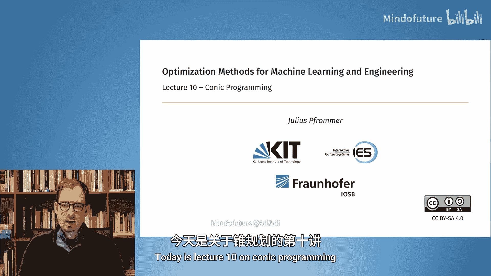
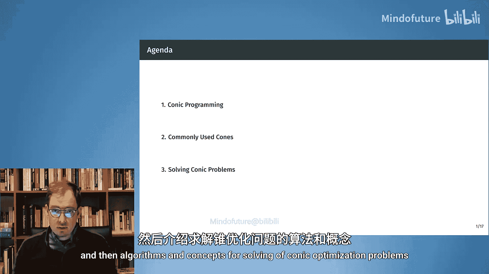
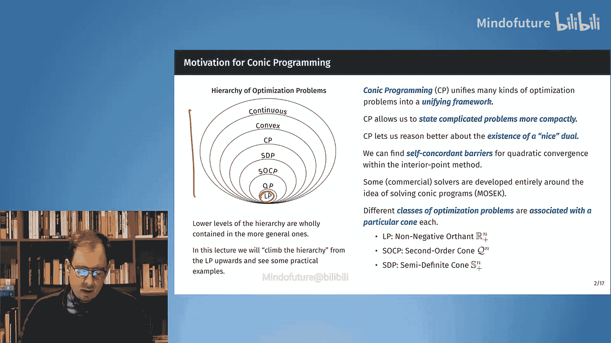
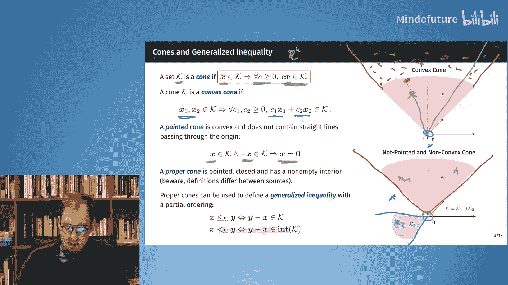
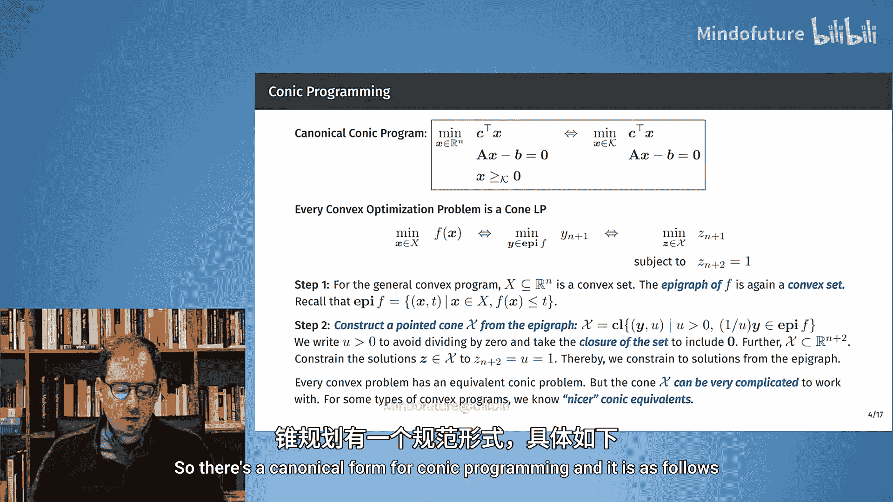
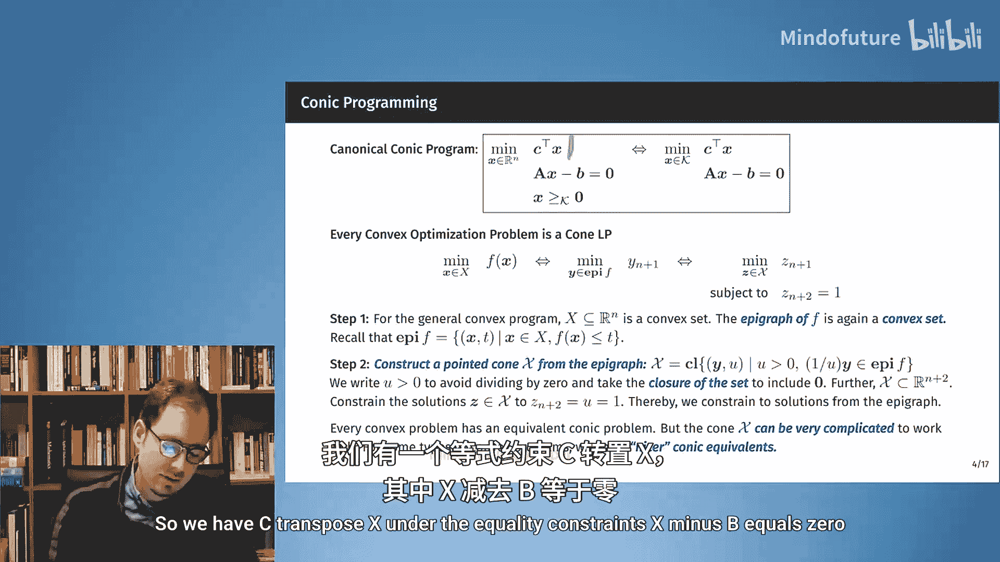
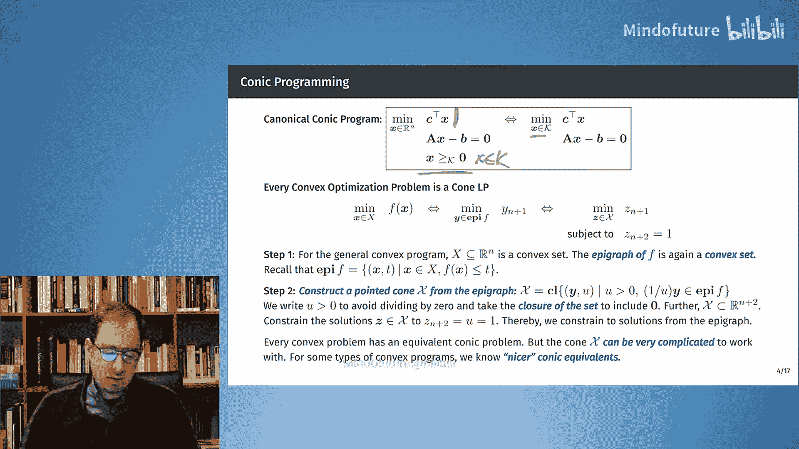
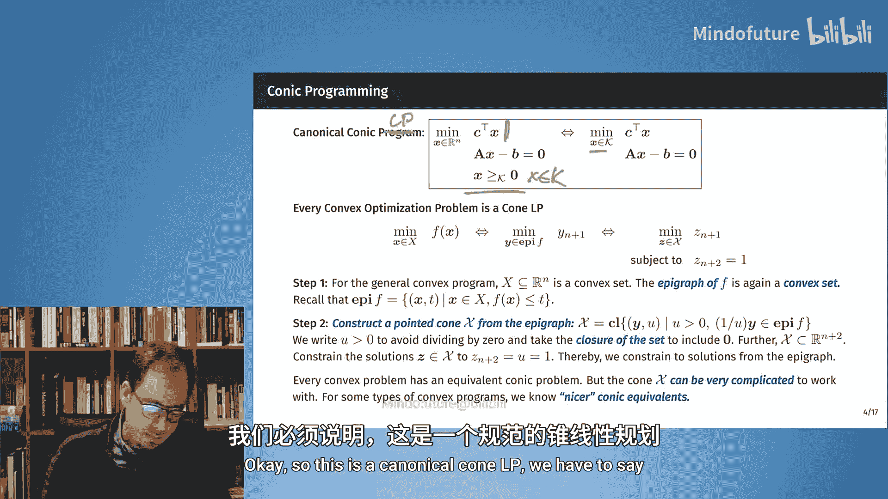
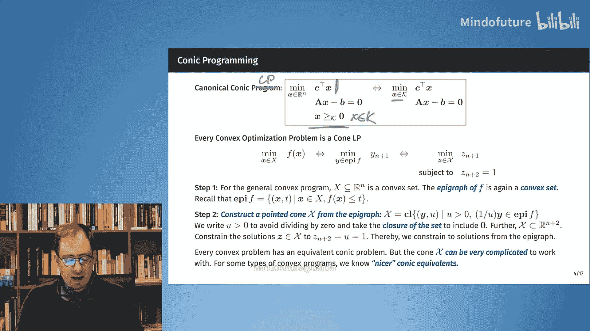
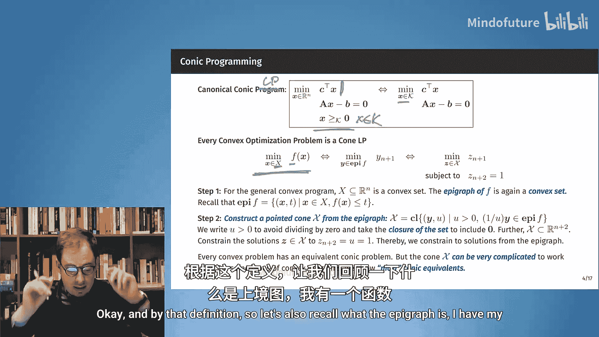

# 【凯尔大学】机器学习优化方法 ｜ Optimization Methods For Machine Learning And Engineering 2021 p35 P35_10.1_锥优化 -BV1C6SwBqEp7_p35-

Welcome to Opim methodsth for Mach learninging and Engineering today's lecture 10 on Con programming。

The agenda as follows， we will see a definition of current programming。And some motivation。

 we will see commonly used cones， so the important examples for chronic cropbing。

And then algorithms and concepts for solving of chronicic optimization problems。

Let's jump right into it in the very first course we saw this hierarchy of optimization problems。And。

Well， the hierarchy is such that the mall。Easy problems are contained in the more difficult optimization problems。

 and the reason for this is that we have more and more structure to use and to exploit it in our algorithms as we go lower into into the definitions of this hierarchy。

And what we will see today is that all these different levels here can be described by different cones and optimization over certain cones and we will see a definition for that exactly。

And so accounting programming， it unifies a lot in this hierarchy and we can exactly see what the differences are between these classes of optimization problems。

And they also allow us to state rather big and involved optimization problems more compactly。

 and then in the compact form we can define algorithms for the compact form to take its input。

Furthermore， chronic programming lets us think about the dual and in some cases these cones they allow for a nice due and give us nice closed form duality results。

 for example。

And it also gives us barriers and good barriers to use in the interior point method。

So chronic programming is highly successful and in the past years some of the commercial optimization packages where you pay thousands of dollars to use them。

 many of them have switched to chronic programming or have now put an emphasis on chronic programming so they are also not hiding the fact that they are using chronic programming in the interfaces and all the interfaces for programming。

 these solvers are then also surrounding around the idea of chronic programming。

So there are different classes of optimization problems here the hierarchy and today we will focus on three particular ones。

 so today we will focus on the non negativeative author。

 so this is the first column we are looking at and it defines here the LP for linear programming。

The second one is the second autoor， it's this guy up here and actually the quadratic problems can also be stated in terms of the second autoor。

And the last one we look at today is the semideinite cone here， the semidefinite cone。

 and it allows for an even larger class of optimization problems to be solved。Now what are cones。

 what is the definition of cones， it's rather easy， so a set K。

 and we're denoting cones here always with this calligraphic notation。

A set calligraph a is a cone if for every element x contained in K。We have that。

For every positive scale R， multiplied with x that result will still be in K。

And so on the right hand side we see a comb and it's easy to visualize this fact so here we have our point X。

 which is contained inside of the comb。And when we multiply， and this is here， it's a vector。

And if we multiply this with a constant， then we arrive at some other point。

 let's call it here x prime and this X prime will still be contained in the column and you have to imagine that the colon is's open on this side so it continues like this。

And all these points up here， they would also as well be contained in the。嗯。However。

 we must not multiply with a negative。呃。Constant。So if we were multiplying our x。Here。

 with a negative constant， we could end up， end up somewhere here on this side。

 and this is not allowed。 However， we can always multiply our。Vects with zero because here the zero。

 it is contained in the core and it's always contained。Now furthermore。

 a cone is convex if for every two elements of the cone that I pick and two positive scals。

 then the weighted and added vectors would still be a result of the cone。And on the right bottom。

 we see a counter example for that。So here we have actually a cone that is made up from two subcones so here we have our first cone。

 K1。And then we have our second cone here， K2。And。If I choose any point X。That sits either。

On this side， or it sits on this side， I can multiply it with a positive scalar。

And the entry side will still be in the cone now so there's no necessity for the cones to be for the cone to be connected。

 it only has to be connected， of course， at the zero now， so everything ends up at the zero。

This is then not a convex column because when I select my x1 here and my x2 here。

 then I could end up somewhere here in the middle and this would not be contained。

 hence here on the right hand side it is a nonconvex column。Now we could also look at， for example。

 RN and the question is RN， so the space of all vectors in n dimensions。

 real vectors and n dimensions， is this a con？And the answer， yes。

 it is a cone and it is also a conx cone。However， it is not a pointed co。It's a funny。Coe。

 you wouldn't think of it like an ice cream cone or something but actually our end would hold the definition and here it would be a cone and also a con cone。

 but it wouldn't be pointed。So because for a pointed cone。

 it is not allowed that if x is contained that also minus x is contained and that means or this is only allowed if x is actually equal to zero。

 and that means that a pointed cone it contains no straight lines that pass through the origin。

 so here I have of course the straight lines， but they all stop at the origin。

And in the lower example here here I have a straight line that passes through the origin and then continues。

 and hence this is not a pointed call。

And now the proper cone， these are the cones we like， the proper cones they are both pointed。

 closed and they have a non empty interior。So attention。

 different sources have a little bit different definitions for proper cone， but here we use this。

 this is the most common definition in the journal a proper cone is like an ice cream cone。

 the way we like our con。Okay， and for these proper cones， we can define generalized inequalities。

And these generalized inequalities， they work like this。

 if I say that x is small or equal in the sense of k to y。

 that means that y minus x is element K and we will see this often in the form as follows。

 often we will see something like。Z， smaller or equal in the sense of K than y。

And this here is equivalent to saying that y is element of the con K？

And so this is just a very shorthand。Notation to state that a certain element is contained in the con。

 and it often also makes sense to think about this like a generalized inequality statement and especially when we use the non negative orned。

 then for the non-negative orhand here， this would exactly recover the definition of inequality that you already know。

Okay。Now K programming， how does a conNI program look like。

 so there's a cononical form for K programming and it is as follows。

 so here it looks like a linear program so we have C trans post X。

嗯。Under the equality constraints， x minus b equals0， so like we know the constraint。And in addition。

 we say that x has to be contained in the column now so this here is the same statement as saying x element of the column。

Okay， and now while we can restate that， make it little shorter and now we just say， okay。

 minimize over all the elements of the cone。With a linear search direction and additional equality constraints。

And actually every convex optimization problem is a cone LP okay so this is a canonical cone LP we have to say。

 and every convex optimization problem is a linear con program and we can show that really quickly so this is the shortest definition for a convex optimization problem that we have。

So big x here has to be convex and also F， then the APpC of F has to be convex as well。Okay。

 and by that definition。

So let's also recall what the APgraph is I have my function。And the epigraph。

 these are all the points above the function。So all the red points here， this is mine。Then now。

An equivalent way of writing down the optimization problem is to say， well。

 we are minimizing overall epsilon in the EG， but we are only looking at the last。

ElementSo the epigraph here contains micros x and then t where the T has to lie above my function。

And then I only look at the last element of this vector y。

 which would correspond to the T that has to be above。The function itself， and by doing that。

 in the case of our function here， I would end up exactly here because only the entry at this position x star here is minimizing the last entry of the vector from the EP。

Okay， and now we can construct a cone from that。So now we construct a really special combe。

So we are now in a high dimensional space and I'm writing it down a little bit simplified but now imagine that here we have a convex potato and this convex potato is the EP graph。

Of F。And now we can construct a columne。So let's say I have my zero vector。Is here。

 so this is no zero vector。And then we can construct a cone that。Goes out like this。

Contains the AP curve fully。And then containers like that。Okay。So what we say here is we go in。

 so let's say the EP graph is in our n plus 1。So。Our， our ex。Is contained in RN。then our epi off。

Is contained in our n plus one。And now we make a cone that is in our N plus2。

And the way we do it is we look at all the elements Y from the EG。And in addition。

 we have a certain U and the U has to be larger than zero。

And this point here is contained in the con only。Well， if u is larger than0。

 and if1 over u times y is part in the acal of F。So you can think of this like a scaling factor。

So we have the you。goes like this， and I have certain， I have like smaller versions of the EPG。

Sitting here in the column， so this is a smaller version of the APClf and then an even smaller version of the APClf and so on。

And so by selecting this U for a certain value larger than zero。

 I'm making like a scaled version of the epi half and I find this at this position when I'm going across the U。

Okay， and the problem that we have is that we cannot put you down to exactly zero because if you were exactly zero。

 then I would here have a division by zero， which is undefined。And therefore I'm not doing that。

 I'm reducing you as much as possible， so I'm looking here at also the very， very。

 very small use and then taking the closure of that and you might recall the definition of the closure from the discussion of open and closed sets。

And well in the closure， this will just add the zero point and in the end I will have a call。

And well， this cone contains then many scaled versions of the APC。

And then I can add an additional equality constraint and for the additional equality constraint。

 what I do is I require my U to be1， which means I'm only looking then at the AP graph at the right scale。

 which is contained in my con at that point。Or at that like a hyperplane that I cut through through my comb。

And what I then have is this very simple。Linear program。

 so then I'm optimizing overall all the that in calligraphic x。

 so calligraphic X is here the con I'm constructing。

And I constrain the points from calligraphic X that I'm looking at to be only from the AP graph at the right scale。

And then I'm again looking at the function values contained in these ER vectors and minimizing over that。

 so the three definitions that we've seen here， they are all they lead to their equivalent and they lead to the same side。

The problem is。Calligraph X is complicated and we don't have nice closed form equations to work with it and knowing that every convex optimization problem can be stated as a linear chronic program。

It's cool to know but it doesn't help us so what we rather need is we need nice cons。

So we can construct。From any converse optimization problem， we can construct a column。

But we need niceSo cones and then develop solution algorithms for them。

