# 【凯尔大学】机器学习优化方法 ｜ Optimization Methods For Machine Learning And Engineering 2021 p36 P36_10.2_常用锥体 -BV1C6SwBqEp7_p36-

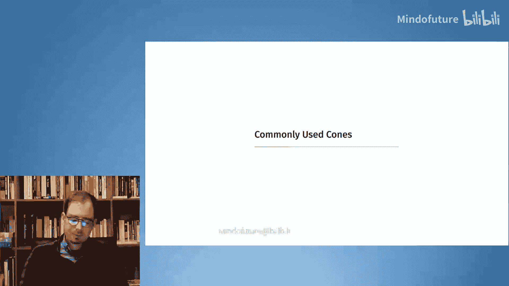

Okay， now what are the commonly use calls？The first column that we're looking at is the non negative orphaant。

And it's really easy to imagine， so here we have our coordinate system in two dimensions and here we have x1 and here we have x2 and then the non negative orpha。

 it is just this part where both my x1 and my X2 are both positive。

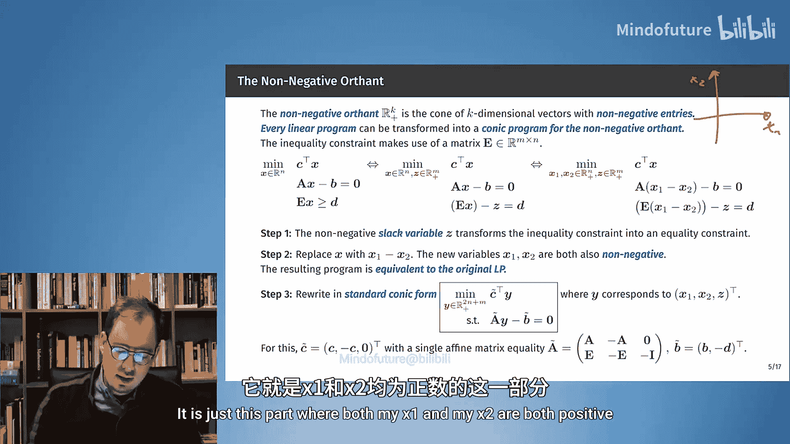

And therefore， the the non negative or is the cone that。

Just takes the x1 axiss and the x2 axis as directions。And fills up everything here in between。

 and it's easy to see that this is a call because I can take any point from in here multiplied by a positive scalar and all the entries will remain positive。

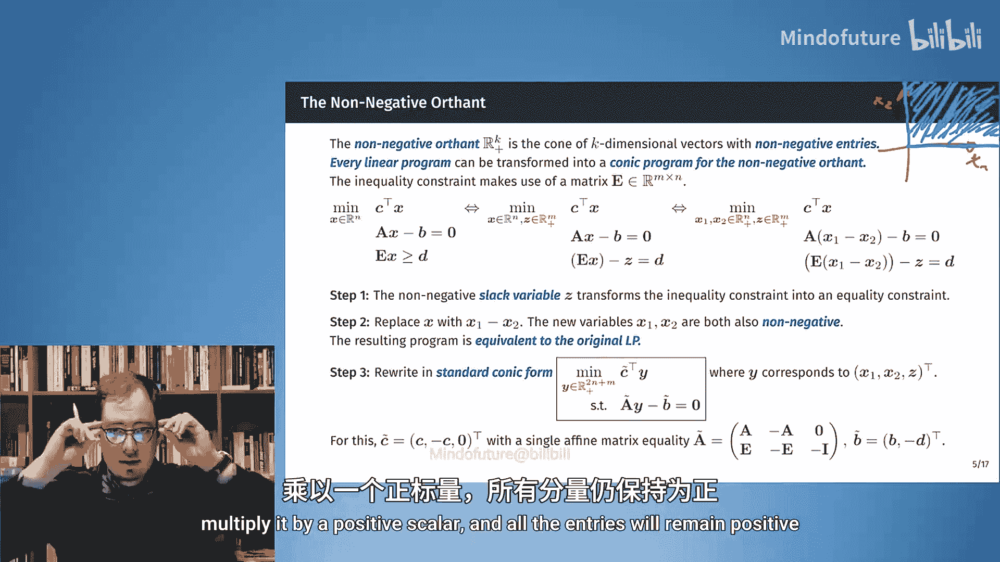

O。嗯。And actually we can take any linear program defined like this。And to transform it。

So first of all， here， move the EX out and。Add a slackck variable and so on and transform it into a con program on the non negative author。

So in the first step， I'm adding here a slacklack variable。

 so a slacklack variable is that that I require to be all positive。

And then I can here replace my inequality constraint with an equality constraint and because I know that my Z has to be positive。

 these two problems are equivalent。And what I then do in addition is my target variable x that I'm looking at。

My target variable x， it could be negative or it could be positive。

 I don't know this when I'm starting。So in order to enforce it to be in the non negative orpha。

 I split this up so instead of a single variable x， I now have two variables x1 and x2。

 and both of them have to be positive。And everywhere where I had originally considered X。

I am now considering x1 minus x2。And I can still reach the same solutions as before， however。

 now all my target variables， I can constrain them to be in the non negative author。

And now by doing some additional combinations and so on。

 I can combine these three here and then have a single variable y in the larger dimensional non-neative authentic。

 and thereby get to the standard chronic form so every linear program and I can rewrite it in the standard chronic form。

Fther non negative off。Okay， now we come to optimization problems that we weren't able to solve in a nice fashion before。

 and for that we need the more advanced cones， for example， now here the second order column。

And the second autocone， it's rather simple， it's also called the Logans cone or the ice cream cone。

 and what it does is I take it back to X。And then I'm considering all the T that are larger than the Euclidean norm。

Of this vectorx。And here I have。The example of the second auto cone in three dimensions。

That means I'm looking at two dimensions for my first entry and then T， this is the last entry。And。诶。

And now when I'm selecting U1 and U2， so let's say I'm here。

Then I need the T to be larger than the Euclidean distance。

 and this exactly gives me this ice cream cone opening up。Okay。

 and when many applications fall under this category。

 there are many practical examples and for example。

Or convex problems with quadratic constraints can be rewritten as a second autoor。the formula here。

You don't have to remember that for the exam so in this lecture we have a couple of formulas that are where it's more important to know that a certain transformation exists than it to actually keep in mind the complicated formula。

But anyhow， let's here take a closer look， a quadratic constraint here is that in the constraint we have a certain matrix in the middle that was decomposed into two parts or C transpo T C。

And for this here， then I have a quadratic matrix equation in my inequality constraints。

And while this C transpose C obviously has to be positive semidefinite for the whole thing to work out。

 because I need， if I have an inequality constraint， G of x smaller equal than zero。

 I need G of x to also be a convex function for the entire domain of the function to be convex。

And here we can rewrite the whole thing and in the end， well this here should be Q。

 and in the end we end up with a formulation as a con program with the second autocon constraints。

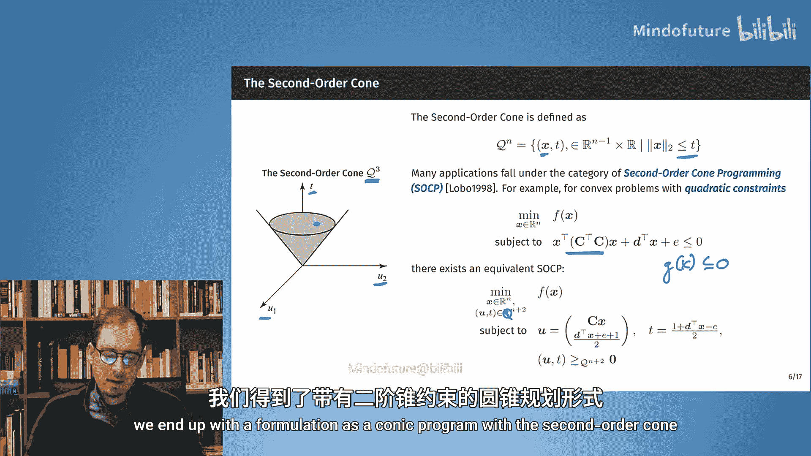

But now let's see some of these practical examples that we promised。

 and the first one we see is total variation denoing。

So imagine you have very noisy data and this is what we see here on the lefthand side so the gray the gray points that we have。

 these are measurements that we have time series measurements and there're rather complicated and from time to time there's like a jump or there's a sudden switch in the regime and what we want to do is we want to dennoise and also want to see where these jumps in the data have happened and so what we could do as an easy approach is to have like a sliding window approach or something like that but with a sliding window approach usually。

This is not perfectly reacting， but rather here we would like here have an area where it's rather smooth and then going back up and so on。

 but what we want to have is to really sharply discover the the points where our。

Underline process is changing。And we can get that with a so called total variation。

Now what is the total variation for the total variation。

 we look at the distance from one data point to its neighbor。

 so in a time series we always consider the points and their neighbors and now the absolute distance between the two of them。

And for dennoizing the time series， what we do is first of all we have our measurements and the measurements are our y and we want to have X contain our dennoed time series so the dimension of Xy can be really high。

 it can be a couple of thousand dimensions when I have that many data points in my time series。

And for for the x， I would like x to be close to y。

 So now if I'm looking at the original measurement and the denise measurement。

 I want the two to be close。 So here and I'm taking here the the squared distance between。

The original and the the dennos one。But in addition， I'm adding the total variation term。

 so I want the。The Recover time series or the Denos time series。

 I want it to be close to original one。And I wanted to not be noisy。😡。

And this not being noisy is here the second term where I'm looking at the absolute distances between data points and their neighbors。

 and I have some scalar that I can use to give weight to this denoising term。

And so by setting this to zero， I would exactly recover the original time series and by setting this to something larger。

 I can say how much I prefer a dennoed time series over one that stays true to the original measurements and what we see here as output。

 it really nicely recovers what probably is the underlying change in how the process worked that generated here time series。

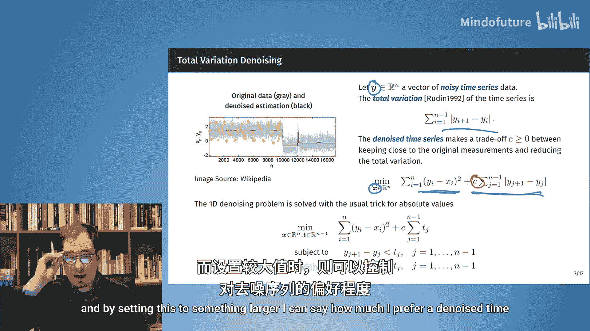

And this oneD denoing problem with the total variation。

 we can write this down as a comic optimization problem。

So first of all here we have our quadratic distance， which is still actually the same。

But now for the denoizing term， which just right here the weighted sum overall TJ。

And here for the TJ。We can use the trick or the initial trick that we saw in lecture five on how to express absolute values。

 So here we have TJ。eququals。Y j。Plusus one minus。谁。And have a look at lecture five。

 there there's an explanation how these two inequality constraints here exactly recover the absolute value because there's like pressure from the optimizer to exactly push TJ into the inequality constraint。

Okay， but now let's move over and finally see how this works with the second article。

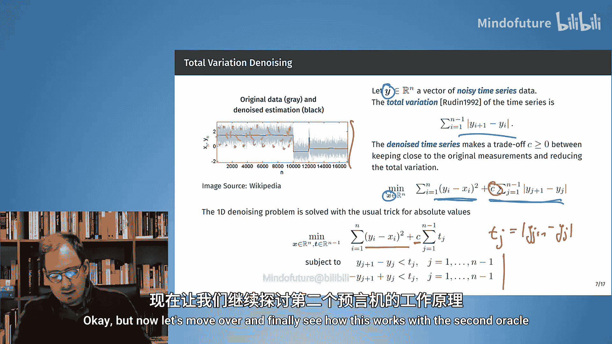

Now， from the。OneD denoizing that we saw， let's now move over to image denoing。

 so now we are in the 2D domain。So now take a gray scale image y。

 so the grayscale image it's a matrix that contains entries let's say whether a certain pixel is or white。

And now we can also compute the total variation， but do that overall pixels。

When we look at the individual pixels for the neighbors in two directions。

 so here we have the neighbor going right and we have the neighbor going up and so the total variation here is the absolute。

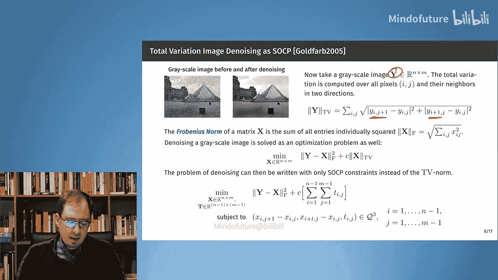

Distance is squared。For the neighbors in the two directions， the sum of them and then the squarewood。

And。Well， we can use this in a similar fashion to the total variation term for the one knee domain。

And how for for the closeness of how close the reconstruction is to the original noisy image。

 we use this so called phobius norm， the phobius norm is actually quite easy， it's just the squared。

 the sum of all squared pixel distances and the square root of that and the square root here we get rid of it because here we then also square the norm。

 so actually what we have here in this first term here。

 this is just the distance of all pixels squared and then summed up。And then the second term here。

 this is the TV mode。And we now rewrite this whole thing as a second autoor problem because here we have for every pixel a constraint。

Where we say that the distance to the right and the distance to the top。嗯。

And this TIJ have to be in the second article。And for the second autocon。

 we know that if we have something U and T element of the second autoor。

That means that T has to be larger than the。Then the Euclidean norm of the U。

 and so this exactly gives us then here for this。Constraint here is the TV norm because the optimizer has an incentive to push the TIJ。

Down and as small as possible。 and therefore。In the optimum， we will have exactly。

The TV norm recovered。 So in in the maximum。We would have here the Euclidean on equal to T and this is exactly the。

And now this you here， it would correspond this。Term here， then would be the you。

That we're looking at。O。And now we have a very high dimension optimization problem suddenly。

 So if we have a 200 by 200 image， then we are already looking at。40000。Pixlet。

 and meaning that we would have a 400，000 dimensional optimization problem with a second order constraint for each pixel。

That's quite a lot so we would like our algorithms to be efficient and we have these efficient algorithms today。

 this is rather standard practice and possibly even your camera and mobile phone are applying such methods for optimizing noisy images。

 for example， when you're shooting images in the dark。Okay。

 now on to the last of the three columns that we're looking at in more detail。

 and this is the semi definite comb。And for the semi definite cons， we are looking at。

Elements that are actually matrices so we have here our this is now the vector space of all n times n symmetric matrices So if we have a matrix now x a big x。

Would be contained， for example， here in SN。And these would be all symmetric matrices。

 but I'm only looking at the positive definite symmetric matrices。

 and this is here this semi definite hole。And well the canonica semideinite programming optimization problem then is here。

This in a product that corresponds also to the phobios norm。

 so here the sum of all multiplied entries of the matrix。

So here this would correspond this term here， it actually is a really close。

Closely corresponding to to the。嗯。To a product we use for linear programming。

 so this here would correspond to C transposed X and now I'm putting a bar on top。

 so if I would take the matrices and put them into a really long column vector by reshaping them。

 then I could write this also as C transposed X。Okay。

 and so this is the target function for the objective function for the canona。Semidefininite program。

 and then I also have here these equality constraints and the X is required to be in the positive semi definite cone。

Okay， and there are also for this there are many practical applications。

 famously we can use SDPs to approximate combatoral optimization problems。In computer science。

 we all hear about， for example， the traveling sement problem。

 which is an NP hot problem and there are other ones。

 for example there's the maxC problem that is described down here。

 so given a graph how to partition it so that the edges between the two partitions have a maximum weight。

This is also an NPH problem。诶。So many NPR problems， for example， those in the SAT class。

 I can translate between these problems and so solving one of them means solving all of them。

And here we know that for this Mu cut problem， we can write it down or approximated it with an SDP problem and get a solution that is really close to the optimum。

 so nearly 90%。And that's good， so as a baseline， if we know how to solve STP fast。

 there are many NP hub problems where I can get a really。

 really good approximation already or a solution that is close to being optimal。

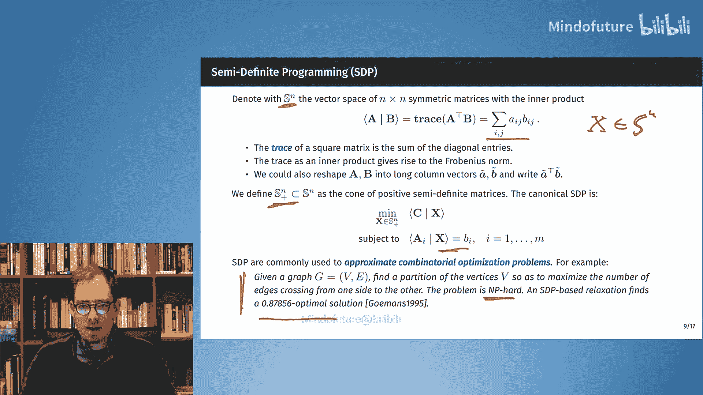

Okay。呃。There are other applications that are of practical relevance， for example。

 the localization of wireless sensors。Imagine you have many wireless sensors in the field could be。

 for example， cell phones， and you want to do a precise localization of all the cell phones from the signal strength that you get back from them。

If you have cell towers with known location， then it's easy because if you have cell towers with known location。

 then you can triangulate and so on， but it would be even better if we would if we could consider a mesh network because maybe the mobile phones。

 they also see each other and then we not only have the distance to the cell tower that we can look at。

 but we also see the distance between the mobile phones or the wireless sensors where they see。

 okay how strong is the signal to the neighbors and so on。And。So what we do is。

We recover or estimate in the distance between。Our wireless sensors and we do that。

By looking at the signal strength and we describe the distances here as this。DIj square。Okay。

 and the big question is， how can we combine all these different distance estimations into position predictions for all the sensors that I have in my mesh？

And。Well， what we can do is。combinebine all our position vectors into a big big matrix。

And write down this equation here， where the D。The DIJ。嗯。Scrach。

can be written down like this equation and then by doing some additional transformations I end up with an SDP。

 however the SDP is an approximation and it gives us constraints so here this is an SDP where I'm looking for a matrix big y。

And I'm looking for any matrix bigwi that holds these constraints。

And then I have greatly reduced the number of possible locations of the sensors that I'm looking at。

 and here in the paper of Docati， for example， he uses then the SDP to reduce the search space or the space of possible locations for every sensor that I have tools something that is a really tight approximation。

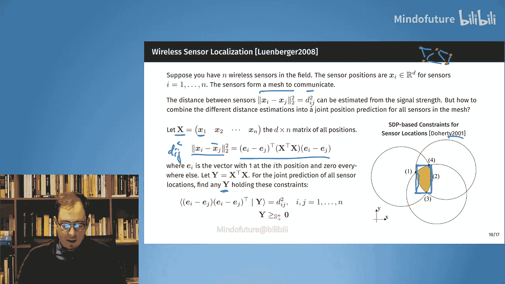

Okay， so this would be a practical application of SDP and go have a look at Dockerty if you're interested in technical details that we don't have the time here。

And a last application of semideite programming that we're looking at here is the so called blindd decoconvolution。

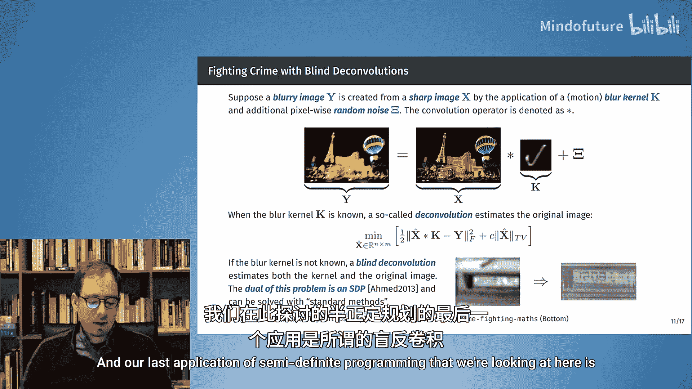

Now， this is also an application from computer visionion， suppose that you have a blurry image right。

 so you have taken a shaky camera picture or something like that。And the idea is that。嗯。

The process that constructed this blurry image。

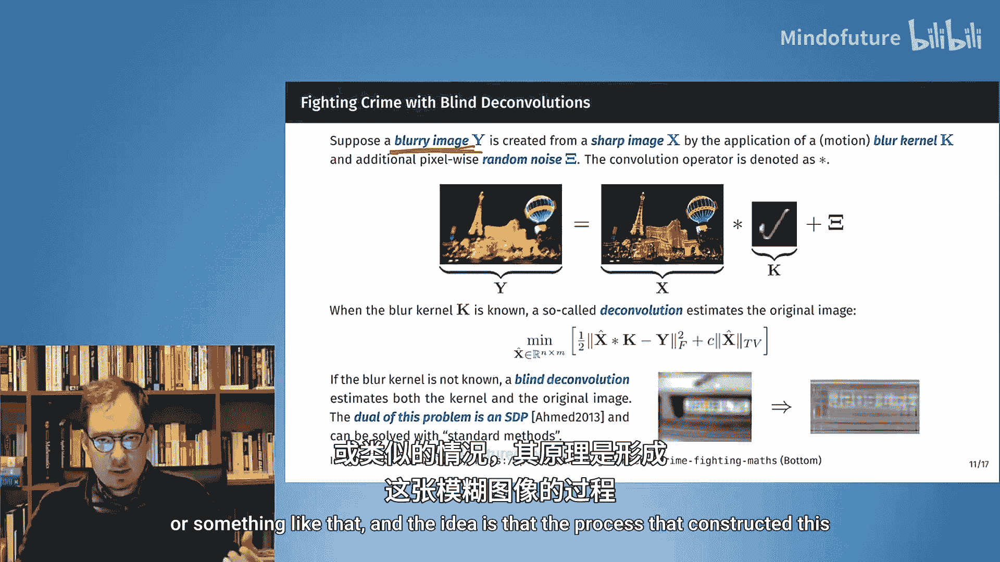

It's like having a sharp image first。And then apply applying a so called block kernel to it。

So here you see this block kernel okay。And you can somehow see the ways the movements in how the camera was shaking and so there is a convolution operator and you might know convolutions also from lectures on convolution and neural networks。

 so here the convolution operator， it takes。

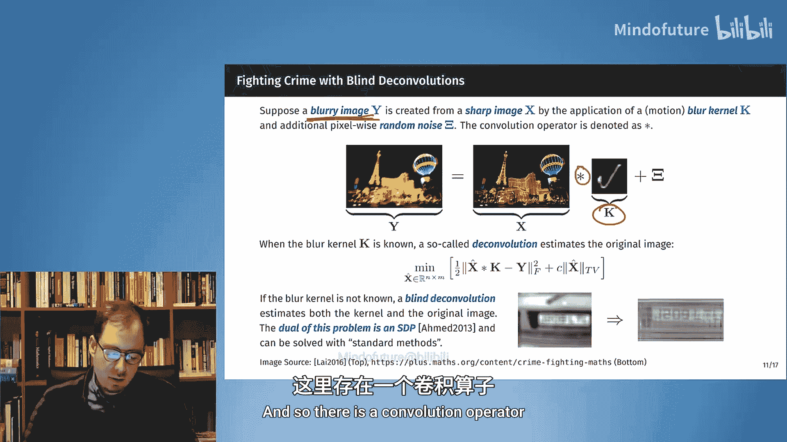

Pixels in a rectangular area and combines it into an opera pixel。

 so here we would have this area and all these would be combined by the blue color into exactly this pixel over here。

And then this rectangular window that we're looking at， it has moved one pixel over。And then。

 we are looking at。this window。Apply the convolution to it and then the end result will be this pixel in the blurry image and while we say there is this convolution operator and the block kernel that transforms the clear image into the blurry image。

And there is some additional invoice。嗯。Now， when we know this block kernel， we can try to reverse it。

And we do that by writing it down as an optimization problem where we say， well。

 we know the K and we know the blurry image that was given to us by the camera。

And what we want to do is we want to recover this X here。

In a way that the total variation noise of the recovereded image is low。

And so this is the deconvolution that estimates the original image from the blurry image and the known block camera。

However， in many cases， I don't have the blue kernel available because I don't exactly know how the camera was shaking。

And but I can still apply optimization here and now it's called blind deconvolution and there is a huge number of literature out there and a very famous paper by Ahmed and Bent is using convex optimization for blind deconvolution where they are estimating the blue kernel and the clear image at the same time。

And this is a really powerful method because you can take a blurry image。

 however it was constructed if somebody used a Gaussian blur from Photoshop on it or if somebody was shaking the camera doesn't matter and it takes this blurry image like here this license plate from the car and reconstructs it as much as possible and oftentimes there is enough useful information in the image so that I can make for example here the license plate readable once more so this is really like a James Bond technique of taking a bad image and enhancing it in order to then get the license plate and possibly get after the bad guys。

And well， what many of these papers then say well here is a complicated construction and in the end we get an SDP to solve and then we solve that with standard methods and the question is what are these standard methods so how can we solve STPs or colon problems in general。

 what are the important ideas here？