# 机器学习优化方法：10.2：常用锥体 🧊

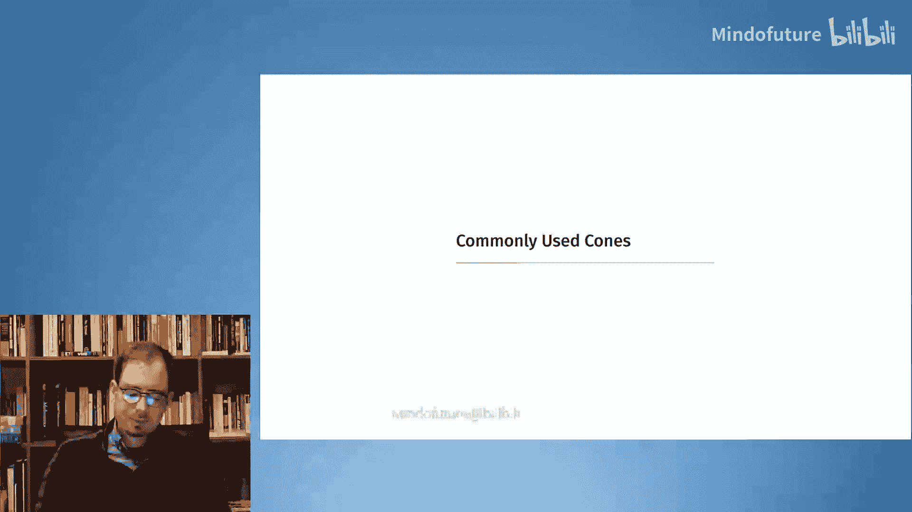

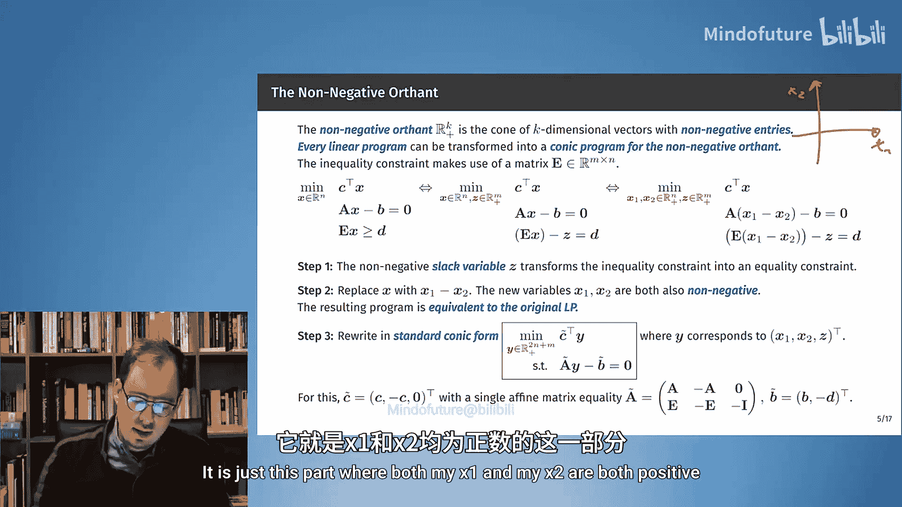

在本节课中，我们将学习锥优化中几种常用的锥体。理解这些锥体是掌握如何将实际问题建模为锥优化问题的关键。我们将依次介绍非负象限锥、二阶锥和半正定锥，并探讨它们各自的应用场景。

## 非负象限锥 📊

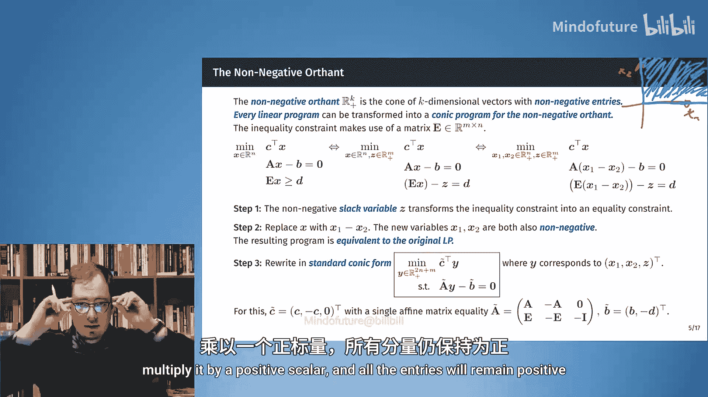

上一节我们介绍了锥的定义和锥优化问题的标准形式。本节中，我们首先来看最基础的一种锥：非负象限锥。

非负象限锥非常容易想象。在一个二维坐标系中，我们有x1轴和x2轴。非负象限锥就是由x1轴和x2轴作为方向，并填充它们之间所有区域的锥体。具体来说，它包含了所有x1和x2都为正数的点。


可以很容易地看出这是一个锥，因为我可以取其中的任意一点，乘以一个正标量，得到的新点的所有坐标分量仍然为正。


实际上，我们可以将任何形如下式的线性规划问题，转化为定义在非负象限锥上的锥优化问题。

首先，我们引入一个松弛变量 `z`，并要求 `z` 的所有分量都为正。这样，我就可以用等式约束来替换原来的不等式约束。因为我知道 `z` 必须是正的，所以这两个问题是等价的。

其次，我的目标变量 `x` 可能是负的也可能是正的，在开始时我并不知道。为了强制 `x` 位于非负象限锥中，我将它拆分成两个变量 `x1` 和 `x2`，并且要求它们都为正。在所有原来使用 `x` 的地方，我现在使用 `x1 - x2`。这样我仍然可以得到和原来一样的解，但现在我所有的目标变量都可以被约束在非负象限锥中。

最后，通过一些额外的组合操作，我可以将这三个部分合并，得到一个在更高维度的非负象限锥中的单一变量 `y`，从而得到标准锥形式。因此，**任何线性规划都可以被重写为标准锥形式，其锥体就是非负象限锥**。

## 二阶锥 🍦

现在，我们来看一些之前无法很好求解的优化问题，为此我们需要更高级的锥体，例如二阶锥。

二阶锥也被称为洛伦兹锥或冰淇淋锥。它的定义是：对于一个向量 `x`，考虑所有满足 `t` 大于等于 `x` 的欧几里得范数的 `t`。公式表示为：
```
(t, x) ∈ Q^n 当且仅当 t ≥ ||x||_2
```

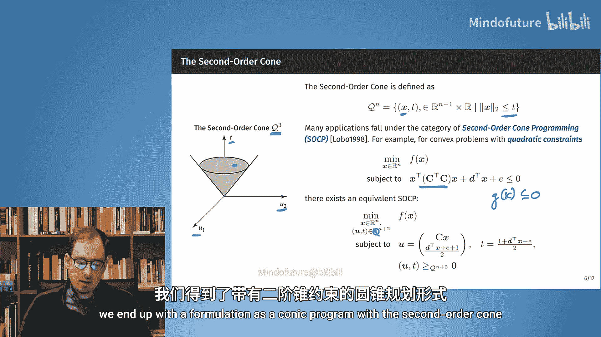

下图展示了三维空间中的二阶锥，其中前两个维度是 `x` 的分量，第三个维度是 `t`。


当我选择 `x1` 和 `x2` 时（例如图中红点），`t` 需要大于等于该点到原点的欧几里得距离，这就精确地给出了这个向上开口的“冰淇淋”锥。

许多应用都属于这个范畴。例如，具有二次约束的凸优化问题可以被重写为二阶锥优化问题。下面的公式展示了这种转换，在本课程中，你不需要记住这个复杂公式，更重要的是知道这种转换是存在的。

一个二次约束的形式是 `x^T C^T C x ≤ ...`，其中 `C^T C` 显然必须是半正定的，以确保整个函数是凸的。最终，我们可以将整个问题重新表述为一个带有二阶锥约束的锥优化问题。

现在让我们看一些之前承诺的实际例子。

### 应用一：全变差去噪

假设你有一个非常嘈杂的数据，如下图中左侧的灰色点所示。这些是时间序列测量值，相当复杂，时不时会出现跳跃或状态的突然切换。我们想要做的是去噪，同时也想看到数据中发生这些跳跃的位置。


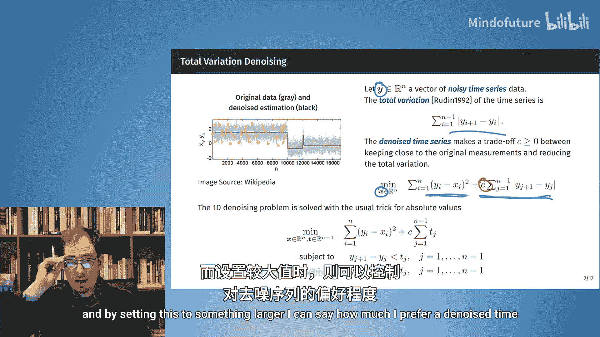

一个简单的方法是使用滑动窗口，但滑动窗口通常不能完美反应，我们更希望精确地发现底层过程变化的点。我们可以通过所谓的“全变差”来实现。

全变差是查看一个数据点与其邻居之间绝对距离的总和。对于时间序列去噪，我们设测量值为 `y`，希望去噪后的序列为 `x`。`x` 和 `y` 的维度可以很高。

我们希望 `x` 接近 `y`，因此最小化它们之间的平方距离。此外，我们添加全变差项，即相邻数据点绝对距离的和，并乘以一个标量权重 `λ`。这个权重控制我们对去噪的偏好程度：设为0则完全恢复原始序列，设得越大则越偏好平滑的序列。

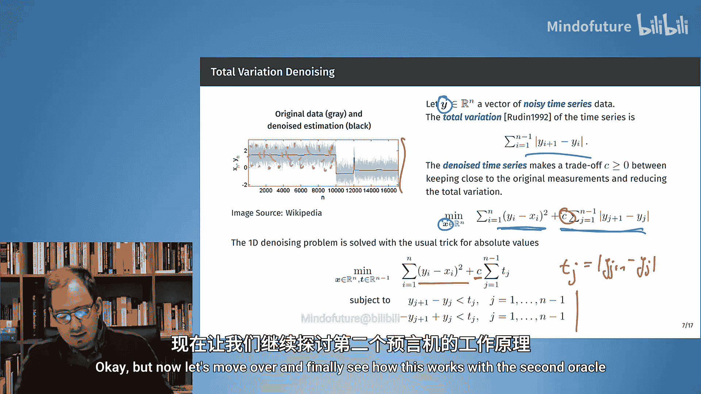


这个一维全变差去噪问题可以写成一个锥优化问题。平方距离项保持不变。对于去噪项，即 `λ * Σ t_j`，其中 `t_j = |x_{j+1} - x_j|`，我们可以利用第五讲中提到的技巧，用两个不等式约束来精确表示绝对值。

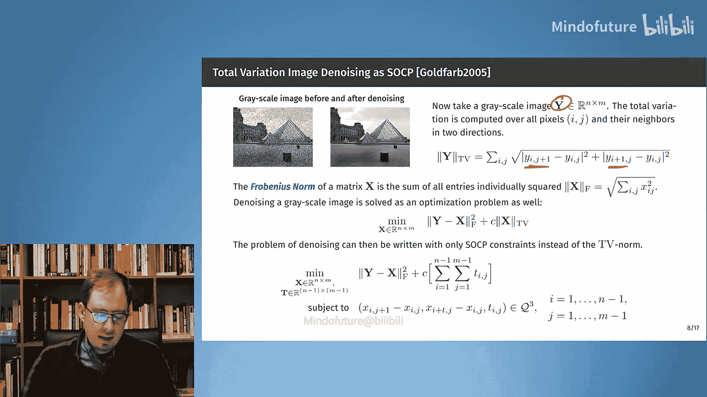

### 应用二：图像去噪

从一维去噪，我们现在转向图像去噪，即二维域。我们有一幅灰度图像 `y`，它是一个矩阵。

我们也可以计算全变差，但现在是针对所有像素，考虑每个像素在右和上两个方向上的邻居。总变差是这两个方向上绝对距离平方和的平方根。


类似于一维情况，我们构建优化问题：第一项是去噪图像 `x` 与原始噪声图像 `y` 所有像素的平方距离和（即 Frobenius 范数的平方），第二项是全变差项。

我们可以将整个问题重写为一个二阶锥问题，因为对于每个像素，我们都有一个约束，要求其向右和向上的距离 `u` 与变量 `t_ij` 满足 `(t_ij, u) ∈ Q^3`（二阶锥）。我们知道，如果 `(u, t)` 属于二阶锥，意味着 `t` 必须大于等于 `u` 的欧几里得范数。优化器有动力将 `t_ij` 向下推至尽可能小，因此在最优解处，我们将精确地得到 `t_ij = ||u||`，这正是该像素处的总变差范数。


现在，我们得到一个非常高维的优化问题。例如，一个200x200的图像意味着一个40000维的优化问题，每个像素对应一个二阶锥约束。这规模很大，因此我们需要高效的算法。如今这类算法已是标准实践，甚至你手机上的相机在暗光拍摄时可能就应用了此类方法来优化噪声图像。

## 半正定锥 ⬜

最后，我们详细看看三种锥中的最后一种：半正定锥。

对于半正定锥，我们处理的元素实际上是矩阵。我们考虑所有 `n x n` 对称矩阵构成的向量空间 `S^n`，但只关注其中的半正定对称矩阵，这就构成了半正定锥。

标准的半正定规划优化问题如下：
```
最小化 C • X
满足 A_i • X = b_i, i=1,...,m
且 X ≽ 0
```
其中 `C • X` 表示矩阵的弗罗贝尼乌斯内积（对应元素相乘之和），类似于线性规划中的 `c^T x`。`X ≽ 0` 表示 `X` 属于半正定锥。

同样，半正定锥也有许多实际应用。

### 应用一：组合优化近似

著名的是，我们可以用 SDP 来近似组合优化问题。在计算机科学中，我们都听说过旅行商问题（NP难问题）。另一个例子是最大割问题：给定一个图，如何划分它使得两个分区之间边的权重最大。这也是一个NP难问题。

对于这个最大割问题，我们可以将其写成一个 SDP 问题来近似求解，并获得一个非常接近最优解的解（接近90%的近似比）。这很好，因为如果我们知道如何快速求解 SDP，就能为许多NP难问题找到一个非常接近最优的解。

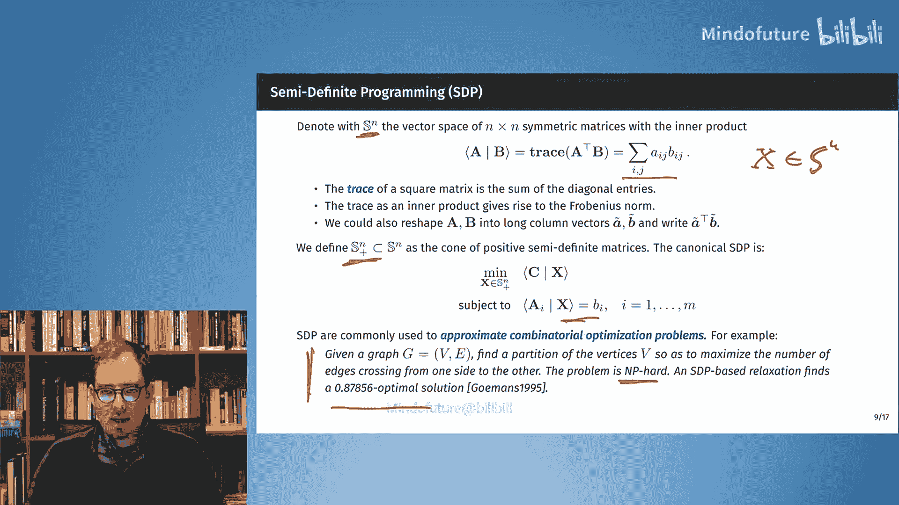


### 应用二：无线传感器定位

另一个具有实际意义的应用是无线传感器定位。想象田野中有许多无线传感器（例如手机），你想根据从它们接收到的信号强度进行精确定位。

如果你有已知位置的基站， triangulation 很容易。但如果我们能考虑网状网络会更好，因为手机之间也能相互看到信号强度，这样我们不仅有到基站的距离，还有传感器之间的距离估计。

我们通过信号强度来估计传感器之间的距离 `d_ij`。关键问题是如何将所有不同的距离估计组合成所有传感器的位置预测？

我们可以将所有位置向量组合成一个大矩阵，并写下距离方程。通过一些额外的变换，最终得到一个 SDP 问题。这个 SDP 是一个近似，它给出了约束，从而极大地减少了每个传感器可能位置的搜索空间。例如，在 Doherty 的论文中，就使用 SDP 将每个传感器的可能位置空间缩小到一个非常紧的近似范围内。

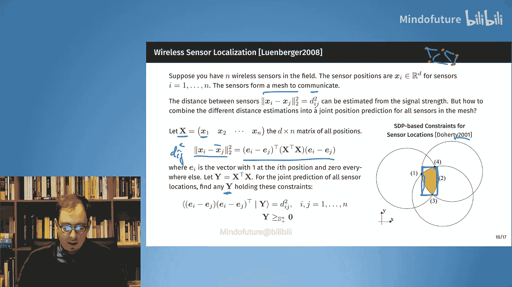


### 应用三：盲反卷积

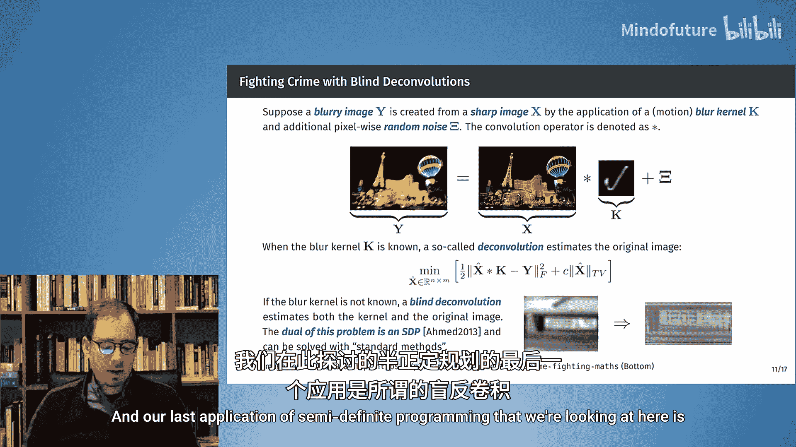

我们看的最后一个半正定规划应用是所谓的“盲反卷积”。

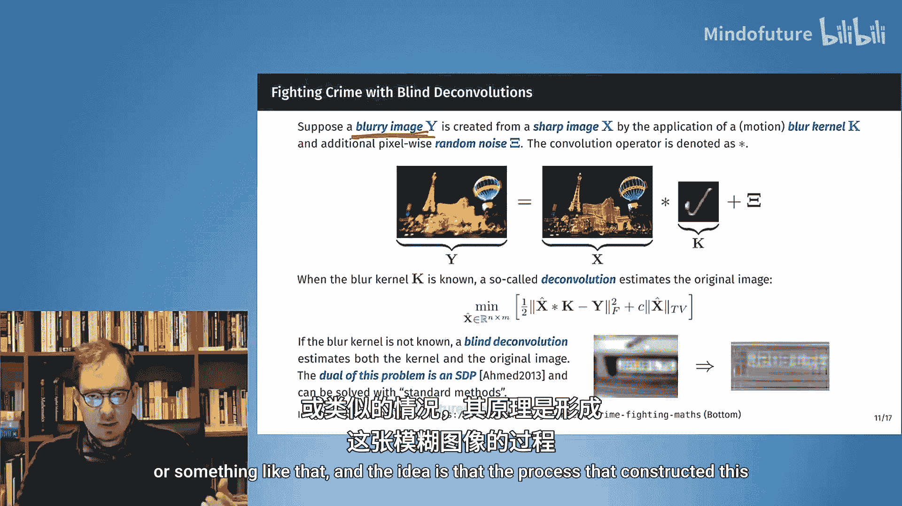


这也是一个计算机视觉应用。假设你有一张模糊的图像，比如用抖动的相机拍摄的照片。其背后的过程是：先有一张清晰的图像，然后对其应用一个模糊核（卷积操作）。卷积操作取一个矩形区域内的像素，通过模糊核将它们组合成一个输出像素。

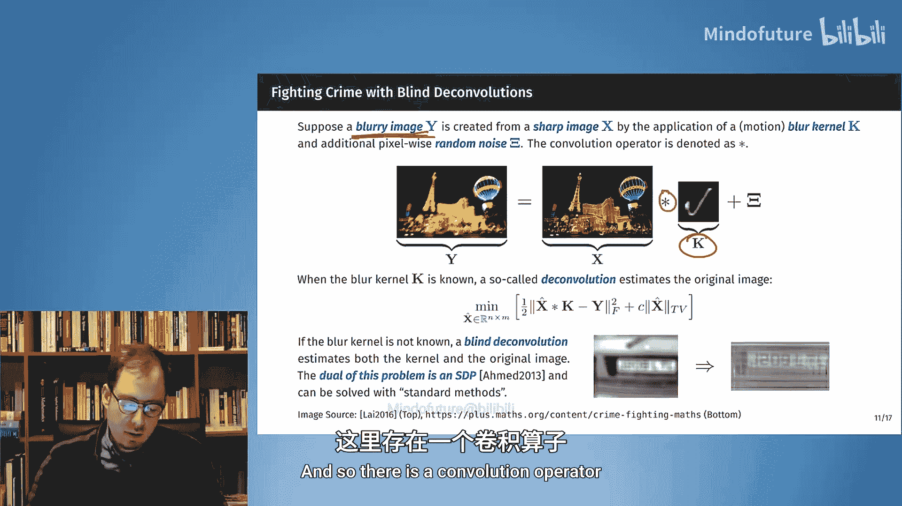


当我们知道这个模糊核时，可以尝试逆转它，通过一个优化问题来估计原始清晰图像 `x`，同时希望恢复图像的全变差噪声较低。这被称为“反卷积”。

然而，在许多情况下，我并不知道模糊核，因为我不确切知道相机是如何抖动的。但我仍然可以应用优化，这被称为“盲反卷积”。Ahmed 和 Bent 的一篇著名论文使用凸优化进行盲反卷积，同时估计模糊核和清晰图像。


这是一个非常强大的方法。你可以拿一张模糊的图像（无论是Photoshop的高斯模糊还是相机抖动造成的），并尽可能重建它。通常图像中有足够的有用信息，可以使其再次可读，例如让车牌号变得清晰。这就像一种詹姆斯·邦德式的技术，通过增强坏图像来获取车牌并追踪目标。

许多这类论文最终都会得到一个需要解决的 SDP，然后用标准方法求解。那么问题来了：这些标准方法是什么？我们如何一般性地求解 SDP 或锥优化问题？其中的重要思想是什么？这将是我们后续课程要探讨的内容。

## 总结 📝

本节课中，我们一起学习了锥优化中三种最常用的锥体：
1.  **非负象限锥**：最基础的锥，任何线性规划都可转化为其上的锥优化问题。
2.  **二阶锥**：形如冰淇淋锥，可用于处理全变差去噪（一维时间序列和二维图像）等具有二次约束或范数约束的问题。
3.  **半正定锥**：处理矩阵变量，用于半正定规划，在组合优化近似、传感器网络定位和图像盲反卷积等领域有强大应用。

理解这些锥体及其应用场景，是将复杂实际问题建模为可高效求解的锥优化模型的第一步。