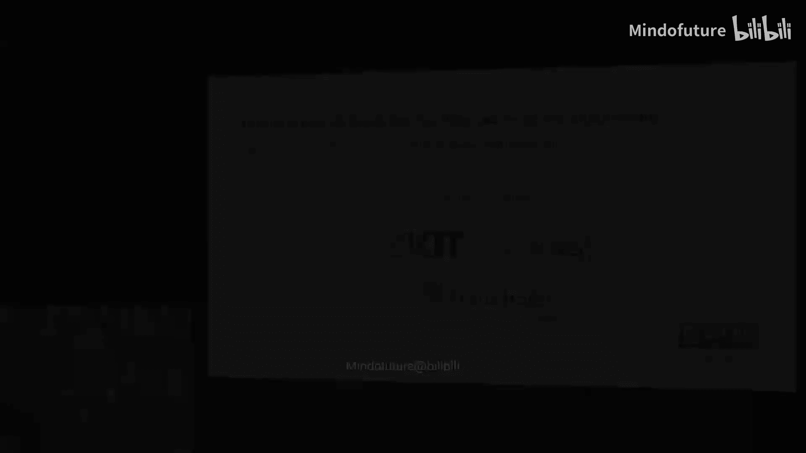
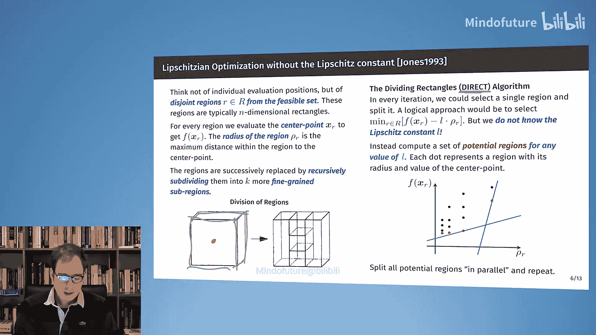

# 【凯尔大学】机器学习优化方法 ｜ Optimization Methods For Machine Learning And Engineering 2021 p38 P38_11.1_非凸连续优化 -BV1C6SwBqEp7_p38-

Welcome to the last installment of the lecture， optimizationimization Methods for Mach learning and Engineing。

Today we will open the scope a little bit to the end of this lecture series and today we will hear about gradient and free and nonconvet optimization。

 so things that have not been covered in the previous lectures and this will open up the scope a little bit more but we will not go into every detail。

 this is to give you a taste of what is to be found beyond the scope of the lecture。

We will talk about optimization of non convex continuous functions。

 we will learn about mixed integer optimization where， for example。

 we have only integers or natural numbers in the solution。

We will hear about stochastic optimization and there will be a quick recap and outlooklook。

So let's dive into non convex continuous objective functions。So far。

 all the optimization problems we considered have been convex and we had a lot of advantages from that。

We could always quote unquote， walk downhill。And also。

 we were sure that there is only a global optimum that fulfills some conditions， for example。

 for unconstrained optimization that the gradient is zero at only this point。Now。

 for non convex optimizations， we cannot rely on all this prior knowledge。

And so we need to have other concepts to think about these kinds of functions。

And one very important of these concepts is the lipss continuity。

 so we call a function lipschs continuous。If it is。

 if if there is a certain limit to how much this function is spending。

 So here we look at two values in the。In the domain of the function。

And now if the distance between this function between the two points is limited。

 then also we know that the distance of the function evaluated at these two points is limited。

And so if we have a function， that is。It's only a very small bendiness then there it can be a very small lipstitz constant and another function that is bending quite a lot here the lipstitz constant would be larger because I could pick here some points that are pretty close to one another but where the distance between the points evaluated on the function is quite large。

O。So for the lipssheds continuity， well this is the definition。

 it should say everything there is to know about lipsshed's continuity。

And now assumem that we have a non convex function at hand。

 so now our F is lipsitz continuous but non convex。

And we try to optimize it and we try to find a solution that is closer to the optimizer than some very small epsilon。

So the remaining error that we allow is this epsilon。And the question is。

 how often would we have to evaluate F if we did a grid search to be sure that our solution is smaller than this epsilon away from the optimizer？

Okay， and now we can make a very simple well example， example problem out of that。

 let's say we have a function that is completely flat and has only a small dip。

Or dimer and we try to find that。So in drawn as a 3D figure now here in 2D。

 let's say here we have our 2D， we have our function， and we somehow plot a grid on that。

And there's only one place where this function has a small dip。

here it goes down and up again and then of course here in 3D。

 so there's a dip that goes down just epsilon。And the question is how fine grained？

We need to make our grid search in order to find this dip。

And this has acquired dramatic growth in its runtime complexity。Because in higher dimensions。

 so when we are not in 2D but in N， then for this grid space， we would need L。

 so this has to be a small L because this is the constants constant divided by two epsilon。

And then we ro that down and the whole thing is taken to the power of N that many evaluations of the grid are required to be sure that we have found a solution that is not farther than this epsilon away from。

From from the minimizer。And what you see here is now when we make this epsilon smaller。

 we have to dramatically increase the number of evaluations that we need。

 and also if we make the L bigger， so if there's a more bendiness of the function。

 then we also have to dramatically make the number of es bigger。

And I'll consider a very simple optimization problem in 16 dimensions。

 so we have solved much more complicated optimization problems than that for convex optimization problems。

 but now for the nonconvex one， assume that we have 16 dimensions， we have an epsilon of 0。

01 and our lipsitz constant is exactly one。And then we need about 1。5 shit tons of evaluation。

 so a lot of evaluations are needed because of this exponential growth。O。And as a consequence。

 in the general case， nonconvex functions cannot be optimized efficiently and we have seen here this test function with the small dip as an example。

 where at no point we would get any useful graded information only at the location of this absoluteps dip。

And hence， grid search is the best solution that is available to us。And hence in the general case。

 non convex functions， we cannot solve them efficiently， it blows up exponentially。However。

 in practice， we can still often solve them by relying on some structure that is still present in the problem。

 so where the practical problems are nicer than the worst case than the theoretical worst case that we could be looking at。

And there are heuristic methods that on these types of。Problems。Perform quite well in practice。

 but they don't have good theoretical guarantees and we can often construct synthetic examples where the performance of the heuristic methods is not very good。

O。Now there are some common test functions used in the literature to evaluate these theuristic methods。

 so these are a couple of nonconvex functions that you can find quite often in the literature while the gar function here。

 this one is newish it appeared in the last six to seven years。But the others。

 the Rosenpo function and the active function， are those have been known for at least 50。

60 years and our example non convex functions with there are more or less nice so the Rosenpo function it's rather more nice and the optimum will lie somewhere。

The optimum will lies somewhere over here and the big challenge of the Roseen cork function is that when you have ended up here in this valley。

 you have a very small gradient but you still have to run along this valley with a very small gradient to find the optizer sitting over there。

And the big problem of the A function is that it is highly nonconvex and it has many， many。

 many local minima， so these are different types of problems in optimization that could occur and there are these test functions designed specifically to suss these problems out。

And then the garland function here， this is a rather special one。

 it looks quite nice the way the garland function is designed。

 but it is particularly nasty because it is not lipss continuous so for any you cannot find a lipsched constant or the constant will always tend towards infinity。

And so this is also a test function used particularly now for so-called optimization optimization methods。

 and well you can imagine the difficulties that the gradient based optimization would have in any of these cases。

Now let's have a look at one of the first heuristic methods and so there have been many heuristic methods in the past。

 but we will specifically pick that one out because it is rather easy and also rather successful and for most programming languages you can just pull out libraries that implement this differential evolution algorithm and for many practical problems in low dimensions the differential evolution algorithm might already suffice for you to solve your problem。

 maybe solve it once， but maybe not consistently if you want to deploy a system that has to do the optimization。

 at runtime over and over， because it might run into problems。

 you have very little theoretical guarantees， but if it's enough on your problem then maybe you can already solve your problem without thinking too much about optimization。

So differential evolution is a type of genetic algorithm and genetic algorithm。

 this is an entire field that has its own scientific conferences and journals and so on and so this is just now an example for this entire field。

And genetic algorithms are a nature inspired heuristics。

 and it works a little bit like evolution does a nature。

 where you have a survival of the fittest and good results have a higher probability of having offspring then there's a mixing and you create new variations and have this evolutionary method where bad solutions are weeded out and good solutions are able to continue to have offspring。

O。So differential evolution could already work nicely for functions that have only a few noncontinuities or with jumps and have rather low dimensionality and also for this differential evolution。

 you typically require box constraints so that you have an area that is like a high dimensional box and you don't have very fancy constraints on your domain that defines your function。

And what you do is you populate this range initially with possibly thousands of trial solutions that are selected randomly。

And then you start combining them。So then you take three random solutions from this initial population。

 let's call them x y and z， and you combine them into a new mutant by this formula where you combine where you integrate all this three solutions into into a new trial solution and you check that if this is an improvement and if yes。

 then you replace the X by the new mutation or new mutant V。And then you repeat that。

 you repeat that over and over， and oftentimes it happens that you terminate because all your solutions end up at the exact same spot。

And because you have initially so many randomly distributed solutions。

 there is like an exploration of the solution space in areas that are better。

There the mutants tend to survive longer and then there's like a convergence slowly to one of the optima。

Okay， and also for Julia， there is some implementation readily available and you just put in your optimization function and the box constraints and you don't need to have any gradient information or Hesian or and so on。

 so this can even be quite fast because the initial function evaluations are not blowing up with respect to the dimensionality like the Hesian would。

Okay， and now in the aerobic G， you could also hear a click on the play button and have a look at this animation for the differential evolution algorithm on the A function that we have introduced on the previous slide。

ok。Now let's have a look at another algorithm that uses this information about the lipsitz constant。

Now consider that if we have e constants or a maximum bendiness of our function that is known ahead of time。

And what we now can do is we can form lower bounds for our function。

So on this picture on the left hand side， the blue line is the non convex function that we want to optimize。

And we have made initially we have made two evaluations of our function and these are the red dots here。

 so we know that at these places this is a one dimensional function so in these places our function to how much it evaluates。

And then by taking the lipsitz constant into account。

 we can find a lower bound going down from these evaluations。

 because well from the lipsitzs constant， we know that all the solutions have to lie above this line that we have drawn now。

 so all these yellow points are still potentially solutions but we know that there are no solutions below these green lines。

And then what we do is since we want to minimize is by just geometric considerations。

 we look at where the lowest point is and then the next evaluation we probably would select this point。

And say， okay， this is potentially still the lowest possible solution。

 we would get a new evaluation point that is then up here。

 then we have to redraw our lipssheditz bounds and then probably the next evaluation would be here。

 we select this point because from the lower bound。

 it could be the best solution that is still available and then we get the next evaluation up here and so this continues。

And this works incredibly well in 1D， and it works less and less well in higher dimensions because you get more and more possible intersections of theseipids and lower bounds and then it gets also expensive to track all the different regions that have been opened up and so on。

 but in general， if you have eipitz bound，Then this could work incredibly well。However。

 it doesn't work on functions where you don't have a lips constant either because there is none like for the gallon function or。

Also because you don't know any， because you wrote a complex simulator。

And it would be a really a pain to do a mathematical analysis of your whole。

Simulation environment to somehow get eips constant out。What you could do。

 you could also just estimate the luus bound and hope for the best。

That can quickly become problematic。嗯。But in general。

 this is also an approach that you could just try and see how it works out because in many languages。

 the scientific libraries with code for optimization， they have such an algorithm out of the box。O。

Now， but there are a couple of disadvantages that I still have to mention。

 oftentimes when you compute a theoretical ellipiate constant。

The lipsts constant will be quite large。And larger than you would prefer and larger than is also expected from just looking at the bendiness of the function。

And therefore this grid search could or this lipstitz in optimization could result in a rather finegraed grid search because the lipsttz constant is very large here these green lines would go like this and then the distance between the red points。

 the distance between the evaluation points is much more important then actually having here a good result on the target function and in essence you get a finegraed grid search so the question now is what do we do when we don't want to use heuristic method but we either don't know a lipss constant or the lipstitz constant by the theoretical considerations is much too large。

There has been a paper in the 9s， 90s from Jones at All， which exactly proposes that。

 so lipssheditz in optimization without the lipsshedditzs constant。

And the algorithm proposed in this paper， this is called the Direct algorithm。

 this was a small revolution and a big change in the thinking， well。

 how can we do Lipsian type optimization if we don't know the lipsititz constant but it does work？

In in a very particular way。So now let's not think about the individual evaluations and then thes。

Constant lower bounds going out from them， but let's think about our solution set as disjoint unions。

So initially from the box constraints here we have a single box in dimensions。And now this box。

 it has a center point， so there's a center point here in the middle。

 and in the center point we can evaluate and see how good the solution is at this point。

And furthermore， this box， it has what is called a radius and the radius is the maximum distance。

From the center point to any other solution in this box。

 so this will be like a diagonal line if we are in a square rectangle。

But the rectangle doesn't have to be square and then the computation of this radius becomes a little bit more involved。

 but imagine that we just have a center point with an evaluated。Reside and we have a radius。

And then by looking at the lipsitz constant and at the radius。

 then we can provide a lower bound for the entire region and so here the lower bound for this initial entire region is well is initially what we think how how good our function。

Can be at most。However， we don't know thes and lipssheds constant air。Okay。

 but note different from them。Liiphis and optimization on the previous slide。

 what we now do is we split this rectangle into smaller regions。

So what we initially do is we take the solution and we split it into three regions could also be five。

 but in our case， let's say we always split into three child regions and so now we split like this and we split like this and now we have three child regions and then I select one of these child regions and then I have this。

And this selection and on。And that way， I more and more split my regions and for the new regions。

 then I also know the center point that I'm evaluating and I also know this radius of this。

This new region。Okay， but the question is， how do I select the regions that I want to split？

So if we would know the lit constant， then it would be rather easy because then we would just compute the lower bound for each of the regions and take the one with the smallest lower bound。

And just to this iterate leafy， that works beautifully。

We still have the problem that we don't know our lipsts constant。Now。

 let's have a look at this picture here on the right hand side。

What we see here are the center points for the different regions。

But not in their coordinates in the actual function domain。But what we have here on。

This axis is the radius of that is associated with that region。

 and we have here how the function evaluates for the center point。嗯。And if we would know a。

 a particular lipschitz constant。And if we were selecting， for example， at this point here。

Then we could say， well， we know how the function evaluates and we know how big the radius is。

 and then I can draw here the slip sheets or let's pick a different one， this one is hard to draw。

Let me just rule out that。Now we select。We select。This region。

And we know where evaluates and we also know what its radius is and then I can draw for a particular lipids constant here。

 I can draw the line。And then I get。At this location。

 I get the lower bound and so this tells me for a particular lipstitz constant。Well， the region。

 it cannot， any point in the region cannot be better than this or cannot be smaller than this。

And for anotheriptitz constant， I could draw this line like this。And then I would have here my logo。

The problem is I don't know the lipss constant， so what do I do？Well， by looking at this image。

 we see that some points can as things are standing right now， can never be the optimal， for example。

 if the lipss constant。Is like this。Then this point is the best one。

And if the lipss constant is like this。Then this one is the best one。

And if the lu constant is like this。Then this point is the best one。

But there are a couple of points that are in the interior， this point， this point and so on。

 and all of these these are suboptimal or if I'm computing lower bounds， then for any lipss constant。

 they will not have the lowest lower bound， they could still eventually contain the best solution。

 but as far as things stand right now， they don't contain the lowest lower bound。

For any lipsitz concept。And hence I get here something that is akin to a。

To a Pato front so there are a couple of points that are optimal and so for any for and I can by geometric considerations。

 I can find them out and so all of these points here，あ。That are on the like palli of Fund。

 those are potential regions。And what I do is I split all of the potential regions at the same time。

So I picked them out。I split all the potential regions into three or five or seven or how much I have initially decided sub regionsions。

And then I compute the new potential regions， and then I iterate all lot of that。

And that way we can use lips sheetitz and optimization where we don't actually have to know the lips sheets constant and this also this direct algorithm。

 the direct stands for dividing rectangles is something that is provided in many packages and you can just pull that out and apply it on your optimization problem and you don't need to have a derivative or a hasset。

