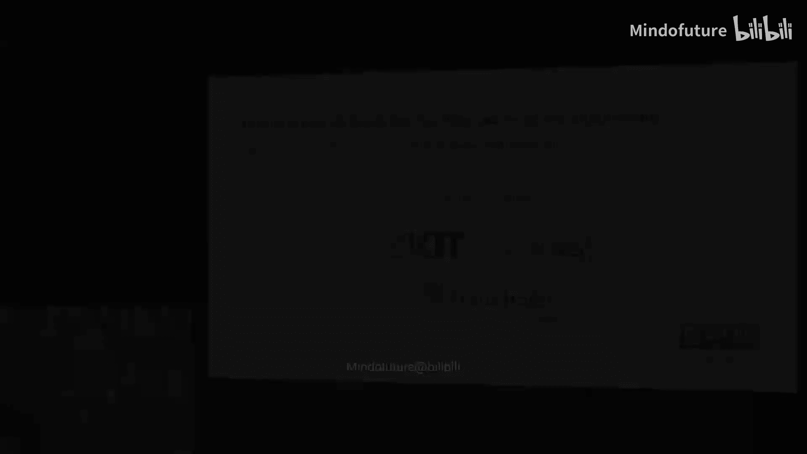
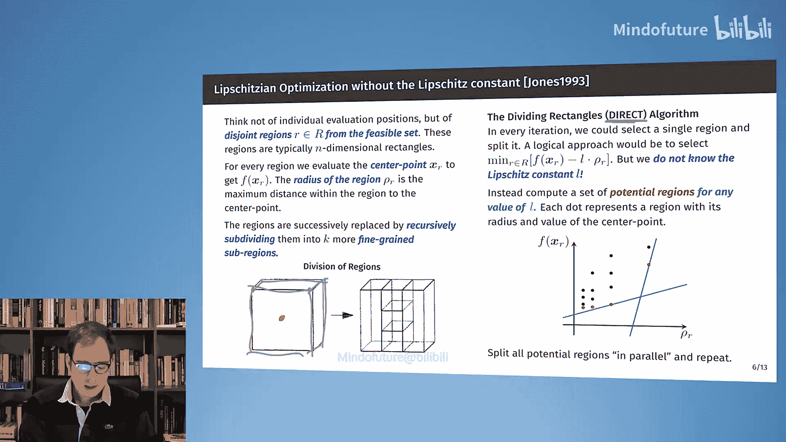

# 机器学习优化方法：11：非凸连续优化

在本节课中，我们将学习非凸连续函数的优化。我们将探讨当目标函数不再是凸函数时，优化问题会面临哪些新的挑战，并介绍几种用于解决此类问题的启发式方法。

## 概述

欢迎来到本系列讲座的最后一讲。今天，我们将扩展视野，探讨之前课程中未涵盖的内容：无梯度和非凸优化。这旨在让大家了解本课程范围之外还有哪些优化方法，我们不会深入每个细节，但会介绍核心概念。

我们将讨论非凸连续函数的优化、混合整数优化、随机优化，并进行快速回顾与展望。

## 非凸连续目标函数

到目前为止，我们考虑的所有优化问题都是凸的，这为我们带来了许多优势。我们总是可以“走下坡路”，并且确信只有一个满足特定条件（例如，对于无约束优化，梯度在该点为零）的全局最优解。

然而，对于非凸优化，我们无法依赖这些先验知识。因此，我们需要其他概念来思考这类函数。其中一个非常重要的概念是**利普希茨连续性**。

### 利普希茨连续性

如果一个函数的变化速率存在一个上限，我们称其为利普希茨连续。具体来说，我们观察函数定义域中的两个点。如果函数在这两点之间的距离是有限的，那么函数在这两点处的取值之差也是有限的。

**定义**：若存在常数 L > 0，使得对于定义域中的所有 x1 和 x2，都有：
`|f(x1) - f(x2)| ≤ L * ||x1 - x2||`
则称函数 f 是 L-利普希茨连续的。

一个函数如果弯曲程度很小，其利普希茨常数 L 可以很小；而一个弯曲剧烈的函数，其利普希茨常数 L 会更大。

### 非凸优化的复杂度挑战

现在假设我们有一个非凸但利普希茨连续的函数 f。我们尝试优化它，希望找到一个解，其与最优解的距离小于某个很小的值 ε。

问题是：如果我们使用网格搜索，为了确保我们的解与最优解的距离小于 ε，我们需要对函数 f 进行多少次评估？

我们可以通过一个简单的例子来理解。假设有一个函数几乎是平坦的，只有一个很小的凹陷（深度为 ε）。为了在 N 维空间中找到这个凹陷，我们需要进行网格搜索。所需的评估次数与 `(L / (2ε))^N` 成正比。

可以看到，当 ε 变小或 L（函数弯曲度）变大时，所需的评估次数会急剧增加。考虑一个简单的 16 维优化问题，设 ε=0.01，L=1，那么需要的评估次数将是一个天文数字。

因此，在一般情况下，**非凸函数无法被高效优化**，因为其复杂度呈指数级增长。我们看到的这个带小凹陷的测试函数就是一个例子，因为除了凹陷处，其他任何地方都无法提供有用的梯度信息，所以网格搜索是我们能使用的最佳方法。

然而，在实践中，我们通常仍然可以通过依赖问题中仍然存在的某些结构来解决它们。实际问题通常比理论上的最坏情况要“友好”得多。

## 启发式方法

存在一些启发式方法，在实践中对这类问题表现良好，但它们缺乏严格的理论保证，并且我们可以构造出一些合成例子，使得这些启发式方法表现不佳。

文献中常用一些测试函数来评估这些启发式方法。以下是一些常见的非凸测试函数：

*   **Rosenbrock 函数**：相对“友好”，其最优解位于一个长而平坦的“山谷”尽头，挑战在于需要沿着梯度很小的山谷行进才能找到最优解。
*   **Ackley 函数**：高度非凸，拥有许多局部极小值。
*   **Griewank 函数**：这是一个较新的函数（过去六七年出现），它特别棘手，因为它不是利普希茨连续的（其利普希茨常数趋于无穷大），常被用于测试无导数优化方法。

可以想象，基于梯度的优化方法在处理这些函数时会遇到困难。

## 差分进化算法

现在，让我们看看最早的启发式方法之一。历史上有很多启发式方法，我们特别选择差分进化算法，因为它相对简单且成功。对于大多数编程语言，你可以直接调用实现此算法的库。对于许多低维度的实际问题，差分进化算法可能足以解决你的问题。

差分进化是一种**遗传算法**。遗传算法是一个受自然进化启发的启发式方法领域，它遵循“适者生存”的原则：好的解有更高概率产生“后代”，通过混合产生新的变体，从而淘汰差的解，让好的解得以延续。

差分进化算法适用于具有少量不连续性或跳跃、维度较低的函数。通常，它需要**边界约束**，即定义域是一个高维“盒子”。

算法步骤如下：
1.  **初始化**：在定义域内随机生成大量（例如数千个）试验解，构成初始种群。
2.  **变异**：从种群中随机选择三个解 x, y, z，通过以下公式组合成一个新的变异解 v：
    `v = z + F * (x - y)`
    其中 F 是缩放因子。
3.  **交叉与选择**：将变异解 v 与当前种群中的某个目标解进行交叉操作，生成试验解 u。如果 u 比目标解更好（函数值更小），则用 u 替换目标解。
4.  **迭代**：重复步骤 2 和 3，直到满足终止条件（例如，所有解收敛到同一点）。

由于初始解是随机分布的，这实现了对解空间的探索。在更好的区域，变异解倾向于存活更久，从而逐渐收敛到某个最优解附近。

在 Julia 等语言中，有现成的实现库。你只需要输入你的优化函数和边界约束，无需提供梯度或海森矩阵信息，因此对于某些问题可能相当快。

## 利普希茨优化

现在，让我们看看另一种利用利普希茨常数信息的算法。假设我们事先知道函数的最大弯曲度（即利普希茨常数 L）。

我们可以为函数构造**下界**。在左侧图中，蓝线是我们想要优化的非凸函数。我们首先对函数进行两次评估（红点）。利用利普希茨常数 L，我们可以从这些评估点向下画出两条斜率为 ±L 的直线，形成一个“V”形下界。我们知道，函数的任何点都不可能位于这些绿色下界线的下方。

由于我们想要最小化函数，通过几何考虑，我们选择当前下界可能最低的点（即两个“V”形下界交点中最低的那个）作为下一个评估点。得到新评估点后，我们重新绘制利普希茨下界，并重复此过程。

这种方法在一维情况下效果非常好，但在更高维度上效果会变差，因为下界区域会变得复杂，追踪所有可能区域的计算成本也会增加。然而，总的来说，如果有利普希茨常数，这可能非常有效。

但是，它不适用于没有利普希茨常数的函数（例如 Griewank 函数），或者当你不知道常数时（例如，你的函数是一个复杂模拟器，难以进行数学分析）。你可以尝试估计利普希茨常数，但这可能很快变得棘手。

## DIRECT 算法（无利普希茨常数的优化）

然而，利普希茨优化有一个缺点：通常，通过理论计算得到的利普希茨常数 L 会非常大，大于实际需要，也大于直观看到的函数弯曲度。这会导致优化过程退化为精细的网格搜索。

那么，当我们既不想使用启发式方法，又不知道利普希茨常数，或者理论常数太大时，我们该怎么办？

Jones 等人在 90 年代的一篇论文提出了解决方案：**无利普希茨常数的利普希茨优化**。其中提出的算法称为 **DIRECT 算法**（Dividing Rectangles，划分矩形），这在当时是思维上的一个重大改变。

DIRECT 算法的思路如下：
1.  我们不再考虑单个评估点和从它们出发的下界，而是将整个解集视为不连续子区域的并集。
2.  初始时，我们有一个由边界约束定义的大矩形（N 维超立方体）。这个矩形有一个中心点（我们在此评估函数值）和一个“半径”（中心点到矩形内任何点的最大距离）。
3.  与利普希茨优化不同，DIRECT 算法将这个矩形**划分**成更小的子区域（例如，每次划分为 3 个子矩形）。
4.  关键问题是：如何选择要划分的区域？如果我们知道利普希茨常数 L，我们可以计算每个区域的潜在下界（基于中心点函数值和半径），然后选择下界最小的区域进行划分。
5.  由于我们不知道 L，DIRECT 采用了一种巧妙的方法。它将每个区域表示为一个点，其横坐标是区域的半径，纵坐标是中心点的函数值。通过几何分析，它可以找出对于**任何**可能的利普希茨常数 L，哪些区域可能包含当前最好的下界（这些点构成了一个帕累托前沿）。
6.  算法**同时划分所有**这些“有潜力”的区域，然后在新产生的子区域上重复这个过程。

这样，DIRECT 算法实现了无需事先知道确切利普希茨常数的利普希茨型优化。该算法在许多软件包中都有提供，你可以直接调用并将其应用于你的优化问题，且无需导数信息。

## 总结

在本节课中，我们一起学习了非凸连续优化的挑战与方法。我们了解到，一般而言，非凸优化问题非常困难，存在指数级复杂度的挑战。然而，通过利用问题结构或使用启发式方法，我们仍然可以在实践中解决许多问题。

我们介绍了两种主要方法：
1.  **差分进化算法**：一种受自然进化启发的、无需梯度信息的启发式全局优化方法，适用于低维、有边界约束的问题。
2.  **基于利普希茨性的方法**：
    *   **利普希茨优化**：在已知利普希茨常数时非常有效，尤其在一维情况下。
    *   **DIRECT 算法**：无需已知利普希茨常数，通过智能地划分和选择搜索区域来进行优化，是一种更通用的无导数全局优化方法。

这些工具扩展了我们处理复杂、非凸优化问题的能力，是机器学习与工程优化工具箱中的重要组成部分。