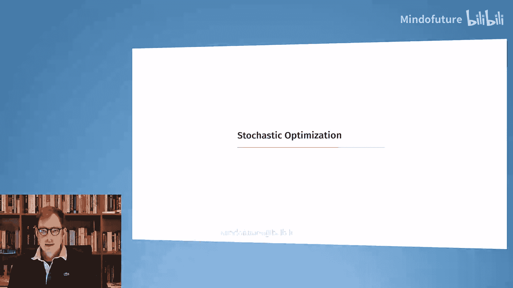
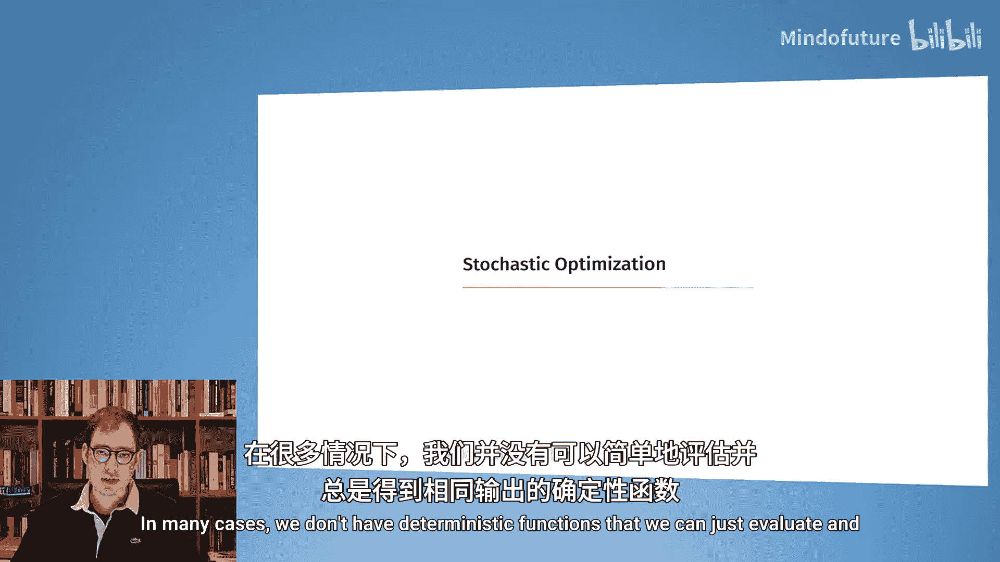
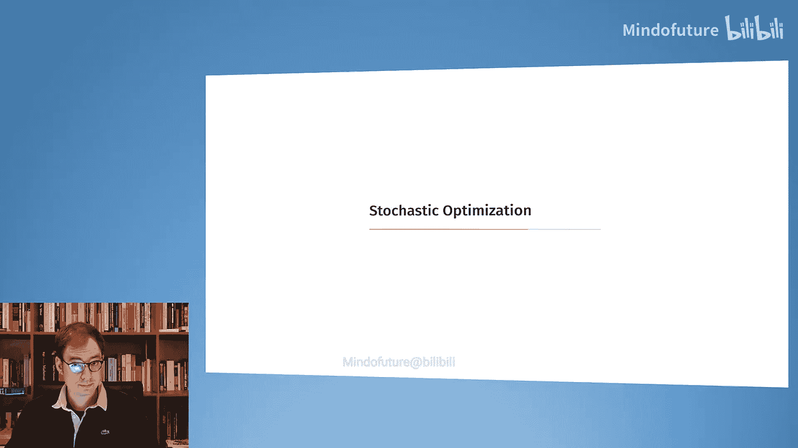

# 机器学习优化方法：11.3：随机优化 🎲







在本节课中，我们将要学习随机优化。在许多实际场景中，我们无法获得确定性的函数输出，因为评估过程本身可能包含噪声。本节将介绍两种处理此类问题的核心方法：贝叶斯优化和蒙特卡洛树搜索。

## 概述

上一节我们讨论了确定性函数的优化方法。本节中我们来看看当函数评估存在噪声时，应如何进行优化。随机优化方法允许我们在不确定或嘈杂的环境中寻找最优解，这在机器学习超参数调优和复杂游戏策略搜索中尤为重要。

## 贝叶斯优化

贝叶斯优化是应用高斯过程来优化噪声函数的一种方法。其核心思想是将我们对目标函数的“认知不确定性”和函数本身的“固有噪声”都建模为一个概率分布。

初始时，我们对函数 `f(x)` 一无所知，可以为其假设一个先验分布（例如高斯过程）。这个分布有一个均值函数（代表我们对函数值的“最佳猜测”）和一个方差（代表我们的“不确定程度”）。

```python
# 概念性描述：高斯过程先验
# f(x) ~ GP(mean_function(x), kernel_function(x, x'))
```

通过在不同的输入点 `x` 评估函数，我们可以获得观测数据。每次评估都会更新我们的后验信念：在评估点附近，不确定性（方差）会减小，我们对函数形状的了解会更加精确。

贝叶斯优化的巧妙之处在于，它使用一个“采集函数”来智能地选择下一个评估点。该函数平衡了“利用”（在预测均值高的区域采样）和“探索”（在不确定性高的区域采样），以期望获得最大的信息增益或找到更优解。

以下是贝叶斯优化的典型步骤：
1.  建立一个目标函数的高斯过程先验模型。
2.  使用采集函数（如期望提升EI）选择下一个最有潜力的评估点 `x_next`。
3.  在 `x_next` 处评估目标函数（可能得到带噪声的结果 `y`）。
4.  将新数据 `(x_next, y)` 加入观测集，并更新高斯过程后验。
5.  重复步骤2-4，直到达到预算或收敛。

一个广泛的应用是机器学习中的超参数优化。训练神经网络时，不同的超参数组合（如学习率、 dropout率）会产生不同的性能，但每次训练的结果都有随机性。贝叶斯优化可以高效地在这个嘈杂的搜索空间中找到接近最优的超参数设置。

## 蒙特卡洛树搜索

刚才我们介绍了在连续空间中的随机优化。现在，我们转向离散或组合设置下的随机优化方法——蒙特卡洛树搜索。该方法因在AlphaGo系统中击败世界围棋冠军而闻名。

MCTS用于模拟具有随机性或对抗性的序列决策过程，例如棋类游戏。它将可能的未来状态表示为一棵树，每个节点代表一个游戏状态，每条边代表一个可能的动作。

MCTS的一个主要优势是它只需要前向模拟，而不需要在树中进行昂贵的回溯。算法总是从根节点（初始状态）开始，模拟到终局，然后根据结果更新路径上节点的统计信息。

MCTS的核心是平衡**探索**（尝试访问次数少、潜力未知的节点）和**利用**（频繁访问当前估计价值高的节点）。这种平衡通过一个选择子节点的公式来实现，该公式受到**切尔诺夫不等式**的启发。

对于节点 `i`，其价值 `Q(i)` 通常由两部分组成：
```
Q(i) = R_i + c * sqrt( ln(N_parent) / N_i )
```
其中：
*   `R_i` 是从节点 `i` 开始所有模拟的平均奖励（**利用项**）。
*   `c` 是一个可调常数，控制探索程度。
*   `N_parent` 是父节点的访问次数。
*   `N_i` 是节点 `i` 本身的访问次数（**探索项**：访问越少，该项值越大）。

以下是MCTS的单次迭代过程：
1.  **选择**：从根节点开始，使用上述公式递归地选择子节点，直到到达一个未完全展开的节点（即存在未模拟过的合法动作）。
2.  **扩展**：为该节点添加一个或多个新的子节点（对应一个未尝试过的动作）。
3.  **模拟**：从新节点开始，使用一个简单的默认策略（如随机策略）快速模拟直到游戏结束，得到一个结果（奖励）。
4.  **回溯**：将模拟得到的奖励，沿着从新节点到根节点的路径反向传播，更新路径上所有节点的访问次数 `N` 和平均奖励 `R`。

通过大量次数的迭代，MCTS能够逐渐将搜索重点集中在更有希望的游戏路径上，同时保持一定的探索性以避免陷入局部最优。AlphaGo的成功正在于将MCTS与神经网络结合：神经网络提供了更精准的初始价值评估和模拟策略，而MCTS则在此基础上进行深入的策略搜索和优化。

## 总结

本节课中我们一起学习了两种重要的随机优化方法。
*   **贝叶斯优化**适用于连续参数空间的噪声函数优化，它利用高斯过程建模不确定性，并通过智能采样高效寻找最优解，常用于超参数调优。
*   **蒙特卡洛树搜索**适用于离散序列决策问题，它通过重复的模拟、评估和回溯，在树结构中平衡探索与利用，是复杂游戏AI和序列规划中的强大工具。

这两种方法都展示了在面对不确定性时，通过概率模型和智能探索策略，我们仍然能够进行有效的优化。