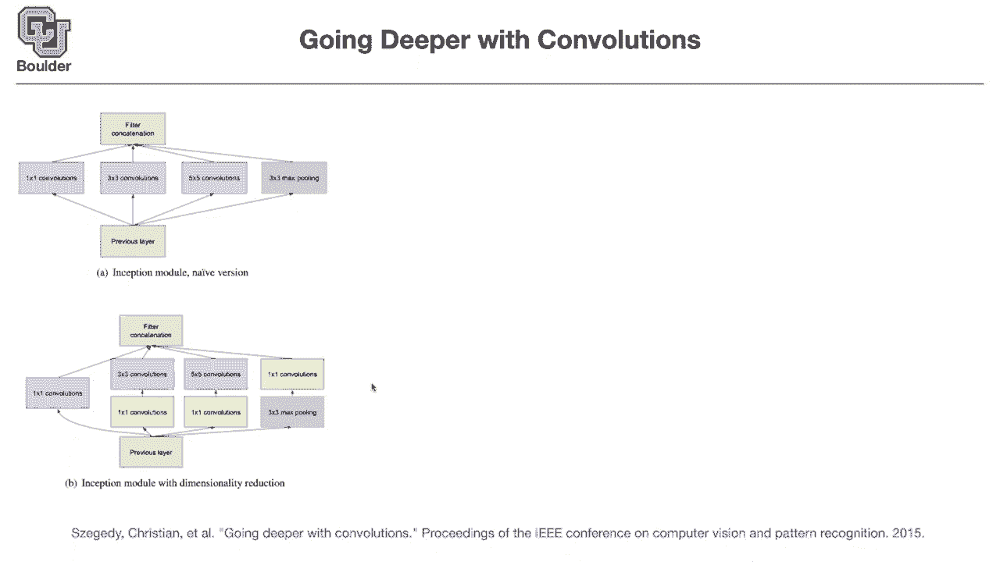
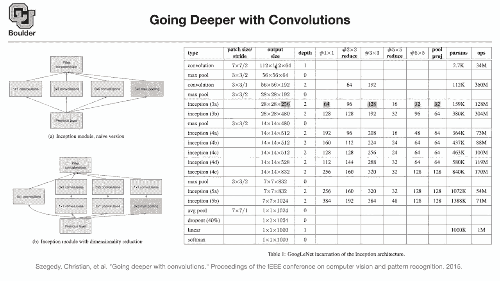

# 📘 课程 P10：L5.1 - GoogLeNet 结构详解

在本节课中，我们将深入探讨 GoogLeNet 的核心组件——Inception 模块的结构与设计思想。我们将了解如何通过 1×1 卷积进行降维，以及整个网络的层次化构建方式。

---

## 🧱 Inception 模块与 1×1 卷积

上一节我们介绍了 Inception 模块的基本概念。本节中我们来看看它的具体结构。

Inception 模块的设计初衷是解决网络层中卷积核尺寸选择的问题。它并行使用 1×1、3×3、5×5 卷积和最大池化，并将结果拼接起来。但直接这样做会导致计算量巨大。

这里的关键创新是引入了 **1×1 卷积**。1×1 卷积的主要作用是在进行更大尺寸卷积（如 3×3 或 5×5）之前，先将输入数据的通道数（即特征图数量）投影到一个较低的维度。

**1×1 卷积的公式化描述**：
对于一个输入特征图 `X`，其形状为 `(H, W, C_in)`，1×1 卷积相当于一个全连接层作用于每个空间位置 `(i, j)` 的 `C_in` 维向量上，输出一个 `C_out` 维向量。其操作可以表示为：
`Y[i, j, :] = W * X[i, j, :] + b`
其中 `W` 是形状为 `(C_out, C_in)` 的权重矩阵，`b` 是偏置。

这样做的好处是，先通过 1×1 卷积减少通道数，再进行昂贵的 3×3 或 5×5 卷积，可以显著降低计算复杂度和参数量，使网络更高效。

---

## 🏗️ GoogLeNet 整体架构解析

理解了 Inception 模块的核心后，我们来看 GoogLeNet 的整体架构是如何搭建的。

以下是网络前几层的结构：

1.  **输入层**：接收 `224×224×3` 的 RGB 图像张量。
2.  **第一卷积层**：使用 `7×7` 卷积核，步长为 2。由于步长为 2，图像的空间分辨率减半。该层包含可学习的权重和偏置，被视为一个独立的层。
3.  **最大池化层**：使用 `3×3` 窗口，步长为 2。这是一个无参数的操作，不增加网络深度，仅用于进一步降低分辨率并增强平移不变性。
4.  **后续卷积层**：接着是两个 `3×3`、步长为 1 的卷积层（分辨率不变），然后又是另一个最大池化层。

在图像分类网络中，一个常见的趋势是：随着网络加深，空间分辨率逐渐降低，但通道数（特征维度）逐渐增加，以提取更抽象的特征。

---

## 🔍 深入第一个 Inception 模块

在完成上述基础层之后，网络引入了第一个 Inception 模块。

该模块的输入分辨率为 `28×28`，通道数为 256。其内部并行路径如下：

*   **1×1 卷积路径**：直接使用 64 个 `1×1` 卷积核。
*   **降维后 3×3 卷积路径**：先使用 96 个 `1×1` 卷积核将通道数从 256 降至 96，再进行 128 个 `3×3` 卷积。
*   **降维后 5×5 卷积路径**：先使用 16 个 `1×1` 卷积核将通道数从 256 降至 16，再进行 32 个 `5×5` 卷积。
*   **池化后投影路径**：先进行 `3×3` 最大池化（通道数保持 256），然后使用 32 个 `1×1` 卷积核进行投影。

最后，将这四条路径输出的特征图在通道维度上进行**拼接**。计算其总通道数：`64 + 128 + 32 + 32 = 256`。因此，该模块的输出为 `28×28×256`。

**关于维度的说明**：在卷积神经网络中，每个特征张量都有三个维度：宽度（x轴）、高度（y轴）和通道深度。1×1 卷积操作的是每个空间位置 `(x, y)` 上的通道向量。

---

## 📉 网络后半部分与输出

在第一个 Inception 模块之后，网络结构按类似模式堆叠。

以下是后续的关键步骤：

1.  **堆叠 Inception 模块**：网络继续使用多个 Inception 模块，中间穿插最大池化层以降低分辨率。
2.  **全局平均池化**：在网络末端，特征图尺寸变为 `7×7`，通道数为 1024。此时，对每个通道的所有 `7×7=49` 个像素值取平均，得到一个 1024 维的向量。这替代了传统网络中庞大的全连接层，极大减少了参数量。
3.  **分类头**：在全局平均池化后，连接一个丢弃率为 40% 的 Dropout 层，然后是一个线性层（即全连接层），将 1024 维向量映射到类别数量对应的维度。
4.  **Softmax 与损失**：最后使用 Softmax 函数将线性层的输出转换为各类别的概率分布，从而可以计算交叉熵损失函数用于训练。

**关于参数量与计算量**：卷积层的参数量主要取决于卷积核尺寸和输入/输出通道数，与输入图像分辨率无关，因此相对高效。而全连接层的参数量则与输入输出维度乘积直接相关，通常非常庞大。GoogLeNet 通过大量使用 1×1 卷积和全局平均池化，有效地控制了模型的总参数量。

---

## 🎯 课程总结

本节课中，我们一起学习了 GoogLeNet 的核心架构。

我们首先明确了 **1×1 卷积** 在降维和提升计算效率方面的关键作用。然后，我们逐步剖析了 GoogLeNet 从基础卷积层到 **Inception 模块** 的构建过程，理解了其并行多尺度特征提取与拼接的设计思想。最后，我们查看了网络后半部分如何通过堆叠模块、使用**全局平均池化**和线性层来完成图像分类任务。

GoogLeNet 通过精巧的 Inception 结构，在保持高性能的同时，显著提升了模型的效率，对后续的神经网络设计产生了深远影响。