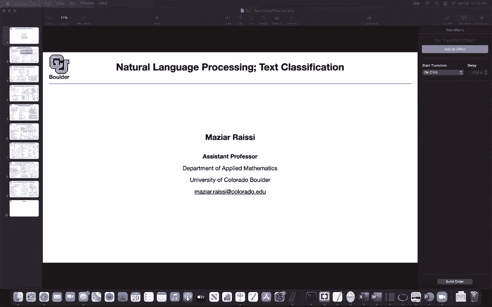
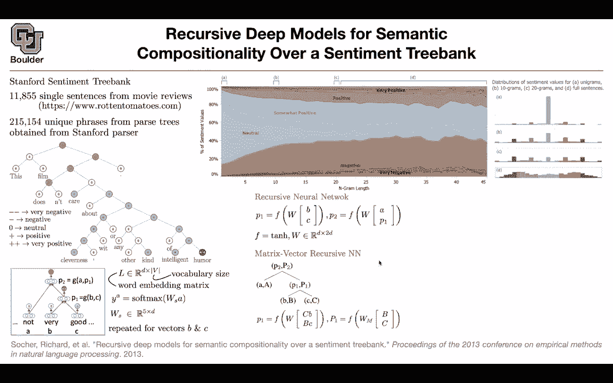

# 课程 P101：L48.1 - 递归深度模型 🧠

在本节课中，我们将学习如何处理自然语言数据，并重点介绍一种用于情感分析的模型——递归深度模型。我们将从数据表示开始，逐步深入到模型结构，并理解如何利用句子的树形结构进行分类。

## 数据表示 📝

处理自然语言的第一步是表示数据。自然语言数据以文本形式存在，文本由单词组成，单词又由字符组成。因此，有两种主要的数据表示模型。

*   字符级模型
*   词级模型

目前我们主要讨论的是词表示模型。一个词实际上可能是几个词的组合，例如“New York Times”是一个短语。此外，在测试数据中可能会遇到训练数据中从未见过的词。处理这类词的一个好方法是将其分解为子词，然后尝试为这些子词赋予意义，从而为遇到的新词或任何不在词汇表中的词建立表示。对于词汇表中不存在的词，通常用一个特殊的“未知”标记来表示。

## 文本分类应用 📧

现在我们已经知道如何表示文本数据，接下来可以转向应用。我们将要介绍的第一个应用是文本分类。

最简单的文本分类例子是垃圾邮件过滤。输入数据是一段文本（电子邮件内容），输出数据是“垃圾邮件”或“非垃圾邮件”的类别标签。一旦能够实现这个功能，就可以将其作为服务提供给用户。

另一个应用是情感分析。例如，分析亚马逊产品评论的主要情感倾向。输入数据是一段用户撰写的评论，输出可以是自动生成的0到5的评分，或是“好/坏”的二分类标签。对于没有标签的测试数据，我们的目标是预测其情感倾向。这正是我们将要开始的内容：使用递归模型进行情感分析。情感分析本质上是文本分类的一个子类。

我介绍这篇论文有两个原因：一是它引入了一个新的数据集——斯坦福情感树库，这是测试文本分类模型性能的基准之一；二是你将听到“递归深度神经网络”这个词，请注意不要与“循环神经网络”混淆，它们是不同的。

## 任务目标与数据 🎯

我们的目标是：给定一段文本，将其转化为一个或多个数字，这些数字对应不同情感类别的概率（例如，好/坏二分类，或五分类）。

对于斯坦福情感树库数据集，它有11855个单句，内容是关于电影评论的。我们可以使用一个解析器（这与深度学习无关）来处理这些句子，得到大约20万个独特的短语。为什么需要解析器？为什么需要将句子解析为树形结构？因为递归神经网络的结构将依赖于底层的语法树。解析器会为我们完成这项工作。

例如，对于句子“This film doesn't care about cleverness with or any other kind of intelligent humor”，解析器会生成一个树形结构。树中的每个节点都被标注了情感标签：0代表中性，+代表积极，++代表非常积极。整个短语的情感被标注为消极。这就是我们的数据：输入是树形结构，输出是情感类别（非常消极、消极、中性、积极、非常积极）。

## 探索性数据分析 📊

一旦有了数据，我们可以查看句子中的n-gram分布。一元组对应单个单词。如果只看单词，大多数单词的情感是中性的，少数是消极或积极的。当我们开始考虑词的组合（二元组、三元组等）时，中性的比例会下降，其他类别的分布会更均衡。当n-gram长度达到20或以上时，分布会变得更加平衡，甚至呈现双峰分布。

这只是探索性数据分析的一部分。我们通过观察数据的整体分布、单个样本的输入输出形式，来理解数据集。在深度学习中，一切始于数据，数据是源代码。观察数据能为我们构建何种模型来解释数据提供思路。

## 递归模型构建 🏗️

接下来，我们将依赖树形结构来创建一个递归模型。假设我们已经有了一个正确构建且带有标签的树。

以短语“not very good”为例。每个单词（not, very, good）都有一个标签（中性、中性、积极），并且有一个树形结构。我们的目标是将整个句子组合成一个低维向量，以便进行分类。

首先，单词需要用向量表示。我们使用词嵌入矩阵，而不是独热编码。每个词对应矩阵中的一列，向量维度d是一个超参数。

为了将单词向量转化为情感类别的概率，我们将其乘以一个矩阵Ws（例如，5×d维），然后通过softmax函数得到一个5维的概率分布。这样，我们就对树中的每个叶子节点（单词）进行了分类。

## 递归组合与神经网络 🧩

现在，我们需要一个函数g来组合子节点向量，生成父节点向量（例如P1）。一个简单的模型是：将两个子节点向量B和C拼接起来，得到一个2d维的向量，然后乘以一个矩阵W，再应用一个非线性激活函数（如tanh），从而得到一个新的d维向量P1。对P2也进行类似操作。

然后，我们可以像处理单词一样，对P1和P2应用相同的分类步骤（乘以Ws，再softmax）。有了概率分布，就可以写出损失函数，并通过最大化似然或最小化损失来训练模型。

然而，这个简单模型的问题在于，单词之间没有交互。它只是B和C的线性组合，缺乏成对交互，导致性能不佳。

## 改进：矩阵向量递归模型 🔄

随后的论文提出，也许问题在于需要更多参数。因此，不仅为每个词学习一个向量表示，还学习一个矩阵表示。在计算父节点向量时，让子节点的矩阵和向量进行交互（例如，C * B 和 B * C），然后将结果拼接，再通过矩阵W变换。这样引入了单词间的交互。

但这个模型参数过多，对于只有12000个句子的数据集来说，容易导致过拟合，并且内存消耗大。

## 递归神经张量网络 🧮

为了在保持交互的同时控制参数，递归神经张量网络被提出。它是对之前模型的泛化。

其核心思想是：在计算父节点向量时，不仅保留原有的线性变换部分（W * [B; C]），还增加了一个张量V来捕获B和C之间的成对交互。具体操作是，通过张量V计算出一个d维的向量，该向量由d个不同的“头”组成，每个头计算B和C通过一个特定矩阵变换后的点积结果。最后，将线性部分和张量交互部分相加，再通过非线性激活函数得到父节点向量。

张量V的尺寸是2d × 2d × d，它与词汇表大小无关，只与选择的维度d有关，因此参数更少，但仍能捕获单词间的交互。

## 损失函数与训练 📉

模型的损失函数是交叉熵损失。对于树中的每个节点，我们都有一个预测的概率分布y（例如5维），以及一个真实标签的独热编码向量t。损失函数会选取正确类别对应的预测概率，并希望最大化它。同时，损失函数中包含对模型参数（L, Ws, W, V）的正则化项，以防止过拟合。

词嵌入矩阵L可以用预训练模型（如Word2Vec或GloVe）初始化，也可以随机初始化并在训练中学习。所有参数都通过优化这个目标函数来学习。

## 总结 ✨

本节课我们一起学习了用于情感分析的递归深度模型。我们从自然语言数据的表示（词嵌入）开始，介绍了文本分类任务，特别是情感分析。我们详细探讨了如何利用句子的语法树结构，逐步构建递归神经网络模型：从简单的向量拼接模型，到引入单词矩阵交互的模型，最后到参数更高效且能捕获成对交互的递归神经张量网络模型。我们还了解了模型的训练目标和损失函数。理解这些模型为处理具有层次结构的序列数据（如自然语言）提供了强大的工具。