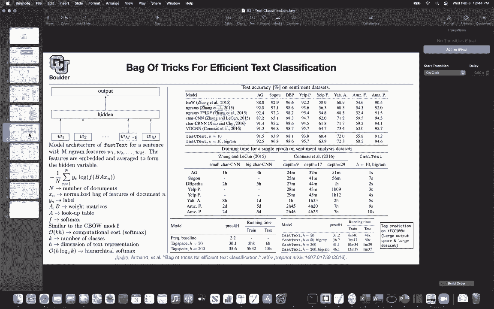
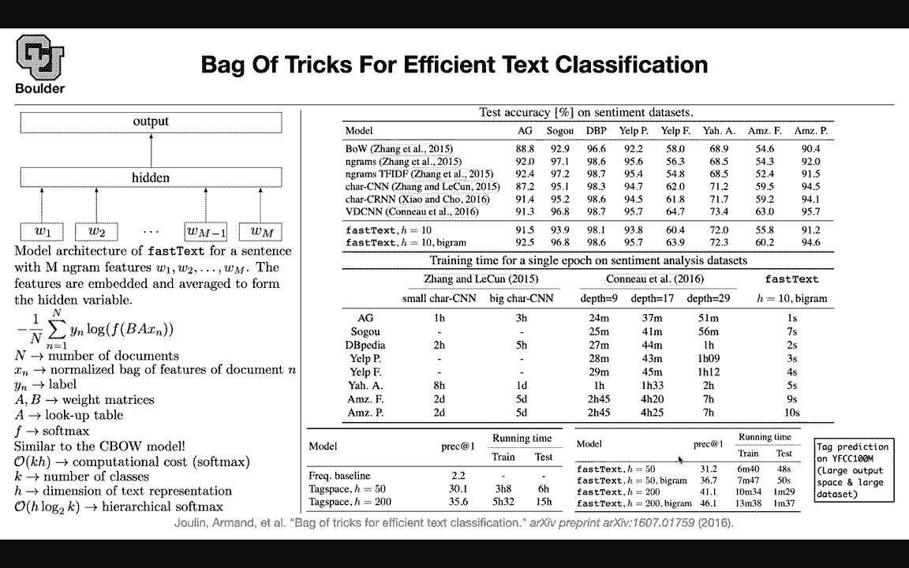

# 📚 课程 P105：FastText 文本分类模型 🚀

在本节课中，我们将学习一个名为 **FastText** 的强大文本分类模型。该模型以其简单、高效和卓越的性能而闻名，是许多复杂非线性模型的有力基准。我们将深入探讨其核心思想、模型架构、工作原理及其优势。

---

## 📖 概述

到目前为止，我们一直在探索文本分类任务，例如情感分析。我们首先介绍了**递归深度模型**，这类模型需要解析树结构，并进行相应的预处理。接着，我们探讨了将句子视为图像、使用**卷积神经网络**的方法，包括基于词向量和独热编码的两种版本。这些模型都是非线性的。

我们还学习了使用**段落向量**的线性模型，它虽然参数众多，但通过局部近似复杂函数，表现强大，其缺点是在推理阶段需要进行优化。

今天，我们将介绍循环神经网络、LSTM 和 GRU。但在深入之前，我们先学习一个非常强大且简单的基准模型——**FastText**。

---

## 🏗️ FastText 模型架构

FastText 的核心思想非常简单。模型架构如下图所示：

模型输入是句子的 **n-gram 特征**（可以是单词或单词对）。每个 n-gram 通过一个**查找表**（即矩阵乘法）投影到一个隐藏空间。然后，将所有 n-gram 的隐藏向量**求和**，得到一个代表整个句子的单一向量。最后，通过一个线性层（逻辑回归）和 **softmax** 函数进行分类。

整个框架可以用一个公式概括：

**公式：**
\[
P(y_n | x_n) = \text{softmax}(B \cdot \text{sum}(A \cdot x_n))
\]

其中：
*   \( x_n \) 是第 n 个文档的特征表示（如 TF-IDF 向量）。
*   \( A \) 是将特征投影到隐藏层的权重矩阵（可视为查找表）。
*   \( B \) 是将隐藏层向量映射到输出类别的权重矩阵。
*   \( y_n \) 是文档的真实标签（独热编码）。

损失函数是正确类别的负对数似然：
\[
L = -\frac{1}{N} \sum_{n=1}^{N} \log P(y_n | x_n)
\]
模型的目标就是优化参数 \( A \) 和 \( B \) 以最小化该损失。

---

## 🔍 核心概念详解

上一节我们概述了模型架构，本节我们来详细看看其中的关键组件。

### 特征表示：\( x_n \)

\( x_n \) 是文档的特征化表示。最直接的方式是使用 **词袋模型**，即统计每个 n-gram 在文档中出现的次数。

然而，一些词在整个语料库中非常常见（如“的”、“了”），它们的信息量较低。因此，我们常使用 **TF-IDF** 进行归一化，以降低这些高频词的权重。
*   **词频**：单词在当前文档中出现的次数。
*   **逆文档频率**：降低在所有文档中都常见的单词的权重。

### 隐藏层：矩阵 \( A \)

矩阵 \( A \) 的作用是将稀疏的高维特征 \( x_n \) 投影到低维的稠密隐藏空间。由于 \( x_n \) 通常是稀疏的（如独热编码），这个矩阵乘法操作实际上等价于一个**查找表**，直接取出对应 n-gram 的嵌入向量。

### 分类输出：矩阵 \( B \) 与 Softmax

求和得到的句子向量通过矩阵 \( B \) 线性变换到类别数量的维度，再经过 softmax 函数得到每个类别的概率。

标准的 softmax 计算成本与类别数 \( K \) 和隐藏层维度 \( H \) 成正比。为了在大规模分类任务中提升效率，FastText 采用了**分层 Softmax**，将计算复杂度从 \( O(K) \) 降低到 \( O(\log K) \)。

---

## ⚡ 性能与优势

以下是 FastText 模型的主要优势：

*   **性能强大**：在多个情感分析数据集上，其准确率与复杂的非线性模型（如 CNN、RNN）相当。
*   **训练极快**：相比需要数小时甚至数天训练的 CNN 模型，FastText 通常只需几秒到几分钟即可完成训练。
*   **可扩展性强**：得益于分层 Softmax，它能高效处理具有海量类别（大 \( K \) ）的大规模语料库。
*   **模型简单**：整体是一个线性模型，易于理解和实现。

下图展示了 FastText 与其它模型在训练时间和性能上的对比，其效率优势非常明显：

因此，当你提出一个新的文本分类模型时，**FastText 是一个必须与之比较的强基准**。如果你的模型需要更长的训练时间，那么它应该带来比 FastText 更显著的性能提升。

---

## 📝 总结

本节课我们一起学习了 **FastText 文本分类模型**。我们了解了其将句子通过 n-gram 特征求和池化为一个向量，再进行线性分类的简洁架构。我们探讨了其使用 TF-IDF 作为特征、将投影矩阵视为查找表、以及采用分层 Softmax 加速训练的核心思想。最重要的是，我们认识到 FastText 以其惊人的训练速度和强大的分类性能，成为了文本分类任务中一个不可或缺的基准模型。在后续学习更复杂的循环神经网络之前，理解这个高效的线性模型为我们奠定了重要的基础。