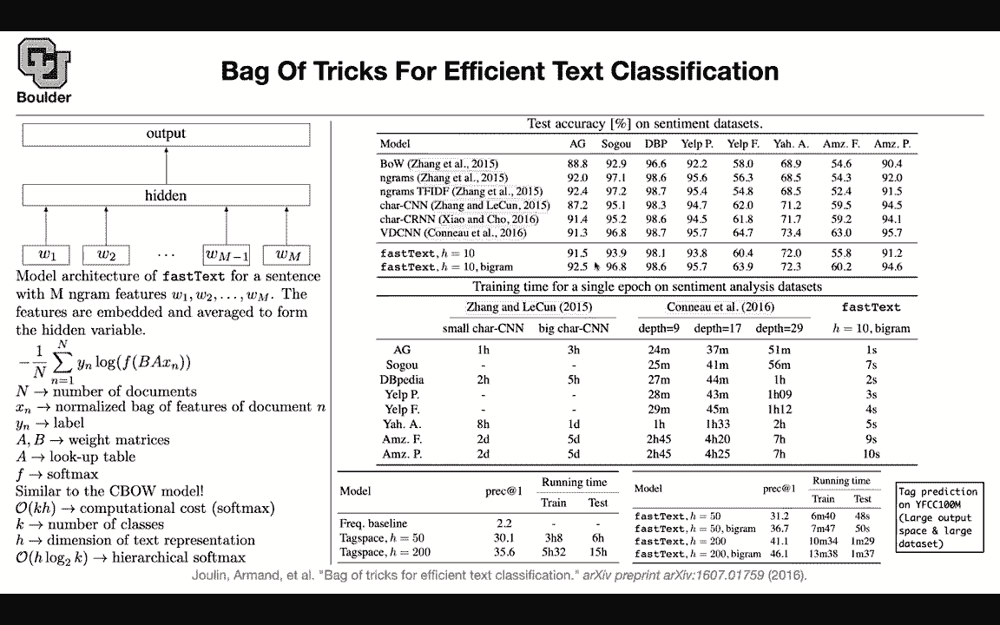
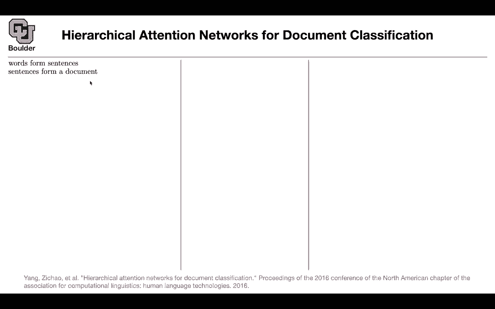
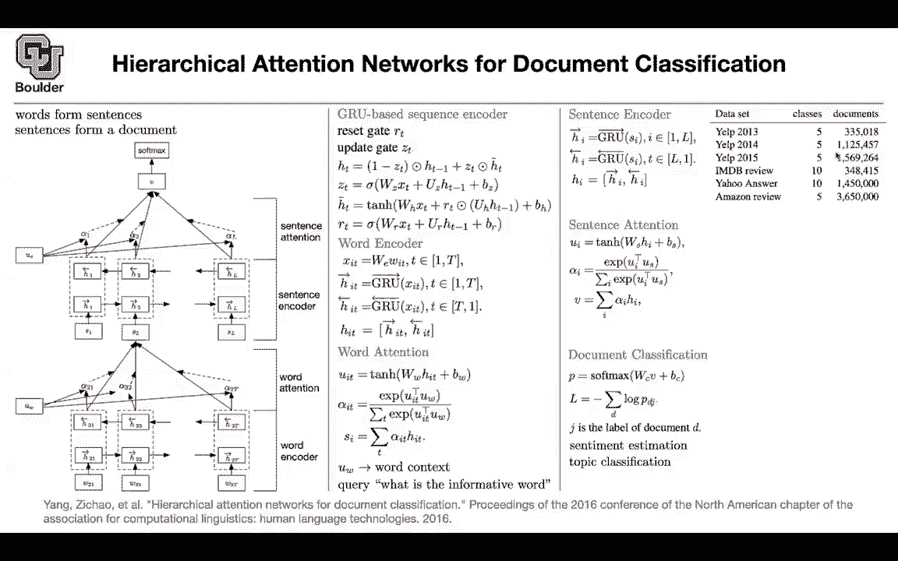

# 🧠 P106：L50.2- 层次注意力网络

在本节课中，我们将要学习一种用于文档分类的神经网络模型——层次注意力网络。我们将从文档的层次结构（词组成句，句组成文档）出发，逐步构建模型，并重点介绍门控循环单元和注意力机制。

## 文档的层次结构

上一节我们介绍了循环神经网络的基础。本节中，我们来看看如何将这种结构应用于具有层次性的文本数据。

我们知道，词语构成句子，而句子构成文档。这是语言的基本结构。我们甚至可以深入到更低的层次，即字符构成词语，这将在后续幻灯片中看到。但“词构成句，句构成文档”这一说法本身是正确的。让我们利用这一结构，构建一个模型来表征它。

你有一个文档，并希望用一个单一的向量 **V** 来表示它。一旦得到 **V**，你就可以进行 softmax 操作，然后完成分类任务。每个文档由一系列句子组成（句子1，句子2，...，句子L），其中 L 随文档不同而变化，是一个可变长度的序列。而每个句子又由词语构成。

以下是文档的层次结构示意图：

例如，第二个句子由词语 W21, W22, ..., W2T 组成。同样，T 也可以随句子不同而变化。对于句子 S3、S4 等，情况也是如此。

现在，我们想为此构建一个模型。暂时不必担心图中的各个组件，接下来我们会详细讲解。

## 门控循环单元

我们将要使用的模型类型是门控循环单元。这是一种带有门控激活函数的循环神经网络。

以下是 GRU 的基本结构示意图：

你看到的是一个循环神经网络：前一个隐藏状态和当前词语结合，产生当前隐藏状态，然后重复这一模式。参数是共享的，即图中这些位置的参数是相同的。

GRU 的激活函数需要两个门：**重置门** 和 **更新门**。

*   **更新门 (z)**：它控制着从上一个隐藏状态到下一个隐藏状态的信息累积。**z** 决定了保留多少上一个状态的信息（保留 `1 - z` 的部分），以及关注多少新信息。
    *   如果 **z = 1**，则忽略历史信息，完全关注当前输入的新信息。
    *   **z** 是依赖于具体数据的，并非一个固定数值。每个输入的数据点（在这里是每个词或句子）都会有自己的 **z**。
    *   **z** 的计算方式：将当前输入 **x_t** 和上一个隐藏状态 **h_{t-1}** 分别乘以权重矩阵，加上偏置，然后通过 sigmoid 函数将其压缩到 [0, 1] 区间。公式可表示为：`z_t = σ(W_z * x_t + U_z * h_{t-1} + b_z)`。

*   **新信息/候选隐藏状态 (h̃_t)**：它计算当前时间步可能的新状态。公式类似于：`h̃_t = tanh(W_h * x_t + U_h * (r_t ⊙ h_{t-1}) + b_h)`。这里暂时忽略 **r_t**。

*   **重置门 (r)**：它决定了在计算候选状态时，要“重置”或忽略多少上一个隐藏状态的信息。其计算方式与更新门类似：`r_t = σ(W_r * x_t + U_r * h_{t-1} + b_r)`。

关于 GRU 有两种常见的实现方式：一种是先进行矩阵乘法，再决定保留信息；另一种是先让 **r_t** 与 **h_{t-1}** 进行元素乘法，再进行矩阵乘法。后一种在实践中更流行，性能也略好。在后续涉及语音识别的课程中，我们会通过论文系统研究这些变体。

目前，我们将使用这个模型。**r_t** 作用于 **h_{t-1}**，控制重置多少旧信息；**z_t** 作用于 **h̃_t**，控制引入多少新信息。

## 双向处理

到目前为止，我们只讨论了图中从左到右的部分。那么从右到左的箭头呢？这是一个很好的问题。

我们将简单地反转时间顺序，让模型从右向左处理序列。这被称为**双向 GRU**。正向循环和反向循环使用相同的 GRU 结构，但具有**独立的参数**。最后，我们将每个时间步的正向和反向隐藏状态**拼接**起来。

以下是处理流程：
1.  **词嵌入**：首先对词语进行编码，将 one-hot 向量乘以词嵌入矩阵 **WE**，得到词向量 **x**。**WE** 可以随机初始化，也可以用 Word2Vec 或 GloVe 预训练模型初始化。
2.  **双向 GRU**：词向量 **x** 分别输入正向 GRU（时间从 1 到 T）和反向 GRU（时间从 T 到 1）。
3.  **拼接**：对于每个词语，将其在正向 GRU 和反向 GRU 中对应时间步的隐藏状态拼接起来，形成一个维度翻倍的向量。

至此，我们涵盖了词级别的处理。完全相同的模式将应用于句子级别，即另一个 GRU 来处理句子序列。

## 注意力机制

现在引入注意力机制。最终，我们需要将一句话中的所有词向量组合成一个单一的句子向量。

句子向量 **s_i** 将是所有词向量 **h_{it}** 的线性组合，权重为 **α_{i1}, α_{i2}, ...**。我们需要确定每个词在句子中的重要程度，即注意力权重。

我们希望这些权重满足两个条件：
1.  每个权重在 0 到 1 之间（注意力不能超过 1）。
2.  所有权重之和为 1（注意力预算固定为 1）。

这自然让我们想到 **softmax** 函数。但在这之前，我们需要将每个词对应的向量 **u_{it}** 转换为一个标量分数。通常，我们通过点积来实现。

具体步骤：
1.  对每个词的拼接隐藏状态 **h_{it}** 进行线性变换：`u_{it} = tanh(W_w * h_{it} + b_w)`。
2.  计算注意力分数：`score_{it} = u_{it}^T * v_w`。这里 **v_w** 是一个可学习的参数向量，可以理解为“查询向量”或“上下文向量”，它代表“这个句子中最重要的词是什么？”。
3.  对分数进行 softmax 归一化，得到注意力权重：`α_{it} = exp(score_{it}) / Σ_t exp(score_{it})`。
4.  句子向量是词向量的加权和：`s_i = Σ_t α_{it} * h_{it}`。

这就完成了从词到句子的构建。我们有一个双向 GRU 来编码词语，拼接状态，然后通过注意力机制线性组合这些状态得到句子表示。

## 从句子到文档

接下来，我们需要将句子组合成单个文档向量。其模式与从词到句子**完全相同**，只是输入和隐藏状态的名称变了。

以下是处理流程：
1.  **句子编码**：文档由多个句子组成。使用另一个双向 GRU（具有独立的参数）来处理句子序列。
2.  **句子级注意力**：同样，使用注意力机制来组合句子向量。我们有一个可学习的“句子查询向量” **v_s**，用于找出文档中最重要的句子。
3.  **文档向量**：文档向量 **v** 是各个句子向量的加权和，权重由 softmax 归一化的注意力分数决定。
4.  **分类**：得到文档向量 **v** 后，由于其维度可能与分类类别数（例如5类）不同，我们进行一个投影操作，然后通过 softmax 得到每个类别的概率分布。

对于训练数据中的每个文档，我们已知其真实类别标签 **j**。目标是最小化负对数似然损失，即最大化正确类别的预测概率：`J = -log(p_j)`。这与之前用 one-hot 向量表示的交叉熵损失是等价的。

## 应用与可视化

这个模型可以用于情感分析、主题分类等任务。不同的数据集可能有不同数量的类别和文档规模。

注意力机制的一个很酷的特点是它可以被**可视化**。例如，对于一个预测正确的文档，我们可以查看哪些句子的注意力权重（**α**）最高，从而知道模型认为哪些句子对决策最重要。

以下是注意力可视化的一个示例：

图中红色越深，表示注意力权重越高。我们不仅可以在文档级别可视化句子注意力，还可以在句子级别可视化词语注意力。例如，在一个预测为负面情感的句子中，模型可能最关注“terrible”这个词；在一个正面评价中，可能最关注“amazing”或“delicious”。

## 总结与问答

本节课中我们一起学习了：
1.  **门控循环单元**：一种具有更新门和重置门的循环神经网络，能更有效地处理序列信息。
2.  **层次注意力网络**：利用文档“词-句-文档”的层次结构，在词级别和句级别分别使用双向 GRU 和注意力机制来构建文档表示。
3.  **注意力机制**：通过可学习的查询向量和 softmax 归一化，动态地为序列中不同部分分配重要性权重，并且这种权重可以可视化以解释模型决策。

**关于参数的共享**：在 GRU 中，参数在**时间步之间**是共享的（水平方向）。但在网络的不同层次（词 GRU 和句 GRU）以及双向的不同方向（正向和反向），参数是**不同**的。

**关于词嵌入**：对于较小的数据集，使用预训练的词向量（如 GloVe）初始化通常效果更好。对于大型数据集，随机初始化也可能通过训练达到良好效果。

**关于注意力的解释性**：在像本节课这样的简单模型中，注意力权重可以为了解决策提供一定洞见。然而，由于神经网络中存在非线性变换，注意力权重并不直接等同于原始输入的重要性，其解释需要谨慎。更复杂的模型（如 Transformer）中，多层注意力交织，解释起来更具挑战性。

GRU 是 LSTM 的一个简化版本，参数更少，易于解释。它们都属于门控循环网络家族，性能相近。在接下来的课程中，我们将学习 LSTM。