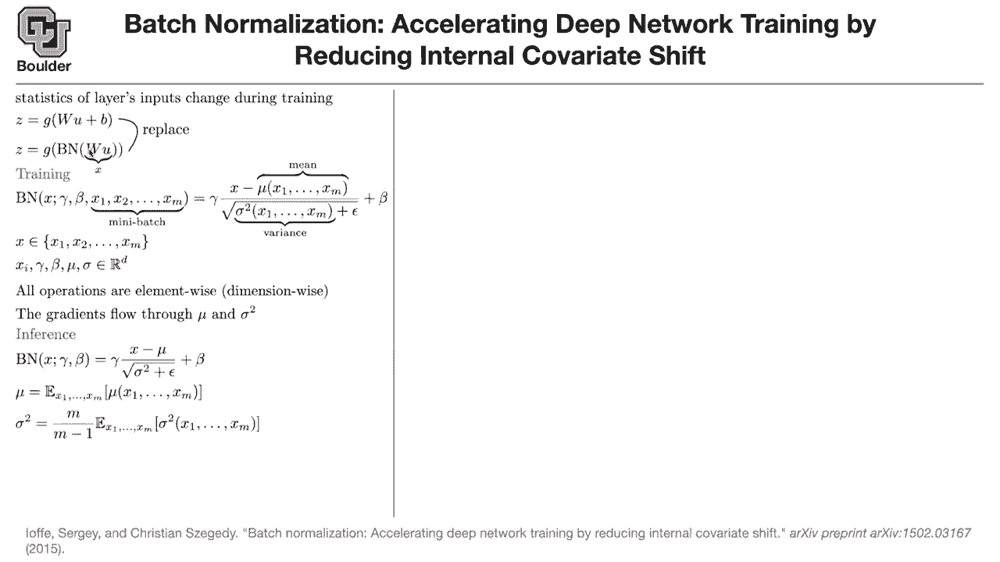
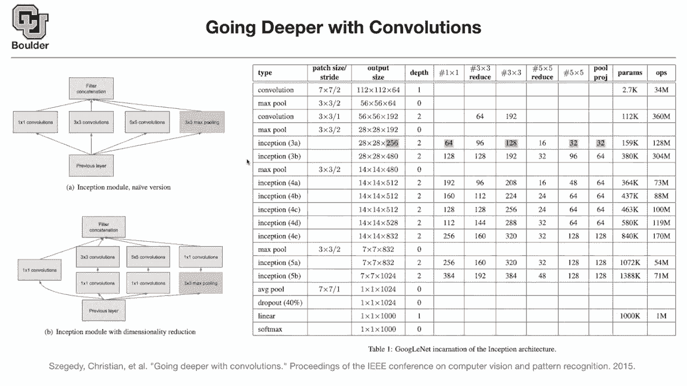

# 📚 课程 P11：L5.2 - 批标准化 (Batch Normalization)

在本节课中，我们将学习一种名为“批标准化”的技术。它的核心思想是减少神经网络训练过程中的“内部协变量偏移”，从而稳定和加速训练过程。

## 🔍 什么是内部协变量偏移？

上一节我们介绍了批标准化的目标，本节中我们来看看什么是“内部协变量偏移”。

通常，在进行任何形式的回归或分类任务时，即使是浅层网络或经典机器学习，你都需要对输入数据进行标准化。这意味着你需要减去数据的均值并除以标准差。如果不这样做，不同特征的量纲和单位会差异巨大，有些特征值会非常小，有些则会非常大，这会混淆训练过程。

对于输入图像，你可以也确实应该这样做。但问题是，当你将数据通过多层网络时，每一层的输入在训练过程中是变化的。输入数据的统计特性是固定的，但第二层的输入（即第一层的输出）的统计特性，却取决于第一层的参数。因此，中间层张量的均值和方差会随着参数的变化而变化，这就是所谓的“内部协变量偏移”。

为了更直观地理解这个问题，可以尝试一个简单的线性回归实验。

以下是理解该问题的建议步骤：
1.  创建一个具有三个维度的简单数据集。
2.  让第一个维度的范围非常小（例如 -ε 到 ε）。
3.  让第二个维度的范围非常大（例如负无穷到正无穷）。
4.  让第三个维度的范围适中（例如 -10 到 10）。
5.  尝试在这个数据集上进行回归，观察会发生什么。

你会发现，如果不进行标准化，训练过程会遇到条件数问题，导致收敛困难。即使只是将某个变量的均值进行偏移（例如加上一个很大的数），也会导致同样的问题。

## 🛠️ 批标准化的解决方案

理解了问题所在后，我们来看看批标准化如何解决它。批标准化可以应用于卷积层、全连接层甚至循环神经网络。

一个带有批标准化的层结构如下：
```
输入 x -> 线性变换 (Wx) -> 批标准化 (BatchNorm) -> 非线性激活 -> 输出
```
在批标准化中，我们通常忽略偏置项，因为批标准化本身会引入新的参数来扮演类似角色。

与 Dropout 类似，批标准化在训练阶段和测试阶段的行为是不同的。

### 训练阶段

在训练时，我们通常使用小批量数据。假设小批量的大小为 `m`，这是从数据中抽取的一个子样本。

批标准化的计算过程如下：
1.  对于小批量中的每个数据 `x_i`，计算整个小批量的均值 `μ` 和方差 `σ^2`。
2.  对每个 `x_i` 进行标准化：`(x_i - μ) / sqrt(σ^2 + ε)`。其中 `ε` 是一个非常小的数（如 `10^-8`），用于数值稳定性。
3.  引入两个可学习的参数 `γ`（缩放）和 `β`（偏移），得到最终输出：`y_i = γ * [(x_i - μ) / sqrt(σ^2 + ε)] + β`。

这里所有的操作都是逐元素进行的。`μ` 和 `σ` 是向量，`x_i` 也是向量，它们之间的减法和除法都是逐元素操作。

**核心公式**：
`y_i = γ * ( (x_i - μ_B) / sqrt(σ_B^2 + ε) ) + β`
其中 `μ_B` 和 `σ_B^2` 是当前小批量数据的均值和方差。



`γ` 和 `β` 不是超参数，而是**可学习的参数**，它们会像权重 `W` 一样，通过梯度下降进行更新。

在训练时，梯度会流经均值 `μ` 和方差 `σ` 的计算过程。这意味着算法会考虑到标准化操作对梯度的影响，这是非常重要的细节。



### 推理阶段

在推理时，我们不希望输出是随机的（因为小批量是随机的），我们需要确定性的输出。

因此，在推理阶段：
1.  我们不再使用当前批次的 `μ` 和 `σ`。
2.  取而代之的是，我们使用在**训练过程中计算并维护的“运行平均值”**。这个运行平均值是所有训练批次均值和方差的指数移动平均。
3.  将训练最终得到的固定 `μ_run` 和 `σ_run` 代入公式：`y = γ * ( (x - μ_run) / sqrt(σ_run^2 + ε) ) + β`。

这样，在推理时，网络就变成了确定性的。`γ`、`β`、`μ_run`、`σ_run` 以及网络的其他权重都是固定的。

## 💡 关键点与常见问题

以下是关于批标准化的一些关键澄清点：
*   **`γ` 和 `β` 的作用**：它们用于恢复网络可能丢失的表达能力。标准化将数据强制转换为均值为0、方差为1的分布，`γ` 和 `β` 允许网络学习最适合当前层的最优缩放和偏移。
*   **并行计算的重要性**：批标准化在训练时依赖于小批量统计量。这意味着 `x1` 的标准化结果依赖于同一批次中的 `x2, x3, ... xm`。这种操作天然适合在 GPU 上并行计算，这也是 GPU 在深度学习训练中如此重要的原因之一。
*   **参数区分**：`γ` 和 `β` 是可训练参数，通过梯度下降学习。而用于推理的 `μ_run` 和 `σ_run` 是统计量，不是通过梯度下降学习的，它们只是训练过程中均值和方差的移动平均。
*   **逐层应用**：批标准化通常应用于每一个隐藏层（线性变换或卷积之后，非线性激活之前）。

## 📝 总结


本节课中我们一起学习了批标准化技术。我们首先了解了“内部协变量偏移”的概念，即神经网络中间层输入的分布会随着网络参数更新而发生变化，这给训练带来了不稳定性。接着，我们深入探讨了批标准化的解决方案：在训练时，它利用小批量数据的均值和方差对层输入进行标准化，并引入可学习的参数 `γ` 和 `β`；在推理时，则使用训练阶段估算的全局统计量，使网络输出确定化。批标准化能有效加速训练、提升模型稳定性，并具有一定的正则化效果，是现代深度神经网络中不可或缺的组件之一。