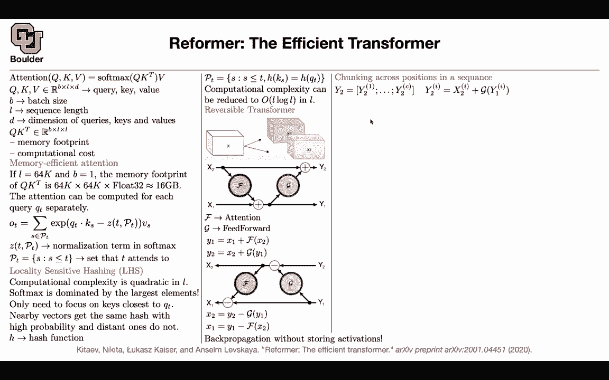
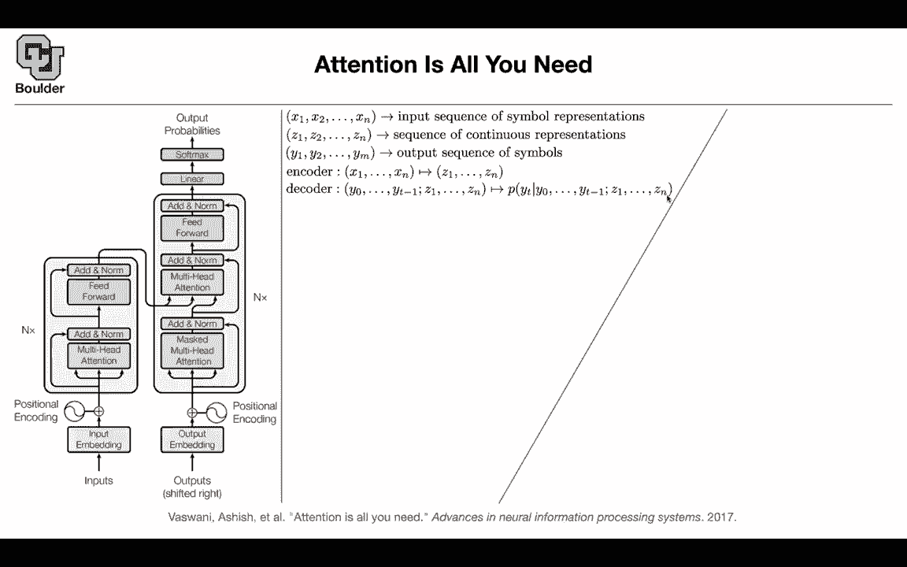

# 🧠 P118：L56.2 - Reformer 模型高效化教程

在本节课中，我们将学习如何使Transformer模型（特别是其解码器部分）在计算和内存使用上更加高效。我们将探讨注意力机制的成本问题，并介绍Reformer论文中提出的几种关键技术，包括分块处理、可逆层和局部敏感哈希。

---

## 🤔 注意力机制并非免费午餐

有一种错误的观点认为注意力机制能解决所有问题。这是一个错误的观点。注意力模型本身很好，它的归纳偏置很少，非常适合像语言建模这样的大数据任务。但它也有自己的缺点。有人能猜到是什么吗？天下没有免费的午餐。它需要海量的数据，而对于语言建模任务来说，我们确实有大量数据，所以数据方面或许不是问题。

这类模型所需的数据类型是无标签的。暂时忘掉翻译任务，如果你在做语言建模，你使用的是无标签数据，并且数据量很大。天下没有免费的午餐，这些模型并不廉价。注意力机制的成本很高，无论是在内存还是计算方面。有一系列文献致力于提高Transformer模型的效率。我们刚刚看到的模型就叫Transformer。我们只取解码器部分进行研究，因为语言建模任务可以使用Transformer的编码器或解码器部分，我们会看到两者都被使用。但在这篇论文中，我们以解码器为例，尝试让它更高效。有一系列文献都在研究如何让Transformer更高效。

---

## 💻 注意力机制的计算与内存成本

我不要求你理解这篇论文的每一个细节，我会快速过一遍。核心思想是：注意力机制并非没有代价。我之前用展开项的方式解释是为了更直观，有助于我们更好地理解。但在计算机上，实际的操作是这样的：Q（查询）是你将整个句子放入一个大矩阵，乘以一个权重矩阵得到的。K（键）是句子乘以另一个矩阵得到的。V（值）也是如此。这就是你在代码中的实现方式：`Q` 乘以 `K` 的转置，经过softmax得到注意力权重，然后将注意力权重分配到 `V` 上。

让我们看看 `Q`、`K`、`V` 的尺寸。为了更高效地使用GPU或TPU，我们需要并行处理，因此会进行批处理。每个序列有一个长度 `L`，每个矩阵有嵌入维度 `D`。所以这些张量的尺寸都是 `B x L x D`，其中 `B` 是批大小，`L` 是序列长度，`D` 是查询、键或值的维度。

看看 `Q` 乘以 `K` 的操作：求和是在维度 `D` 上进行的，所以这部分的计算成本是 `O(D)`，这个成本不高。但运算结果会是一个 `B x L x L` 维的矩阵。然后你需要做softmax。对于softmax，你需要关注句子中的每一个其他词，这涉及到对 `L` 的循环操作，计算成本是 `L` 的平方级（`O(L²)`）。因此，计算成本随序列长度呈二次方增长。序列越长，需要的操作就越多。此外，这个中间矩阵会占用大量内存，首先你需要存储它，其次它的计算成本也很高。这篇论文就是要告诉我们如何让它更高效，而且这不是唯一的方法。

---

## 🧮 一个具体的成本例子

假设序列长度 `L` 是64K（64000），对于语言建模来说，这是一个合理的句子长度。即使批大小 `B` 为1，计算和存储 `Q` 乘以 `K` 转置所需的内存占用将是 `64K x 64K`。每个元素是一个32位浮点数，加起来将达到16GB。如今一台非常好的GPU大约有48GB内存，这意味着你或许只能处理很小的批次（比如批次大小为4），而且这还仅仅是这一个操作。因此，这个矩阵在大多数GPU上甚至是最好的GPU上都难以容纳。

---

## 💡 策略一：更高效的内存使用——逐元素计算

如何让它内存效率更高？不要一次性计算整个矩阵，而是一次计算一个元素。这正是我们之前讨论过的做法。只需计算softmax和与 `V` 的乘法，并将其展开，一次处理一个元素。

具体操作是：对于查询 `Q_i`，计算它与所有键 `K_s` 的点积。有一个指数运算，然后除以一个归一化项（即一堆指数项的和）。所有这些项可以放在 `Z` 里。问题是，你的概率 `P_t` 是什么？如果你在做解码器部分，你不被允许关注未来的信息。所以你的 `P_t` 是所有时间步 `s` 小于当前时间步 `t` 的项。这些项会进入 `Z` 的计算，用于softmax和输出的求和。这就是你的注意力机制。所以，不要计算并存储整个大矩阵，一次只算一个元素。这会更加节省内存。

---

## 🎯 策略二：降低计算复杂度——局部敏感哈希

我们知道，计算这个矩阵并将其与 `V` 相乘的计算复杂度是 `L` 的二次方（`O(L²)`）。有一种方法可以将其成本降低到 `L log L`（`O(L log L)`）。关键的观察点是什么？Softmax由其最大的元素主导。你的查询和键越相似，对应的值就越大，softmax权重也就越大。这意味着你只需要关注与你的查询最接近的那些键。

因此，在计算 `Z` 时，你只需要关注最接近 `Z` 的那些键。但如何编码这个“接近”的概念呢？这就需要哈希机制。你的哈希机制会说：如果向量彼此接近，就给它们相同的哈希值；否则给不同的哈希值。你有一个哈希函数。

现在你要做的是：改变你的概率集合 `P_t`。`P_t` 仍然是所有小于 `t` 的时间步 `s`。你仍然不被允许关注未来。但然后你查看哈希函数，如果两个向量根据你的哈希函数是接近的，它们就是你的 `P` 的一部分。这样，你就可以将计算复杂度从 `L` 的二次方降低到 `L log L` 的量级。这里我省略了很多细节，但这没关系。这只是为了向你介绍，注意力机制并非没有代价。

---

## 🔄 策略三：可逆层与无需存储激活值的反向传播

即使在反向传播时你也会遇到麻烦。进行反向传播时，你需要知道前向传播的变量来计算反向导数。技巧在于：你将输入 `x` 分成 `x1` 和 `x2` 两部分，分别处理它们。你在这里有注意力机制，在这里有前馈网络。`y1` 将是 `f(x2) + x1`，`y2` 将是 `x2 + g(y1)`。

为什么这样做？因为当进行反向传播时，你不需要存储前向传播的变量，你可以直接计算它们。你可以计算 `x2`：`x2 = y2 - g(y1)`。然后计算 `x1`：`x1 = y1 - f(x2)`。因此，如果你将向量分成两个部分并分别处理，你就不需要存储任何前向操作的结果，可以在反向传播需要时直接计算它们。这被称为“无需存储激活值的反向传播”。

---

## 📦 策略四：跨位置分块处理序列

如果你有一个很长的序列，不要一次性处理它，而是分块处理。你有一个长序列，然后将其分成 `C` 个块，独立处理这些块。在某些时候，这些块之间会进行通信。论文中有一张很好的图，如果你想看可以查阅。

---

## 📊 性能评估：我们损失了什么吗？

如果我们使用常规的前向传播与使用可逆层的方法相比会怎样？可逆层比常规方法更高效，但在性能上，你得到了相同的表现，没有损失太多。

还有另一个想法：你可以共享用于从序列获取查询和键的相同权重。基本上，你的查询和键将处于相同的空间。如果你这样做，你将节省一些参数，但同样不会损失太多性能。

另外，还需要研究哈希的效果以及你需要有多少个哈希桶。这是这里的哈希函数 `H`，你需要决定使用多少个桶。你不会损失太多信息，大多数设置都表现良好，除了使用两个哈希桶的情况，那可能太少了。

这里的纵轴是什么？是困惑度。我不希望你们害怕困惑度这个概念，我们以后在语言建模中会需要它。对于语言模型，你有一个序列，我们知道你会有一个概率。如果你取对数，事情会变得更清晰。取对数后，你会得到 `1/N * (-log(你的概率))` 的平均值。这可以看作是几何平均，或者在对数空间下的算术平均，这就给出了困惑度度量。困惑度与序列的概率直接相关，这就是这里的纵轴。

---

## 🎓 总结

本节课我们一起学习了如何使Transformer解码器更高效。我们探讨了注意力机制在计算和内存上的二次方成本问题，并介绍了Reformer论文中提出的四种核心优化策略：
1.  **逐元素计算**以避免存储巨大的注意力矩阵。
2.  **局部敏感哈希**将计算复杂度从 `O(L²)` 降低到 `O(L log L)`。
3.  **可逆层**使得在反向传播时无需存储中间激活值，节省大量内存。
4.  **序列分块处理**以处理超长序列。

这些技术使得Transformer模型能够处理更长的序列，并在有限的硬件资源下高效运行，同时保持了模型的性能。理解这些优化策略对于在实际应用中部署和缩放大型语言模型至关重要。