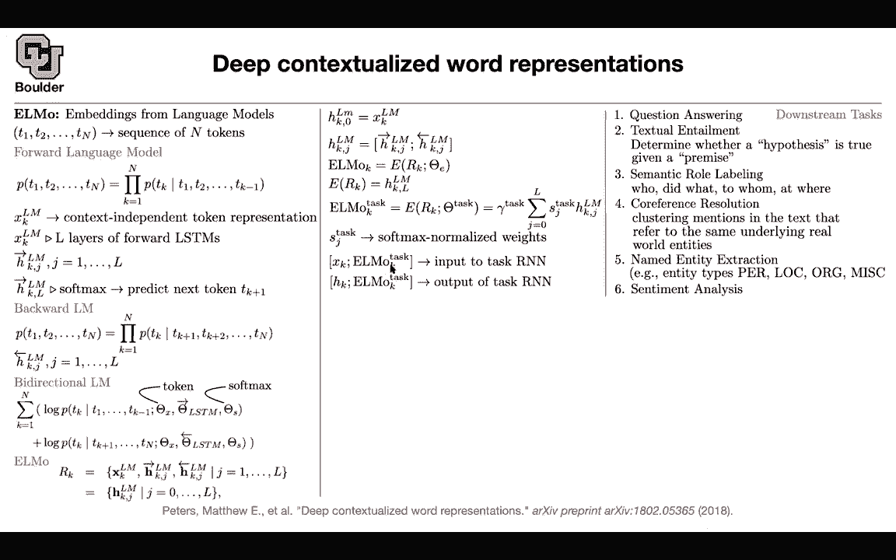

# 课程 P119：L57.1 - ELMo 🧠

## 概述

在本节课中，我们将要学习一种名为 **ELMo** 的模型。ELMo 的全称是 **Embeddings from Language Models**，即“来自语言模型的词嵌入”。我们将探讨为什么需要这种模型，它是如何工作的，以及它如何帮助我们完成各种自然语言处理任务。

---

## 为什么需要语言模型？

上一节我们介绍了课程主题，本节中我们来看看为什么我们会对语言模型感兴趣。

我们并非为了语言建模本身而对语言模型感兴趣。语言建模的任务是，给定一个词，预测下一个词。这个任务本身并不有趣。我们之所以研究它，是因为它可以帮助我们进行**预训练**。

互联网上有大量未标注的数据。我们可以从这些数据中学习，然后进行**迁移学习**，应用到分类、情感分析或翻译等目标任务中。因此，我们感兴趣的是语言模型在迁移学习中的作用。

我们之前已经见过迁移学习的例子。在做词嵌入时，我们为分类或翻译任务的神经网络第一层使用了预训练的词向量。自然语言处理领域如今已被迁移学习主导。这篇论文将在词表示的基础上进行扩展。

---

## 从单一词义到上下文相关词义

我们之前看到的词表示方法，为字典中的每个词分配一个固定的向量。这意味着每个词只有一个含义。但我们知道，词的含义会根据上下文而变化。

例如，“bank”这个词可以有两种不同的含义：
*   当谈论“river bank”（河岸）时，它有一种含义。
*   当谈论“money bank”（银行）时，它有另一种含义。

如果只为字典中的每个词分配一个向量，就只能关联一种含义。这篇论文的核心思想是：**让词根据上下文拥有多种含义**。

---

## ELMo 模型：双向语言模型

那么，如何实现上下文相关的词义呢？模型被称为 **ELMo**。我们的数据是一个大小为 N 的语料库，词按顺序排列。

### 前向语言模型

我们可以构建一个**前向语言模型**。它通过概率的链式法则来计算一个句子出现的概率，将联合分布分解为一系列条件分布。

公式表示为：
`P(T1, T2, ..., TN) = ∏ P(Tk | T1, T2, ..., Tk-1)`

对于每个词 `Tk`，我们有一个上下文无关的词表示向量 `x_k`。在训练时，我们虽然会看上下文，但每个词仍然只有一个固定的向量表示，无法处理像“bank”这样的多义词。

在模型中，我们将向量 `x_k` 以及其他向量输入到多层 LSTM 中。序列输入，序列输出。我们记录每一层 LSTM 的输出，而不仅仅是最后一层。最后一层的隐藏状态会通过一个 softmax 层，用于预测下一个词。这就是我们建模概率的方式。

### 双向语言模型

同样，我们可以构建一个**后向语言模型**，根据未来的词来预测当前的词。其联合分布公式为：
`P(T1, T2, ..., TN) = ∏ P(Tk | Tk+1, Tk+2, ..., TN)`

我们可以用堆叠的后向 LSTM 来建模这个概率。

### 训练双向语言模型

如何训练这些 LSTM 的权重以及上下文无关的词表示呢？我们将前向和后向语言模型的对数似然目标函数相加，给予两者相等的权重。

公式表示为：
`∑ [ log P(Tk | T1, ..., Tk-1; Θ) + log P(Tk | Tk+1, ..., TN; Θ) ]`

这里的参数 `Θ` 包括：
*   **Θ_x**：上下文无关的词向量参数。
*   **Θ_s**：前向和后向 LSTM 的参数。
*   **Θ_softmax**：用于预测下一个词的 softmax 层参数。

我们通过最大化这个对数似然函数来优化所有参数。这个过程称为**预训练**。可以看到，我们不需要数据的标签，这是一个无监督学习过程。

---

## 从多层表示到 ELMo 向量

预训练完成后，我们会得到每一层 LSTM 的隐藏状态输出，而不仅仅是最后一层。对于每个词 `Tk`，我们得到一个表示集合：

`R_k = { x_k, h_forward_k,j, h_backward_k,j | j=1,...,L }`

这里，`h_forward_k,j` 和 `h_backward_k,j` 分别是前向和后向第 `j` 层 LSTM 对于词 `Tk` 的输出。为了简化，我们可以将初始词向量 `x_k` 记为第 0 层的输出 `h_k,0`。

但我们需要的是一个向量，而不是一个集合。因此，ELMo 将这个词的所有层表示压缩成一个任务特定的向量。

以下是 ELMo 表示的一般公式：

`ELMo_k^task = E(R_k; Θ^task)`

一个具体的实现例子是，对所有层的表示进行加权求和：

`ELMo_k^task = γ^task * ∑ s_j^task * h_k,j`

其中：
*   `h_k,j = [h_forward_k,j; h_backward_k,j]` 是前后向表示的拼接。
*   `s_j^task` 是 softmax 归一化的权重，总和为 1，表示模型对不同层的关注度。
*   `γ^task` 是一个可学习的缩放参数，允许模型调整 ELMo 向量的整体大小。

这些参数 `s^task` 和 `γ^task` 是任务相关的，需要在**下游任务**的优化过程中学习。

---

## 在下游任务中使用 ELMo

现在，我们来看看如何将 ELMo 表示应用到具体的自然语言处理任务中。

假设我们有一个情感分类任务。一个句子输入，需要判断是正面还是负面评价。之前，我们只使用上下文无关的词向量 `x_k` 作为循环神经网络（RNN）的输入。

现在，我们可以将 ELMo 向量结合进来。有两种主要方式：
1.  **作为输入**：将 ELMo 向量 `ELMo_k^task` 与原始词向量 `x_k` 拼接，然后一起输入任务 RNN。
2.  **作为输出增强**：让句子先通过任务 RNN，得到隐藏状态 `h_k`，然后在将其送入分类 softmax 层之前，将 `ELMo_k^task` 向量与 `h_k` 拼接。

我们可以灵活选择如何使用这些表示。下游任务有自己的损失函数和网络参数。在优化下游任务时，我们不仅可以优化任务 RNN 的参数，还可以优化 ELMo 组合中的权重参数 `s^task` 和 `γ^task`。这意味着 ELMo 表示可以在下游任务中进行**微调**。

---

## 下游任务与性能提升

ELMo 可以应用于多种自然语言处理任务。以下是几个例子及其对应的数据集：

*   **问答**：斯坦福问答数据集
*   **文本蕴含**：斯坦福自然语言推理数据集
*   **语义角色标注**
*   **共指消解**
*   **命名实体识别**
*   **情感分析**：斯坦福情感树库

评估指标通常使用 **F1分数**（精确率和召回率的加权平均）。这些任务通常已有高度优化的基线系统。

实验表明，在基线系统（例如，一个没有经过预训练的、仅用于分类的RNN）中加入 ELMo 表示后，所有任务的性能得分都得到了显著提升。这些提升的百分比幅度很大，证明了上下文相关词表示的有效性。

---

## ELMo 与 GloVe 等传统词向量的区别

为了理解 ELMo 与传统方法（如 GloVe）的区别，让我们以单词“play”为例。

**传统方法**：为“play”分配一个固定的向量。通过计算向量间的距离，找到“play”的最近邻词可能是“playing”、“game”、“games”、“player”等。这些词都传达了相似的含义，但无法区分“play”在不同上下文中的细微差别。

**ELMo方法**：考虑“play”出现的具体句子上下文。
*   在句子“The batter stepped up to the play.”中，“play”可能与棒球相关。
*   在句子“The actors put on a great play.”中，“play”则指戏剧演出。

ELMo 会为这两个句子中的“play”生成不同的向量表示。如果我们计算这些上下文相关向量的最近邻，我们会发现第一个“play”的向量更接近其他关于体育的句子，而第二个“play”的向量更接近其他关于戏剧的句子。这样，ELMo 就成功地为同一个词在不同语境下赋予了不同的含义。

---

## 总结

本节课中我们一起学习了 **ELMo** 模型。

我们首先回顾了语言模型在迁移学习中的重要性。然后，我们指出了传统词嵌入方法（每个词一个向量）的局限性，即无法处理一词多义。

ELMo 的核心思想是通过训练一个**双向语言模型**，来获取上下文相关的词表示。它利用多层 LSTM 捕获不同层次的语法和语义信息，并将这些信息通过一个可学习的加权机制组合起来，形成最终的词向量。

最后，我们探讨了如何将 ELMo 向量应用到下游任务中（如情感分析、问答等），并看到了它相比传统方法带来的显著性能提升。ELMo 的关键突破在于，它使同一个词在不同的句子中可以拥有不同的向量表示，从而更好地建模自然语言的复杂性。