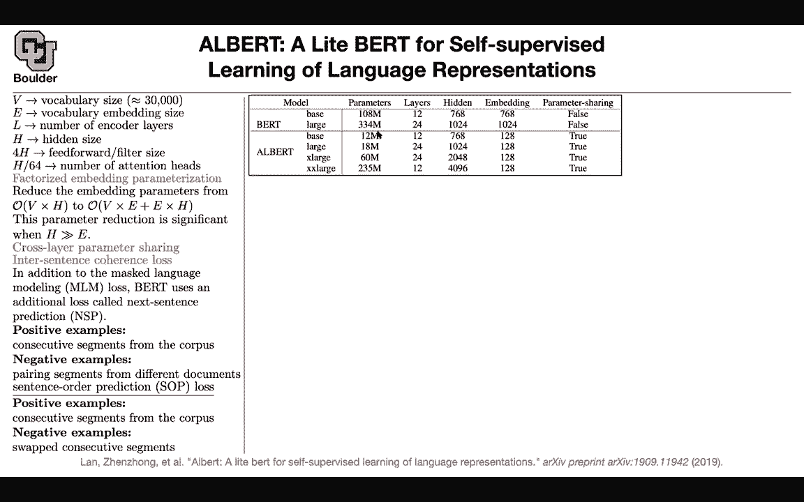
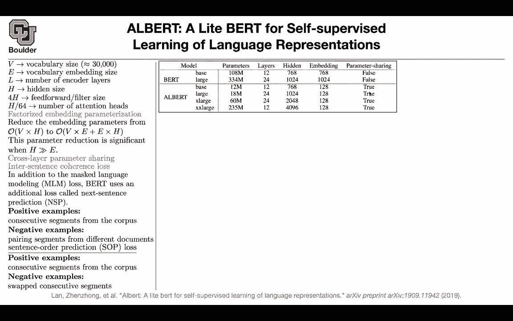
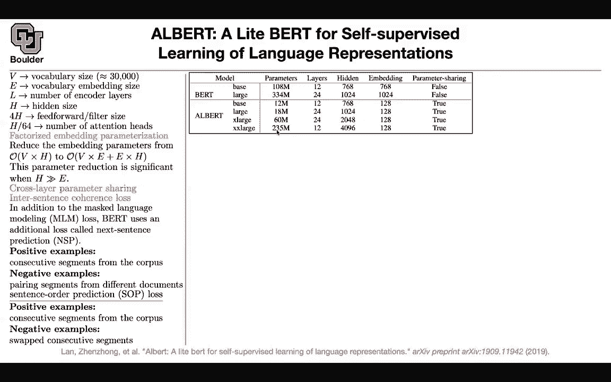
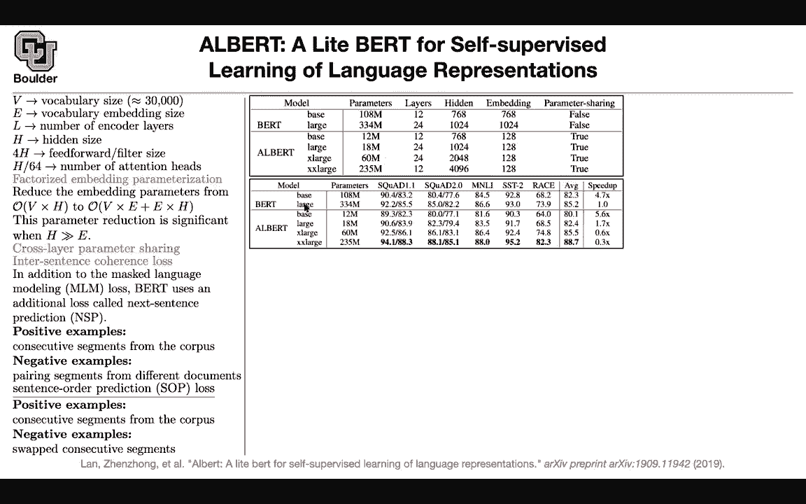
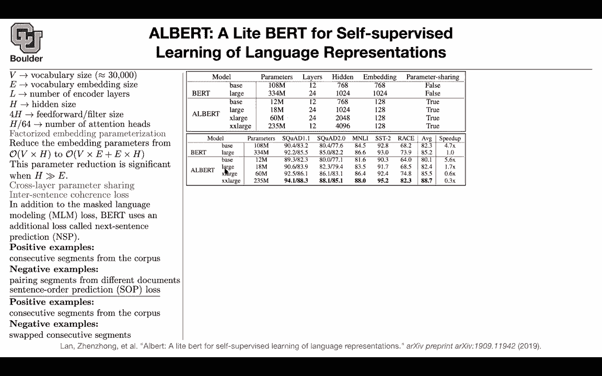
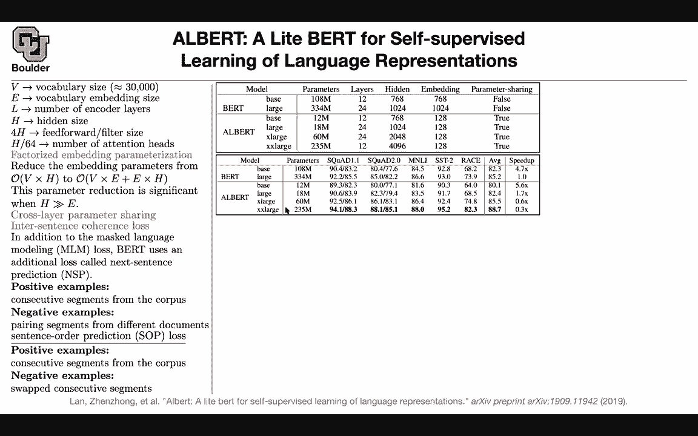
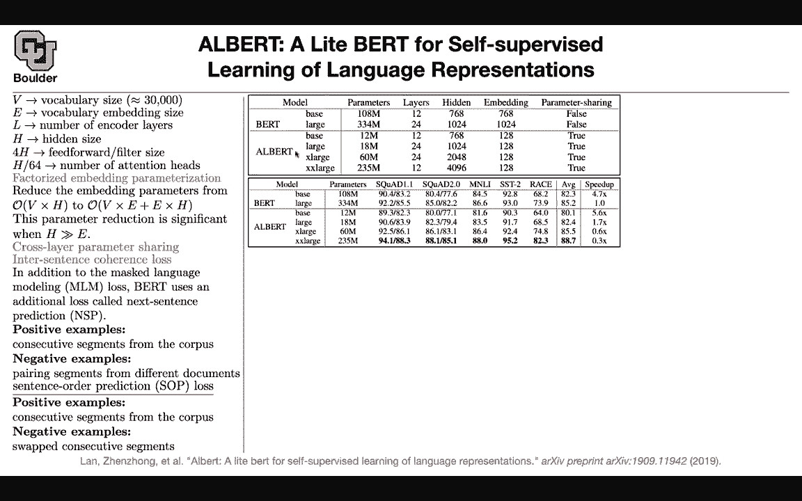
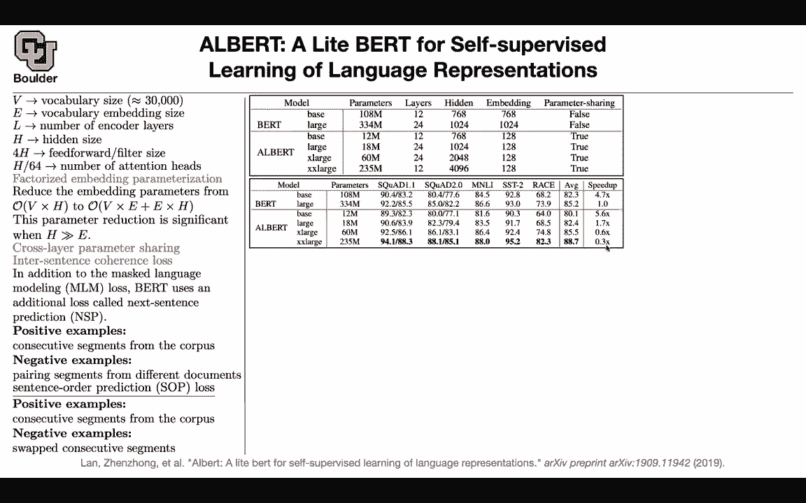

# P123：L58.3 - ALBERT 模型详解 🧠

在本节课中，我们将深入探讨如何对BERT模型进行剖析与优化，从而引出ALBERT模型。我们将学习ALBERT通过哪些关键技术来减少模型参数量、提升训练效率，并最终在保持甚至提升性能的同时，实现模型轻量化。

## 1. 剖析BERT模型参数构成

上一节我们介绍了BERT模型的基本架构。本节中，我们来看看BERT模型的主要参数来源，以便理解后续的优化方向。

BERT模型的核心参数主要分布在以下几个部分：
*   **词汇表嵌入层**：词汇表大小 `V`（通常约30k）乘以嵌入维度 `H`。
*   **编码器堆叠层**：模型深度 `L`（编码器层数），每层包含自注意力机制和前馈神经网络。
*   **前馈神经网络**：其隐藏层大小通常是 `H` 的4倍，即 `4 * H`。
*   **多头注意力**：头数通常为 `H / 64`。

## 2. ALBERT的核心优化策略：分解嵌入参数

为了提升BERT的效率，ALBERT提出了第一个核心优化：**分解嵌入参数**。

在原始BERT中，嵌入层直接将词汇表映射到隐藏维度 `H`，参数量为 `V * H`。ALBERT引入一个更小的嵌入维度 `E`，先将词汇表映射到 `E`，再通过一个线性层将 `E` 投影到 `H`。

**公式表示如下：**
`原始BERT嵌入：Embedding = V * H`
`ALBERT嵌入：Embedding = V * E + E * H`

当 `H` 远大于 `E` 时，这种分解能显著减少参数量。例如，当 `V=30000`, `H=768`, `E=128` 时：
*   BERT参数量：`30000 * 768 = 23,040,000`
*   ALBERT参数量：`30000 * 128 + 128 * 768 = 3,840,000 + 98,304 ≈ 3,938,304`
参数量减少了约80%。

## 3. 跨层参数共享

上一节我们通过分解嵌入减少了部分参数。本节中，我们来看看ALBERT另一个大幅减少参数的策略：**跨层参数共享**。

在原始BERT中，`L` 层Transformer编码器的参数是独立的。ALBERT提出在所有编码器层之间共享参数，这意味着所有层使用相同的权重矩阵。

以下是参数共享的几种方式研究：
*   **全部共享**：共享所有参数（自注意力 + 前馈网络）。
*   **仅共享注意力参数**：只共享自注意力模块的参数。
*   **仅共享前馈网络参数**：只共享前馈神经网络的参数。
*   **不共享**：作为基线对照。

研究表明，**共享前馈网络参数对减少总参数量贡献最大**，因为前馈网络（`4 * H` 维度）本身参数量庞大。

## 4. 句子顺序预测任务

除了结构优化，ALBERT还改进了BERT的预训练任务，用**句子顺序预测** 替代了**下一句预测**。

在BERT中，下一句预测任务的正例是文档中连续的两个句子，负例是随机抽取的两个不相关句子。ALBERT认为这个任务过于简单。句子顺序预测任务则设计如下：
*   **正例**：文档中连续的两个句子（顺序正确）。
*   **负例**：同样的两个句子，但顺序被调换。

SOP任务迫使模型学习更细微的句子间连贯性和逻辑关系，是一个更困难的任务，从而能学习到更好的句子间表示，提升在下游任务（如自然语言推理）上的性能。

## 5. 优化效果与模型规模对比

综合运用以上策略后，ALBERT在参数量和模型规模上产生了显著变化。

以下是BERT与ALBERT的模型规模对比示例（数值为示意）：
*   **BERT-Base**: 参数约1.1亿
*   **ALBERT-Base**: 参数约1200万（大幅减少）
*   **ALBERT-Large**: 参数约1800万
*   **ALBERT-xLarge**: 参数约6000万（通过增大`H`实现，但仍小于BERT-Large）
*   **ALBERT-xxLarge**: 参数约2.35亿

由于参数大幅减少，我们可以在有限的GPU内存下构建更深（`L`更大）或隐藏维度更宽（`H`更大）的模型。虽然ALBERT-Base/Large的性能可能略低于同级别BERT，但**ALBERT-xxLarge**模型凭借更大的容量，最终在多项NLP基准测试上超越了BERT-Large，达到了当时的先进水平。

## 6. 其他重要研究发现

一篇优秀的论文会进行系统性的消融研究，ALBERT也不例外。除了上述核心改进，论文还揭示了以下重要发现：

以下是论文中进行的部分系统性研究及其结论：
*   **嵌入维度 `E` 的影响**：增大 `E` 能提升性能，但会增加参数。在参数共享的背景下，适度增大 `E` 是性价比很高的选择。
*   **Dropout的影响**：ALBERT研究发现，**移除Dropout** 反而能提升模型性能。这可能是因为层归一化已经提供了足够的正则化效果，额外的Dropout在预训练数据充足时反而有害。这是首批在自然语言模型中发现此现象的论文之一。
*   **使用更多数据**：与预期一致，使用更多预训练数据能持续提升模型性能。

## 总结

本节课中我们一起学习了ALBERT模型。ALBERT通过对BERT模型的深入剖析，提出了三项核心改进：
1.  **分解嵌入参数**：将大的词汇表嵌入矩阵分解为两个小矩阵的乘积，大幅减少嵌入层参数量。
2.  **跨层参数共享**：所有Transformer编码层共享参数，极大地减少了模型总参数量。
3.  **句子顺序预测**：用更困难的句子间关系预测任务替代下一句预测，提升了模型对句子连贯性的理解能力。

通过这些优化，ALBERT实现了模型的**轻量化**和**高效化**。虽然基础版本性能略有牺牲，但节省出的参数空间允许我们构建更大的模型（如xxLarge），最终在性能与效率的权衡中取得了突破，超越了BERT并刷新了多项基准记录。同时，其系统的消融研究也为后续模型设计提供了宝贵的经验。