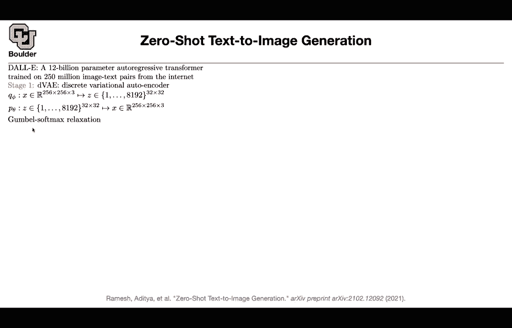
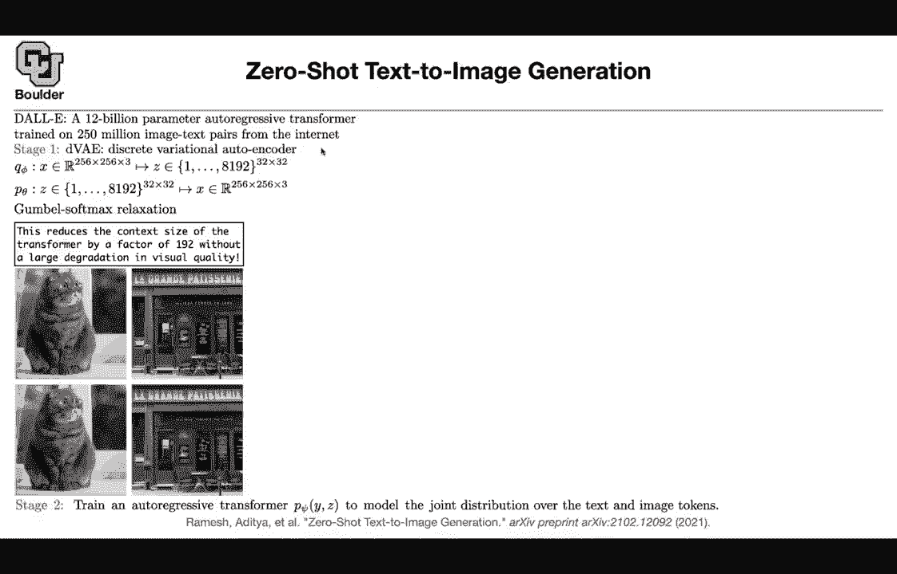
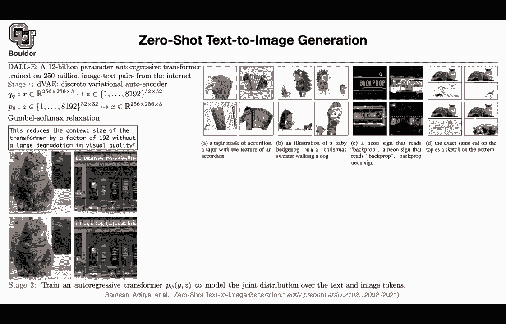
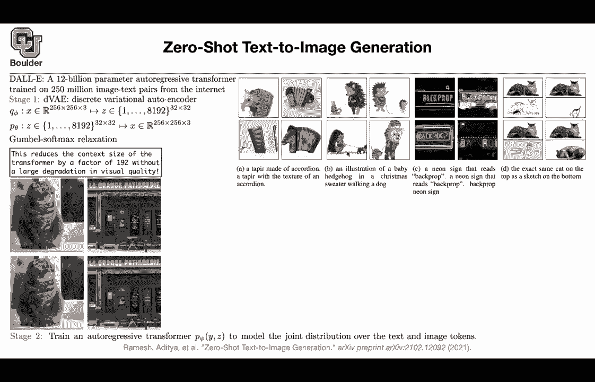
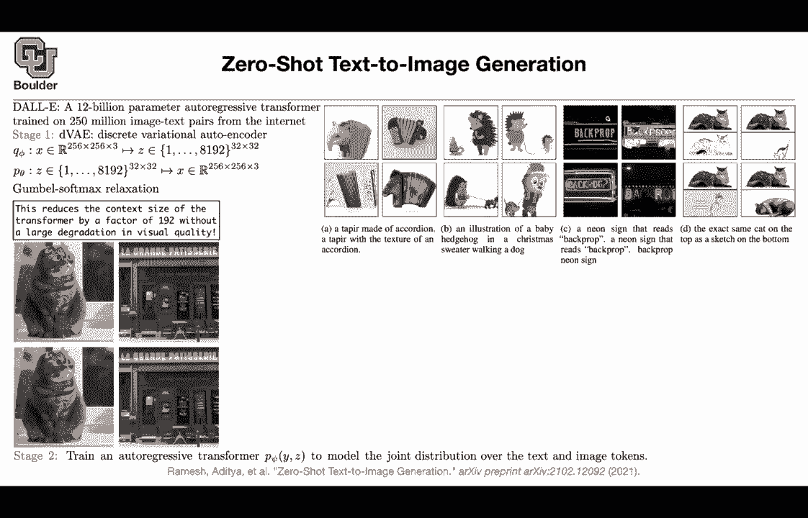

# 课程 P134：L63.4 - DALL-E 🖼️

在本节课中，我们将学习 OpenAI 近期发布的 DALL-E 模型。这是一个零样本文本到图像生成模型，本质上是 GPT-3 的扩展。我们将探讨其核心思想、工作原理以及它如何将图像处理为类似文本的序列。

---

## 模型背景与核心思想

上一节我们介绍了 GPT-3 等大型语言模型。GPT-3 的一个局限是，它仅从文本中学习概念，从未“见过”图像。例如，当它谈论“飞机”时，它并未见过飞机的图片。DALL-E 的提出，标志着技术前沿正朝着结合文本与图像理解的方向发展。

DALL-E 是一个拥有 **120 亿参数**的自回归 Transformer 模型。其方法本身并不复杂，关键在于如何处理图像数据。

**核心公式/概念：**
*   模型架构：**自回归 Transformer**
*   参数量：**12B (120亿)**

---

## 关键挑战：图像分词

对于文本，我们知道如何进行分词：通过词典将单词转换为整数序列。那么，如何对图像进行“分词”呢？如果能将图像转换为一串标记，问题就迎刃而解了。

我们的目标是将图像视为一个“句子”，将其转换为一组标记。之后，就可以使用 Transformer 的解码器部分来预测下一个标记，从而开始生成文本和图像。

以下是实现图像分词的关键步骤：

1.  **使用离散变分自编码器**：我们使用 DVAE 将图像转换为离散的整数序列。不必担心变分自编码器的细节，我们将在后续课程中详细讲解。“离散”部分是因为我们需要将图像转换为一堆整数。
2.  **编码过程**：编码器接收一张 `256x256x3` 的 RGB 图像，并将其转换为 `32x32` 个标记，每个标记来自一个大小为 8192 的词汇表。
3.  **降低上下文长度**：直接处理 `256x256x3` 的扁平化向量会产生极长的上下文，超出了 Transformer 的处理能力。将其转换为 `32x32` 的标记序列，极大地减小了上下文长度。
4.  **解码过程**：解码器（先验分布）将这些 `32x32` 的整数映射回图像空间。

**核心代码/公式描述：**
*   输入图像尺寸：`(256, 256, 3)`
*   输出标记尺寸：`(32, 32)`，每个标记是范围在 `[1, 8192]` 的整数
*   词汇表大小：`8192`
*   上下文长度减少倍数：`(256*256*3) / (32*32) ≈ 192` 倍

通过这个框架，我们可以重建图像。虽然会损失一些信息导致图像变模糊，但整体语义得以保留，图像看起来仍然是合理的。

---

## 训练与生成过程

现在，图像已经被分词为一个“句子”（即 `32x32` 的标记序列）。接下来，我们可以将图像与其对应的文本描述配对。

训练数据由文本序列 `X` 和图像标记序列 `Z` 拼接而成。模型的任务非常直接：**给定历史上下文，预测下一个标记**。这与 GPT-3 的训练方式完全一致。

**核心训练目标：**
`P(下一个标记 | 历史文本标记， 历史图像标记)`

模型训练完成后，就能进行条件生成。例如，给定文本描述“一个穿着圣诞毛衣的刺猬宝宝在遛狗”，模型就能生成对应的图像。

此外，模型还能进行图像到图像的转换。如果想生成更逼真的图像（而非想象图），可以基于一张真实图像的条件来生成。例如，基于“一只非常可爱的猫躺在一辆大自行车旁”的描述及其真实图像，模型可以生成高质量的新图像。

---

## 问答环节澄清

**问：** 每个图像都被转换成 `32x32` 个整数，每个整数在 1 到 8192 之间，这就是图像的“词汇量”，对吗？
**答：** 是的。每个图像都变成一个 `32x32` 的整数矩阵，整数范围是 1 到 8192。这就是图像的词汇表大小。

**问：** 为什么不直接使用每个像素的 RGB 值（0-255）作为标记？
**答：** 如果直接使用像素值，假设图像是 `256x256`，那么扁平化后将得到一个长度为 `256*256*3=196608` 的序列。这是一个巨大的上下文长度，Transformer 难以有效处理。因此，我们需要将上下文长度从 `196608` 减少到 `32*32=1024`。同时，我们允许标记的取值范围更大（1-8192），这为模型提供了更丰富的表示能力。DVAE 中的卷积操作帮助实现了这种压缩和抽象。

**问：** 图像怎么就成了一个“句子”？
**答：** 一个句子本质上是一个单词序列，即一个整数序列。将 `32x32` 的图像标记扁平化，就得到一个长度为 1024 的整数序列。这完全符合“序列”的定义，序列中的每个“单词”就是那些 1 到 8192 的整数。

**问：** 与 GPT-3 相比，DALL-E 的新颖之处是什么？
**答：** 最核心的新颖之处就在于**将图像转换为标记序列**。一旦完成这一步，图像就可以被当作句子来处理。任务就从“文本到图像生成”转变为了“文本到文本翻译”（因为图像也是文本序列）。当然，巨大的模型规模（120亿参数）和海量的训练数据（2.5亿图像-文本对）也是成功的关键。

---

## 总结

本节课我们一起学习了 DALL-E 模型。我们了解到，其核心创新在于通过**离散变分自编码器**将图像编码为离散的标记序列，从而将图像生成问题转化为序列预测问题。这使得强大的自回归 Transformer 架构能够同时处理文本和图像，实现令人惊叹的零样本文本到图像生成能力。关键在于**把图像当成句子看**，并利用海量数据和参数进行训练。