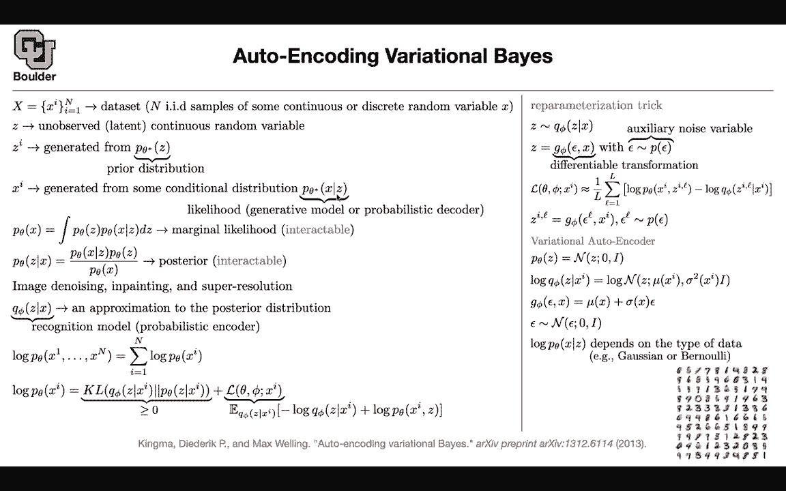

# 课程 P135：L64.1 - 变分自动编码器 🧠

## 概述

在本节课中，我们将学习**变分自动编码器**。这是一种强大的生成模型，能够学习数据的潜在分布，并用于生成新的、类似真实数据的样本。我们将从基本概念出发，逐步理解其工作原理、数学推导以及实际应用。

---

## 从文本到图像生成

上一节我们介绍了将文本翻译成图像的任务，这与之前将图像翻译成文本（图像描述）的任务相反。这是我们首次接触图像生成，并引入了几种关键技术。

我们使用的核心思路是，希望像处理文本一样，将图像也“分词化”。如果我们能做到这一点，就可以使用自回归Transformer来为我们生成图像。

因此，问题就归结为：**如何将图像转化为标记**。

我们提到将使用的方法是**变分自动编码器**，特别是**离散变分自动编码器**，因为我们希望潜在变量Z是离散的。

---

## 变分自动编码器的生成应用

今天，我们将继续探讨变分自动编码器。实际上，变分自动编码器本身就可以用于生成图像。一个应用是将图像分词化，另一个应用是直接作为生成模型来生成图像。

我们将继续专注于生成网络一段时间，并从变分自动编码器开始。

---

## 目标：生成逼真的图像

我们的目标是生成看起来像真实数据的图像。例如，下图是一些我们希望生成的“假”图像，它们需要看起来像真实的手写数字。

我们有一个数据集，但它是**无标签**的。因此，我们现在处于**无监督机器学习**的范畴。

我们有一堆数据，没有对应的标签。这些数据是从某个分布中独立同分布采样得到的。这个分布可能是连续的，也可能是离散的。世界上存在一个生成这些图像的真实分布，我们从中采样。我们的任务是**学习这个分布**，一旦学会，就可以生成看起来像真实数据的样本。

---

## 引入潜在变量

因为我们要使用神经网络，而神经网络需要输入。所以我们假设存在一个**未观测到的、连续的潜在随机变量Z**，这可以作为我们神经网络的输入。

我们不知道Z具体是什么，但假设我们可以从某个**先验分布**中生成Z的样本。先验分布是我们做出的假设，可以自由选择，例如正态分布或均匀分布。

然后，我们定义**似然函数**，这里将放入我们的神经网络。Z作为输入，X（例如一张数字图像）作为输出。这构成了我们的**条件分布**（似然），通常被称为**生成模型**或**解码器**，因为它将“代码”Z解码成图像。

我们最终关心的是**边际似然** `P_θ(x)`，即数据的真实分布。我们不关心Z本身，它只是辅助工具。我们需要对Z进行积分（边缘化）来得到边际似然，并尝试最大化它的对数。

---

## 面临的难题

问题是，如果似然函数 `P_θ(x|z)` 是一个神经网络，那么对这个先验分布进行积分来计算边际似然 `P_θ(x)` 是**难以处理的**。

同样，后验分布 `P_θ(z|x)` 也难以处理，因为它也依赖于这个难以计算的边际似然。

---

## 解决方案：变分推断

既然后验分布未知，我们就去**近似**它。我们尝试用一个分布 `Q_φ(z|x)` 来近似真实的后验 `P_θ(z|x)`。

这个 `Q_φ(z|x)` 以图像X为输入，输出一个编码后的分布。因此，它可以被视为一个**概率编码器**，拥有自己的参数φ，并且通常也由一个神经网络来近似。

于是，我们有了两个神经网络：一个**编码器** `Q_φ(z|x)`，一个**解码器** `P_θ(x|z)`。

---

## 推导证据下界

我们假设数据是独立同分布的，因此整个数据集的似然是每个样本似然的乘积。取对数后，乘积变为求和。现在，让我们专注于单个样本。

通过对边际似然的定义进行数学变换（具体推导留作练习，涉及乘以再除以 `Q_φ(z|x)` 并重新排列项），我们可以得到以下等式：

对于单个样本 `x_i`，其对数边际似然可以分解为：

`log P_θ(x_i) = D_KL[ Q_φ(z|x_i) || P_θ(z|x_i) ] + L(θ, φ; x_i)`

其中：
*   `D_KL[...]` 是 **KL散度**，衡量两个分布之间的距离，总是**非负**的。
*   `L(θ, φ; x_i)` 被称为**证据下界**。

由于KL散度非负，`L(θ, φ; x_i)` 是对数似然的一个**下界**。如果我们最大化这个下界，也就间接地最大化了对数似然。

因此，我们的优化问题从最大化难以处理的 `log P_θ(x_i)`，转变为最大化可处理的**证据下界ELBO**：`L(θ, φ; x_i)`。

---

## 重参数化技巧

为了通过蒙特卡洛方法估计ELBO中的期望，我们需要能够从变分分布 `Q_φ(z|x)` 中采样。但 `Q_φ(z|x)` 可能很复杂。

**重参数化技巧**解决了这个问题。其核心思想是：
1.  从一个简单的辅助分布（如标准正态分布）中采样一个噪声变量 `ε`。
2.  将这个噪声通过一个**可微的确定性变换** `g_φ(ε, x)`，得到来自 `Q_φ(z|x)` 的样本。

这样，采样过程就变得可微，允许我们进行反向传播。例如，如果假设 `Q_φ(z|x)` 是正态分布 `N(μ_φ(x), σ_φ²(x))`，那么我们可以定义：
`z = μ_φ(x) + σ_φ(x) ⊙ ε`，其中 `ε ~ N(0, I)`

---

## 变分自动编码器的具体形式

将上述通用框架具体化，并做出一些常见假设，就得到了标准的**变分自动编码器**。

以下是关键假设：

1.  **先验分布 `P(z)`**：通常假设为标准正态分布，即 `z ~ N(0, I)`。
2.  **变分分布（编码器） `Q_φ(z|x)`**：假设为对角协方差的正态分布，其均值和方差由神经网络输出：
    `Q_φ(z|x) = N(z; μ_φ(x), diag(σ_φ²(x)))`
    其中 `μ_φ(x)` 和 `σ_φ(x)` 是编码器神经网络。
3.  **似然函数（解码器） `P_θ(x|z)`**：取决于数据类型。
    *   对于**图像**（如MNIST），可以假设为高斯分布，其均值由解码器神经网络 `f_θ(z)` 输出，方差可以固定或学习。
    *   对于**文本**或离散数据，则需要假设为离散分布（如多项分布）。

---

## 训练与生成

有了这些假设，ELBO可以具体写出来，并通过重参数化技巧和蒙特卡洛采样进行估计和优化。

训练过程就是同时优化编码器参数φ和解码器参数θ，以最大化ELBO。

一旦模型训练完成，我们就可以进行**生成**：
1.  从先验分布 `P(z)`（如 `N(0, I)`）中采样一个潜在变量 `z`。
2.  将 `z` 输入解码器神经网络 `P_θ(x|z)`。
3.  解码器输出生成的数据 `x`（如图像）。

---

## 潜在空间的意义

学习到的潜在变量 `z` 是一个低维向量（例如 `R^100`），它编码了数据的重要特征。这个潜在空间具有很好的性质：
*   **插值**：在两个图像的潜在编码之间进行线性插值，解码后可以得到中间过渡状态的图像。
*   **语义操控**：改变 `z` 的某些维度，可以对应改变生成图像的属性，例如人脸图像的姿态（向左看、向右看）、表情（从生气变为开心）等。

---

## 总结

本节课中，我们一起学习了**变分自动编码器**的核心思想。我们从生成模型的目标出发，引入了难以处理的边际似然后验问题，并通过**变分推断**和**证据下界**将其转化为可优化问题。关键的**重参数化技巧**使得采样过程可微，从而能够用神经网络进行端到端训练。VAE不仅能作为强大的生成模型，其学习到的**结构化潜在空间**也为图像编辑、插值等任务提供了可能。