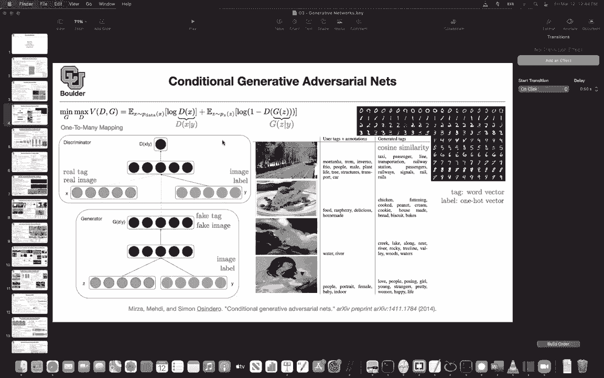
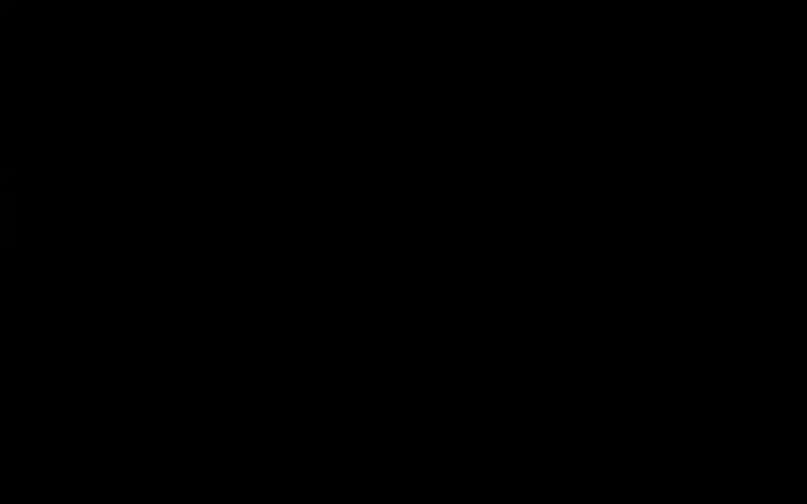
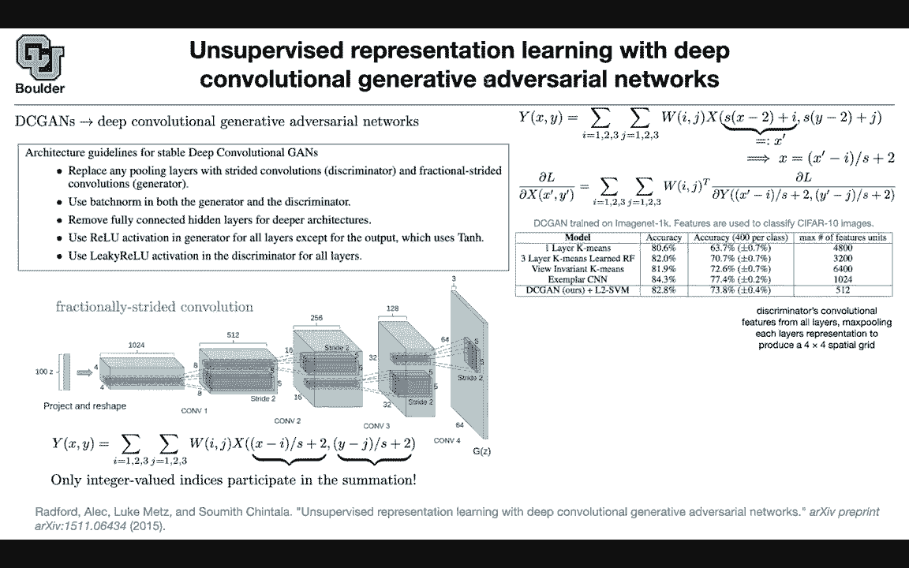

# 课程 P138：L65.1 - DCGANs 🎨

在本节课中，我们将学习深度卷积生成对抗网络（DCGANs）。我们将探讨如何利用DCGANs从无标签数据中学习有效的低维表示，并详细解析其网络架构的设计准则与数学原理。

---

## 概述

上一节我们介绍了条件生成对抗网络（cGANs），它是常规GANs的一个简单扩展。本节中，我们将聚焦于一种更稳定、更强大的GAN变体——深度卷积生成对抗网络（DCGANs）。我们将看到，通过精心设计的卷积架构，DCGANs能够学习到高质量的数据表示，并生成更逼真的图像。

---

## DCGANs的设计准则

由于GANs的训练过程通常不稳定，研究人员通过大量实验总结出了一套适用于DCGANs的架构设计准则。以下是这些核心准则：

*   **替换池化层**：在判别器或生成器中，将所有池化层替换为步长卷积。池化层通常用于降低图像分辨率，而通过设置卷积步长为2，可以达到相同的效果，同时卷积层本身包含可学习参数。
*   **使用批归一化**：在生成器和判别器中都使用批归一化层。这有助于稳定训练过程并加速收敛。
*   **移除全连接层**：避免在架构中使用全连接隐藏层。全连接层会引入大量参数且效率低于卷积层。
*   **激活函数选择**：
    *   除最后一层外，所有层使用ReLU激活函数。
    *   生成器的最后一层使用Tanh激活函数，以将输出值约束在[-1, 1]区间，这与归一化后的图像像素值范围相匹配。
    *   判别器中使用Leaky ReLU作为激活函数。

这些准则主要源于大量实验经验，而非严格的数学推导，但它们被证明能显著提升GAN训练的稳定性和生成效果。

---

## 生成器架构详解

上一节我们了解了设计准则，现在我们来具体看看生成器的架构。判别器的架构我们已较为熟悉，它类似于一个反向的生成器。生成器的核心任务是将一个100维的随机向量`z`转换为一张64x64x3通道的图像。

其过程可分为以下几步：

1.  **投影与重塑**：首先，通过一个全连接层（矩阵向量乘法）将100维向量`z`投影为一个更长的向量（例如 `4*4*1024 = 16384` 维）。随后，将该向量重塑（reshape）为一个4x4x1024的三维张量。公式可以表示为：
    `projected_vector = W * z` （其中 `W` 是权重矩阵）
    然后 `tensor = reshape(projected_vector, (4, 4, 1024))`。

2.  **分数步长卷积（上采样）**：接下来，通过一系列分数步长卷积（或称转置卷积）层，逐步提高图像的空间分辨率。分辨率从4x4依次增加到8x8、16x16、32x32，最终达到64x64。同时，通道数会相应减少（例如从1024减至512、256等）。

---

## 分数步长卷积的数学原理

分数步长卷积是实现上采样的关键。它本质上是普通卷积在反向传播时的梯度计算过程。

**考虑一个普通的前向卷积操作**：
假设我们有一个输入`Y`，通过一个卷积核`W`进行卷积，得到输出`X`。卷积步长为`s`。输出位置`(x, y)`的值由输入`Y`的一个局部窗口计算得出。

**其反向传播（梯度计算）**正是分数步长卷积：
损失函数`L`对输入`Y`的梯度，需要通过损失对输出`X`的梯度进行反向传播得到。这个计算过程在形式上就是一个分数步长卷积操作。具体公式涉及对输入像素位置的映射和求和，框架（如PyTorch/TensorFlow）在内部自动完成了这一计算。

简而言之，**分数步长卷积是普通卷积的逆过程**，我们在神经网络的反向传播中一直在使用它，只是未曾显式地将其视为一个独立的层。

---

## 学习无监督表示

我们最初的目标是利用DCGANs从无标签数据中学习有效的低维表示。那么，具体如何实现呢？

关键在于利用**判别器**。判别器的作用是将图像（如64x64x3）逐步下采样并提取特征。我们可以将判别器中间某层的激活值作为图像的特征表示。

然而，直接使用这些激活值可能维度仍然很高。因此，我们可以在特征图上进行**空间池化**（如平均池化或最大池化）。例如，将一个8x8的特征图划分为2x2的网格，对每个网格内的值进行池化，最终得到一个紧凑的特征向量。

这个特征向量可以输入到一个简单的分类器（如逻辑回归或支持向量机）中。实验表明，使用DCGANs在ImageNet上无监督学习得到的特征，结合L2归一化和SVM，在CIFAR-10数据集上能达到82.8%的准确率，这证明了其学习到的表示是有效的。

---

## 隐空间的操作

除了判别器，生成器的隐空间`Z`也充满了趣味性。由于生成器学习到了从隐空间到图像空间的平滑映射，我们可以在隐空间中进行算术运算，并观察其对生成图像的影响。

例如：
1.  采样多张“戴眼镜的男性”图像，将其对应的隐向量取平均，得到向量`Z_man_with_glasses`。
2.  同理，得到“不戴眼镜的男性”平均向量`Z_man_no_glasses`和“不戴眼镜的女性”平均向量`Z_woman_no_glasses`。
3.  进行向量运算：`Z_woman_with_glasses = Z_man_with_glasses - Z_man_no_glasses + Z_woman_no_glasses`。
4.  将结果向量`Z_woman_with_glasses`输入生成器，便能得到一张“戴眼镜的女性”图像。

这展示了隐空间捕获了数据中有意义的语义方向，通过向量运算可以实现可控的图像生成。

---

## 总结

本节课中，我们一起学习了深度卷积生成对抗网络（DCGANs）。

*   我们首先了解了通过大量实验总结出的、能稳定GAN训练的架构设计准则。
*   接着，我们深入剖析了生成器的构建流程，特别是**分数步长卷积**的原理，并揭示了它实质上是普通卷积反向传播的数学体现。
*   然后，我们探讨了如何利用DCGANs的**判别器**来提取图像的无监督特征表示，并用于下游分类任务。
*   最后，我们看到了在生成器的**隐空间**中进行向量算术运算，可以实现有趣且可控的图像语义编辑。

DCGANs为稳定训练深度GAN和利用无监督学习获取有效数据表示提供了重要的基础框架。