# P142：L66.2 - InfoGAN 教程 🧠

在本节课中，我们将要学习 InfoGAN。InfoGAN 是一种生成对抗网络（GAN）的变体，其核心目标是为潜在空间中的变量赋予明确的、可解释的语义含义。我们将探讨其动机、原理、目标函数以及如何实现解耦表示。

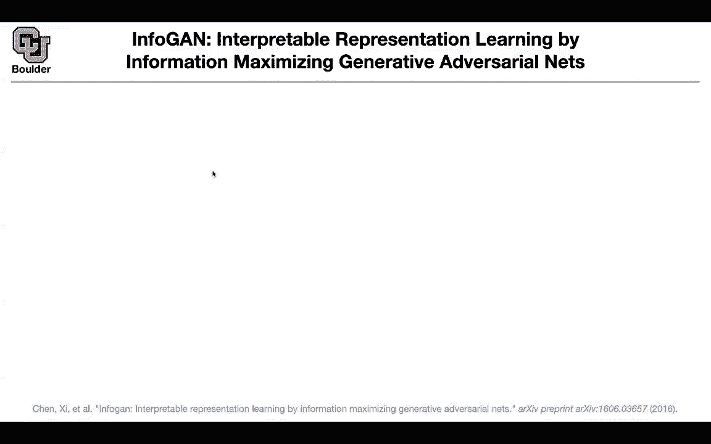

## 概述

在标准的 GAN 中，生成器从一个随机噪声向量 **Z** 生成数据。虽然可以在 **Z** 空间中进行插值运算（例如，让一张生气的脸逐渐变得开心），但 **Z** 的每个维度本身并没有明确的、独立的含义。InfoGAN 旨在解决这个问题，它通过引入结构化的潜在编码 **C**，并最大化 **C** 与生成数据之间的互信息，使得 **C** 的每个维度都能对应数据中某个具体的、可解释的特征（例如数字类别、旋转角度、笔画粗细等），从而实现“解耦表示”。

## 潜在空间的局限性

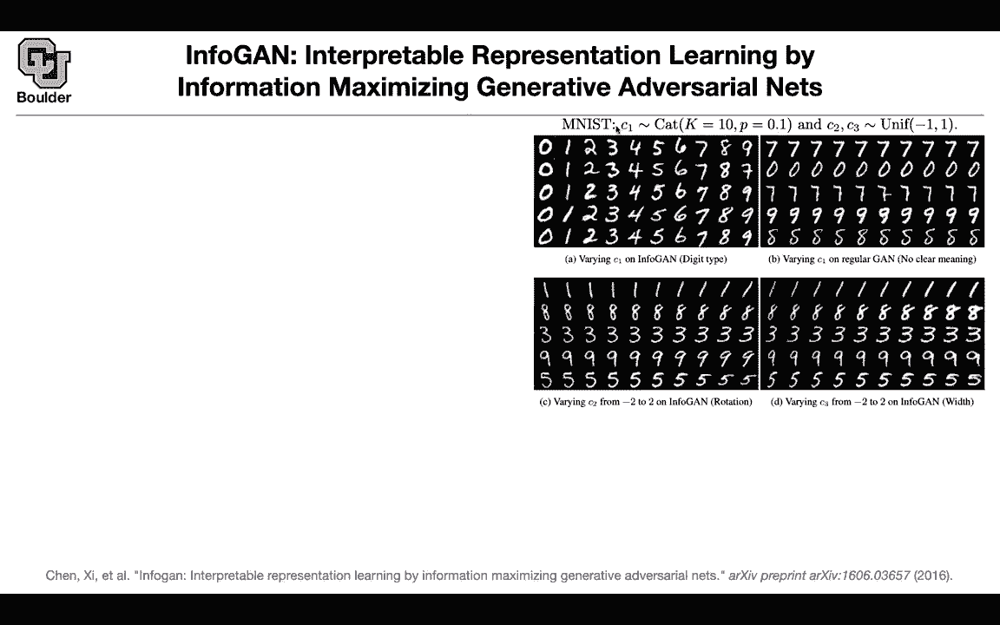

上一节我们提到了标准 GAN 中潜在空间 **Z** 的特性。在 **Z** 空间中，你可以进行算术运算，例如加法和减法。

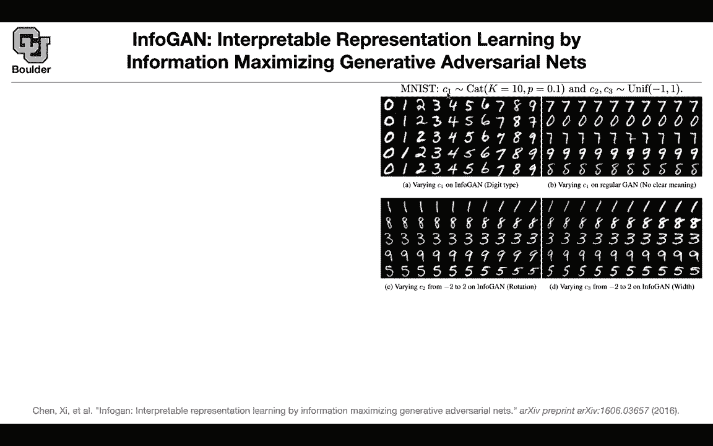

你可以取一张图像，再取另一张图像，找到它们对应的 **z** 向量，在潜在空间中进行插值，从而让一个愤怒的人通过两张图像 **z** 向量之间的插值变得开心。

但问题是，如果你从你的 **z** 中选取一个维度（假设 **z** 是 100 维的，你选取第 10 个元素）并改变它，你希望为这个潜在向量的条目关联上含义。

之前它们没有任何含义，只有在进行插值时你才能看到一些意义。现在，你希望潜在空间的每个元素或每个维度都具有独立的含义。

## 解耦表示与 InfoGAN 的目标

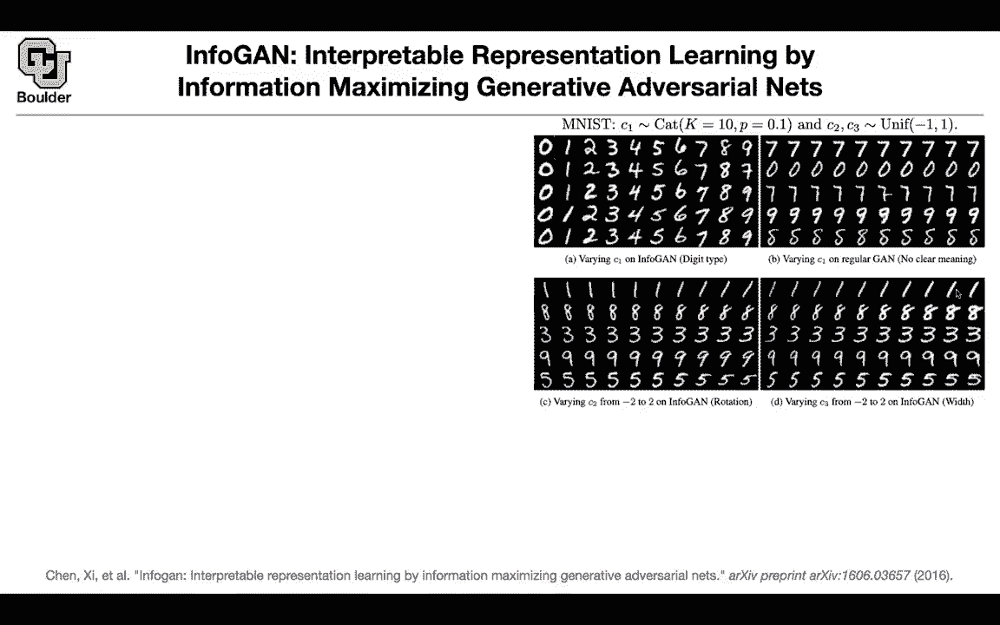

本节中我们来看看 InfoGAN 如何实现解耦表示。假设你有一个分类变量 **C1**，这些是你的潜在变量。

你有一个分类变量，它只是一个均匀分布，在 0 到 9 这 10 个数字之间均匀分布，这就是 **C1**。你还有一个在 -1 到 1 之间均匀分布的变量 **C2**。

现在你希望这些变量具有含义。“具有含义”指的是，如果你改变 **C1**，从中生成一个样本并通过你的神经网络，你希望它生成不同的数字（0 到 9）。这与条件 GAN 不同，请注意不要混淆。

现在你正试图为这些潜在变量关联含义，这篇论文倡导的方法被称为 InfoGAN。如果你使用它并持续从 **C1** 生成样本，你将会看到不同的数字（这些数字只是被作者排序了，所以不用担心排序问题）。随着你不断生成样本，你会看到不同的数字 0, 1, 2, 3, 4, 5... 所以现在 **C1** 已经关联了一个含义。

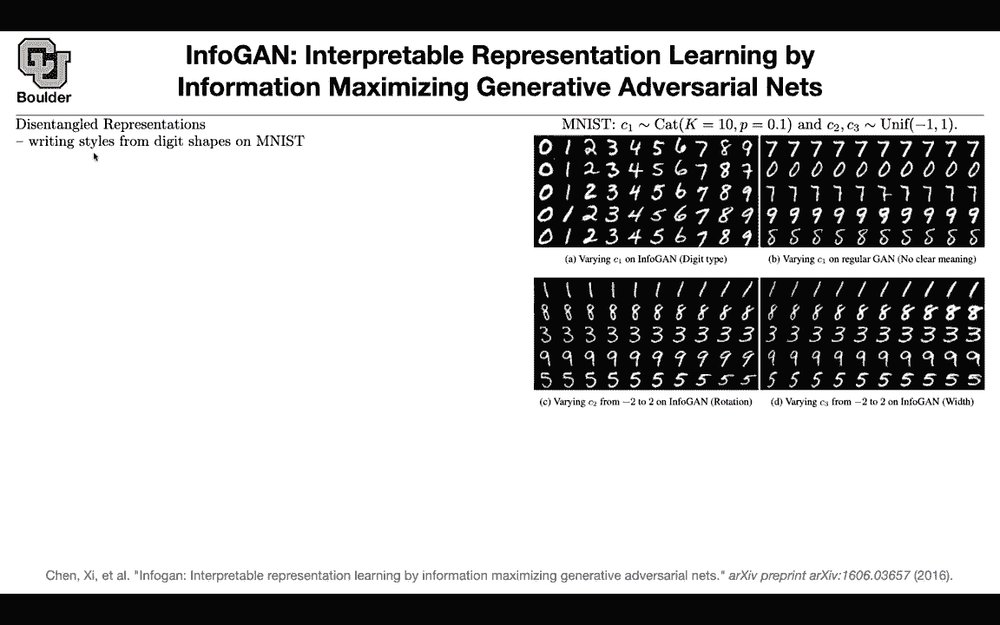

如果你在常规 GAN 上做同样的事情，你将不会得到任何清晰的含义。有时是 7，有时是 0 等等，所以行为是随机的。

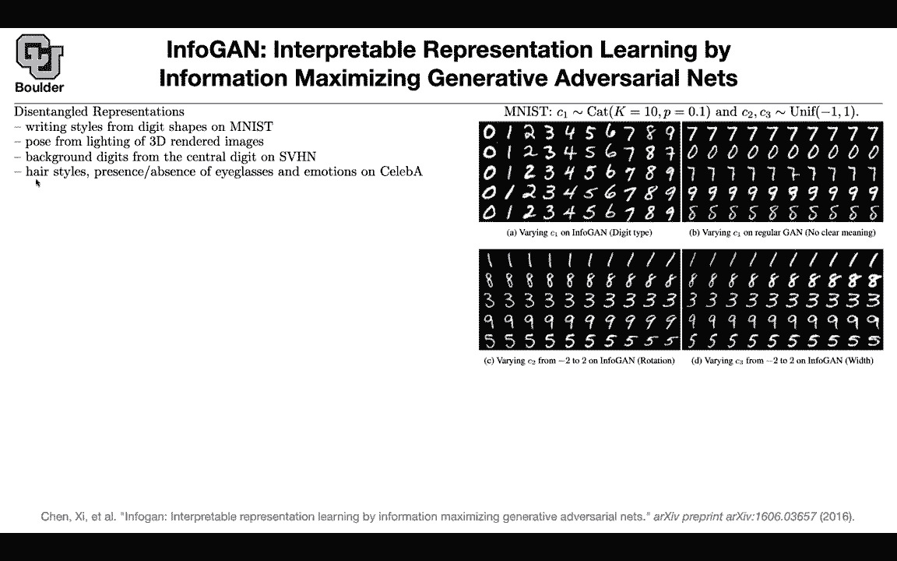

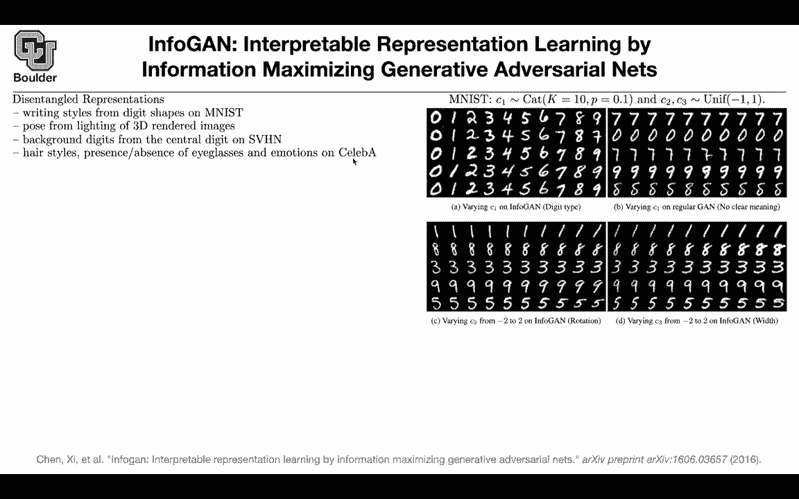

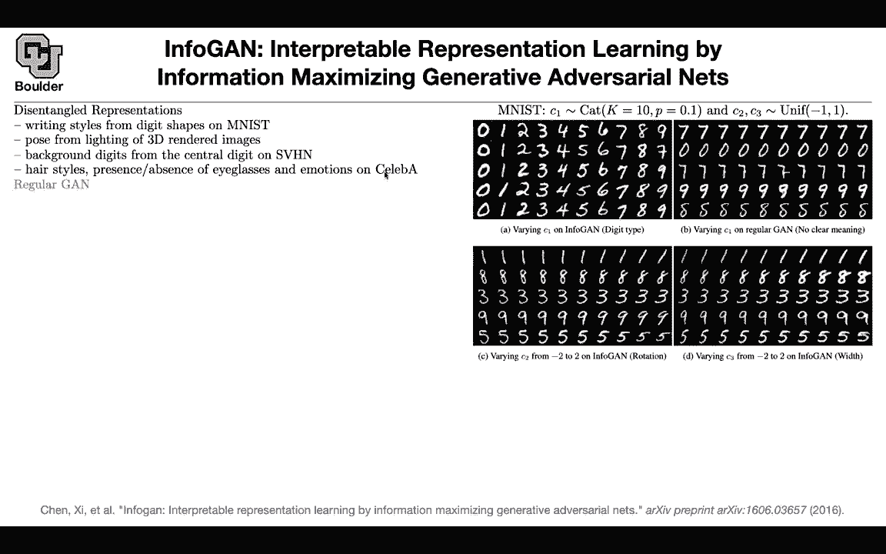

如果你观察 **C2** 并持续将其从 -2 变化到 2（这略微超出了均匀分布的边界，但这是细节问题），你可以看到 **C2** 对应于数字的旋转。

如果你改变 **C3**，你可以看到它对应于你手写笔画的宽度，所以它变得更宽。

## 如何实现解耦

但如何做到这一点？如何为潜在变量关联含义？这就是所谓的**解耦表示**。你的隐藏变量的每个元素或每个维度都将具有一个含义，它将关联一个语义，并且这些含义是解耦的。因此，你不必像之前在两个 **z** 向量之间进行插值那样，去查看潜在空间的线性组合。

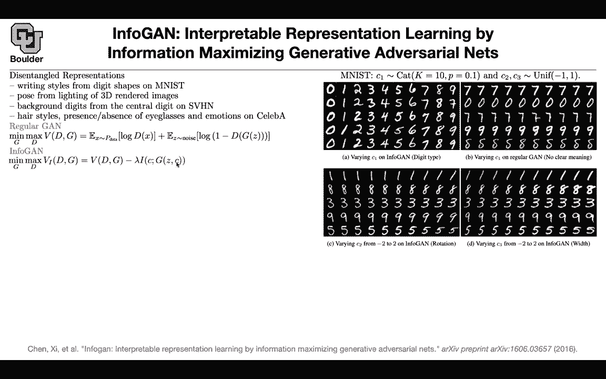

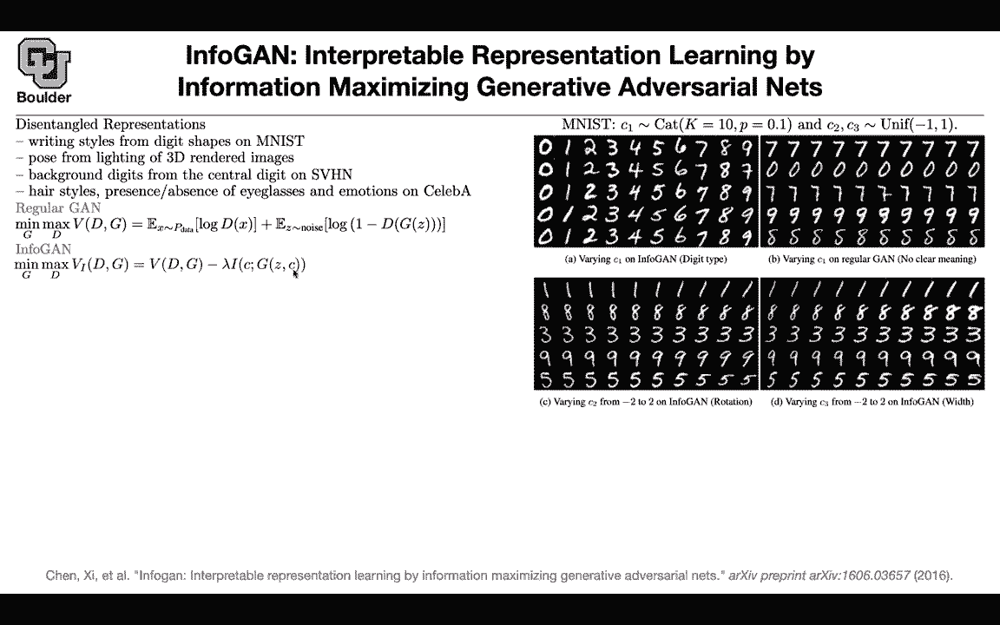

例如，你可以将书写风格与数字形状解耦，可以将 3D 渲染图像的姿态与光照解耦，可以将街景门牌号数据集中的背景与数字解耦（这是谷歌的一个数据集，你可以探索它，这些图像是从门牌号拍摄的彩色图像，与 MNIST 不同），可以将发型与是否戴眼镜或 CelebA 数据集中的情绪解耦（CelebA 也是生成模型的著名数据集，顾名思义，里面是名人的面孔）。

## InfoGAN 的目标函数

让我们看一下常规 GAN 的目标函数。在常规 GAN 中，你有一个判别器来区分真实数据和噪声，而噪声基本上就是你的生成图像。

如果你取一个噪声 **z**，将其通过生成器 **G**，你将得到一个生成图像。

InfoGAN 试图做什么？你仍然拥有常规 GAN 的目标，但现在你希望你的潜在变量（即你刚才在这里看到的 **C1**、**C2**、**C3**，如果你将它们放入一个向量中）具有含义。这意味着如果你取 **C**，将其通过你的生成器，那应该能提供很多关于 **C** 的信息。你不希望 **C** 消失，你不希望 **C** 的含义消失。

所以你对 **G** 求最小化，意味着你正在最大化这个 **I**（互信息），并且由于这个负号，你正在最大化这个 **I**。

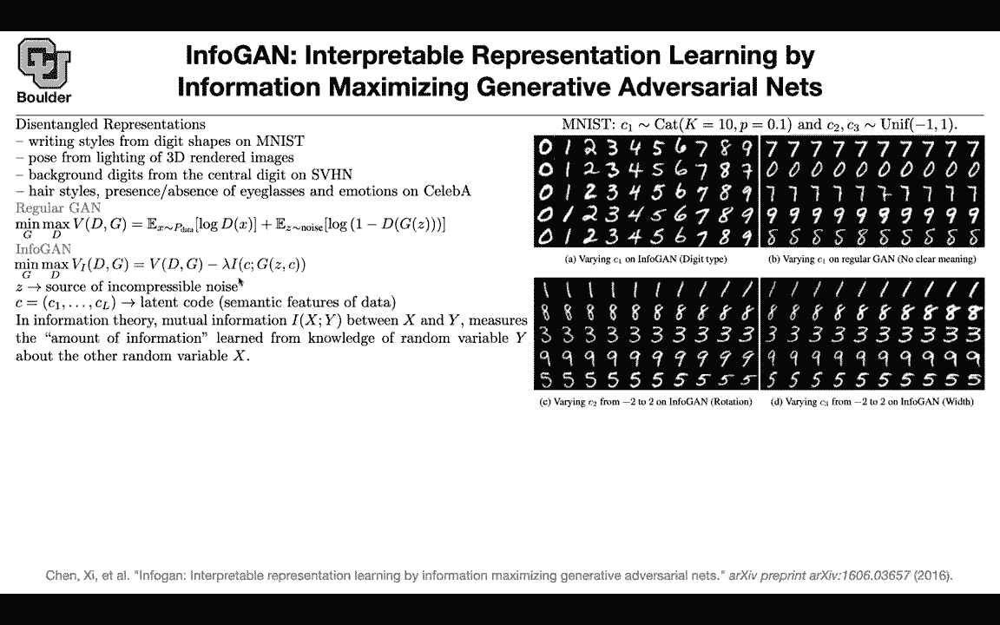

但那个 **I** 是什么？**Z** 又是什么？首先，**Z** 是不可压缩噪声的来源，因此你将无法控制它。所以它们将会是纠缠的。你的潜在空间的某些部分将会是纠缠的，你无法为其关联含义。这是为了让你的模型有一定的自由度。

而对于 **C**，你希望它们具有这种解耦的含义。你希望 **C1** 具有与 **C2**、**C3**、**Cn** 不同的含义。这些是你的潜在编码，它们具有数据的语义特征。

**I** 是两个随机变量之间的互信息。一个随机变量是 **C**，另一个随机变量是 **G(z, c)**。

你希望 **C** 和 **G** 之间的互信息很高。互信息是什么意思？它指的是你从一个随机变量（在这种情况下是 **y**）中能学到的关于另一个随机变量（**x**）的信息量。基本上，如果 **y** 独立于 **x**，知道 **y** 你不会学到任何关于 **x** 的东西。如果你知道 **y**，它不会帮助你减少 **x** 的熵。

所以你希望这两者之间的互信息很高。你不希望 **c** 消失，不希望 **c** 的含义消失。

**x** 和 **y** 之间的互信息是 **x** 的熵减去已知 **y** 条件下 **x** 的熵。基本上，如果 **y** 独立于 **x**，它不会以任何方式减少熵，所以这将是 **H(x) - H(x) = 0**。因此，最小的互信息是零，然后它可以变得更高。所以你希望最大化它。

## 变分下界与实现

但有一个问题：这在数学上很优美，但有一个难点。如果你想计算这个互信息，你需要能够访问后验分布，因为看这里，你有条件概率。所以你需要能够访问后验分布。

但这并不是一个大问题。我们在做变分自编码器时见过，如果你需要访问一个后验分布，而你的后验分布是难处理的，只需用一个变分分布来近似它。

所以你将引入一个变分分布，它具有与你的后验分布相同的格式，它以 **x** 作为输入，并会给你 **C**。这是一个辅助分布，用于帮助你近似 **P**。

完美，然后你进行一些数学推导，就像你为对数概率或对数似然写下变分下界一样，你可以得到一个互信息的下界。一些简单的算术运算将为你提供这个下界。

记住你想要最大化 **I**。如果你有一个下界，你可以最大化这个下界。现在你的下界取决于你为 **C** 选择的先验分布。这些是你选择的先验分布：我们选择 **C1** 为分类分布，选择 **C2** 和 **C3** 为均匀分布。这是我们做出的一个假设。

这是从生成器中出来的：你取 **Z**（来自正态分布，这是不可压缩的噪声），将其与这个你刚从先验分布中采样得到的向量 **C** 连接起来，将它们通过你的生成器，这将给你一张图像。

一旦你有了图像，你就知道 **Q**（变分分布），你用一个神经网络参数化它。然后你还有 **C** 的熵在这里。这是你的变分下界，现在你要最大化这个下界。

完美。现在你要用这个下界替换 **I**，改变你的目标函数。现在，你不仅需要对 **G** 求最小化、对 **D** 求最大化，你还需要对 **Q** 求最小化。如果你对 **Q** 求最小化，你就是在最大化这个下界；如果你最大化这个下界，你就是在最大化互信息。

完美。现在你可以将其应用于不同的数据集。这是 3D 渲染图像，你可以调整旋转角度，可以在另一个数据集上调整椅子的宽度，可以调整发型，或者将情绪从悲伤变为开心。现在你一次只改变一个变量，所以可能是你选取 **C5** 并改变 **C5** 来给你不同的发型。

## 总结

本节课中我们一起学习了 InfoGAN。InfoGAN 通过修改 GAN 的目标函数，引入结构化潜在编码 **C** 并最大化 **C** 与生成数据之间的互信息，成功实现了对数据生成过程的可解释、解耦控制。其核心公式是在原始 GAN 目标上增加了一个互信息项 **I(c; G(z, c))** 的负值，并通过变分下界进行优化。这使得我们可以通过单独改变 **C** 的某个维度，来对应地、可预测地改变生成数据的某个特定语义特征（如数字类别、旋转、笔画粗细等），为生成模型的可解释性提供了有力工具。