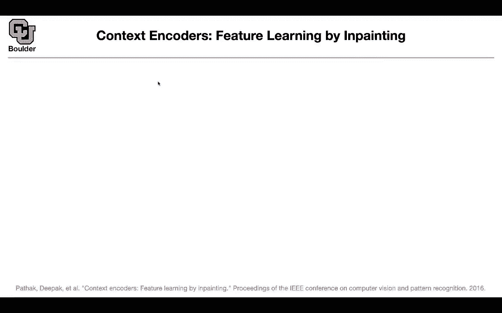
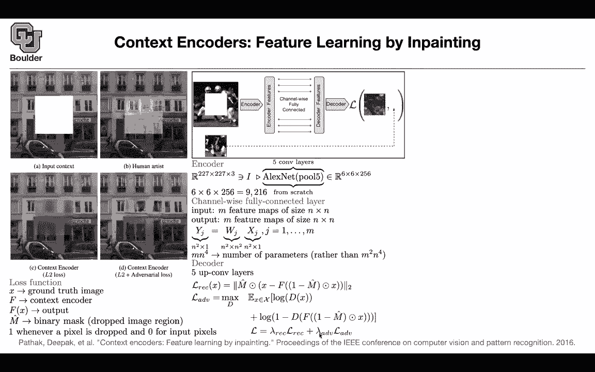

# 课程 P143：L66.3 - 上下文编码器 🎨

在本节课中，我们将学习**上下文编码器**，这是一种用于图像修复（Inpainting）的深度学习方法。我们将了解其核心思想、网络架构、损失函数以及如何利用它学习有用的图像特征。

---

## 概述

图像修复是指给定一张有缺失区域的图像，模型需要根据图像上下文来预测并填充缺失部分。这是一个“病态”问题，因为对于同一个缺失区域，可能存在多种合理的填充结果。我们将介绍一种结合了**重建损失**和**对抗损失**的编码器-解码器架构来解决此问题。

---

## 网络架构

上一节我们介绍了图像修复问题的定义，本节中我们来看看解决该问题的神经网络架构。

模型的核心是一个编码器-解码器结构，我们称之为**上下文编码器**。

1.  **编码器（Encoder）**：编码器部分基于**AlexNet**架构。输入是一张被掩码的图像（例如，227x227x3），经过多个卷积层后，输出一个低分辨率但通道数更多的特征图。
2.  **通道全连接层（Channel-wise Fully Connected）**：为了在编码特征上引入更多的全局推理，同时避免参数量爆炸，我们采用了一种特殊的层。以下是其工作原理：
    *   假设编码器输出特征图的形状为 `[M, N, N]`，其中 `M` 是通道数（例如256），`N` 是空间尺寸（例如6）。
    *   我们不将特征图展平，而是对**每个通道**独立进行全连接操作。这相当于一个 `for` 循环，对 `M` 个通道中的每一个 `N*N` 维向量，乘以一个 `[N*N, N*N]` 的权重矩阵。
    *   与将整个特征图展平后做全连接相比，这种方法将参数量从 `O((M*N*N)^2)` 减少到了 `O(M*(N*N)^2)`，节省了一个数量级为 `M` 的参数。
3.  **解码器（Decoder）**：解码器由五个**上卷积层**（或称为转置卷积层）构成，其目标是将编码后的低分辨率特征图上采样，最终重建出与原始输入图像相同分辨率的输出图像。

整个模型可以表示为一个函数 `F`：
`output_image = F(masked_input_image)`

---

## 损失函数

网络架构定义了模型如何转换数据，但要训练它，我们需要定义合适的损失函数来指导学习。

上下文编码器使用一个组合损失函数，包含两部分：

1.  **重建损失（Reconstruction Loss）**：这部分损失鼓励模型准确地填充缺失区域。具体计算如下：
    *   首先，将模型输出图像与原始完整图像进行比较。
    *   但我们只关心被掩码（缺失）区域的修复质量。因此，我们使用一个二进制掩码 `M_hat`（在缺失区域值为1，其他区域为0）来提取输出图像和原始图像在缺失区域的部分。
    *   计算这两部分之间的 **L2 损失（均方误差）**。
    *   公式可以简化为：`L_recon = || (F(masked_input) - original_image) * M_hat ||_2`
    *   仅使用重建损失会导致输出图像在缺失区域**模糊**，因为L2损失倾向于预测像素值的平均值。

2.  **对抗损失（Adversarial Loss）**：为了解决模糊问题并生成更逼真、细节丰富的纹理，我们引入了对抗训练。
    *   在这里，上下文编码器 `F` 充当**生成器（Generator）**。
    *   我们额外训练一个**判别器（Discriminator）** `D`，其目标是区分“真实完整图像”和“由模型修复生成的图像”。
    *   生成器 `F` 的目标是“欺骗”判别器，使其认为生成的图像是真实的。
    *   这为生成器提供了信号，促使它生成视觉上更逼真、细节更清晰的图像内容。

最终的损失函数是重建损失和对抗损失的加权和：
`L_total = λ_recon * L_recon + λ_adv * L_adv`

通过调整超参数 `λ_recon` 和 `λ_adv`，可以平衡重建的准确性和视觉的真实感。

---

## 应用与评估

我们已经了解了模型如何训练，那么它的输出效果如何，又有哪些用途呢？

### 图像修复结果

使用组合损失函数训练的模型能够实现令人印象深刻的修复效果。例如，可以填充图像中缺失的物体部分，生成在语义和纹理上都合理的细节。

### 特征学习

除了直接用于修复，上下文编码器在预训练过程中学习到的特征表示也很有价值。这些特征可以迁移到其他视觉任务中，如图像分类、目标检测和分割。

为了评估学习到的特征质量，可以进行“特征空间最近邻”检索实验：
*   给定一张查询图像（带有掩码），通过编码器得到其特征向量。
*   在大型数据集中，寻找与该特征向量最接近的其他图像特征。
*   实验表明，上下文编码器学习到的特征，其最近邻图像在语义上高度相关（例如，都是狗的脸部）。相比之下，传统特征（如HOG）或纯判别式模型（如标准AlexNet）学习到的特征，其最近邻结果在语义上的一致性较差。

这表明，通过图像修复这种自监督任务，模型能够捕获到图像中深层次的语义信息。

### 评估指标

对于图像生成和修复任务，常用的评估指标包括：
*   **信噪比（Signal-to-Noise Ratio, PSNR）**
*   **L2损失均值**
*   **L1损失均值**
*   **初始分数（Inception Score）**：结合图像分类器的置信度和多样性来评估生成图像的质量。对于本任务，**初始分数**可能是比单纯L2损失更好的评估标准。

---

## 问答环节

**问**：关于对抗损失，这里我们只关注判别器吗？生成器部分是什么？
**答**：在这个框架中，上下文编码器 `F` 本身就是**生成器**。它的输入是带掩码的图像，输出是修复后的图像。判别器 `D` 的目标是区分真实图像和生成器 `F` 产生的图像。生成器 `F` 有两个目标：一是最小化重建损失，做好修复；二是最大化对抗损失，即让自己生成的图像能够“骗过”判别器，从而看起来更真实。

**问**：所以生成器同时追求逼真度和低重建误差？
**答**：是的。对抗损失促使图像看起来真实，避免生成不合理的内容。同时，重建损失确保修复区域与上下文协调，并防止输出过于模糊（因为仅追求低L2损失容易导致模糊）。两者需要平衡。

---

## 总结

本节课中我们一起学习了**上下文编码器**。我们首先了解了图像修复这一自监督任务。接着，详细分析了模型的编码器-解码器架构，特别是其中用于减少参数量的通道全连接层。然后，我们探讨了结合**重建损失（L2）**与**对抗损失**的组合损失函数，这是生成清晰、逼真结果的关键。最后，我们看到了模型在图像修复和特征学习方面的应用，并讨论了相关的评估指标。这种方法为图像的自监督表示学习提供了一个强大的框架。