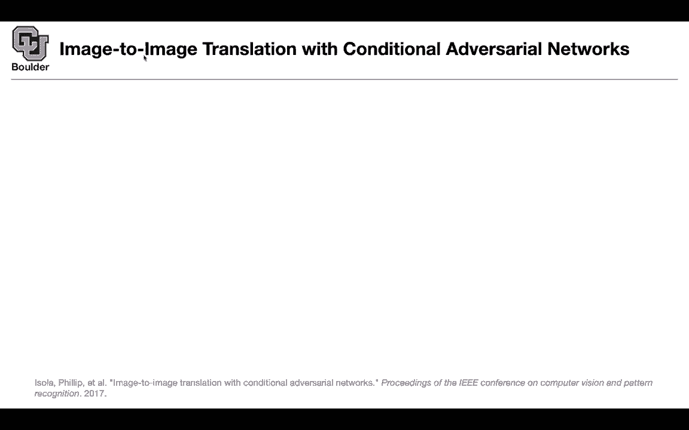
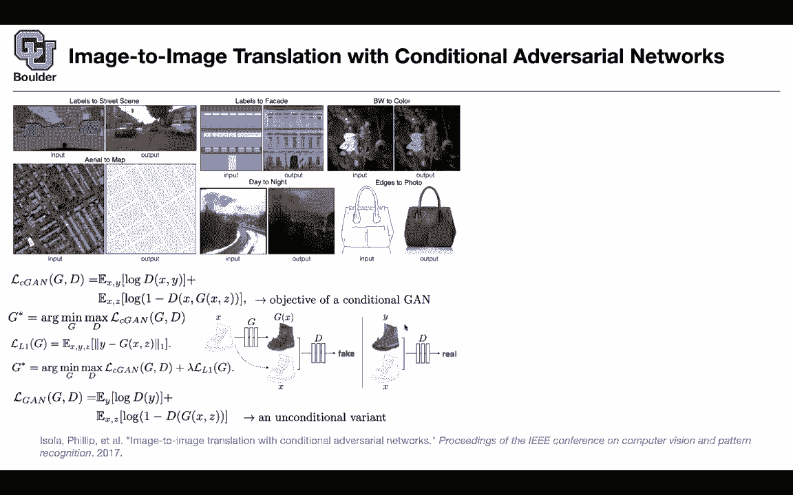

# 🖼️ 课程 P145：L67.2 - Pix2pix 图像翻译

在本节课中，我们将学习条件生成对抗网络（CGAN）在图像到图像翻译任务中的应用。我们将探讨其核心框架、损失函数设计以及实际应用案例。

---

上一节我们介绍了无条件生成对抗网络（GAN）的基本概念。本节中，我们来看看条件生成对抗网络（CGAN）如何应用于图像翻译任务。

图像到图像翻译的应用场景非常广泛。以下是几种常见的数据集类型：

*   **语义分割图转真实图像**：输入是带有类别标签（如汽车、道路、树木）的语义分割图，目标是生成逼真的街道场景图像。
*   **地图与航拍图互转**：可以在地图视图和航拍视图之间进行相互转换。
*   **图像着色**：将黑白图像作为输入，生成对应的彩色图像。
*   **自动驾驶数据增强**：现实驾驶场景数据（如雨天、雾天、夜晚）难以全面收集。此框架可以帮助生成各种天气和光照条件下的图像，用于扩充训练数据。
*   **季节与时间转换**：实现图像从白天到夜晚、从夏季到秋季的转换。
*   **时尚设计**：输入鞋子的边缘草图，生成逼真的鞋子照片。

---

那么，Pix2pix 采用的核心框架是什么呢？其目标函数由两部分组成。

首先，我们有一个**条件判别器**。判别器 `D` 的输入是条件信息 `x`（例如语义标签图）和图像（真实图像 `y` 或生成图像 `G(x)`），它需要判断图像的真假。这为我们提供了对抗损失。

**公式：对抗损失**
`L_cGAN = E[log D(x, y)] + E[log(1 - D(x, G(x)))]`

同时，因为我们有真实的配对数据 `(x, y)`，我们可以引入**重构损失**（如 L1 损失），要求生成器 `G` 的输出尽可能接近真实图像 `y`。

**公式：L1 重构损失**
`L_L1 = E[||y - G(x)||_1]`

最终的总损失是这两项损失的加权和，超参数 λ 可以通过验证集进行调整。

**公式：总损失**
`L_total = L_cGAN + λ * L_L1`

论文中的系统研究表明，**让判别器也以条件信息 `x` 作为输入**（即条件判别器）至关重要，这能显著提升生成效果。

---

从视觉流程上看，模型的工作方式如下：

1.  输入条件信息 `x` 到生成器 `G`，得到生成图像 `G(x)`。这里的随机性可以通过网络内部的 Dropout 机制实现，无需额外输入噪声 `z`。
2.  将配对数据 `(x, G(x))` 和 `(x, y)` 分别输入条件判别器 `D`。
3.  判别器 `D` 学习区分“真实配对” `(x, y)` 和“虚假配对” `(x, G(x))`。
4.  生成器 `G` 则同时优化，以最小化对抗损失和 L1 重构损失。

---

了解了框架后，让我们看看它在不同任务上的实际效果。

*   **图像着色**：仅使用 L1 损失会使结果模糊；结合 CGAN 损失后，生成图像的色彩更加生动自然。
*   **地图转航拍图**：模型能够根据地图信息生成具有相应布局和纹理的逼真航拍图。
*   **标签图转街景**：这是一个将语义标签转换为街道场景图像的示例。如果仅使用 L1 损失，生成的图像会非常模糊。加入 CGAN 损失后，生成器会尝试“想象”出汽车的细节、窗户的反射等，结果更加清晰真实。

---

然而，要获得高质量结果，不仅需要设计合适的损失函数，**神经网络结构也至关重要**。Pix2pix 论文采用了 **U-Net** 作为生成器。

U-Net 最初用于图像分割，它是一种编码器-解码器架构，并带有跳跃连接（类似 ResNet 中的捷径）。这些跳跃连接可以将低层特征信息直接传递到高层，帮助网络保留更多输入条件的细节信息，从而生成更精细的图像。

---

这种条件生成对抗网络的思想催生了众多有趣的应用：

*   **背景替换**：类似于视频会议中的虚拟背景功能，可以学习将人物与背景分离。
*   **深度伪造**：其背后的核心技术之一就是条件 GAN。通过输入一个人的图像或视频，模型可以将其面部特征替换成另一个人的。

---

本节课中，我们一起学习了 Pix2pix 图像翻译模型。我们了解到，通过结合**条件对抗损失**和**L1重构损失**，并采用**U-Net** 这类能保留细节的网络结构，生成对抗网络能够有效地学习从一种图像表示到另一种图像表示的映射，从而在图像着色、地图生成、风格转换等多个领域实现强大的应用。