# 课程 P15：L7.2 - Inception-V3 详解 🧠

在本节课中，我们将深入学习 Inception-V3 网络架构。Inception-V3 是 Google 团队在原始 Inception 网络基础上进行多项重要改进的模型。我们将重点解析其核心模块设计、计算优化策略以及整体架构的演变。

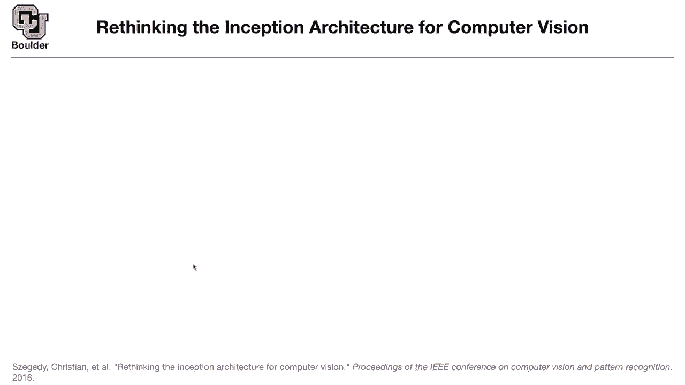

## 概述

Inception-V3 架构源自 Google 的论文。该论文在发表后引入了批归一化这一新技术，因此 Inception-V3 也采用了批归一化。除了这项技术，架构本身还进行了多项关键性修改。

## 架构的主要变化

上一节我们提到了批归一化的引入，本节中我们来看看网络结构上的具体变化。主要变化包括使用不同步长的 3x3 卷积，以及多个 Inception 模块的组合。

以下是 Inception-V3 的整体结构流程：

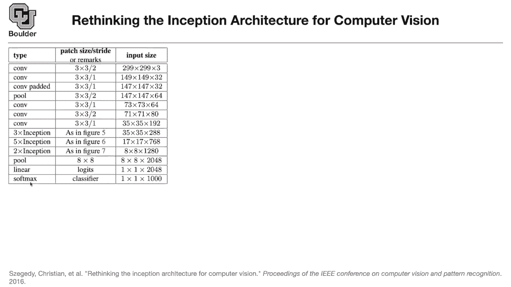

1.  使用三个特定类型的 Inception 模块。
2.  在其之上使用五个其他类型的 Inception 模块。
3.  再使用两个 Inception 模块。
4.  进行全局平均池化（该技术由 Network in Network 论文首次引入）。
5.  通过全连接层得到逻辑值。
6.  最后通过 Softmax 函数将逻辑值转换为分类概率。

## Inception 模块解析

那么，这些 Inception 模块具体是什么呢？我们来看第一个模块。

在之前的课程中我们提到，一个 5x5 卷积的感受野与两个堆叠的 3x3 卷积相同。Inception-V3 利用了这一点。

以下是第一个模块的分解：
*   首先是一个步长为 1 的 3x3 卷积。
*   在其之上是另一个滤波器大小为 3 的 3x3 卷积。
*   这两个堆叠的 3x3 卷积共同提供了与一个 5x5 卷积相同的感受野。

核心思想是：**用两个堆叠的 3x3 卷积替换一个 5x5 卷积**。这样做增加了网络深度，同时其余部分与之前的架构相似。其中的 1x1 卷积用于降维，最后将所有滤波器的输出在通道维度上进行拼接。

这种替换的主要目的是**减少计算量**。从计算成本上看，两个 3x3 卷积比一个 5x5 卷积更廉价。

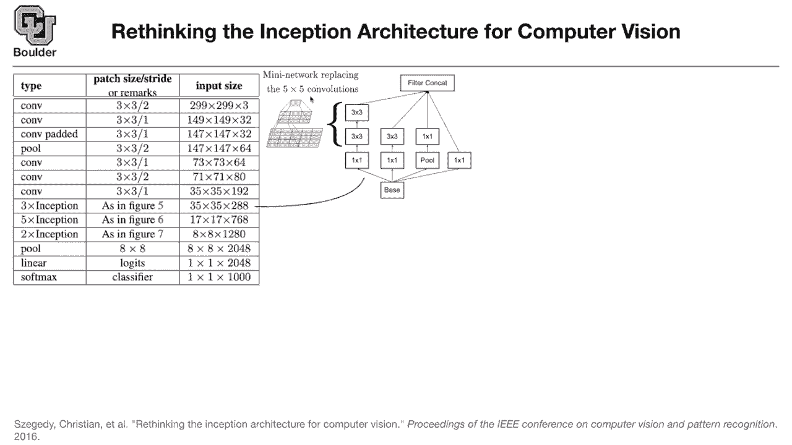

## 网络末端的结构变化

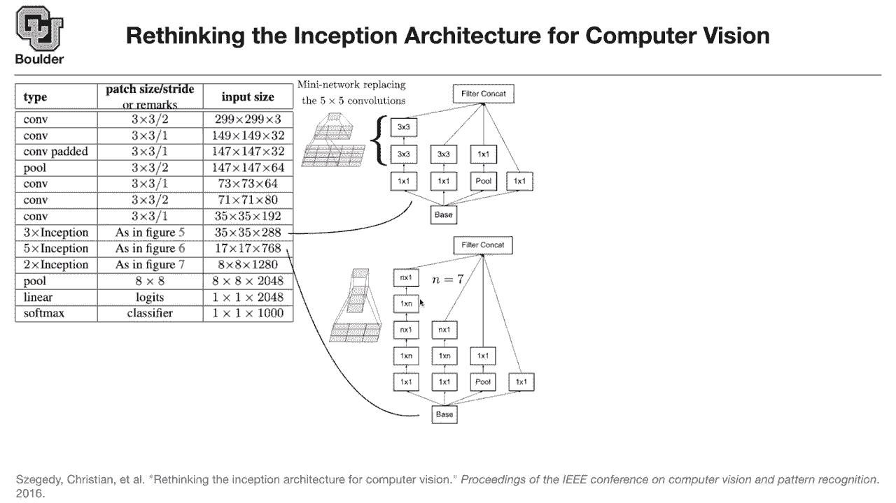

接下来，我们看看网络末端发生的另一项重要变化。这里使用了五个上述的 Inception 模块。

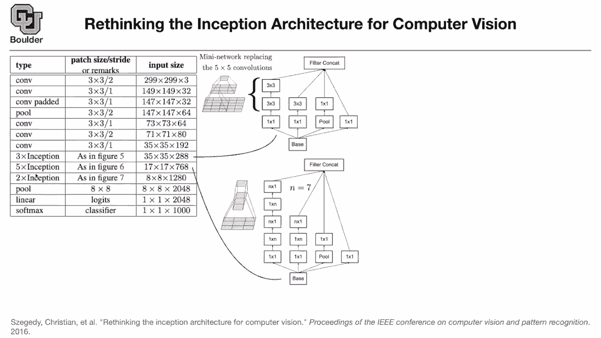

其核心思想是：**一个 7x7 卷积可以被替换为一个 1x7 卷积再接一个 7x1 卷积**（或顺序互换）。这种分解的卷积具有相同的感受野，但参数数量更少。

下图展示的示意图是 1x3 卷积和 3x1 卷积的堆叠，最终获得 3x3 的感受野。

因此，许多 7x7 卷积被这种分解形式所替代。

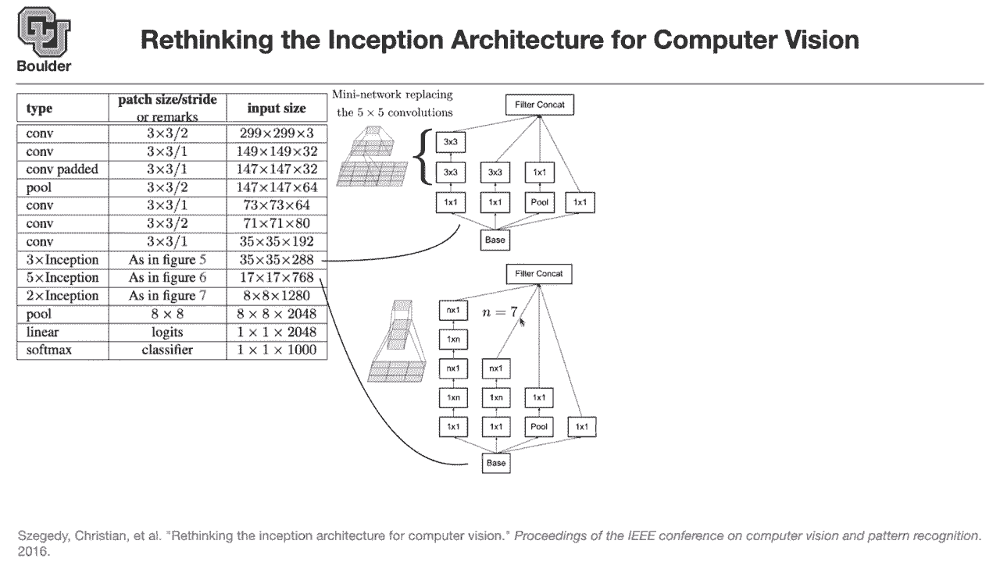

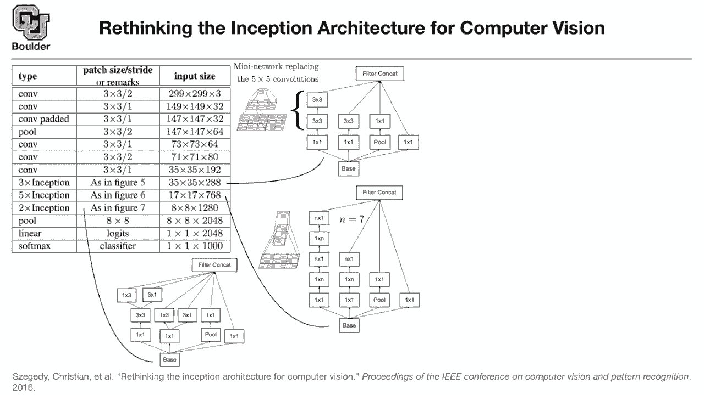

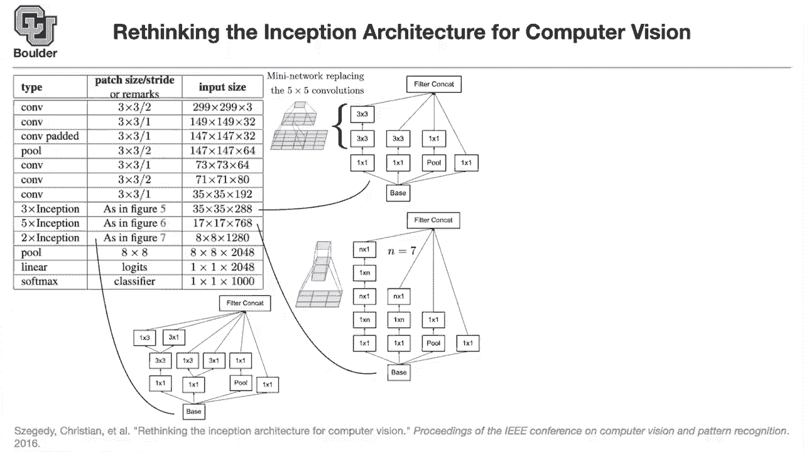

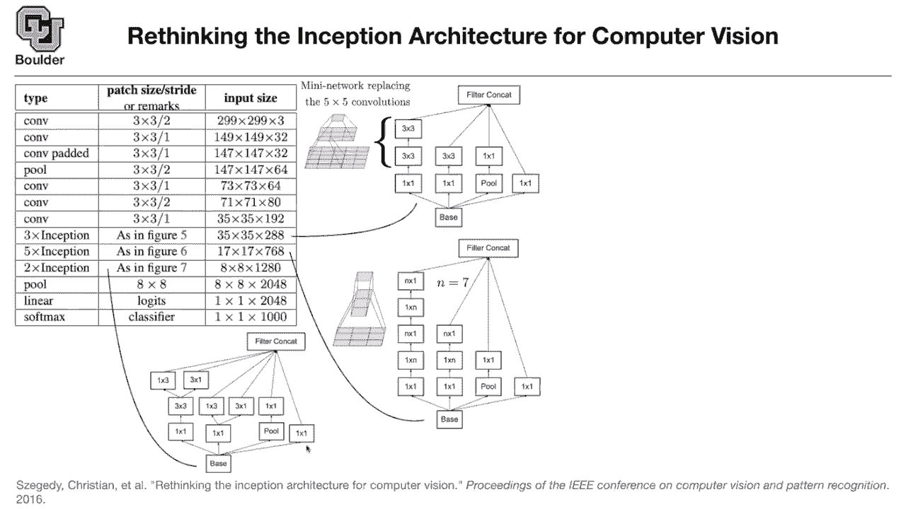

另一种变化是将卷积并行放置，而非堆叠。之前是将一个 1x3 卷积和一个 3x1 卷积堆叠在一起。

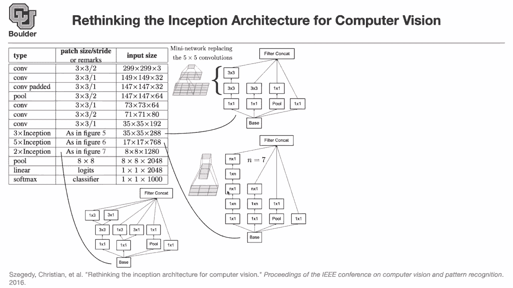

现在是将它们并排放置。

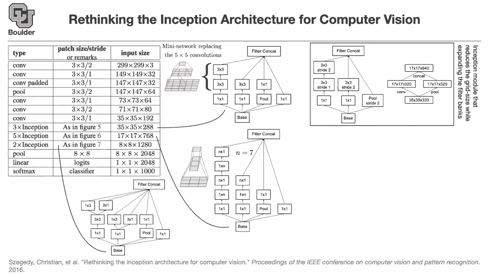

这里是将两个 1x3 卷积和两个 3x1 卷积并排放置。

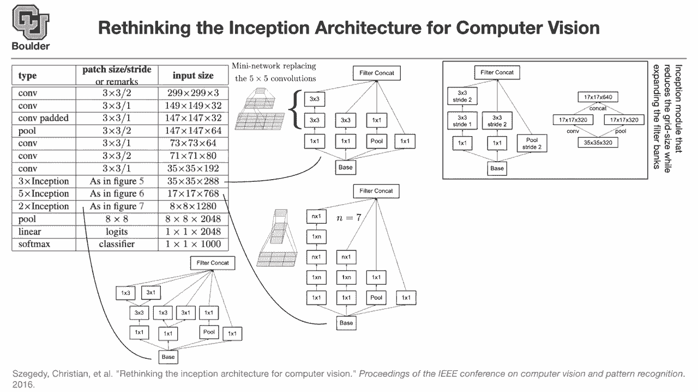

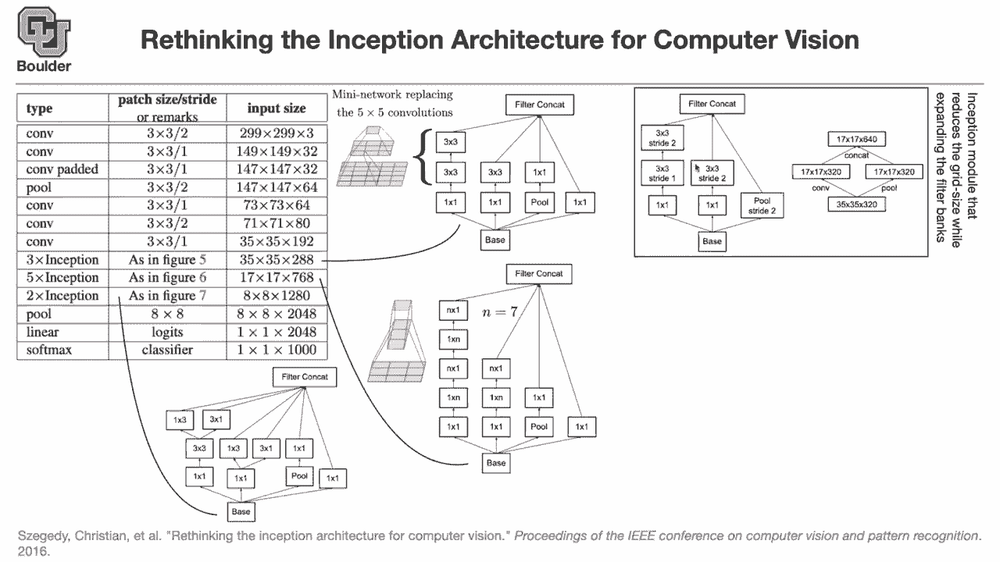

## 关于步长与池化

当需要减少特征图的像素数量（即进行下采样）时，是如何处理的呢？以下展示了两种实现方式，它们本质相同，只是视角不同。在这些卷积操作中指定步长大于1，即可实现下采样。

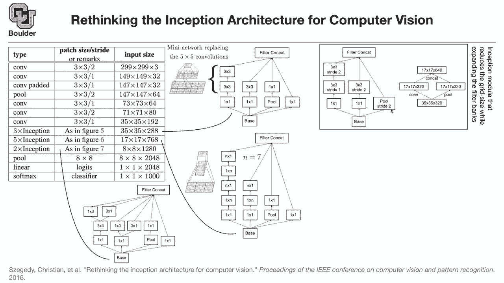

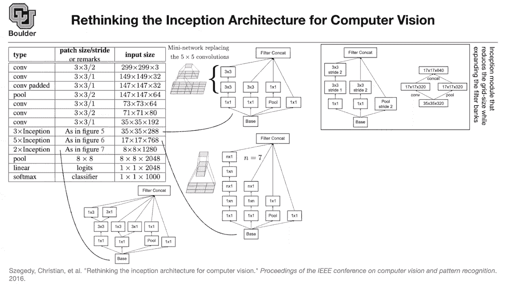

这里就是设置步长的地方。

## 问答环节

**问**：在之前学习的一个模型中，输出层之前的一层维度非常大（例如 1x1x1024）。如果我想预测的类别数很少（比如3类），让一个高维层（如4000维）连接到低维输出层（3维），这会有问题吗？

**答**：这没有问题。最终这只是一个矩阵乘法运算，将高维特征映射到低维输出空间（例如3维）。无论中间层的维度是多少，都可以通过一个权重矩阵将其转换到目标类别数维度。

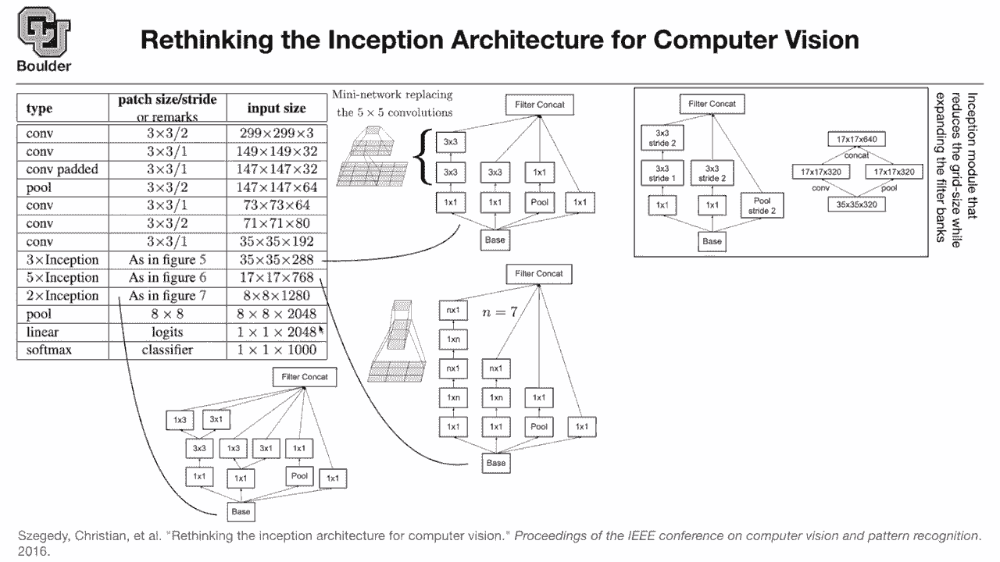

## 总结

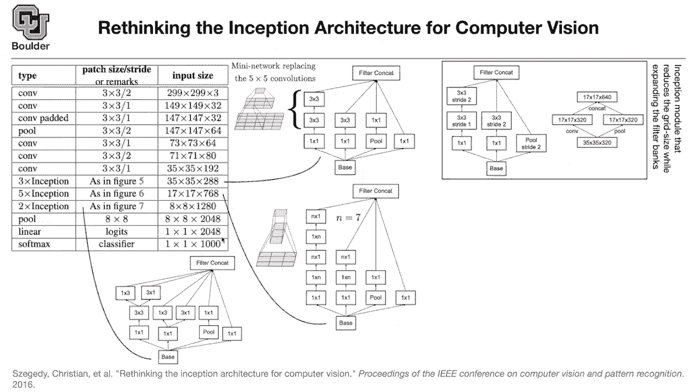

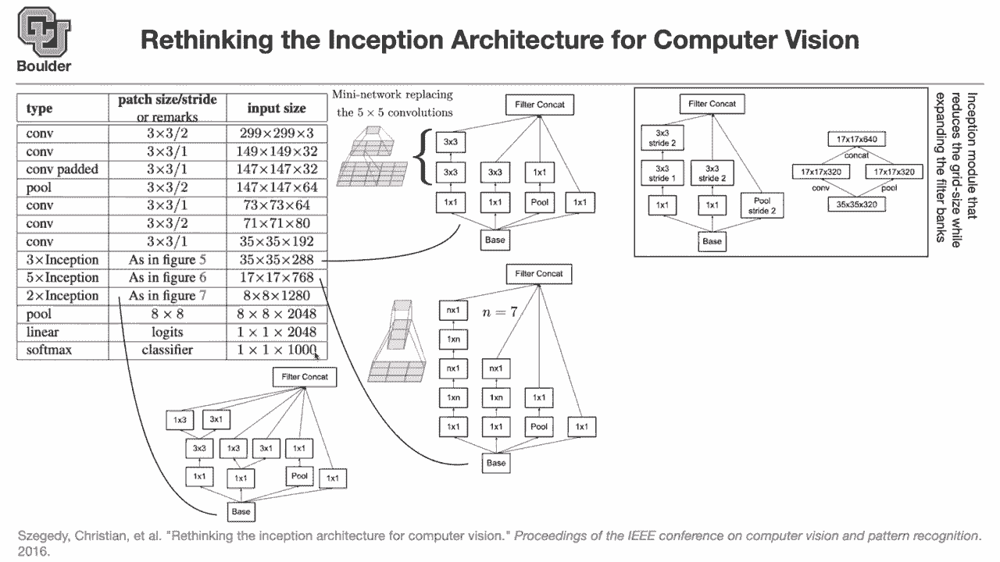

本节课中，我们一起深入探讨了 Inception-V3 架构。我们学习了它如何通过用堆叠的小卷积核替换大卷积核（如用两个3x3替换一个5x5）、将大卷积核分解为不对称卷积（如将7x7分解为1x7和7x1）等方法来优化计算效率、减少参数量，同时保持或提升模型性能。我们还了解了其模块化的设计和网络末端的结构特点。这些思想对后续的卷积神经网络设计产生了深远影响。