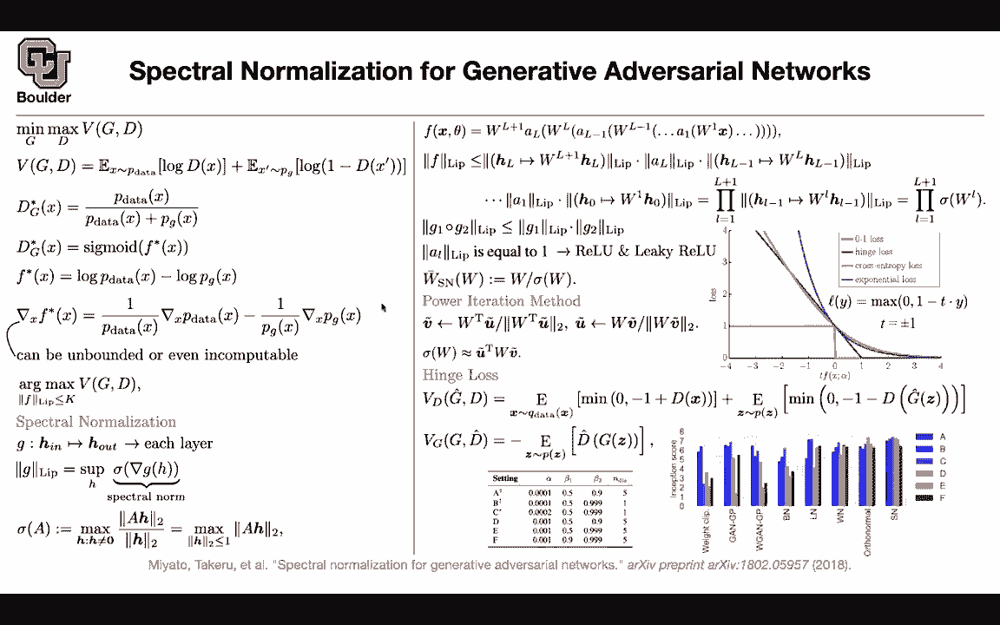
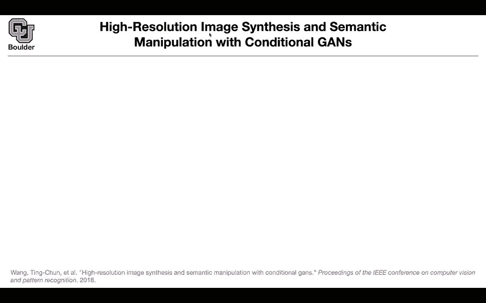
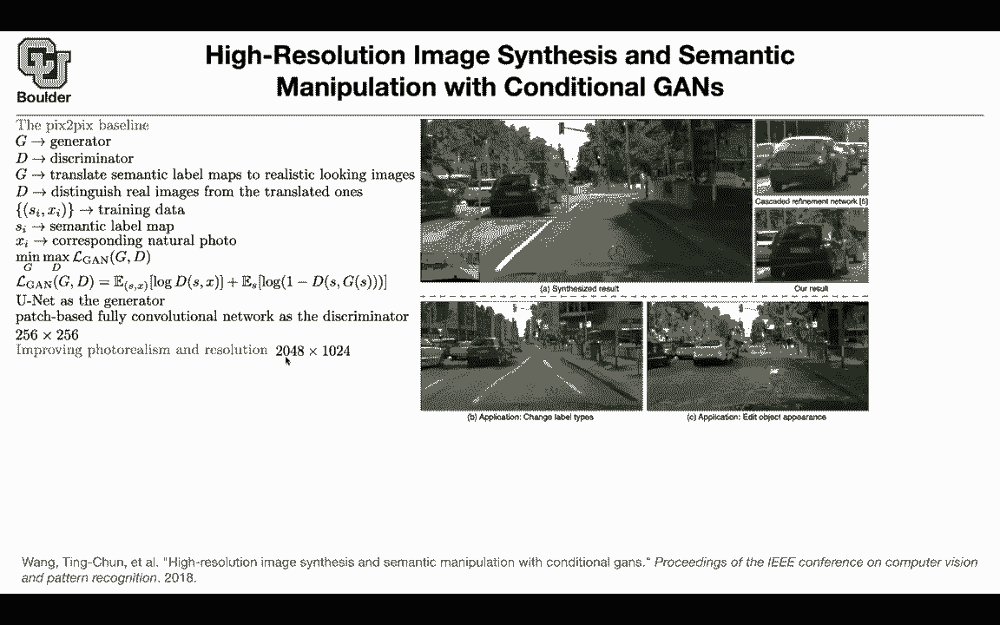

# 🖼️ 课程 P154：Pix2pixHD 高分辨率图像合成与语义操控

在本节课中，我们将学习如何利用生成对抗网络（GANs）进行高分辨率图像合成与语义操控。我们将重点介绍 Pix2pixHD 方法，它能够将语义标签图转换为逼真的高分辨率图像。

---

上一节我们介绍了 GANs 的基本理论，本节中我们来看看一个具体的应用：将语义标签图转换为高分辨率图像。这是一个“一对多”的映射问题，早期方法生成的图像往往分辨率低且模糊。我们的目标是生成更清晰、分辨率更高的图像。

以下是该技术的应用场景示例：例如在自动驾驶领域，可以通过改变场景中的语义标签（如将“树木”标签改为“建筑物”），来生成全新的训练数据，从而丰富数据集。

那么，如何实现高分辨率图像生成呢？核心在于改进已有的图像到图像（image-to-image）转换框架。该框架包含一个生成器和一个判别器。

*   **生成器（G）**：负责将语义标签图（S）转换为逼真的图像。
*   **判别器（D）**：负责区分“真实图像”和“生成器生成的假图像”。

在条件GAN中，判别器和生成器都以语义标签图（S）为条件。其目标函数可以表示为：
`min_G max_D V(D, G) = E_{x~p_data(x)}[log D(x|s)] + E_{z~p_z(z)}[log(1 - D(G(z|s)))]`
其中，`s` 是条件信息（语义标签图）。

最初的网络架构可以生成 256x256 分辨率的图像，但当分辨率提升至 2048x1024 时，模型会失败。为了生成更高分辨率的图像，Pix2pixHD 引入了三项关键技术。

---

首先，我们改进网络架构，设计一个由粗到细（Coarse-to-Fine）的生成器。

以下是具体步骤：
1.  先训练一个生成器 **G1**，用于生成低分辨率（如 256x256）图像。
2.  然后，构建一个更大的生成器 **G2**。G2 的输入是高分辨率语义图，它先进行下采样，与 G1 输出的特征图进行融合，再通过上采样生成高分辨率图像。
3.  训练时，先固定 G1 的参数，用新的判别器训练 G2 的高分辨率生成能力，然后对全部参数进行微调。

---

其次，我们引入多尺度判别器（Multi-Scale Discriminators）。单一判别器难以处理所有尺度的细节。

以下是多尺度判别器的工作方式：
我们使用三个判别器 **D1, D2, D3**，它们分别查看图像的不同分辨率版本（例如原图、1/2 下采样、1/4 下采样）。生成器的对抗损失是这三个判别器损失的总和。这迫使生成器在多个尺度上都产生逼真的结果。

---

最后，我们结合特征匹配损失（Feature Matching Loss）。这有助于稳定训练并提升图像质量。

我们不只使用判别器最后一层的输出计算损失，还利用其中间层的特征。特征匹配损失计算真实图像和生成图像在判别器中间层特征上的 L1 距离。其公式可表示为：
`L_FM(G, D_k) = E_{(s,x)} Σ_i [||D_k^{(i)}(x, s) - D_k^{(i)}(G(s), s)||_1]`
其中，`D_k^{(i)}` 表示第 k 个判别器的第 i 层特征。

此外，还有一个实用技巧：在输入中除了语义标签图，还加入**物体边界图**。这有助于生成器更清晰地处理物体边缘，避免模糊。实验表明，加入边界图能显著提升边界区域的锐利度。

通过以上改进，Pix2pixHD 能够生成非常逼真的高分辨率图像。在评估指标（如像素准确率、平均交并比）上，其生成结果已非常接近真实图像。

---

关于条件GAN，一个常见问题是：是否需要像原始GAN那样输入随机噪声向量（z）？答案通常是否定的。在条件GAN中，**Dropout** 层在训练时提供的随机性已经足以充当噪声源，因此无需额外添加噪声输入。

在测试阶段，我们只需将高分辨率语义标签图输入训练好的生成器，即可直接得到对应的高分辨率合成图像。之后，便可以轻松进行如前所述的各类语义操控应用。

---

本节课中我们一起学习了 Pix2pixHD 方法。它通过**由粗到细的生成器**、**多尺度判别器**和**特征匹配损失**三项核心改进，成功实现了高分辨率、高质量的图像合成与语义操控。这项技术在数据增强、内容创作等领域具有广泛的应用前景。