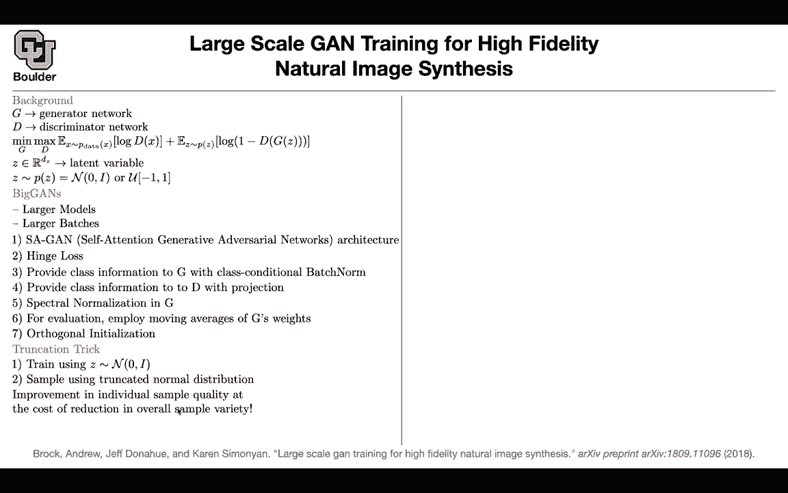
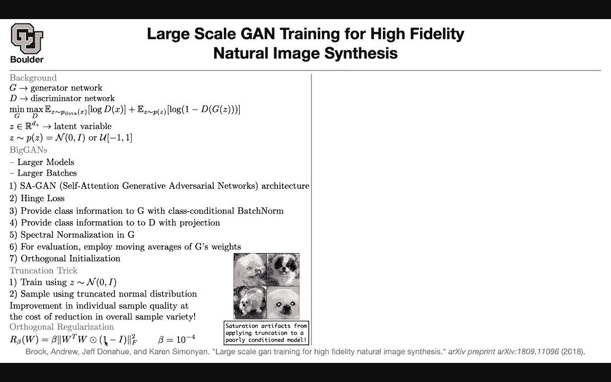
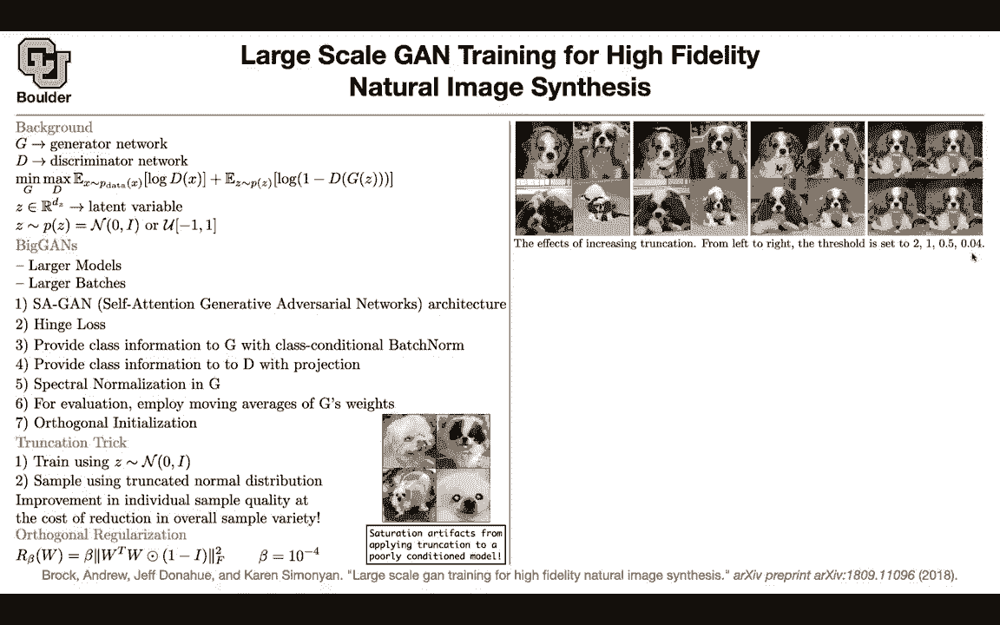

# 🎨 课程 P155：BigGANs 详解

在本节课中，我们将学习 BigGANs，这是一种用于生成高分辨率、高保真度自然图像的技术。我们将探讨其核心思想、关键技术和实现细节，帮助初学者理解如何通过扩大模型规模和批次大小来提升生成图像的质量。

---

## 🏗️ 背景与基本架构

在生成对抗网络中，我们有一个生成器和一个判别器。生成器负责从潜在变量中生成图像，判别器则负责判断图像是真实的还是生成的。在 BigGANs 中，我们主要关注如何通过工程手段提升生成图像的质量。

以下是 GAN 的基本架构：

```python
# 生成器 G
z = sample_from_normal()  # 从正态分布中采样潜在变量
fake_image = G(z)         # 生成假图像

# 判别器 D
real_score = D(real_image)  # 判别真实图像
fake_score = D(fake_image)  # 判别生成图像
```

---

## ⚙️ BigGANs 的核心技术

上一节我们介绍了 GAN 的基本架构，本节中我们来看看 BigGANs 如何通过一系列技术提升生成图像的质量。

BigGANs 是一篇工程性论文，包含许多细节。以下是其核心技术要点：

1.  **扩大模型和批次大小**：通过使用更大的模型和更大的批次，提升生成图像的质量。
2.  **自注意力机制**：在生成器中引入自注意力机制，以捕捉图像中的长距离依赖关系。
3.  **铰链损失**：使用铰链损失函数来训练生成器和判别器。
4.  **条件生成**：在 ImageNet 等大规模数据集上，通过类别标签进行条件生成。
5.  **谱归一化**：对生成器进行谱归一化，稳定训练过程。
6.  **权重移动平均**：在生成器训练过程中，保持权重的移动平均，用于生成最终图像。
7.  **正交初始化**：使用正交初始化方法初始化权重。
8.  **截断技巧**：在生成阶段，从截断的正态分布中采样潜在变量，以提升图像质量。

---

## 🏷️ 条件生成的具体实现

在 BigGANs 中，条件生成通过以下方式实现：

*   **生成器中的条件**：通过修改批归一化层，将类别信息融入生成过程。具体来说，在批归一化后，使用类别信息进行重新缩放和偏置调整。
*   **判别器中的条件**：将类别标签转换为独热编码向量，并通过投影层（矩阵向量乘法）将其作为额外输入提供给判别器。

---

## 🎯 截断技巧与正交归一化

截断技巧是 BigGANs 中的一项重要技术。在训练阶段，我们从标准正态分布中采样潜在变量；但在生成阶段，我们从截断的正态分布中采样。这样做可以提升单个样本的质量，但会降低生成图像的多样性。

截断技巧仅在权重经过正交归一化时有效。如果不进行正交归一化，生成图像可能会出现伪影，例如眼睛颜色错误或背景颜色混乱。

在训练过程中，我们通过添加正交正则化项来近似实现权重的正交性：

```python
# 正交正则化项
orthogonal_loss = torch.norm(W @ W.T - I, p='fro')
```

---





## 📊 截断技巧的效果分析

随着截断区间的缩小（例如从 2 缩小到 0.4），生成图像的多样性会降低，但图像质量会提升。例如，在生成狗的类别时，初始阶段会生成多种狗的图像，但随着截断区间的缩小，多样性减少，但每张图像的质量更高。

在评估生成图像质量时，我们通常使用以下两个指标：

*   **FID（Fréchet Inception Distance）**：数值越低越好。
*   **IS（Inception Score）**：数值越高越好。

不同配置（如批次大小、通道乘数、参数量等）会影响这些指标的表现。

---



## 📈 训练稳定性与谱归一化

在训练过程中，生成器和判别器的权重矩阵的奇异值可能会出现爆炸性增长，这是模型崩溃的典型症状。生成器对此更为敏感，而判别器相对不敏感。谱归一化通过约束权重矩阵的谱范数，有效缓解了这一问题，提升了训练的稳定性。

---

## 🎓 总结

在本节课中，我们一起学习了 BigGANs 的核心思想与关键技术。通过扩大模型规模、使用自注意力机制、条件生成、谱归一化、权重移动平均、正交初始化和截断技巧，BigGANs 能够生成高质量、高分辨率的自然图像。这些技术不仅提升了生成图像的质量，还增强了训练的稳定性，为大规模图像生成任务提供了有力的工具。