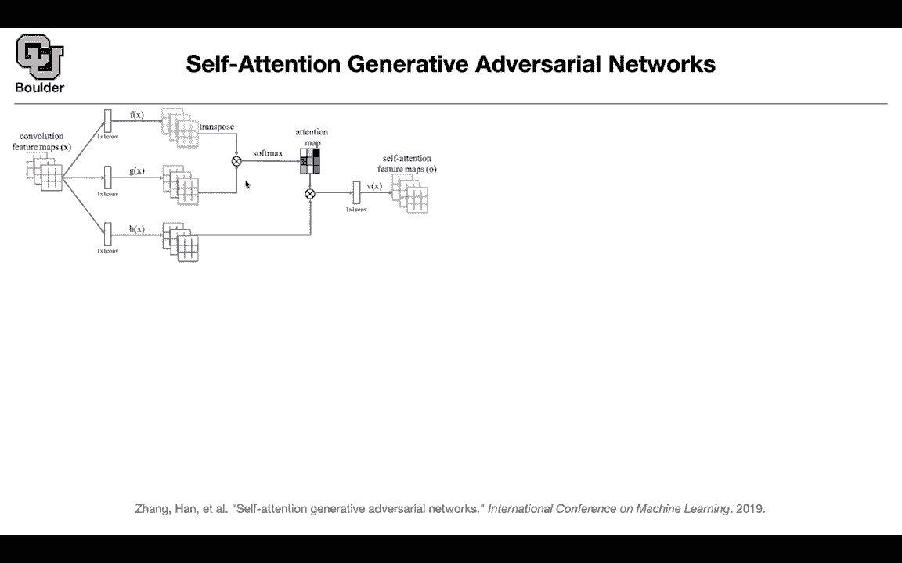
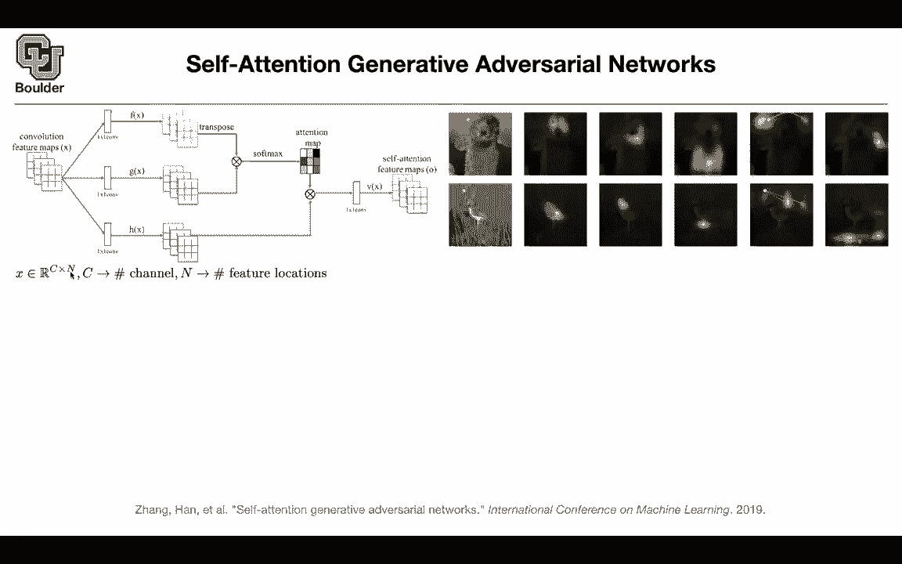
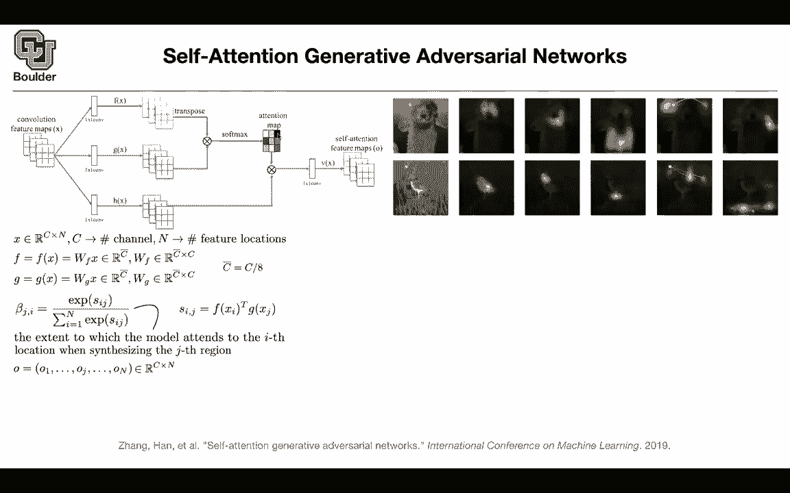
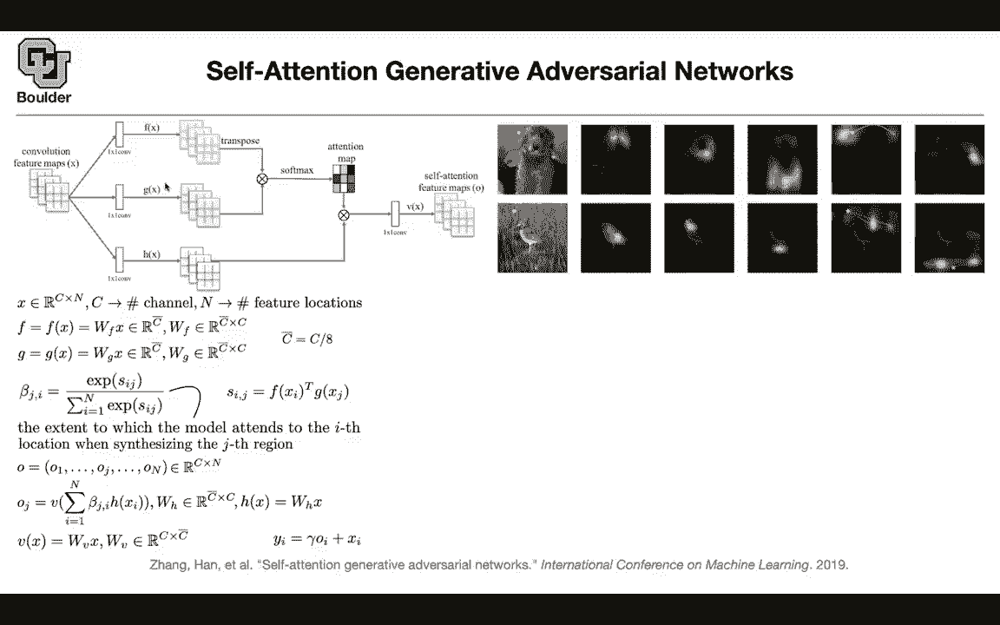
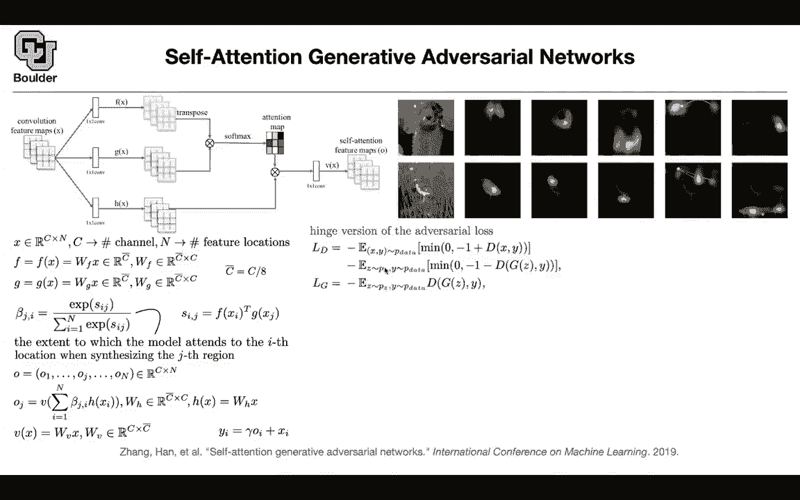
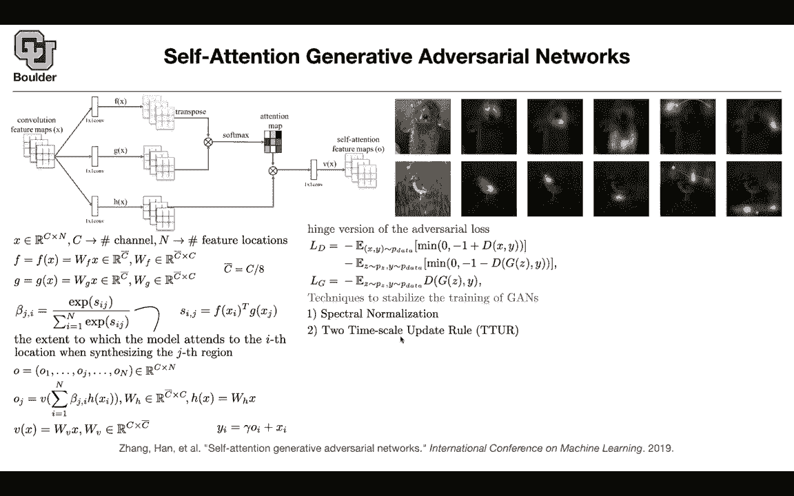
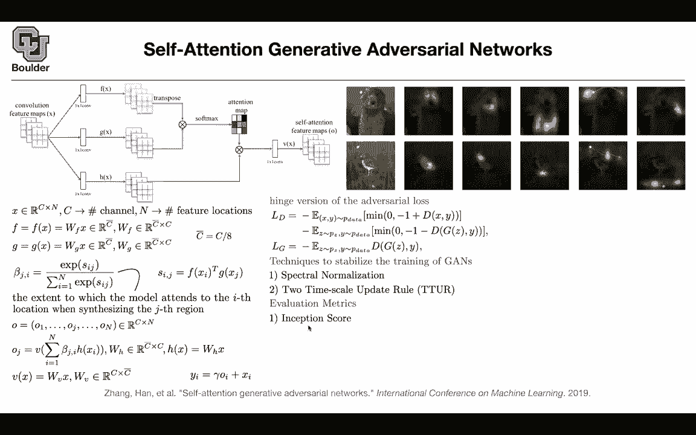

# 课程 P157：L71.2 - 自注意力生成对抗网络 🧠🎨

在本节课中，我们将要学习自注意力生成对抗网络。这是一种改进的GAN架构，旨在解决传统GAN在生成复杂图像时可能出现的结构不一致问题。通过引入自注意力机制，模型能够更好地理解图像不同部分之间的关系，从而生成更协调、更逼真的图像。

---

## 为什么需要自注意力机制？🤔

上一节我们介绍了自注意力GAN的目标。本节中我们来看看为什么需要它。

在自注意力机制提出之前，GAN在生成图像时存在一致性问题。例如，生成一只鸟时，鸟喙可能出现在不合理的位置，或者鸟腿缺失、位置错误。这些不一致性在ImageNet等复杂数据集上尤为明显。

一个可能的原因是，传统的卷积操作是局部的。卷积核只能关注其感受野内的像素，无法“看到”图像中距离较远的其他部分。因此，引入能够建立长距离依赖关系的注意力机制，有望帮助生成的图像在结构上更加一致。

---

## 自注意力机制如何工作？🔍

理解了问题所在后，本节我们来深入探讨自注意力模块的具体框架。

以下是自注意力模块的计算流程：

1.  **特征提取**：首先，输入图像 `X` 经过一系列卷积层，得到一个特征图。这个特征图通道数更多，但空间尺寸（像素数）更小。减少像素数至关重要，因为注意力计算成本高昂。如果对每个像素都计算注意力，模型训练将极其缓慢。因此，我们增加通道数以保留信息，同时减少空间尺寸以提高效率。设最终特征图尺寸为 `C x N`，其中 `N = H x W`（即展平后的空间维度）。

2.  **生成查询、键和值**：接着，我们使用三个独立的1x1卷积（本质是全连接层）对特征图进行变换，分别得到三个新的特征图：
    *   `f(x) = W_f * x`， 形状为 `(C̄, N)`， 作为**键（Key）**。
    *   `g(x) = W_g * x`， 形状为 `(C̄, N)`， 作为**查询（Query）**。
    *   `h(x) = W_h * x`， 形状为 `(C, N)`， 作为**值（Value）`。

    其中，`C̄` 通常是一个比 `C` 小的维度，用于降低计算注意力权重的成本。

3.  **计算注意力图**：注意力权重 `β` 通过查询和键的点积，并应用Softmax归一化得到。公式如下：
    `β_{j,i} = exp(s_{ij}) / Σ_{i=1}^{N} exp(s_{ij})`
    其中 `s_{ij} = f(x_i)^T * g(x_j)`。
    这产生一个 `N x N` 的注意力图 `β`。`β_{j,i}` 表示在生成第 `j` 个区域时，模型对第 `i` 个区域的关注程度。

4.  **生成自注意力特征图**：将注意力权重 `β` 与值 `h(x)` 相乘，得到自注意力特征图 `O`：
    `O_j = Σ_{i=1}^{N} β_{j,i} * h(x_i)`
    `O` 的形状为 `(C, N)`， 与原始输入特征图 `x` 的空间尺寸一致。

5.  **残差连接**：最后，将自注意力特征图与原始输入特征图通过一个可学习的缩放参数 `γ` 相加，形成模块的最终输出：
    `y_i = γ * O_i + x_i`
    这种残差连接允许网络首先依赖局部特征（卷积），并逐渐学习利用通过注意力补充的全局信息。

这个自注意力模块可以作为一个即插即用的组件，插入到生成器网络的多个层中（通常建议在较低分辨率层使用，以控制计算成本）。

---

## 训练技巧与评估 📊

现在我们已经了解了核心模块，本节来看看如何训练和评估这样的模型。

为了稳定GAN的训练并提升性能，论文采用了以下几种技术：

*   **损失函数**：使用**铰链损失（Hinge Loss）** 作为对抗损失。
*   **谱归一化**：在判别器和生成器上都应用谱归一化。这有助于约束模型的利普希茨常数，使训练更加稳定，收敛更好。
*   **两时间尺度更新规则**：为生成器和判别器使用不同的学习率（通常判别器的学习率更高），这能进一步改善训练的收敛性。

模型生成的图像质量通过以下指标进行评估：

*   **初始分数**
*   **弗雷歇初始距离**

实验结果表明，结合谱归一化和TTUR能显著提升模型在IS和FID指标上的表现。

---

## 注意力可视化 👀

理论之后，让我们通过可视化直观感受自注意力机制的效果。

下图展示了在生成图像时，特征图上某些点（像素区域）所关注的图像部分：
*   一个**红点**（可能对应眼睛区域）主要关注另一只眼睛和部分面部特征（如眉毛）。
*   一个**蓝点**（可能对应身体区域）关注的是身体部分。
*   另一个**蓝点**关注的是背景。
在生成鸟的图像时，对应鸟腿的区域会同时关注两条腿，而背景区域则关注整体的背景信息。这证实了自注意力机制确实帮助模型建立了图像不同语义部分之间的关联，从而生成结构更一致的图像。

---

## 总结 🎯

本节课中，我们一起学习了自注意力生成对抗网络。

我们首先探讨了传统GAN在生成全局一致图像时的局限性，并指出局部卷积操作的不足。接着，我们详细剖析了自注意力模块的五个核心步骤：特征提取、生成查询/键/值、计算注意力图、合成自注意力特征以及残差连接。该模块使生成器能够建模图像中远距离区域的关系。此外，我们还介绍了稳定训练的关键技术，如谱归一化和TTUR，以及评估生成质量的IS和FID指标。最后，通过注意力可视化，我们直观地看到了模型如何关注图像的相关部分以生成协调的结果。

自注意力机制为GAN生成更复杂、更结构化的图像提供了强大的工具。