# 课程 P158：L71.3 - StarGAN 🎭

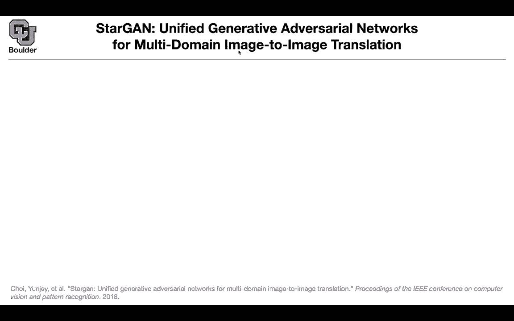

在本节课中，我们将学习 StarGAN 模型。StarGAN 是一种用于多领域图像转换的生成对抗网络，它能够使用一个单一的生成器模型，将输入图像转换到多个不同的目标领域（例如改变发色、性别、年龄等），而无需为每对领域组合训练独立的模型。

上一节我们介绍了 CycleGAN 等图像到图像的转换模型。本节中我们来看看 StarGAN 如何解决多领域转换问题，并仅使用一个生成器网络。

## 多领域图像转换的挑战

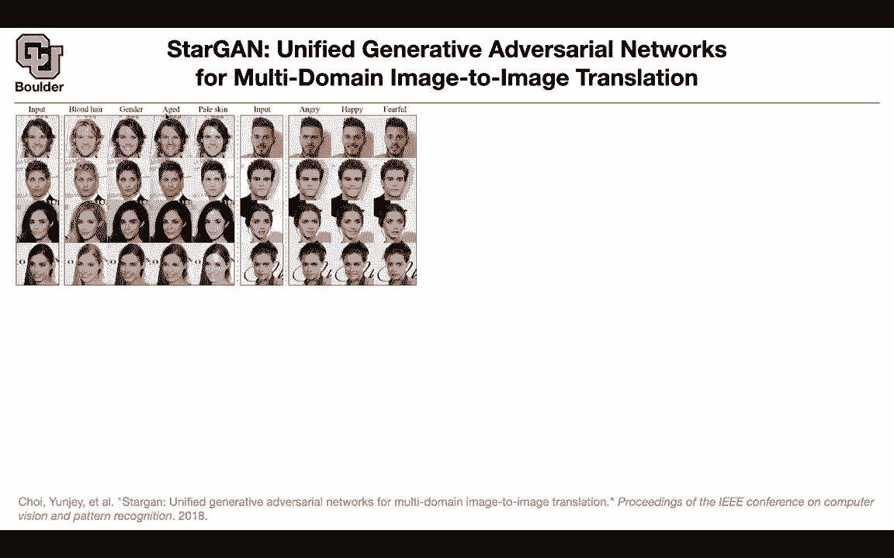

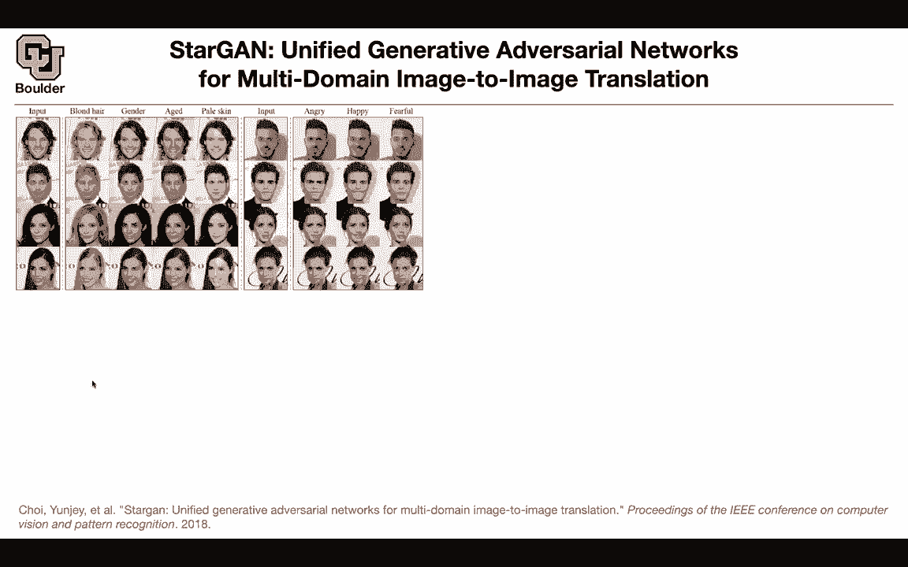

在 CycleGAN 框架中，如果你想在多个领域（例如金发、性别、年龄、肤色、表情）之间进行图像转换，你需要为每一对源领域和目标领域训练一个独立的生成器。这将导致组合爆炸，需要非常多的神经网络。

**问题**：能否只用一个神经网络来完成所有领域的转换？

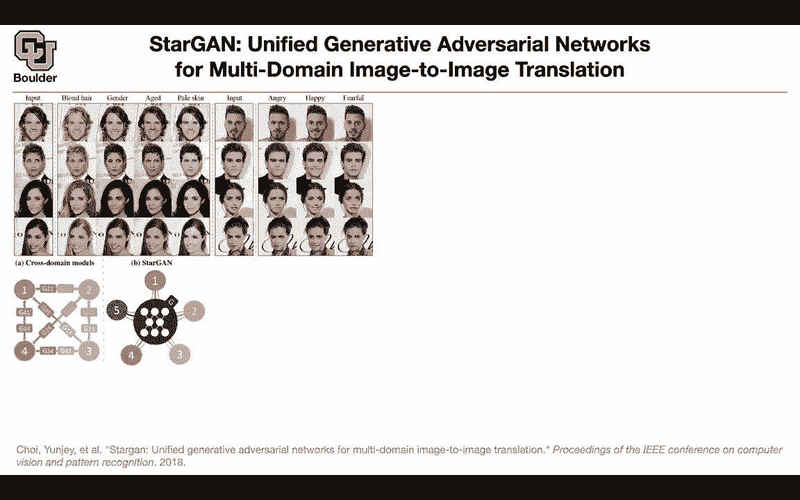

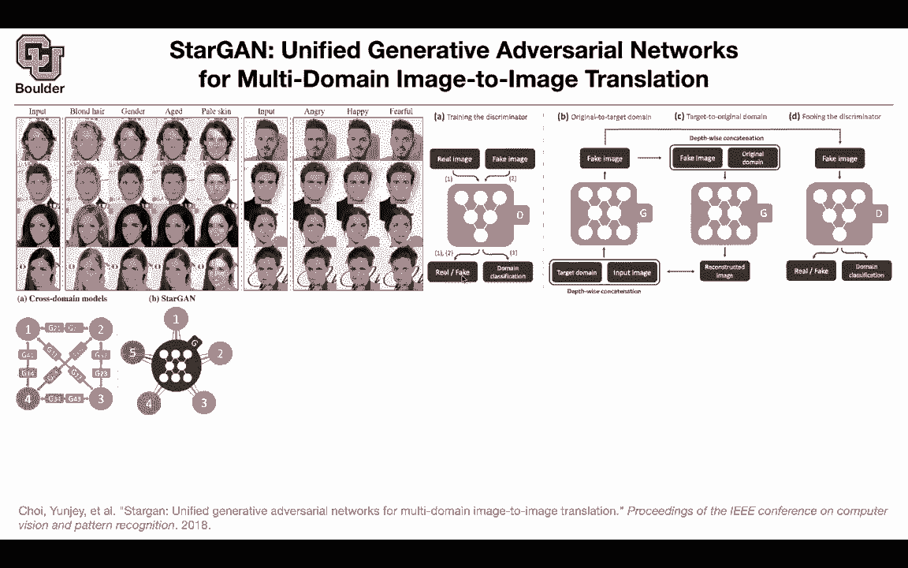

## StarGAN 的核心思想 💡

StarGAN 的核心思想是**对生成器进行条件控制**。生成器不仅接收输入图像，还接收一个表示目标领域的条件向量（例如，“金发”、“女性”）。这样，一个生成器就能根据不同的条件生成不同领域的图像。

以下是 StarGAN 模型的主要组件：

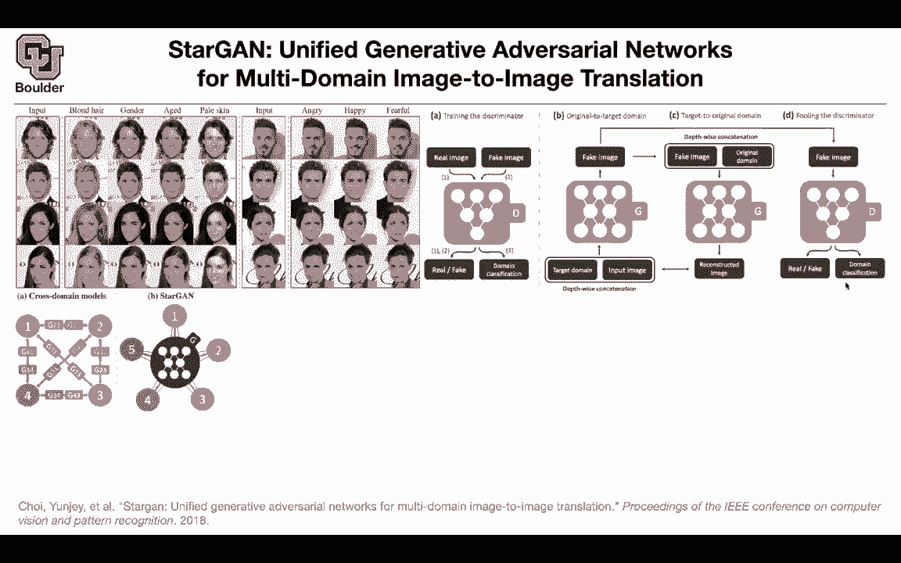

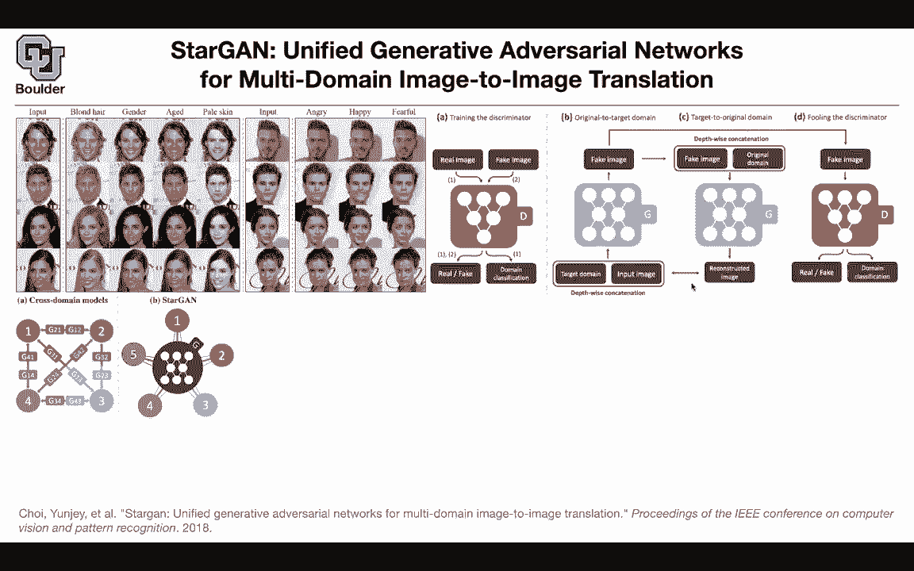

1.  **条件生成器 (G)**：接收输入图像 `x` 和目标领域标签 `c`，生成目标领域的图像 `G(x, c)`。
2.  **判别器 (D)**：不仅需要判断图像是真实的还是生成的，还需要对图像所属的领域进行分类。

## 模型架构与损失函数 🔧

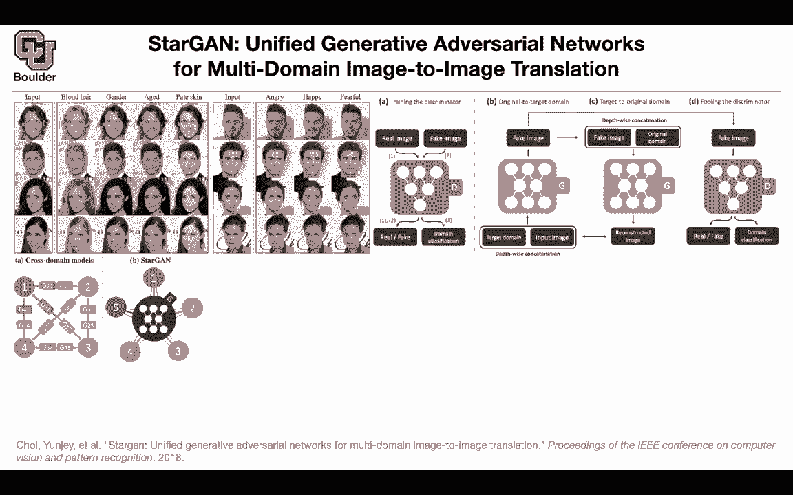

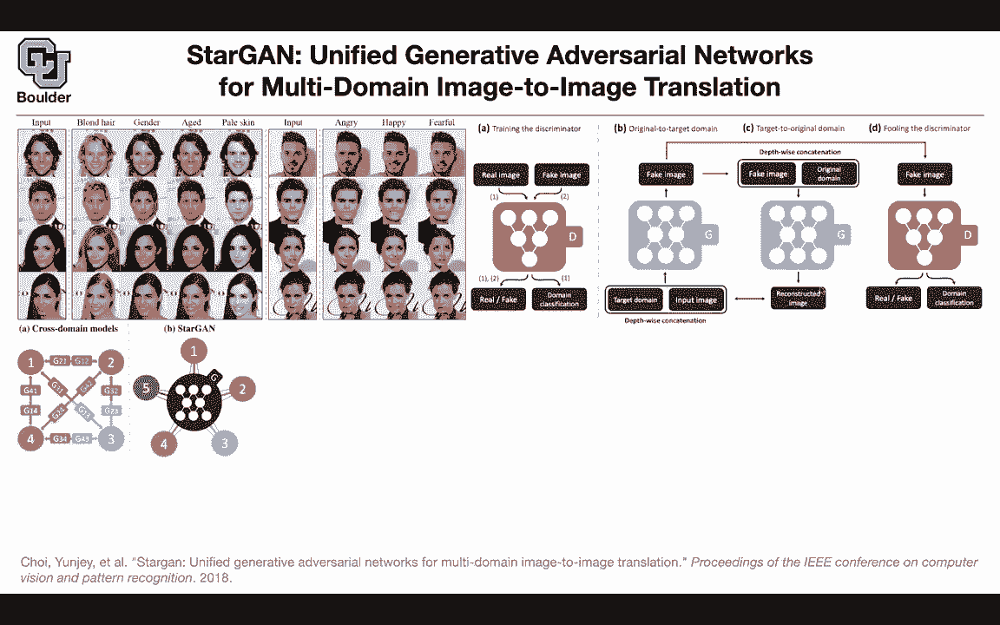

StarGAN 的训练涉及多个损失函数，共同确保生成图像的质量和领域准确性。

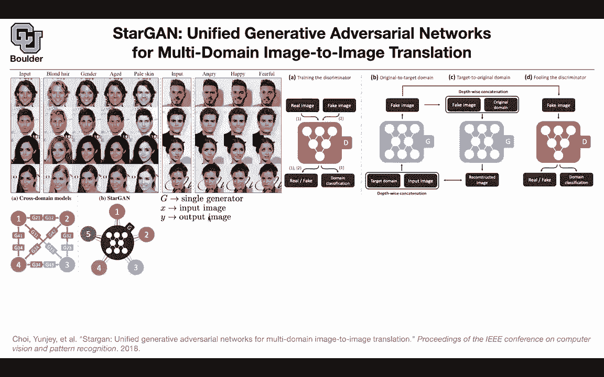

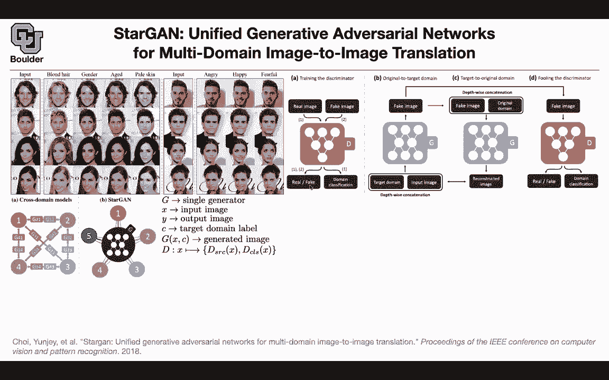

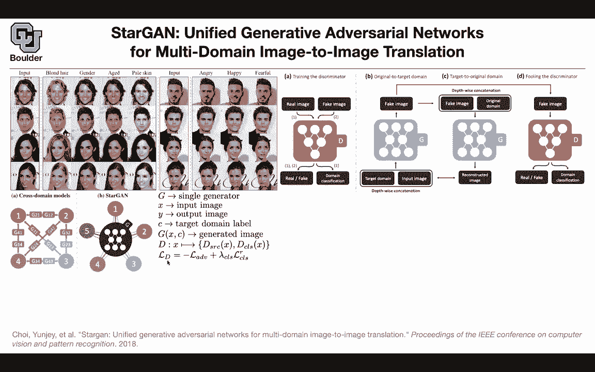

### 1. 对抗损失 (Adversarial Loss)

这是 GAN 的基础损失，用于使生成图像看起来真实。判别器 `D` 试图区分真实图像和生成图像，而生成器 `G` 试图欺骗判别器。

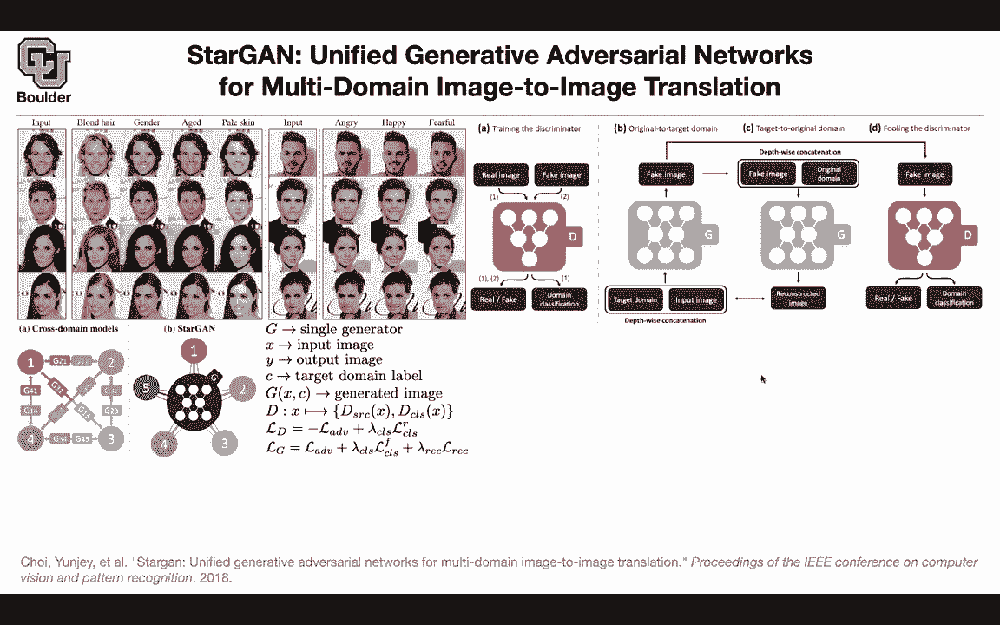

对于生成器，对抗损失是：
`L_adv = E_x [log(1 - D(G(x, c)))]` 或使用 `-log(D(G(x, c)))` 的变体。

### 2. 领域分类损失 (Domain Classification Loss)

这个损失确保生成图像属于指定的目标领域 `c`。
*   对于真实图像 `x`，判别器 `D` 需要正确预测其真实领域标签 `c‘`。
*   对于生成图像 `G(x, c)`，判别器 `D` 需要将其分类为目标领域 `c`。

分类损失通常使用交叉熵损失函数。

### 3. 重构损失 (Reconstruction Loss)

由于训练数据是非配对的，我们需要确保图像转换时能保留原图的身份信息（如人物身份、背景）。这是通过**循环一致性**实现的。

**过程**：
1.  将原图 `x` 从领域 A 转换到目标领域 B，得到图像 `G(x, c_B)`。
2.  再将生成的图像 `G(x, c_B)` 从领域 B 转换回原领域 A，得到重构图像 `G(G(x, c_B), c_A)`。
3.  计算原图 `x` 与重构图像之间的差异作为损失，通常使用 L1 损失：`L_rec = || x - G(G(x, c_B), c_A) ||_1`。

## 处理多个数据集 🌐

在实际应用中，我们可能拥有多个不同属性的数据集（例如 CelebA 人脸数据集和 RaFD 表情数据集）。StarGAN 通过一个**掩码向量 (Mask Vector)** `m` 来处理。

*   `m` 也是一个独热编码向量，指示图像来自哪个数据集。
*   目标领域标签 `c` 被扩展为 `[c, m]` 的拼接形式，作为生成器的条件输入。
*   如果一个数据集的领域类别较少，则在 `c` 的相应位置用零填充，以保持所有条件向量的维度一致。

## 训练细节 ⚙️

StarGAN 的训练遵循标准的 GAN 迭代范式：
1.  固定生成器 `G`，更新判别器 `D` 若干次。
2.  固定判别器 `D`，更新生成器 `G` 一次。
3.  重复上述过程。

为了提高训练稳定性，论文中使用了**梯度惩罚 (Gradient Penalty)** 技术（来自 WGAN-GP），它通过约束判别器的梯度范数来使其满足 Lipschitz 连续性。

## 模型应用示例 🖼️

一旦模型训练完成，应用非常简单：
1.  准备输入图像（例如，一位黑发男性）。
2.  指定目标领域条件（例如，一个表示“金发”的独热向量）。
3.  将图像和条件向量输入生成器 `G`，即可得到金发版本的图像。
4.  你可以通过改变条件向量，依次进行多次转换（例如，先变金发，再改变性别）。

虽然多次转换可能会导致图像质量轻微下降，但少数几次转换通常效果良好。

## 总结 📝

本节课中我们一起学习了 StarGAN 模型。StarGAN 通过引入条件生成器和多任务判别器，巧妙地解决了多领域、非配对数据的图像转换问题。它使用一个单一的生成器网络，结合对抗损失、领域分类损失和循环重构损失，实现了高质量、可控的图像风格迁移。与需要多个生成器的 CycleGAN 相比，StarGAN 在模型复杂度和灵活性上具有显著优势，是图像合成领域的一个重要进展。