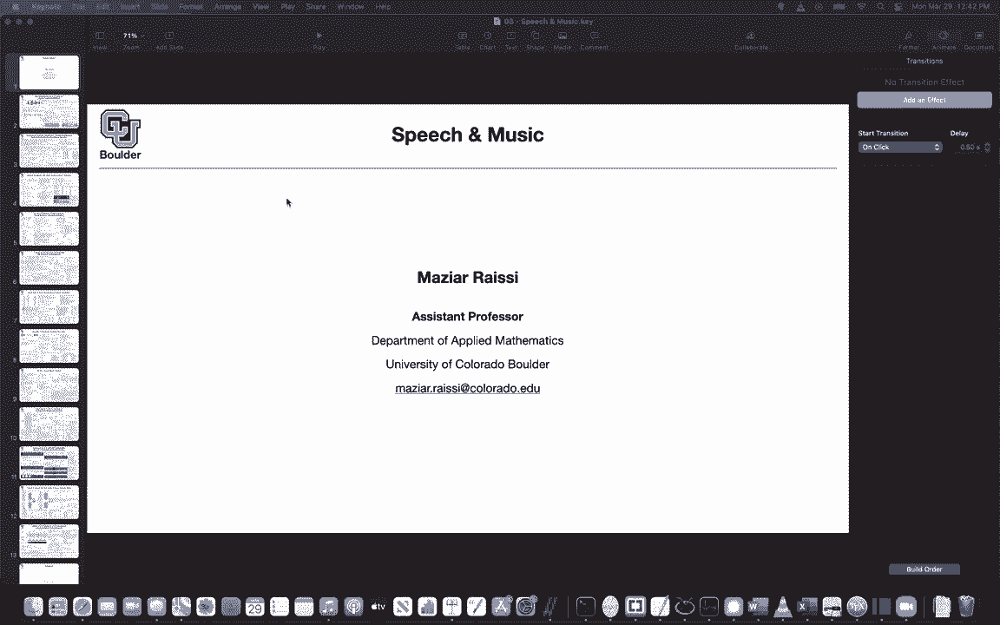
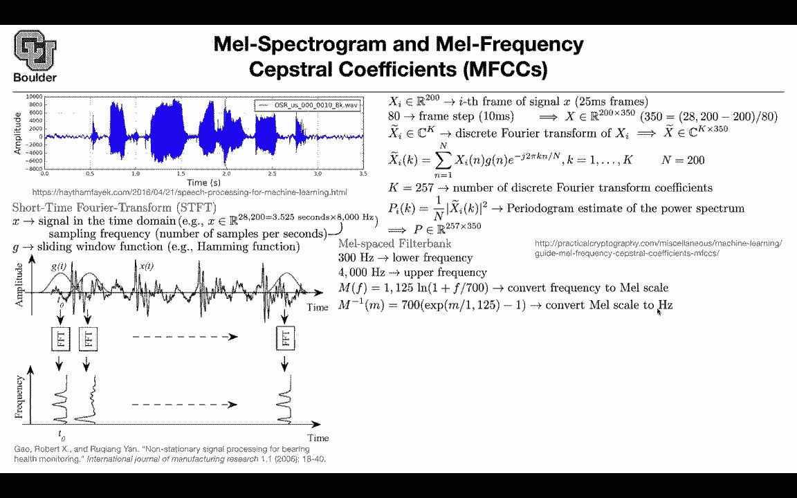

# 🎵 课程 P159：梅尔谱图与MFCCs

在本节课中，我们将学习如何处理语音和音乐这类数据。我们将了解如何将原始的音频波形转换为两种在深度学习中常用的特征表示：**梅尔谱图**和**梅尔频率倒谱系数**。理解这些特征的构建过程，是进行语音识别、音乐分类等任务的重要基础。

---

## 从波形到频谱

到目前为止，我们处理过文本和图像数据，并学习了针对它们的判别式模型和生成式模型。现在，让我们来看一种新的数据类型：语音和音乐。我们将尝试使用这类数据进行判别式分析和生成式处理。

但当我们处理语音时，数据是什么样的？你如何表示你的数据？在深度学习中，一切都始于数据。当你进行机器学习和深度学习时，经常会听到这些术语：**梅尔谱图**、**对数梅尔谱图**和**梅尔频率倒谱系数**。了解它们以及如何从音频文件构建它们，是一个好主意。

假设你有一个约3.5秒的音频文件，格式为 `.wav` 或其他格式。下图展示了它的原始波形。我们的目标是将这个波形转换为梅尔谱图和MFCCs。

---

## 短时傅里叶变换

第一步是进行傅里叶变换。但如果你对整个信号做傅里叶变换，你只是将时间信息转换为了频率信息，并得到频率的幅度。这并没有帮助我们，因为我们希望同时保留时间和频率信息。

为此，我们将使用**短时傅里叶变换**。在时域中，信号可以看作一个长向量。这个向量的维度取决于音频时长和采样率。例如，一个3.5秒、采样率为8000 Hz的信号，总维度为 28200。

视觉上，我们是这样操作的：我们有一个时域信号，然后创建一系列**窗口**。第一个窗口、第二个窗口、第三个窗口，直到最后一个窗口。窗口之间会有**重叠**。

每个窗口内的信号会乘以一个**窗函数**（例如汉明窗），然后进行**快速傅里叶变换**。窗函数的作用是让信号在窗口两端趋于零，以满足傅里叶变换的要求。

数学上，我们具体做了什么？假设我们取第2帧，窗口大小为25毫秒（0.025秒）。乘以采样率8000，我们得到一个200维的向量。因此，每个窗口都是200维的。

同时，我们指定**帧移**为10毫秒。这意味着窗口每次向前移动10毫秒（即80个采样点），从而产生重叠。

最终，整个信号可以表示为一个矩阵。它有200行（来自窗口大小）和350列（来自时间帧数）。350这个数字是通过总信号长度、窗口大小和帧移计算得出的。

---

## 计算功率谱

接下来，我们对每个窗口进行**离散傅里叶变换**。DFT会将实数信号转换为复数系数。假设我们保留K个傅里叶系数，最终会得到一个大小为 K x 350 的复数矩阵。

离散傅里叶变换的公式如下：

`X[k] = Σ_{n=0}^{N-1} x[n] * e^{-i 2π k n / N}`

其中，`N` 是每帧信号的大小（这里是200），`k` 是频率索引。

我们通常不喜欢处理复数，因此会取复数系数的**绝对值**（或模），然后平方并除以每帧的样本数 `N`。这样就得到了**功率谱**的周期图估计。

假设我们保留257个系数（K=257），那么功率谱矩阵 `P` 的维度就是 257 x 350。

---

## 转换到梅尔尺度

目前，我们的频率轴单位是赫兹（Hz），这是一个数学尺度。但我们希望使用与人类听觉感知更相关的尺度，即**梅尔尺度**。

我们选择一个频率范围，例如下界为0或300 Hz，上界为4000 Hz（由采样率8000 Hz的一半得到，这是奈奎斯特频率）。然后，我们将赫兹频率转换为梅尔频率。

转换公式如下：

`mel(f) = 2595 * log10(1 + f / 700)`

你可以将其理解为从摄氏度到华氏度的转换。人类耳朵更适应梅尔尺度。从公式可以看出，转换中包含了**对数运算**，这反映了人耳对低频变化更敏感的特性。

转换后，我们在梅尔尺度上**线性地**创建一组**三角滤波器组**。例如，我们创建26个三角滤波器。

在梅尔尺度上，这些滤波器是等间距的（线性），但当我们映射回赫兹尺度时，它们就变成了非均匀的。每个滤波器本质上是一个稀疏向量，在特定频率区域值为1，其余为0。

我们将功率谱矩阵 `P` 与这个滤波器组矩阵 `T` 相乘。矩阵乘法中的求和运算，计算的是每个三角滤波器在特定时间帧内覆盖的**总能量**。

结果矩阵 `E` 的每个元素 `E[i, l]` 表示在第 `i` 个时间帧、第 `l` 个滤波器中的能量。

---

## 梅尔谱图与MFCCs

对能量取**对数**，就得到了**对数梅尔谱图**。这是深度神经网络通常接收的输入格式。如果不取对数，则得到普通的梅尔谱图。

对于传统的机器学习方法（如高斯混合模型和隐马尔可夫模型），我们通常会再进一步，计算**梅尔频率倒谱系数**。

以下是计算步骤：
1.  计算对数梅尔谱图。
2.  对对数梅尔谱图的每一帧进行**离散余弦变换**。

DCT类似于DFT，但只保留余弦分量，丢弃正弦分量，从而得到实数系数。这些系数就是MFCCs。DCT的公式如下：

`C[n] = Σ_{k=0}^{M-1} S[k] * cos(π n (k + 0.5) / M)`

其中，`S[k]` 是对数梅尔谱图在第k个频带上的能量，`M` 是滤波器数量（例如26），`C[n]` 是第n个MFCC系数。

---

## 常见问题与动机

**为什么要进行这一系列转换？**
1.  **降维与结构化**：将巨大的原始波形向量（如28200维）转换为更短、结构化的序列（如350帧），更便于处理。
2.  **符合深度学习偏好**：转换后的特征是向量或矩阵形式，深度学习模型擅长处理这类数据。
3.  **领域标准**：阅读相关论文时，你会频繁遇到梅尔谱图和MFCCs。理解它们是读懂论文的基础。
4.  **信息保留**：这个过程信息损失很小。基于“短时平稳”的合理假设（在25毫秒内，语音信号特性基本不变），你可以在原始音频和梅尔谱图之间进行近似转换。

**MFCCs和梅尔谱图的主要区别是什么？**
MFCCs是在得到**对数梅尔谱图**之后，再对其应用**离散余弦变换**而得到的一组系数。可以将其视为梅尔谱图的一种压缩或“去相关”表示，它更侧重于信号的包络信息。

---

## 总结

本节课中，我们一起学习了音频信号处理的核心特征提取流程：
1.  我们首先对原始音频进行**短时傅里叶变换**，得到时频谱。
2.  然后计算**功率谱**，并将其通过**梅尔滤波器组**，转换到符合人耳感知的**梅尔尺度**，得到梅尔谱图。
3.  对梅尔谱图取对数后，可直接用于深度学习模型。
4.  对于传统机器学习，可进一步应用**离散余弦变换**，得到**梅尔频率倒谱系数**。

这些转换提供了一种对深度学习更为方便的数据表示方式，同时保留了音频信号的关键信息。大多数相关论文都会使用梅尔谱图，而MFCCs则在传统方法中更为常见。如果你想动手实践，网上有许多教程视频展示了如何用代码实现这些转换。