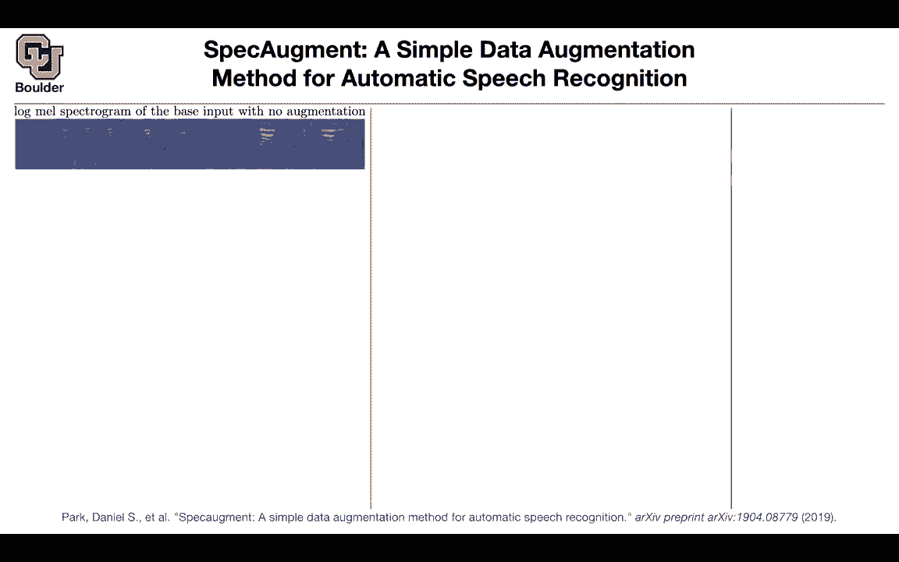
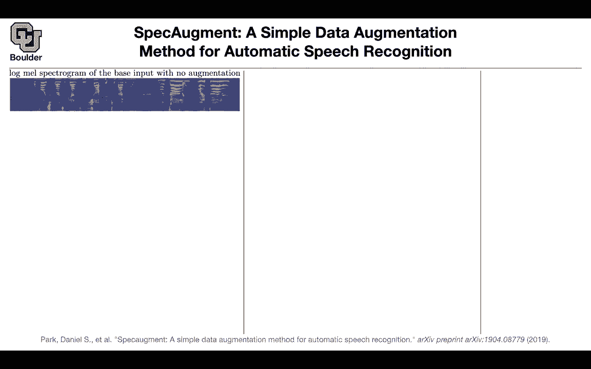
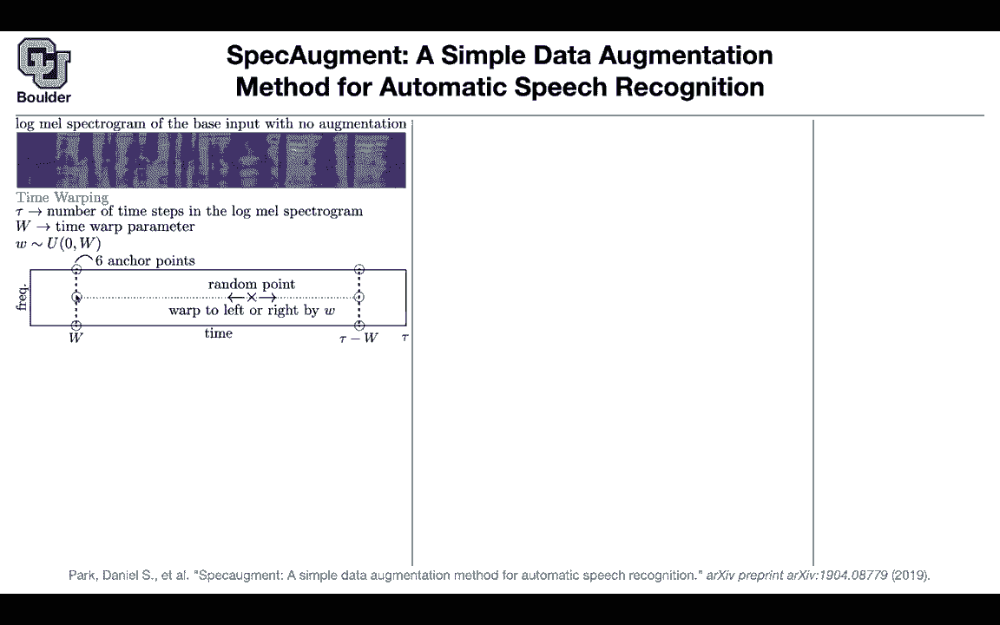
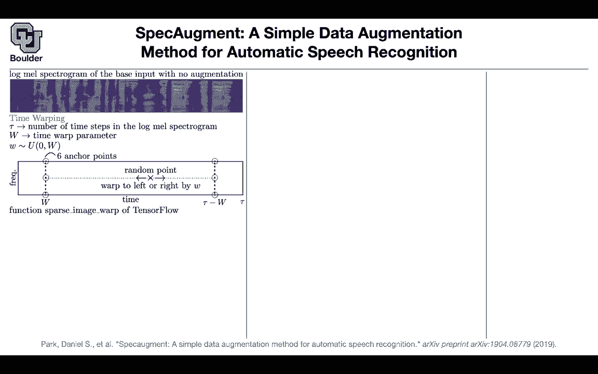
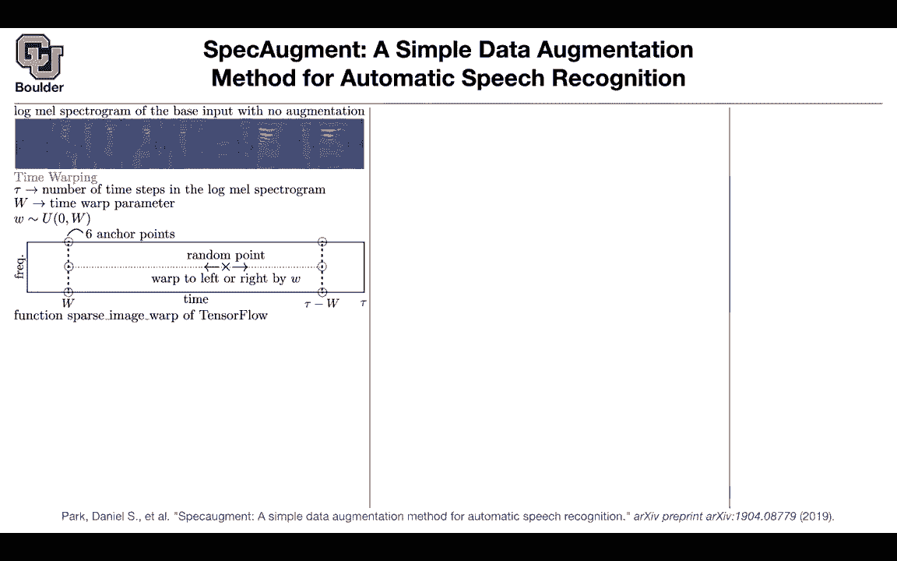
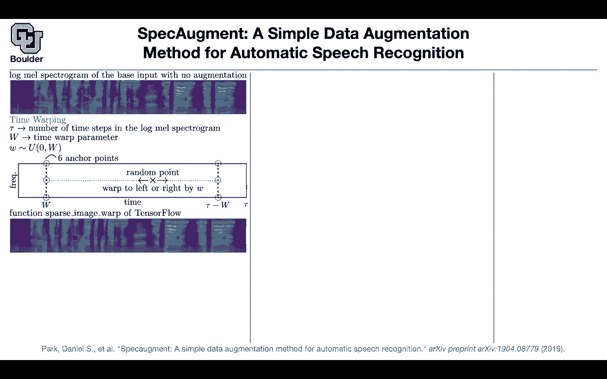
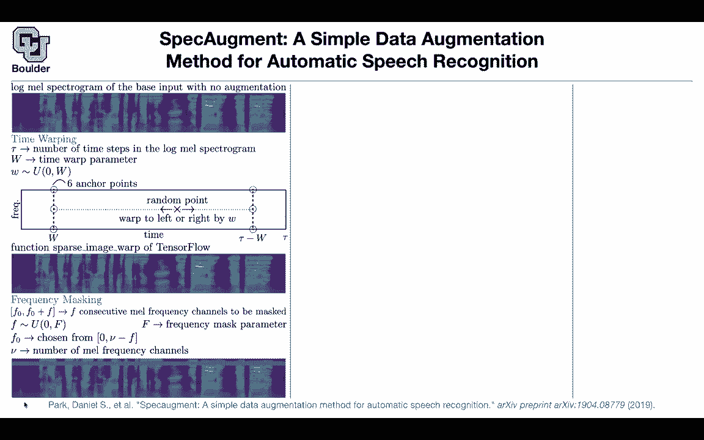
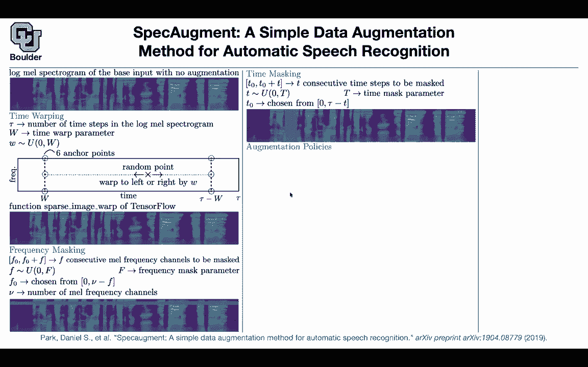
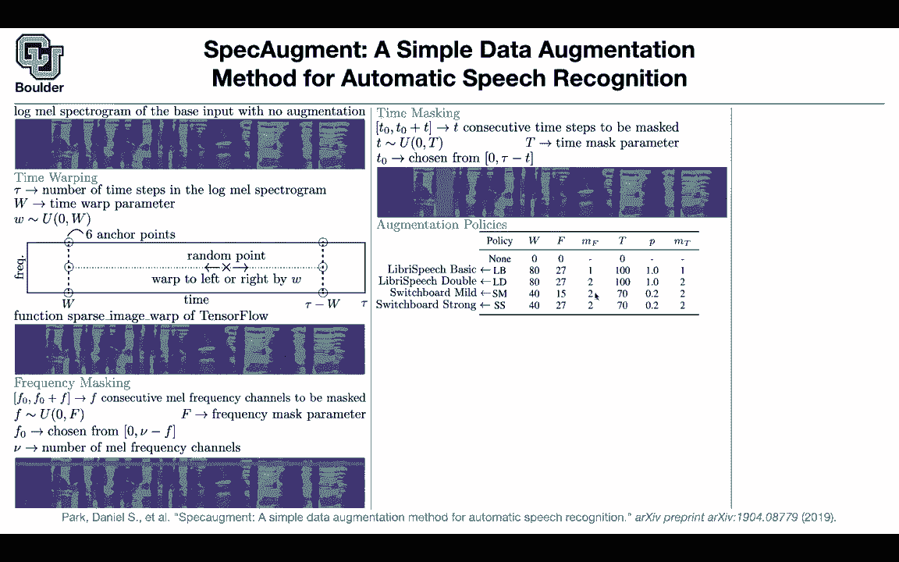
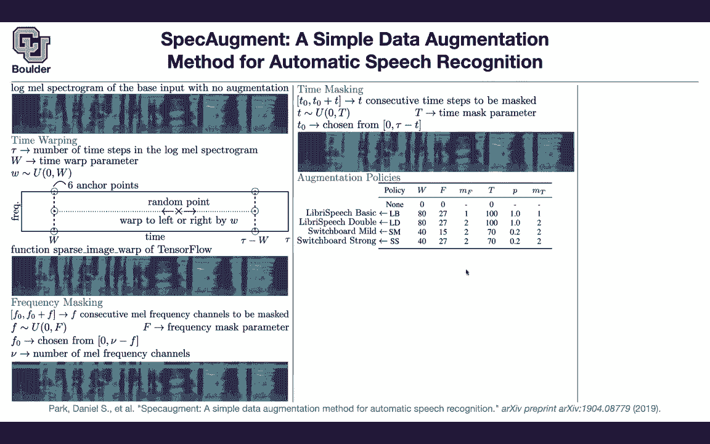

# 🎤 课程 P170：L76.1 - Listen, Attend, and Spell 教程

在本节课中，我们将学习语音识别中的数据增强技术，并比较两种主流的语音识别模型架构：基于CTC损失的模型和基于注意力机制的编码器-解码器模型（如Listen, Attend, and Spell）。我们将探讨这些方法的核心思想、实现方式以及各自的优缺点。

## 📊 数据增强在语音识别中的应用

上一节我们介绍了SpecAugment，这是一种用于语音的简单数据增强技术。我们知道数据增强有助于图像和文本任务。那么，当语音数据规模较小时，数据增强是否有帮助？如果有，该如何实施？

以下是几种常见的语音数据增强方法：

*   **时间扭曲**：选取若干个锚点，然后随机地将其他所有点向左或向右移动。本质上就是选取一个点并将其左右移动，并相应地调整其他点。这可以通过TensorFlow中的`sparse_image_warp`来实现，即对你的图像（此处指对数频谱图）进行扭曲。
*   **频率掩码**：想象一个频率轴，然后掩码其中的一部分。
*   **时间掩码**：在时间轴上进行掩码。

我们应该进行时间扭曲，还是频率掩码，或是时间掩码？或者结合使用所有方法？也许可以执行两次频率掩码、几次时间掩码以及时间扭曲。这正是我们上一节结束时所讨论的内容。因此，你可以组合使用多种增强方式。

数据增强非常重要，因为你可以取一个样本，并将其转化为多个样本（例如五个），从而将数据集规模扩大五倍。我们知道神经网络喜欢更大的数据集。

## 🔄 编码器-解码器与注意力模型

在选择了数据增强方法之后，剩下的就是选择损失函数并进行训练。你可以使用CTC损失。

之前展示时，神经网络输入数据的长度通常小于输出文本的长度。有人可能会问：为什么不直接将信号编码成一个向量，然后解码该向量，就像在语言任务中所做的那样？我们在语言任务中遇到过相同的问题，输入句子和输出句子（例如英语和法语）长度可能不同。我们当时的解决方案是编码然后解码。

我们在图像任务中也遇到过类似情况，图像输入，需要输出文本。在那里我们再次使用了编码器-解码器的思想，甚至更高级的“Show, Attend and Tell”模型。你肯定记得那篇论文：先查看图像并编码，然后解码，中间可以加入注意力机制。

那么，能否为语音做类似的事情？答案是肯定的。

有一篇名为**《Listen, Attend and Spell》**的论文，它与我们之前讨论的“Show, Attend and Tell”非常相似。具体做法是：获取对数频谱图，将其输入神经网络（例如两层CNN，带有一些最大池化和步幅，假设步幅为2）进行编码。编码器由一堆LSTM层堆叠而成，每层LSTM的隐藏层大小为`W`。这将产生一系列向量，在解码输出文本时可以对它们进行注意力加权。

然后，你可以将这些注意力向量与之前的解码器状态一起，输入到两层RNN中，从而得到转录文本的词元。这样就不再需要CTC损失了，你可以使用常规的文本任务损失函数。你的文本可以用词片来表示，就像在处理文本（例如BERT模型）时所做的那样。

你可以添加一个语言模型，解码过程就是一个简单的束搜索（但不再是语音的束搜索），然后以常规方式进行解码并报告结果。

## ⚖️ CTC模型与注意力模型的比较

CTC损失相对于这类注意力模型的一个优势是，CTC损失利用了一些额外信息。这个额外信息是：**输入序列总是（或通常）比输出序列长**。你利用这个假设来设计CTC损失，这也许是CTC效率较高的原因之一。

另一个优点是，你不再需要处理编码器-解码器架构，也不需要复杂的注意力机制。当然，你也可以在这里加入注意力和Transformer，我们稍后会看到一个例子，并将其与CTC损失结合使用。

就性能比较而言，它们会给出相似的性能。对于其中一种（CTC），你在编写损失函数时需要更费心思；而对于另一种（注意力模型），你在设计神经网络结构（如添加Listen, Attend and Spell模块）时需要更费心思。这就是比较两者的方式。

## 📈 不同数据增强方法的效果分析

让我们回到数据增强这个主题，尝试研究每种增强类型的效果。如何比较时间扭曲、频率掩码和时间掩码？

如果全部使用，测试词错误率（WER）为**3.7%**（这些数字是百分比）。当你想知道某个部分有多重要时，只需将其移除，看看性能损失多少。

*   如果移除时间扭曲，性能损失非常小，词错误率仅会轻微上升。
*   如果移除时间掩码或频率掩码，性能损失会很大。

因此，时间扭曲不那么重要，但时间掩码和频率掩码非常重要。

## 📚 推荐探索的数据集

以下是两个值得探索的语音数据集：

*   **LibriSpeech**：包含960小时的语音数据。
*   **Switchboard**：包含300小时的音频数据。

## 🎯 总结

本节课中，我们一起学习了语音识别中的数据增强技术，特别是SpecAugment方法。我们比较了基于CTC损失的模型和基于注意力机制的编码器-解码器模型（如Listen, Attend and Spell）的优缺点。我们还分析了不同数据增强方法（时间扭曲、频率掩码、时间掩码）对模型性能的影响，并了解了时间掩码和频率掩码是关键的数据增强手段。最后，我们介绍了两个重要的语音数据集LibriSpeech和Switchboard供进一步探索。