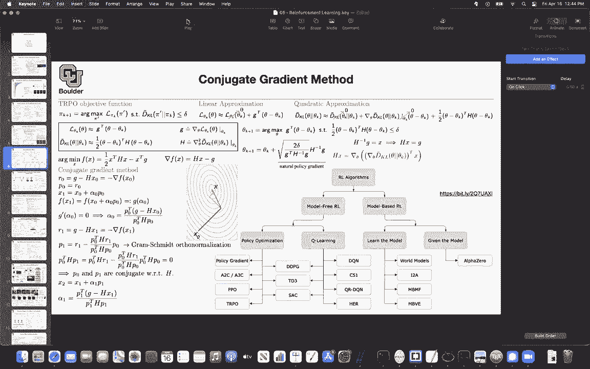

# 强化学习课程 P179：L80.1 - 共轭梯度法 🧮

在本节课中，我们将深入探讨共轭梯度法。我们将回顾其在信赖域策略优化算法中的应用背景，并详细解释该方法的数学原理和计算步骤，旨在帮助初学者理解这一重要的优化技术。

## 概述

上一节我们介绍了信赖域策略优化算法，其核心是一个带约束的优化问题。本节中，我们来看看如何高效地求解该问题中的线性系统，这正是共轭梯度法发挥作用的地方。

## 问题回顾与近似

TRPO的目标是最大化一个关于新策略的目标函数，同时约束新策略与旧策略的KL散度在一个邻域内。具体形式如下：

**目标函数**：`max L(θ) ≈ g^T (θ - θ_k)`
**约束条件**：`(1/2)(θ - θ_k)^T H (θ - θ_k) ≤ δ`

其中，`g` 是目标函数在 `θ_k` 处的梯度，`H` 是KL散度在 `θ_k` 处的海森矩阵。通过拉格朗日乘子法，我们可以得到最优更新步的解析解：

`θ_{k+1} = θ_k + (1/√(2δ)) * H^{-1} g`

然而，直接计算并求逆海森矩阵 `H` 在参数维度极高时（例如百万或万亿级）是计算上的噩梦。

## 共轭梯度法的引入

为了解决海森矩阵求逆的难题，我们引入共轭梯度法。其核心思想是，求解线性系统 `Hx = g` 等价于最小化一个二次函数：

`f(x) = (1/2) x^T H x - g^T x`

该函数的最小值点 `x*` 恰好满足 `Hx* = g`。因此，我们可以通过优化这个二次函数来间接求解 `x`，而无需显式构造和求逆 `H`。

以下是共轭梯度法的主要步骤：

1.  **初始化**：设定初始解 `x_0`，计算初始残差 `r_0 = g - H x_0`，并令初始搜索方向 `p_0 = r_0`。
2.  **迭代更新**：对于第 `k` 次迭代：
    *   计算最优步长：`α_k = (r_k^T r_k) / (p_k^T H p_k)`
    *   更新解：`x_{k+1} = x_k + α_k p_k`
    *   更新残差：`r_{k+1} = r_k - α_k H p_k`
    *   计算共轭系数：`β_k = (r_{k+1}^T r_{k+1}) / (r_k^T r_k)`
    *   更新搜索方向：`p_{k+1} = r_{k+1} + β_k p_k`
3.  **终止条件**：当残差 `r_k` 的范数足够小或达到最大迭代次数时停止。

## 关键优势与计算技巧

共轭梯度法的关键优势在于，它只需要计算 `H` 与向量 `p_k` 的乘积 `H p_k`，而无需存储整个海森矩阵 `H`。这可以通过一次前向-后向自动微分高效完成，极大地降低了计算和存储开销。

直观上，共轭梯度法通过构造一系列相互共轭（即满足 `p_i^T H p_j = 0, i≠j`）的搜索方向，确保在 `n` 维空间中最多经过 `n` 次迭代就能找到精确解（在理想算术精度下）。这比标准的梯度下降法收敛更快。

## 总结

本节课中我们一起学习了共轭梯度法。我们从TRPO的优化问题出发，解释了直接求逆海森矩阵的困难。通过将线性系统求解转化为二次函数最小化问题，我们引入了共轭梯度法，并详细阐述了其迭代步骤。该方法的核心优势在于仅需海森矩阵的向量乘积，从而实现了对高维参数空间的高效、二阶优化。理解这一方法对于掌握现代深度强化学习中的高级策略优化算法至关重要。