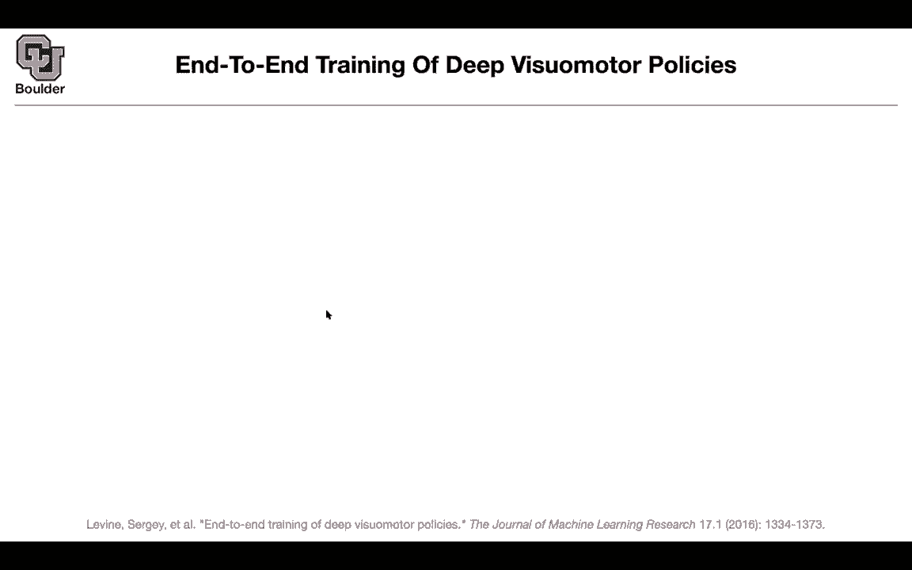
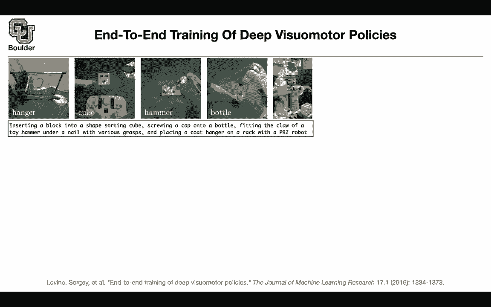
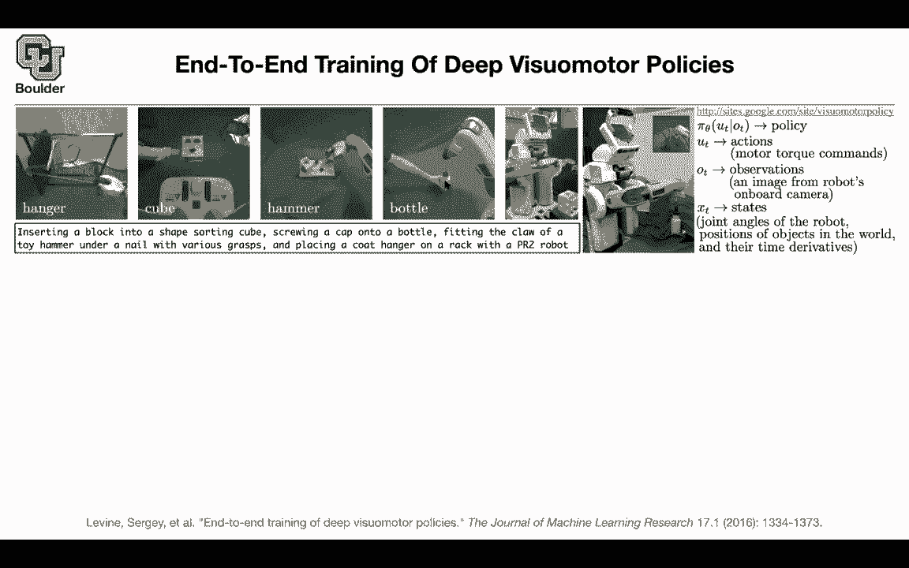

# 🧠 课程 P185：L81.3 - 深层视觉运动策略

在本节课中，我们将学习如何让机器人仅通过视觉观察（例如摄像头图像）来执行复杂的操作任务，例如将积木放入形状匹配盒或拧上瓶盖。我们将重点介绍一种数据高效且能在真实物理机器人上工作的策略学习方法。

---

## 🤖 任务与挑战

上一节我们讨论了自动驾驶汽车，其任务相对有限且定义明确。本节中我们来看看通用机器人在家庭环境中的任务，这些任务更为多样和复杂。

以下是机器人可能需要执行的一些示例任务：
*   将积木放入形状匹配盒中。
*   将瓶盖拧到瓶子上。
*   将玩具锤的爪部对准钉子下方。
*   将衣架挂到架子上。

这些任务对机器人提出了更高的要求，因为它需要从自身的视觉视角理解场景并做出精确的动作。

## 👁️ 机器人的视角

关键的一点是，机器人并非像我们一样从第三人称视角观察整个场景。它只能通过自身的摄像头来感知世界。

以下是机器人“眼中”看到的画面与我们所见的实际场景对比。机器人看到的图像包含其自身的机械臂、目标物体（如衣架）及其周围环境。

## 🧮 方法论：策略学习

我们希望学习一个策略（policy），让机器人能够根据观察（即RGB图像）来采取行动。在控制理论中，行动通常用 `u` 表示。

我们的目标是训练一个神经网络策略：`π(ot) -> ut`。其中，`ot` 是t时刻的图像观察，`ut` 是t时刻的动作（例如关节的电机扭矩）。

面临的挑战主要有两个：
1.  **数据效率**：由于使用真实机器人收集数据成本高昂，我们不能像在模拟环境中（如玩Atari游戏）那样无限收集数据。
2.  **部分可观测性**：在部署（推理）时，机器人只能获得图像观察 `o`，而无法直接获取系统的真实状态 `x`（如关节角度、物体的精确位置）。但在训练阶段，我们可以访问这些状态信息。

## 🧠 策略网络架构

我们使用一个卷积神经网络（CNN）作为策略函数。其输入是RGB图像，输出是7个维度的动作（电机扭矩）。

以下是该网络架构的一个关键特点：
*   第一层卷积使用步幅（stride）为2，其余层步幅为1，且**不使用填充（padding）**。
*   因此，图像尺寸会逐渐略微缩小。

**为什么这样设计？**
我们不希望丢失物体在图像中的位置信息。例如，机器人需要知道形状匹配盒在图像中的具体位置才能将积木放入。通过避免过度下采样和使用填充，我们更好地保留了空间信息。

网络中的一个特殊层是**空间Softmax层**。它对每个通道的特征图独立应用Softmax，使得每个通道上响应最强的区域值接近1，其余区域接近0。这相当于让网络“聚焦”于图像中的关键点。

随后，我们利用这些聚焦后的特征图计算加权坐标。具体做法是，将每个通道的Softmax输出与对应像素的x坐标和y坐标（相对于原始图像）相乘并求和，得到该通道所关注特征点的坐标估计。这样，32个通道的特征图被转换为64个坐标值（每个通道给出一个x和一个y坐标）。

最后，将这些坐标信息与机器人自身的配置信息（如关节角度）拼接，通过几个全连接层，最终输出动作。

## 🔄 训练：引导策略搜索

现在核心问题是：如何高效地训练这个策略网络？

我们将其形式化为一个有限时间段的序贯决策问题，目标是最小化期望成本：`min_θ E_πθ[Σ c(xt, ut)]`。

由于状态 `x` 不可直接观测，且需要数据高效，我们采用**引导策略搜索**方法。其核心思想是将问题分解为两步，并交替优化：

1.  **优化引导分布 `p(τ)`**：我们引入一个辅助的轨迹分布 `p(τ)`。它被设计为**局部线性**的高斯分布，并且可以访问真实状态 `x`。由于其形式简单（类似于线性回归），我们可以用很少的数据高效地优化它，得到最优的局部线性控制器参数（`Kt, kt`）。
2.  **策略匹配**：在第二步中，我们训练主策略网络 `πθ(o)`，使其输出的动作分布与第一步中得到的优秀引导分布 `p(u|x)` 尽可能匹配。这可以通过最小化两者之间的KL散度来实现，本质上是一个监督学习（回归）问题。

**交替方向乘子法**被用来协调这两个步骤，确保引导分布最终与策略网络产生的分布一致。

**为什么这样做是可行的？**
在训练时，我们既知道状态 `x`，也知道对应的图像观察 `o`。因此，我们可以用状态训练出高性能但简单的引导控制器，同时用对应的图像-动作对来训练神经网络，让它学会仅从图像中复制引导控制器的行为。在部署时，神经网络就能仅凭图像做出好的决策。

## ❓ 常见问题解答

以下是关于本方法的一些常见疑问：

*   **成本函数 `c(xt, ut)` 是什么？**
    这取决于具体任务。例如，在插积木任务中，成本函数可能是目标位置（积木孔）与当前积木位置之间的像素距离。论文的附录中会详细说明。
*   **引导分布中的 `N` 符号是什么意思？**
    它表示高斯分布（正态分布）。`p(ut|xt) = N(Kt * xt + kt, Σt)` 意味着在给定状态 `xt` 时，动作 `ut` 服从一个以线性变换结果为均值、以 `Σt` 为协方差矩阵的高斯分布。
*   **局部线性模型是否能力不足？**
    不会。因为这些线性模型是时变的（每个时间步 `t` 都有不同的 `Kt, kt`），它们组合起来可以表示非常复杂的非线性轨迹，足以很好地建模局部动态。
*   **关于图像坐标计算的疑问**：在空间Softmax后，我们用原始图像的坐标进行计算。即使特征图尺寸缩小了，每个位置也对应原始图像的一个区域，我们通常取该区域的中心坐标作为代表。这保证了位置信息得以保留。

---

## 📝 总结

本节课我们一起学习了**深层视觉运动策略**。我们了解到：
1.  让机器人从视觉输入学习动作面临**数据效率**和**部分可观测性**的挑战。
2.  我们设计了一个特殊的CNN策略网络，使用**空间Softmax**和**坐标计算**来保留关键的空间位置信息。
3.  通过**引导策略搜索**方法，我们将问题分解：先利用状态信息训练一个数据高效的**局部线性引导控制器**，再让神经网络策略通过回归来模仿这个控制器的行为。
4.  这种方法允许我们在真实机器人上，用有限的数据，训练出仅依赖视觉输入就能完成复杂操作任务的策略。