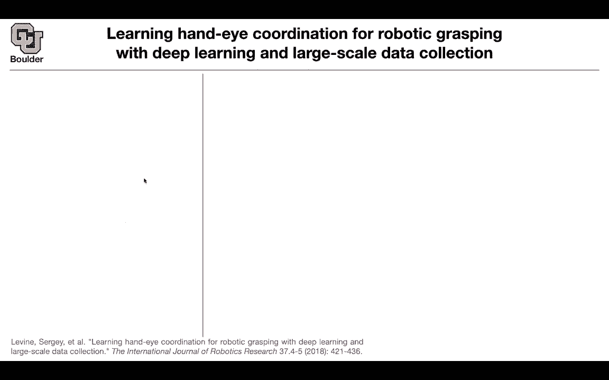
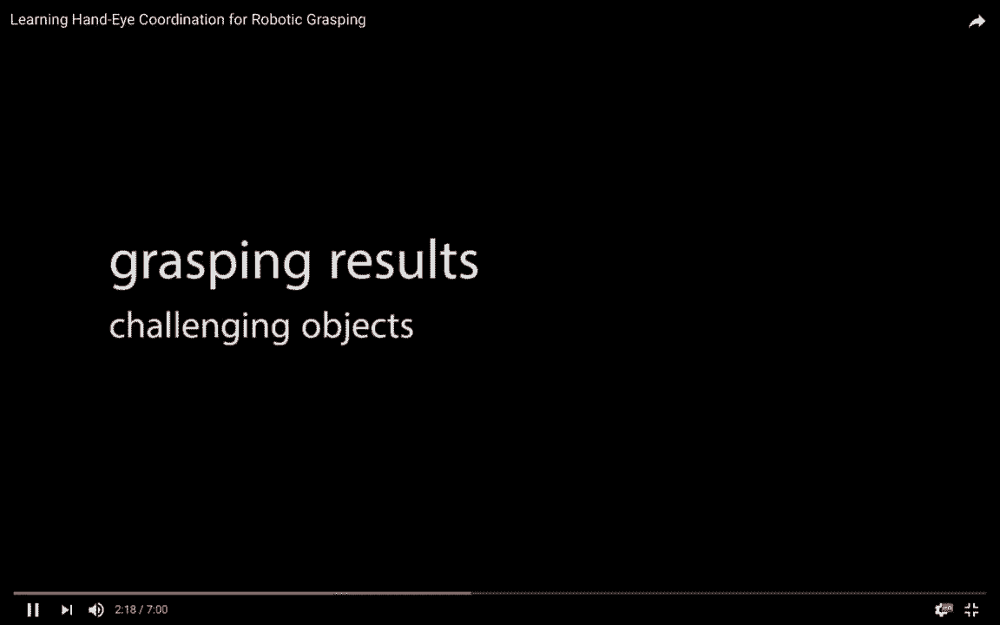
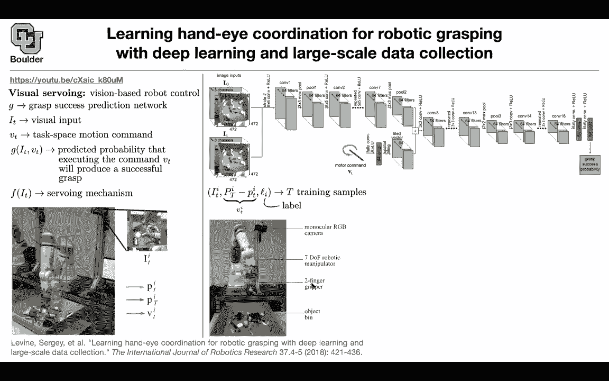

# 课程 P190：L83.2 - 视觉伺服控制 👁️🤖

在本节课中，我们将学习如何将视觉伺服控制从模拟环境应用到真实机器人上。我们将探讨如何通过收集真实世界的数据来训练一个预测网络，并利用该网络引导机器人执行抓取任务。

---

## 从模拟到现实：真实机器人数据收集

上一节我们讨论了模拟环境中的策略。本节中，我们来看看如何在实际机器人上应用类似方法。

研究人员使用了14台机器人，在真实环境中持续进行抓取尝试。这些尝试并非基于深度学习策略，而是一种非深度学习的预定义策略。机器人不断尝试，有时成功，有时失败，并在此过程中收集数据。总共收集了约8000次抓取尝试的数据。

---

## 任务定义：视觉伺服控制

那么，具体任务是什么呢？任务是**视觉伺服控制**。这是一种基于视觉的机器人控制方法。机器人的目标是从一个杂乱的盒子中拾取物品，并将其放入旁边的另一个盒子中。

机器人会持续执行此任务，并统计成功次数。即使在测试阶段，抓取仍可能失败，但系统会从环境中获得反馈。这与之前提到的开环策略不同，开环策略不会根据视觉观察进行自我调整。

---

## 核心组件：预测网络 G

系统的核心是一个预测网络 **G**。你可以将其视为一个 **Q函数** 或状态价值函数。

以下是该网络的功能描述：
*   **输入**：视觉观测（图像）和任务空间运动命令。
*   **输出**：一个预测概率 **g**，表示执行给定运动命令后抓取成功的可能性。

用公式表示其关系为：
**g = G(observation, command)**

最终目标是得到一个策略函数 **F**。给定一个观测，策略能输出一个动作（即一个运动命令），引导机器人从当前位置移动到目标位置。

---

## 网络架构与训练

预测网络 **G** 是一个神经网络。其架构如下：

1.  输入当前时刻的RGB图像。
2.  同时，网络需要知道机器人的初始位置 **I₀**，这对预测很有帮助。
3.  将图像信息与初始位置信息拼接。
4.  经过一系列卷积层处理。
5.  运动命令会被处理成与卷积输出相同的维度，然后与之相加。
6.  再进行几层卷积和全连接层处理。
7.  最终输出一个单一的概率值 **g**。

这个网络的训练是标准的监督学习。利用之前收集的真实世界数据（图像、运动命令、成功/失败标签）进行训练。成功尝试和失败尝试的标签都被用于训练。

---

## 策略生成：优化动作命令

训练好网络 **G** 后，我们如何得到最终的控制策略 **F** 呢？策略可以通过最大化价值函数 **G** 来获得。

具体而言，给定一张输入图像，我们有一个预训练好的网络 **G**。我们需要找到一个最优的运动命令 **v***，使得 **G** 的预测值最大。

**v* = argmax_v G(observation, v)**

为了高效地找到 **v***，系统采用了**交叉熵方法** 这种无梯度优化算法。其步骤如下：

以下是交叉熵方法的优化流程：
1.  从一个正态分布中采样64个运动命令向量 **v**。
2.  将这些 **v** 与当前图像一起输入网络 **G**，得到对应的 **g** 值。
3.  选出其中表现最好的6个 **v**（即 **g** 值最高的6个）。
4.  用这6个最优向量来拟合一个新的高斯分布（更新其均值和方差）。
5.  从这个新分布中再次采样64个向量。
6.  重复此过程数次，最后报告找到的最佳命令 **v***。

---

## 执行与反馈：智能决策逻辑

得到最优命令 **v*** 后，并非直接执行。系统引入了一个智能的比较机制：

1.  首先，将执行 **v*** 的预期成功率与“不采取任何行动”（即直接闭合夹爪）的预期成功率进行比较。后者作为一个基线。
2.  如果“不行动”的基线成功率已经很高，那么机器人就什么也不做，直接抓取。
3.  如果“不行动”的成功率很低，但执行 **v*** 的成功率也不够高，系统会重置环境（例如，将物品放回初始位置），然后重新开始规划。
4.  如果上述情况均未发生，则正常执行命令 **v***。

正是这个 `if-else` 逻辑让机器人能够根据环境反馈进行调整，例如视频中展示的调整手部姿态以抓取复杂物体。

---

## 方法的优势与泛化能力

这种方法有几个显著的优点：

*   **简单有效**：整体框架清晰，先通过监督学习训练 **G**，再通过优化得到策略。
*   **强泛化性**：使用该方法收集的数据和训练出的伺服机制，能够泛化到新的机器人、不同类型的摄像头以及完全不同的机械臂上，而无需重新训练 **G**。
*   **鲁棒性强**：该方法对摄像头标定误差、机械臂磨损等现实世界中的扰动具有较好的鲁棒性。

与处理模拟数据不同，在物理世界中工作面临更多挑战，而本方法展示了处理这些挑战的可行性。相关数据已公开，可供进一步研究。

---

本节课中，我们一起学习了视觉伺服控制在真实机器人上的应用。我们了解了如何通过收集真实抓取数据来训练一个预测成功率的网络 **G**，如何使用交叉熵方法优化动作命令，以及如何通过一个智能的决策逻辑让机器人根据环境反馈执行抓取。这套方法框架简单，且展现了出色的泛化能力和鲁棒性。