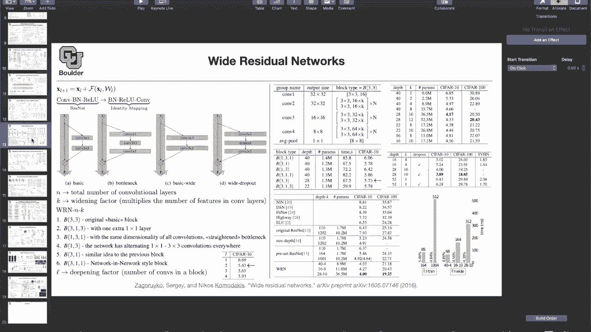
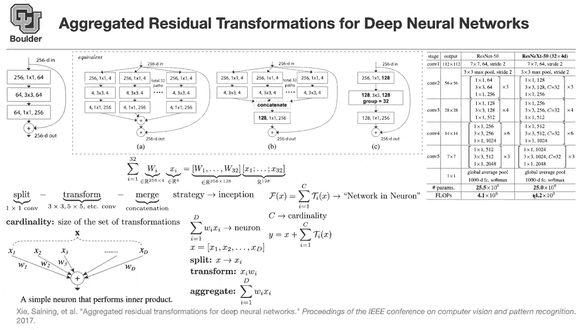

# 课程 P20：L10.1 - ResNeXt 🧠

## 概述

在本节课中，我们将要学习 ResNeXt 网络结构。ResNeXt 是对经典 ResNet 的改进，它通过引入“分组卷积”和“拆分-变换-合并”策略，在保持参数数量相近的情况下，显著提升了模型的效率和性能。我们将详细解析其设计思想、等效变换以及实际网络结构。

---

## 从 ResNet 到更高效的网络

上一节我们学习了 ResNet，了解了如何通过合理安排批量归一化层和权重，以及在捷径分支上避免非线性操作，来构建更深、更高效的网络。随后，我们了解了宽残差网络。当时的主流思路是追求网络深度，但相关论文提出，或许增加网络宽度能获得更高的效率。

接下来，在 ResNet 基础上的一个重要贡献是 ResNeXt。这篇名为《深度神经网络的聚合残差变换》的论文提出了核心思想。

## ResNeXt 的核心模块

左侧图表展示的是残差网络中的一个瓶颈块。假设输入一个 256 维的特征图，首先进行一个 1x1 卷积，将维度从 256 投影到 64。接着进行 3x3 卷积，由于此时特征维度较低，计算成本更小。最后再用一个 1x1 卷积将维度提升回 256，并与输入相加。

为了进一步提升效率，ResNeXt 大量使用了 1x1 卷积。具体做法是：将第一个矩阵分解为 32 条路径。每条路径先进行一个 1x1 卷积，然后进行一个 4x4 的矩阵乘法（对应一个卷积操作），最后再进行一个 1x1 卷积。将所有 32 条路径的结果相加，再与原始输入相加，得到输出。

这种设计比常规残差块效率更高，浮点运算次数更少。选择 32 条路径是为了让这个模块与原始 ResNet 瓶颈块的参数数量大致相同，以确保公平比较。由于使用了更小的矩阵进行计算，其速度更快。

## 模块的等效变换

右侧的图表展示了与上述设计等效的几种形式。

**从形式 A 到形式 B**：在形式 A 中，我们对 32 条路径的结果进行求和。在形式 B 中，我们将这 32 条路径的输出在通道维度上进行拼接，得到一个 128 维（32 * 4）的张量，然后再通过一个 1x1 卷积。这两种形式在数学上是等效的，因为对多个小矩阵乘法结果的求和，等效于先将所有结果拼接成一个大向量，再与一个特定结构的块对角大矩阵相乘。

**从形式 B 到形式 C**：形式 C 直接使用了分组卷积。将形式 B 中拼接前的 32 个并行卷积操作，视作 32 个独立的分组卷积，每组处理输入通道的一部分。这正是分组卷积的定义。因此，B 和 C 也是等效的。

所以，ResNeXt 本质上使用了分组卷积。我们之前在 AlexNet 中见过分组卷积，当时是由于 GPU 算力有限而采用的策略，而现在我们是为了效率而使用它。

## 拆分-变换-合并策略

这种“先拆分，再变换，最后合并”的策略，我们早在 GoogLeNet 的 Inception 模块中就见过。首先将输入拆分到不同路径，每条路径进行不同的变换（如不同尺寸的卷积或池化），最后将结果合并（通常是拼接）。

在 ResNeXt 中，路径数量（例如 32）被称为“基数”。基数、滤波器大小、网络深度和宽度一样，都成为了可以调节的超参数。

有趣的是，这种“拆分-变换-合并”的思想甚至存在于最基本的神经元中。一个神经元的计算是输入向量 **x** 与权重向量 **w** 的点积。这可以看作：将输入 **x** 按坐标拆分成多个标量（拆分），每个标量与对应的权重相乘（变换），最后将所有乘积相加（合并）。ResNeXt 模块可以看作是这个过程的扩展，其中每条路径是一个小的子网络，最后通过求和进行聚合，并额外添加了残差连接。

## ResNeXt 的实际结构

以下是 ResNeXt 与 ResNet 的结构对比。了解这些结构名称（如 conv4, conv5）对后续学习很重要，因为很多论文会直接使用这些层的输出特征。

在 ResNeXt-50 中，基数选择为 32，这使得其与 ResNet-50 的参数数量几乎相同（约 2500 万），浮点运算量也相近。但关键区别在于，ResNeXt 训练更快，并且通常能获得更低的错误率。ResNeXt-101 与 ResNet-101 的比较也显示出类似的优势。

**核心改动**：ResNeXt 所做的，就是将原始 ResNet 中的瓶颈块替换为使用分组卷积的新模块。

---

## 总结

本节课我们一起学习了 ResNeXt 网络。我们了解了它如何通过引入分组卷积和“拆分-变换-合并”策略来改进 ResNet，在参数和计算量相当的情况下实现更高的效率和更好的性能。我们分析了其模块的多种等效形式，并回顾了该思想与早期网络结构（如 Inception）乃至基础神经元的联系。最后，我们对比了 ResNeXt 与 ResNet 的实际网络结构和性能表现。