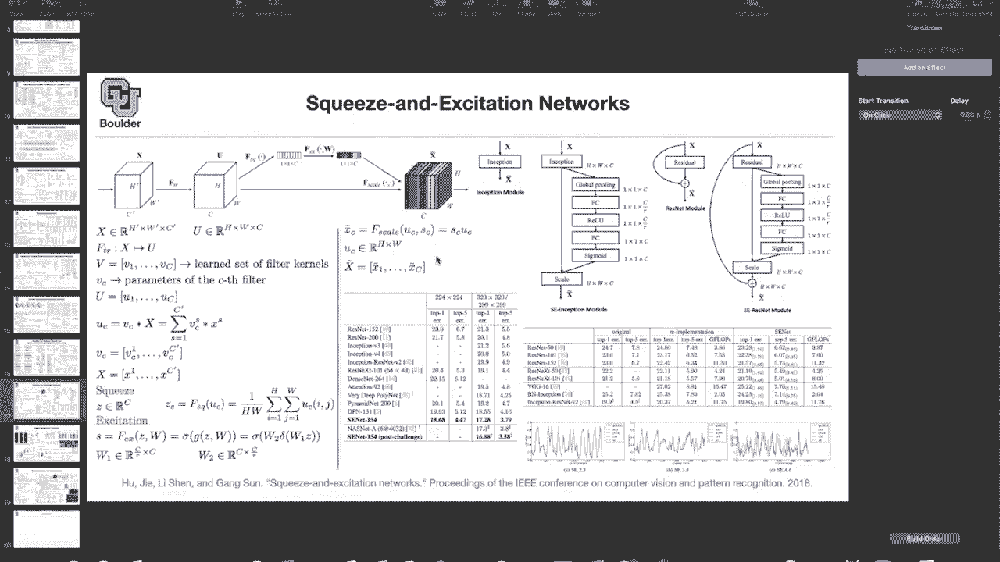
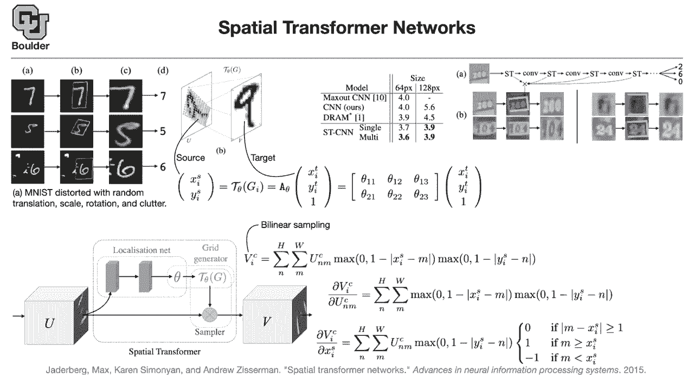

# P24：L12- 空间变换网络 (Spatial Transformer Networks) 🧠



## 概述

在本节课中，我们将学习一种名为**空间变换网络**的新型神经网络模块。它的核心思想是让网络学会自动对输入图像（或特征图）进行空间变换，例如平移、缩放、旋转和裁剪，从而更好地关注图像中的关键区域，提升模型的识别能力。

---

## 卷积网络的局限

上一节我们介绍了各种基于卷积的神经网络架构。卷积操作及其变体（如Inception、ResNet、VGG）是计算机视觉的主流方法。它们通过局部感受野和池化操作，具备了一定的**平移不变性**。

然而，这种不变性是**局部**的。对于图像中目标物体发生**较大**的平移、旋转、缩放，或者当目标被杂乱背景干扰时，传统的卷积网络可能会变得困惑并产生错误。

---

## 空间变换网络的核心思想

空间变换网络旨在解决上述问题。其灵感来源于人类视觉：我们看到一个数字“7”，无论它出现在图像的哪个位置、是何种大小或角度，我们都能轻易识别它。

空间变换网络的目标是让神经网络学会**主动聚焦**。它能够预测一个变换参数，对输入区域进行仿射变换，从而“框出”并“摆正”感兴趣的目标，忽略无关的杂乱信息。经过这样的预处理后，再使用标准的卷积网络进行分类就会容易得多。

---

## 网络架构详解

空间变换网络模块主要由三个部分组成，它们协同工作，实现可微分的空间变换。

### 1. 定位网络 (Localization Net)

定位网络是一个小型神经网络（例如全连接网络或轻量卷积网络）。它的输入是特征图 `U`，输出是用于空间变换的参数 `θ`。

对于最常见的**仿射变换**，`θ` 是一个 2x3 的矩阵参数：
```
θ = [ [θ11, θ12, θ13],
      [θ21, θ22, θ23] ]
```
这个矩阵将用于定义从输出坐标到输入坐标的映射。

### 2. 网格生成器 (Grid Generator)

网格生成器利用预测出的参数 `θ`，在输出特征图 `V` 上创建一个采样网格。

假设输出特征图上某个像素 `i` 的坐标为 `(x_i^t, y_i^t)`。我们想知道这个像素的值应该从输入特征图 `U` 的哪个位置采样。通过以下公式计算对应的输入坐标 `(x_i^s, y_i^s)`：
```
[ x_i^s ]   [ θ11 θ12 θ13 ]   [ x_i^t ]
[ y_i^s ] = [ θ21 θ22 θ23 ] * [ y_i^t ]
[  1   ]                       [   1   ]
```
简写为：`(x_i^s, y_i^s)^T = T_θ(G_i)`，其中 `G_i = (x_i^t, y_i^t, 1)^T`。

这个步骤为输出特征图 `V` 上的每一个像素点，都计算出了其在输入特征图 `U` 上对应的（可能不是整数的）采样位置。

### 3. 采样器 (Sampler)

采样器根据网格生成器计算出的采样坐标 `(x_i^s, y_i^s)`，从输入特征图 `U` 中获取像素值，并填充到输出特征图 `V` 的对应位置。

由于 `(x_i^s, y_i^s)` 通常是浮点数，我们需要通过**插值**来获取该位置的像素值。空间变换网络通常采用**双线性插值**，因为它连续可微，便于反向传播。

对于输出特征图 `V` 上位置 `i`，通道 `c` 的值 `V_i^c`，通过以下公式计算：
```
V_i^c = Σ_n Σ_m U_{nm}^c * max(0, 1 - |x_i^s - m|) * max(0, 1 - |y_i^s - n|)
```
其中，`(n, m)` 遍历输入特征图 `U` 的所有整数坐标。这个公式的本质是，对于每个输出点，取其输入坐标周围四个最近邻像素，根据距离进行加权平均。

---

## 训练与反向传播

整个空间变换模块是**可微分**的，因此可以嵌入到任何神经网络中，并通过标准的反向传播算法进行端到端的训练。

*   损失梯度可以流经采样器，传递到采样坐标 `(x_i^s, y_i^s)`。
*   梯度进一步通过网格生成器，传递到变换参数 `θ`。
*   最终，梯度通过定位网络，更新其权重。

这意味着，网络在训练过程中会自动学会：**“为了更准确地分类，我应该如何变换输入图像（或中间特征）。”** 变换参数 `θ` 不是固定的，而是**根据每一张输入图像动态预测**的。



---

## 应用与变体

以下是空间变换网络的一些关键应用和设计变体：

*   **在多个网络层插入**：空间变换模块不仅可以放在网络最前端处理原始输入，也可以插入到中间的卷积层之后。每一层的变换可以关注不同抽象层次的特征，实现更精细的调整。实验表明，使用多个空间变换模块通常比只用一个效果更好。
*   **并行多个变换器**：对于图像中包含多个物体的场景（例如街景门牌号有多个数字），可以使用多个并行的空间变换模块。每个模块学习关注图像中的一个特定部分，然后将这些变换后的区域特征进行融合或分别处理。
*   **替换插值方法**：双线性插值是最常用的选择，因为它简单且可微。但在理论上，也可以尝试其他可微的插值方法。

---

## 总结

本节课我们一起学习了**空间变换网络**。我们了解了传统卷积网络在应对大尺度空间变化时的不足，并深入探讨了空间变换网络如何通过**定位网络、网格生成器和采样器**这三个组件，实现可学习的、动态的空间变换。这种设计让神经网络具备了主动“注意”和“矫正”输入的能力，显著提升了模型在物体存在平移、旋转、缩放及杂乱背景等复杂情况下的鲁棒性。空间变换网络是一个强大的模块，可以灵活地嵌入到各种视觉架构中，为模型引入空间变换的先验知识。