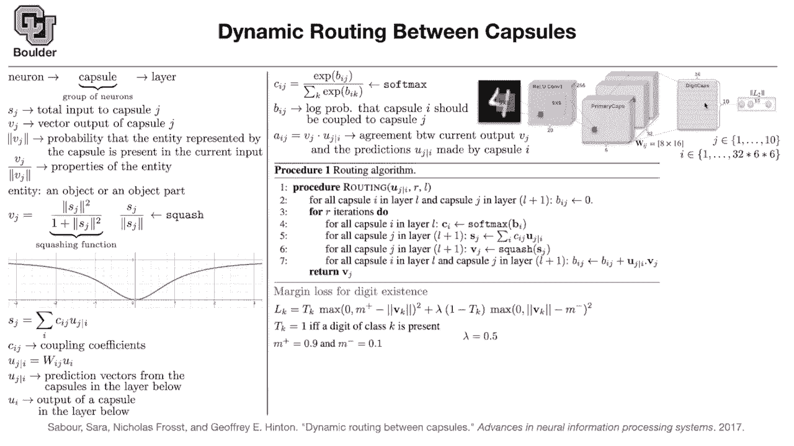

# 胶囊网络课程 P25：L13 🧠

在本节课中，我们将要学习一种与之前所见略有不同的神经网络——胶囊网络。这篇论文由现代深度学习之父杰弗里·辛顿撰写，其核心思想可能代表着未来的发展方向。尽管卷积神经网络在计算机视觉领域已非常成熟，但胶囊网络提出了一种新的视角，旨在模仿人类的视觉感知方式，并具备处理重叠对象等传统网络难以应对任务的能力。

## 胶囊网络的基本概念

上一节我们介绍了本课程将涵盖的最后一种网络。本节中我们来看看胶囊网络的核心思想。它之所以看起来有些不同，是因为其设计理念旨在模拟人类如何观察世界。

卷积网络基于神经元和层的概念，而胶囊网络引入了“胶囊”作为一组神经元。下图展示了“数字胶囊”层，我们的目标是设计网络，使得这10个向量的L2范数能够表示概率。

具体而言，如果取第一个向量的范数，它应表示数字“0”存在的概率；取第二个向量的范数，则表示数字“1”存在的概率，依此类推。因此，**向量的范数即为概率**。我们的设计需确保这些向量的范数值在0到1之间。这与我们通常使用的最后一层（如10维向量）不同，胶囊网络的最后一层是一个矩阵（例如16x10）。

## 网络架构与数据流动

在进入胶囊层之前，网络通常包含两个卷积块。以下是数据流动的简要说明：

*   输入图像首先经过一个9x9的卷积层，使用256个滤波器。
*   接着是激活函数和另一个9x9卷积层。
*   最终，我们得到32个特征块，每个块的大小为6x6。

从这些特征块到胶囊层的转换是论文的核心贡献。每个特征块中的每个“像素”实际上是一个8维向量（在R^8空间中）。然后，通过一个8x16的权重矩阵相乘，我们将这些8维向量转换为16维向量，作为胶囊的输入。

## 胶囊的定义与目标

我们已经了解了神经元（权重向量与输入的点积）和层。现在，我们来定义胶囊：**胶囊是一组神经元**。例如，上图中的每个胶囊包含一组神经元，其输出是一个向量（如16维）。

胶囊的输入和输出定义如下：
*   设 **S_j** 为胶囊j的总输入。
*   设 **V_j** 为胶囊j的向量输出。

我们的设计目标有两个：
1.  **向量V_j的范数** 表示该胶囊所代表的实体（例如数字“4”）存在于当前输入图像中的概率。
2.  **向量V_j的方向** 编码了该实体的各种特征属性（例如笔画的粗细、倾斜度、局部结构等）。

实体可以是一个完整对象（如数字“4”）或对象的一部分（如飞机的机翼）。为了实现范数表示概率的目标，我们使用一个“压缩”函数：

**公式：V_j = (||S_j||^2 / (1 + ||S_j||^2)) * (S_j / ||S_j||)**

这个函数确保输出向量V_j的范数被压缩在0到1之间，从而可以作为概率值。

## 动态路由机制

胶囊的总输入S_j是来自下层所有胶囊预测向量的线性组合。这是通过动态路由算法实现的，该算法是本文的另一大创新。

以下是动态路由算法的核心步骤：

1.  对于每个下层胶囊i的输出U_i，我们通过一个权重矩阵W_ij计算其对上层胶囊j的“预测向量”：**U_{j|i} = W_{ij} * U_i**。
2.  引入耦合系数c_{ij}，它表示下层胶囊i与上层胶囊j之间的连接强度。所有连接到胶囊j的c_{ij}之和为1，通过softmax函数计算得出。
3.  耦合系数c_{ij}由原始对数概率b_{ij}决定，而b_{ij}通过动态路由迭代更新。
4.  胶囊j的总输入是其所有预测向量的加权和：**S_j = Σ_i (c_{ij} * U_{j|i})**。
5.  通过多次迭代（论文中为3次），利用上层胶囊输出V_j与预测向量U_{j|i}之间的“一致性”（点积）来更新b_{ij}，从而动态地确定哪些下层胶囊与当前上层胶囊更相关。

这个机制就像一个注意力过程，让网络动态地决定信息传递的最佳路径。

## 损失函数设计

为了训练网络中的权重矩阵W_{ij}，我们需要定义损失函数。由于胶囊网络能处理图像中存在多个对象的情况，其损失函数与传统的多分类交叉熵损失不同。

论文使用了边际损失函数，对于每个类别k（数字）：
*   如果类别k存在于图像中（T_k = 1），则希望对应胶囊输出向量的范数不小于m+（例如0.9）。
*   如果类别k不存在于图像中（T_k = 0），则希望其范数不大于m-（例如0.1）。

**公式：L_k = T_k * max(0, m+ - ||V_k||)^2 + λ * (1 - T_k) * max(0, ||V_k|| - m-)^2**

总损失是所有类别损失之和。参数λ用于平衡存在与不存在的类别，因为不存在的类别通常更多。

此外，为了鼓励胶囊编码有意义的特征，论文还添加了**重构损失**。具体做法是：
1.  使用正确的类别标签，在训练时“掩码”掉代表不存在类别的胶囊输出向量。
2.  将剩余的活跃胶囊向量输入一个解码器网络（全连接层），试图重构原始输入图像。
3.  计算重构图像与原始图像之间的均方误差，并以一个很小的权重加到总损失中。

这迫使胶囊学习到的特征必须包含足够的信息来重构输入，从而确保这些特征具有实际意义。

## 效果与总结

实验表明，使用动态路由（如3次迭代）和重构损失能有效提升模型性能，特别是在多数字重叠的MNIST数据集上，胶囊网络能成功识别出传统卷积网络难以区分的重叠数字。

本节课中我们一起学习了胶囊网络的核心思想。它通过将神经元组成为胶囊，用向量输出来同时表示实体的存在概率和特征属性。动态路由算法替代了传统的固定连接，让网络能动态决定信息流。结合边际损失和重构损失，胶囊网络展示出了处理复杂场景（如对象重叠）的潜力。尽管这项技术目前尚未成为主流，但其新颖的思路为深度学习的发展提供了重要的探索方向。