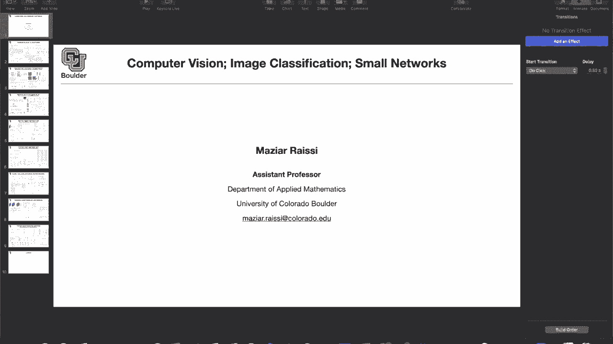
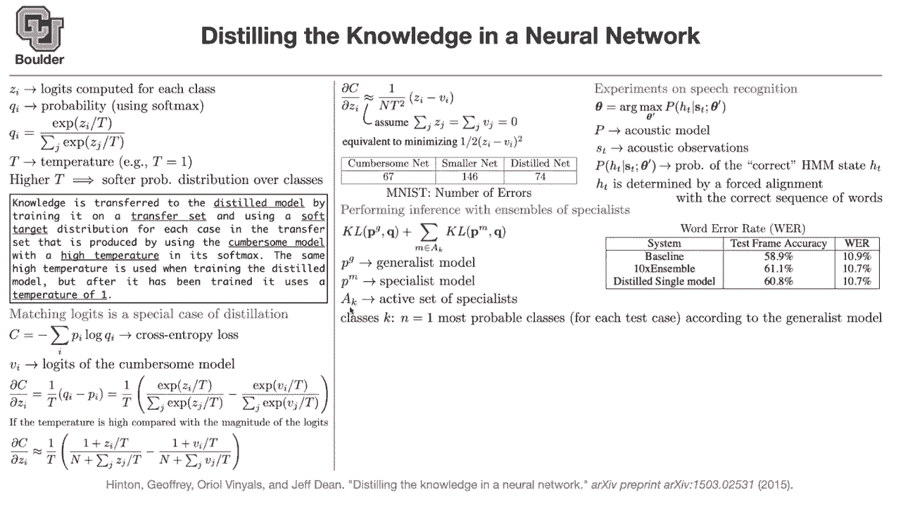

# 课程 P28：L15.1 - 知识蒸馏 [续] 📚➡️🧠

## 概述

在本节课中，我们将继续探讨知识蒸馏技术。我们将了解为何需要小型网络，知识蒸馏在实践中的应用场景，以及一种通过“专家”模型处理大规模细粒度分类问题的先进技术。最后，我们会简要区分知识蒸馏与迁移学习的概念。

---

## 为何需要小型网络？🚗📱

上一节我们介绍了知识蒸馏的基本原理，本节中我们来看看其核心应用动机：构建小型网络。

小型网络至关重要，主要出于运行效率的考虑。当我们需要进行实时预测时，例如在物联网设备、机器人或自动驾驶汽车中，保持网络规模较小可以确保预测速度足够快。

以下是需要小型网络的一些具体应用场景：
*   **物联网与机器人**：任何需要实时神经网络的场景。
*   **自动驾驶汽车**：需要快速识别行人、停车标志、车道线等。
*   **移动设备应用**：例如手机上的实时语言翻译。虽然5G技术可能允许将数据发送到服务器处理，但对于某些应用（如涉及医疗记录），出于隐私考虑，我们仍需要在本地设备上运行小型网络。

将神经网络投入生产环境是一个系统工程，小型网络只是整个技术栈中的一个组件，还需要大量的软件和硬件工程工作。例如在自动驾驶中，会使用多个不同的神经网络协同工作以降低错误率，因为其中涉及巨大的安全风险。

---

## 知识蒸馏回顾与拓展 🔄

现在，让我们回顾并深化对知识蒸馏流程的理解。

我们已知的一种创建小型网络的方法，是将大型网络中的知识“蒸馏”到小型网络中。具体流程如下：
1.  从**逻辑值（logits）** 开始。
2.  引入**温度（T）** 参数。公式为：`softmax_output = exp(z_i / T) / sum(exp(z_j / T))`。温度越高，产生的概率分布越“平滑”。
3.  使用**笨重模型（cumbersome model）** 在较高温度下生成“软标签”数据。
4.  用这些数据和相同的温度来训练**蒸馏模型（distilled model）**。
5.  在最终生产部署时，将温度设回 **T=1** 进行预测。

知识蒸馏是匹配逻辑值的一种通用形式。实际上，直接尝试通过回归来匹配蒸馏模型和笨重模型的逻辑值，只是知识蒸馏的一个特例。原因在于我们做了两个假设：
*   当温度较高时，可以对指数函数进行泰勒展开，且前两项能很好地近似它。
*   我们试图让数据满足特定条件。

在这两个假设下，匹配逻辑值等价于最小化均方误差（MSE）。因此，这两种方法是等效的。实践证明，使用笨重模型来训练小型模型，比直接用真实数据从头训练小型网络，能获得更低的错误率。

这项技术不仅适用于图像分类，还可应用于语音识别、自然语言处理等多个领域。

---

## 处理大规模细粒度分类：专家模型方法 🎯🔍

当面对超大规模数据集和极多类别（例如数万个人脸ID）时，如何有效训练模型？接下来介绍一种使用“专家”模型的巧妙技术。

这项技术涉及两类模型：**通才模型（Generalist）** 和**专家模型（Specialist）**。
*   **通才模型**：负责所有类别的预测（例如一个15000维的输出）。
*   **专家模型**：专注于区分通才模型容易混淆的某些细粒度类别（例如不同品种的狗、不同型号的汽车）。

以下是该方法的运作流程：
1.  首先训练一个通才模型。
2.  分析通才模型的**混淆矩阵**，使用聚类算法（如K-Means）找出它容易混淆的类别组。
3.  为每个混淆类别组创建一个专家模型。每个专家模型负责区分该组内的类别，并额外包含一个“垃圾桶类（dustbin class）”来容纳所有其他类别。
4.  专家模型的参数使用通才模型的参数进行初始化。
5.  在推理时，对于每个输入，根据通才模型预测出的最可能的K个类别，激活与之相关的专家模型子集，共同做出最终决策。

这种方法能有效提升模型在细粒度分类上的准确率。由于专家模型专注于特定子集，它们更容易过拟合，因此需要采用正则化技术，如**Dropout**或**标签平滑（Label Smoothing）**。

---

## 知识蒸馏 vs. 迁移学习 ⚖️

最后，我们简要区分两个容易混淆的概念：知识蒸馏与迁移学习。

知识蒸馏是一种将大型网络的知识压缩到小型网络中的方法。训练完成后，我们得到一个独立的小型网络用于部署。它甚至可以作为一种防御对抗性攻击的手段。

而迁移学习通常指的是将一个任务（如图像分类）上训练好的模型知识，迁移到另一个相关但不同的任务（如目标检测或图像分割）上。在迁移学习中，我们通常会在新数据上对预训练模型进行**微调（Fine-tuning）**。

两者的核心区别在于：**知识蒸馏是创建一个全新的、更小的网络；而迁移学习则是在一个已有模型的基础上进行调整以适应新任务**。虽然都涉及知识传递，但实现路径和目的有所不同。

---

## 总结

本节课我们一起深入学习了知识蒸馏技术的后续内容。我们探讨了构建小型网络的实际需求和应用场景，回顾并拓展了知识蒸馏的流程与数学原理。接着，我们学习了一种利用“通才-专家”模型体系来处理超大规模细粒度分类问题的先进技术。最后，我们明确了知识蒸馏与迁移学习之间的关键区别。理解这些概念有助于我们更好地将深度学习模型应用于资源受限的真实生产环境中。