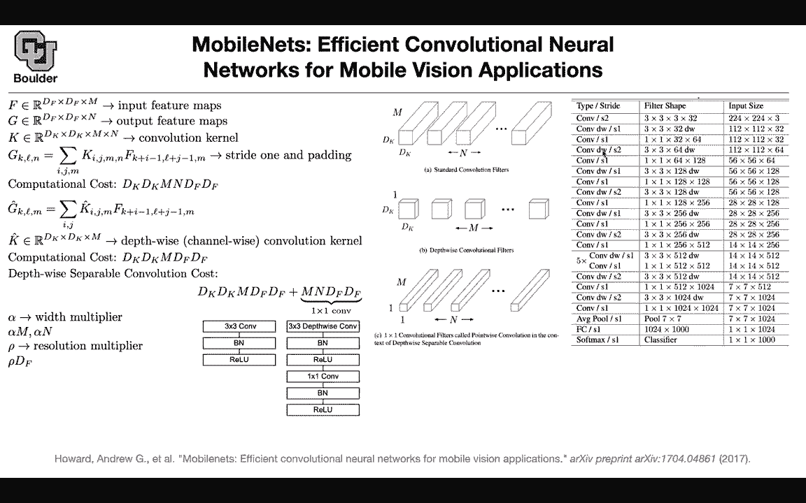
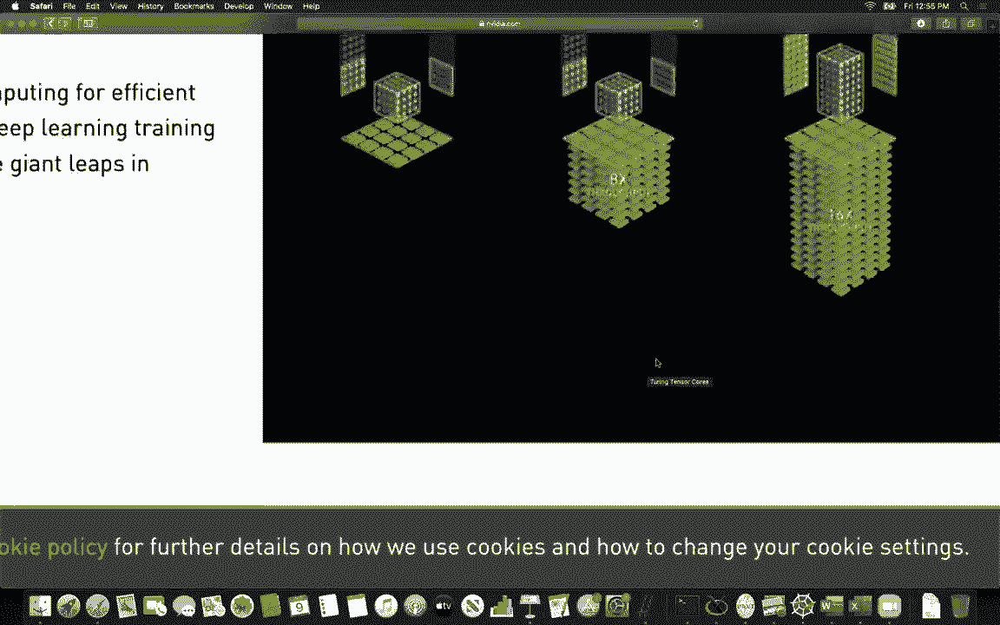
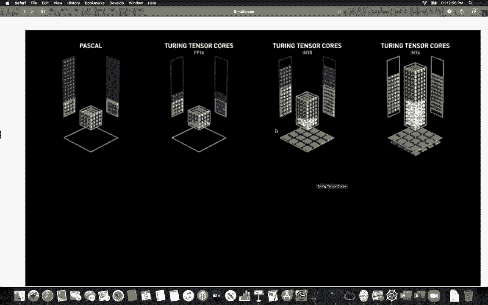
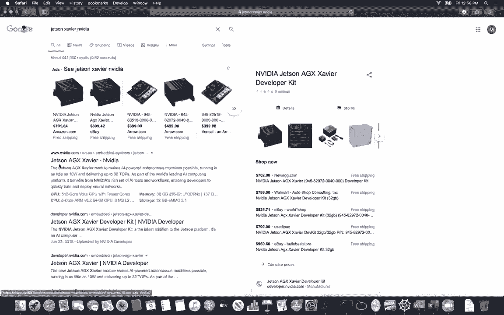
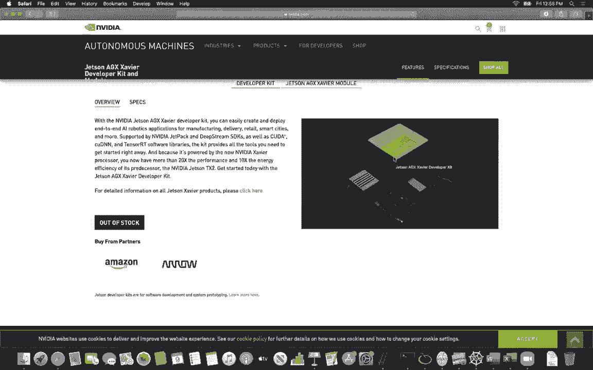
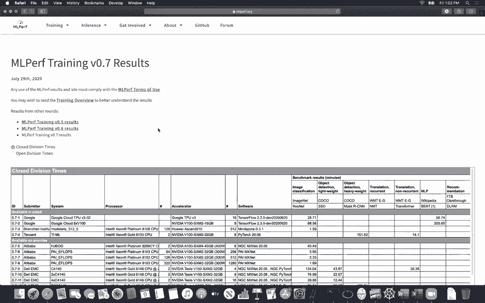

# 课程 P35：L19.1 - MobileNets [续] 📱

在本节课中，我们将继续学习 MobileNets。我们将深入探讨其计算成本、核心结构设计，以及如何通过调整参数在模型精度与计算效率之间取得平衡。同时，我们也会简要讨论支持这些高效模型运行的硬件技术。

---

上一节我们结束了关于 XNOR-Net 的讨论，并开始介绍 MobileNets。我们介绍了常规卷积的计算成本，正如你所见，这些操作并不廉价。因此，我们需要寻找并行化的方法。

例如，一种并行化方法是并行运行 `k`、`l` 和 `n` 的循环，因为这些操作彼此独立。这样可以在并行处理中消除 `k` 的部分，即 `df * df * n` 次操作。这就是 GPU 以及谷歌内部深度学习硬件 TPU 非常有用的原因。大部分操作是独立的简单代数运算，因此并行化并不困难。

常规卷积的计算成本公式如下：
`计算成本 = df * df * dk * dk * m * n`

我们的目标是降低这个计算成本。一个想法是通过 1x1 卷积来减少 `n`。上一节我们有一个问题：为什么不直接使用 1x1 卷积？我们可以减少 `n`，但现在我们想将其推向极致，我们希望 `n` 变为 1。这就是深度可分离卷积（Depthwise Separable Convolutions）或逐通道卷积（Channel-wise Convolutions）的核心理念。

接下来，我们来看看深度可分离卷积的具体步骤。

首先，你将逐通道进行卷积操作，这意味着你消除了 `n`。然后，在下一步中，你将通过一个 1x1 卷积来混合通道，对通道进行加权组合。

这种操作的计算成本如下：
`深度可分离卷积成本 = df * df * dk * dk * m + m * n`

我们消除了 `n`，但之后需要做 1x1 卷积。不过，1x1 卷积比常规卷积廉价。例如，如果你的卷积核是 3x3，那么做 1x1 卷积比做 3x3 卷积要便宜 9 倍。

为了根据目标设备的计算能力和内存能力来控制模型容量，我们引入了两个参数。

以下是这两个参数的定义：
*   **α (Alpha / 宽度乘子)**：控制网络宽度，即特征图（通道）的数量。减少 α 会减少通道数，从而降低计算成本和参数量，但可能牺牲一些精度。
*   **ρ (Rho / 分辨率乘子)**：控制输入图像的分辨率。降低分辨率会直接减少特征图的空间尺寸（`df * df`），从而显著降低计算成本，但参数量不变。

下面是一个视觉对比，展示了常规卷积、深度卷积和 1x1 点卷积的区别。

*   1x1 卷积是逐像素进行操作。
*   深度卷积是逐通道进行操作。
*   在 MobileNet 的微结构中，任何出现 3x3 卷积的地方，都会被替换为 3x3 深度卷积加上随后的 1x1 点卷积。

网络的宏观结构如右图所示。在 Network-in-Network 论文之后，计算机视觉分类任务大多使用全局平均池化，这使我们在训练和测试时能处理任意分辨率的图像。在这个结构中，`DW` 标记的地方就是使用了深度可分离卷积。

那么，MobileNet 为我们节省了多少呢？

当 α 和 ρ 都为 1（即基准 MobileNet）时，其准确率与 GoogleNet 和 VGG16 相当，但参数量和乘加运算次数都更少。你可以通过调整 α（宽度乘子）来平衡准确率与计算/内存效率之间的权衡。

降低 α 会损失一些准确率，但同时会提升速度和节省内存。这是一个多目标优化问题，需要在速度、内存和准确度三者之间取得平衡。

如果改变分辨率参数 ρ，参数量不会改变，但计算成本会发生变化。

在进入下一个主题之前，有任何问题吗？

有一个更普遍的问题：现在有带有专用张量处理单元的芯片，它们与 GPU 相比如何加速？或者它们只是更小的 GPU？

实际上，现代 GPU 就包含张量核心（Tensor Cores），这些是专门为卷积、循环神经网络和注意力模型中的张量操作设计的专用单元。这可能是对幕后工作的一个很好的可视化。

在图灵架构之后引入了这个，它与之前的架构不同，现在可以一次性处理浮点16（fp16）的操作块。如果使用 INT4 等更低精度，可以一次处理更大的数据块。

那么，这是否会让 MobileNet 这样的技术过时呢？

并不会。原因是并非所有设备都配备 GPU。训练和推理是有区别的，你需要为目标机器找到专用的处理单元。MobileNet 仍然可以从张量核心或 GPU 中受益，即使是集成在像 Jetson 这样的小型设备上。

是的，这是一个很好的观点。你几乎可以获得双倍的速度提升。他们刚刚发布了新的 Jetson Nano，非常小但功能强大。这些适用于机器人和嵌入式设备。还有 Xavier 芯片用于自动驾驶汽车。其他公司也有类似产品。这些小型 GPU 主要用于推理，但也可以进行训练。

还有其他关于硬件的问题吗？有不同的数字表示标准，比如 fp16。你可以阅读这篇关于自动混合精度的博客文章。通常，你可以将变量存储在 fp32 中，但在 fp16 上执行操作。PyTorch、TensorFlow 和 MXNet 等框架通常会自动完成这一点。

神经网络对参数的确切值并不那么敏感。但你需要将计算图中最后的部分（如损失）保存在 fp32 中，并在 fp32 上执行相关操作。同时，你需要对损失进行归一化，防止其值过大，并且需要注意梯度问题。

还有其他问题吗？这些都是很好的问题。在深度学习硬件领域存在巨大的竞争。各大公司在视觉、语言、推荐系统和强化学习等任务上竞争。你可以查看 MLPerf 的结果，参与者包括 AMD、Intel、NVIDIA、华为、谷歌 TPU 等，以及 MXNet、TensorFlow、PyTorch 等框架。还有一些初创公司也在尝试开发深度学习硬件。

---

本节课中，我们一起深入学习了 MobileNets 的高效设计原理。我们分析了其通过深度可分离卷积大幅降低计算成本的方法，并了解了如何通过宽度乘子 α 和分辨率乘子 ρ 来灵活权衡模型精度与效率。此外，我们还简要探讨了支持高效模型运行的现代硬件技术，如张量核心。理解这些内容对于在资源受限的设备上部署深度学习模型至关重要。