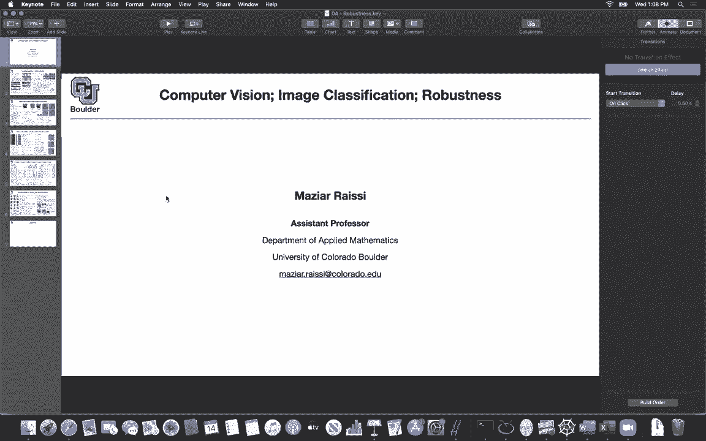
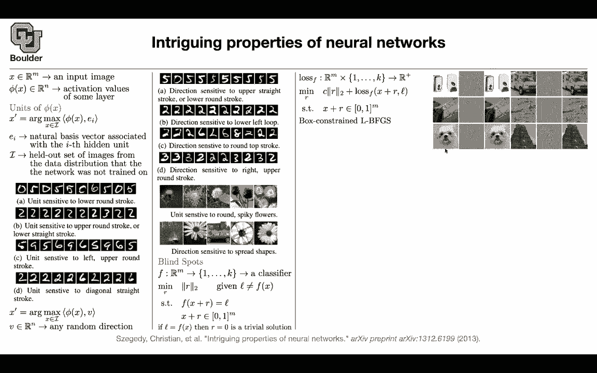

# 对抗学习示例 🛡️

## 课程概述

在本节课中，我们将要学习深度学习的鲁棒性概念，特别是对抗攻击。我们将探讨神经网络在面对微小扰动时的脆弱性，以及如何通过对抗样本来揭示模型的“盲点”。理解这些内容对于构建可靠、安全的深度学习应用至关重要。



---

## 什么是鲁棒性？

上一节我们介绍了深度学习的基本流程，本节中我们来看看鲁棒性在其中的位置。

深度学习的一般流程如下：数据是我们的源代码，我们设计模型（无论是手动设计还是自动搜索），并考虑设备的计算能力来提升模型效率。我们主要使用随机梯度下降法来训练模型，这相当于我们的编译器。最终，我们得到一个可以部署到无人机、自动驾驶汽车、智能设备、机器人或网页上的软件算法。

一旦我们将深度学习产生的算法投入生产，就可能面临各种问题。算法可能遭受攻击，例如病毒或对抗性攻击。因此，我们希望目标应用尽可能鲁棒。这就是我们要讨论鲁棒性的原因，因为它至关重要。深度学习的最终目标是提供一个可用于生产的算法，我们不希望这个算法在遭受攻击时失败。


---

## 对抗攻击与生成对抗网络

许多人将生成对抗网络与对抗攻击混淆。这是两个不同的主题，它们名称相似，但目标完全不同。

*   生成对抗网络的目标是生成内容，例如用于创意工作的图像生成，或学习底层数据分布。
*   对抗攻击关注的是我们网络的**鲁棒性**。

这是两个名称相似但完全不同的主题。

---

## 特征可视化与“无特殊方向”

上一节我们区分了对抗攻击与生成对抗网络，本节中我们来看看如何可视化神经网络学习到的特征。

假设我们有一个输入图像 **x**，它是 **m** 维的（即展平后的像素总数）。我们观察网络中某一特定层的激活值 **a(x)**，其维度为 **n**。我们可以观察这些特征单元，尝试理解网络学到了什么。

我们不再手动进行特征工程，而是让网络自己寻找特征。为了解释这些特征，一种方法是关注其中一个维度。我们可以取一个切片，这本质上是与单位向量 **e_i** 的内积，从而挑选出单个值。

**公式：** `激活值 = a(x) · e_i`

这将是**一维**的，只挑选出 **n** 维特征中的一维。我们可以对其进行优化：在未用于训练的图像集合中，寻找能最大程度激活该特定特征的图像。

这能让我们可视化对该神经元最敏感的图像类型。**e_i** 只是一个自然基向量（在第 i 个位置为1，其余为0），我们只挑选第 i 个隐藏单元。

人们开始这样解释：“这个单元似乎对向下的圆弧笔划敏感”，“那个单元对向上的圆弧笔划敏感”等等。但有趣的是，**e_i** 并没有什么特殊之处。你可以将 **e_i** 改为 **R^n** 中的任何随机向量 **v**，进行同样的操作，并开始类似的解释。

以下是针对随机方向 **v** 的解释示例：

*   该方向对向上的直线笔划敏感。
*   该方向对向下的圆弧笔划敏感。
*   该方向对左上方的圆弧笔划敏感。
*   该方向对对角线直线敏感。

对于自然图像也是如此。你可以解释随机方向，例如“这个方向对圆形带刺的花朵敏感”或“这个方向对展开的形状敏感”。

这里的解释是：**没有哪个特定方向具有特殊含义**。真正有意义的是这个函数所张成的**整个空间**或**流形**。你发现了一些特征，但其中每一个单独的特征可能并不都有意义，是它们的整体共同构成了含义。

---

## 网络的“盲点”与对抗样本

上一节我们探讨了特征的可解释性，本节中我们来看看神经网络存在的“盲点”。

我们来看一个分类器。它接收图像 **x**，并将其分类为 **K** 个类别中的一个。我们寻找“盲点”：对输入 **x** 施加一个微小的扰动 **r**，然后通过网络。我们希望分类结果为指定的错误标签 **l**，同时希望扰动 **r** 尽可能小。

**目标**是找到一个图像 **x + r**，它尽可能接近 **x**，但被网络错误分类。这些就是分类器的反例。图像被轻微扰动后，网络仍应预测相同的结果。

**公式化的目标如下：**

```
最小化 ||r||
约束条件：
    f(x + r) = l
    x + r ∈ [0, 1]^m
```

这里的约束条件意味着 **x + r** 仍然必须是一个有效的图像（像素值在0到1之间）。同时，**l** 不应等于 **f(x)**，否则 **r = 0** 就是一个平凡解。我们想让网络犯错。

直接求解这个问题很困难，因为它是高维的且约束不易处理。因此，我们将其转化为一个可微的损失函数进行优化：



**公式：** `最小化 c * ||r|| + loss(f(x + r), l)`

其中，`loss` 是损失函数（如交叉熵）。如果结果超出 [0, 1] 范围，可以将其截断到边界。我们可以使用带边界约束的 L-BFGS 等优化算法来求解。

通过这种方法，我们可以找到微小的扰动。这些扰动对人类来说几乎无法察觉，但会使网络混淆，给出错误的预测。


例如，两张几乎一样的狗或校车图片，人眼看来相同，但网络会给出不同的分类。更令人惊讶的是，这些对抗样本不仅对生成它的特定网络有效。

---

## 对抗样本的普遍性

上一节我们看到了如何生成对抗样本，本节中我们来看一个更惊人的特性：对抗样本的普遍性。

为某个特定网络结构（例如一个10层的全连接网络）设计的对抗样本，不仅能使该网络100%犯错，还能以很高的概率混淆**其他完全不同结构**的网络。

这意味着对抗样本具有**普遍性**。你为一个网络和数据集设计对抗样本，但它同样会干扰在其他数据集上训练的其他类型网络的预测。

**结论**：对抗样本问题很严重，即使对于使用不同超参数训练的模型也是如此。甚至改变训练数据集，网络仍然有很大可能被相同的对抗方法所混淆。

这是一个严重且引人深思的问题。有观察指出，某些网络（如FC101）的对抗样本，似乎对其他所有网络都具有更强的攻击性，这可能意味着它利用了某种更普遍的“盲点”。

---

## 课程总结

本节课中，我们一起学习了深度学习中对抗攻击与鲁棒性的核心概念。

我们首先明确了对抗攻击与生成对抗网络的区别。接着，通过特征可视化，我们理解了神经网络中“无特殊方向”的特性。然后，我们深入探讨了如何通过优化方法生成微小的对抗性扰动，从而揭示神经网络的“盲点”。最后，我们认识到对抗样本具有普遍性，能为一个网络设计的对抗样本常常也能攻击其他网络，这凸显了提升模型鲁棒性的重要性与挑战。

理解这些原理是构建安全、可靠的深度学习系统的第一步。在后续课程中，我们将探讨如何防御这些攻击，使模型更加鲁棒。