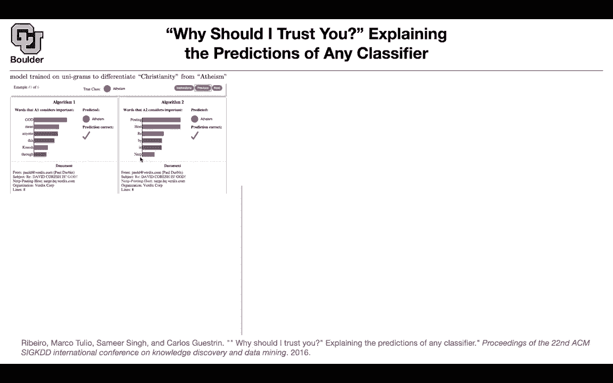
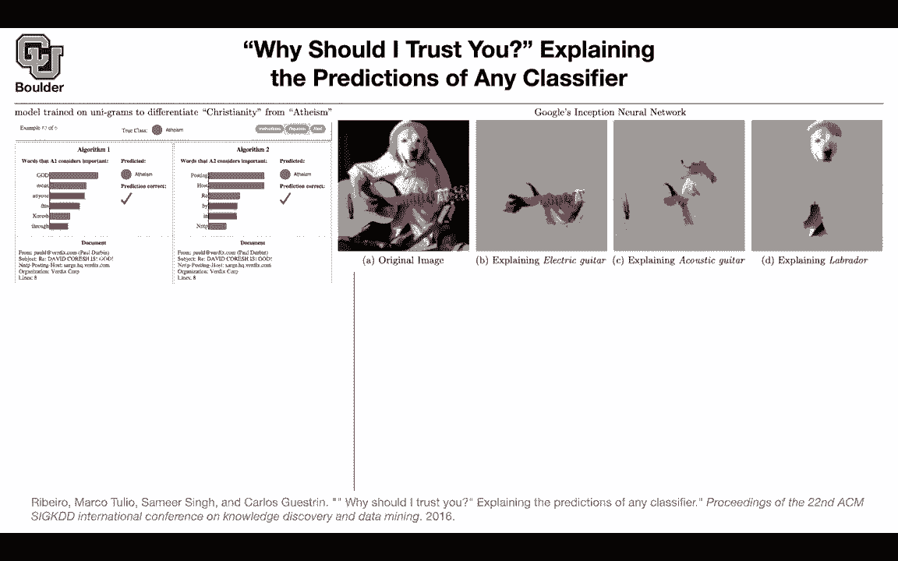
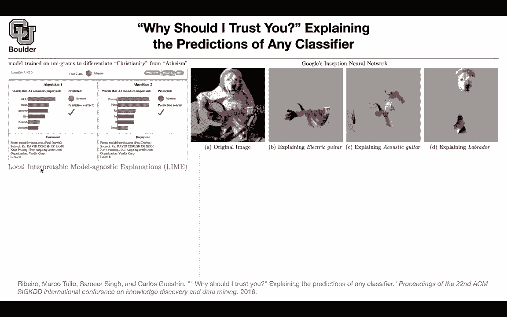
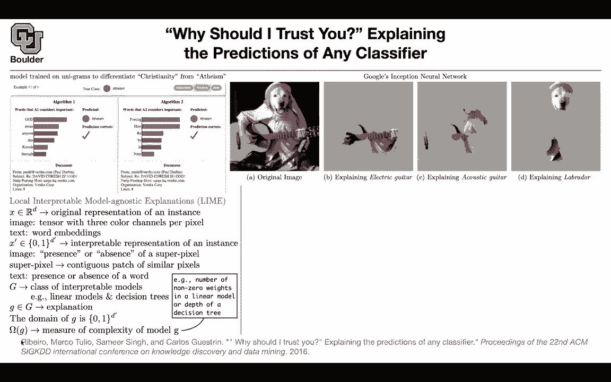
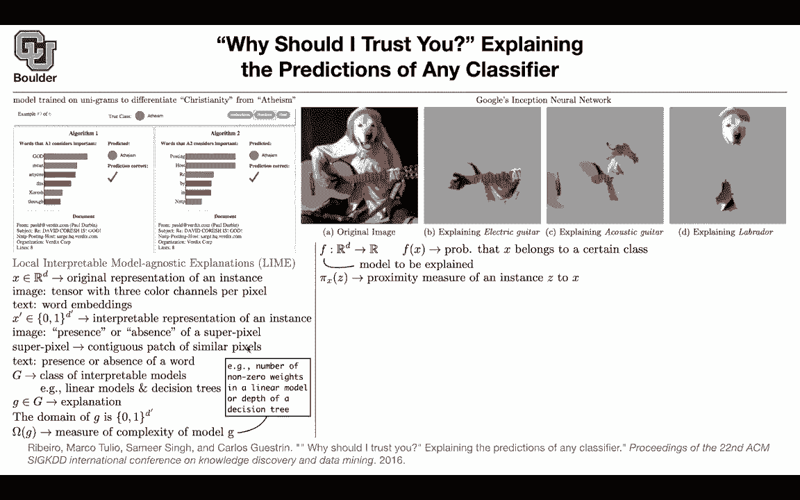

# 课程 P51：L26.1 - LIME 可解释性方法 🧠

在本节课中，我们将学习一种名为 **LIME** 的模型可解释性方法。它的核心思想是：对于一个复杂的“黑盒”模型（如深度神经网络）的预测结果，我们可以通过在其预测点附近，用一个简单、可解释的模型（如线性模型）来近似解释它。这样，我们就能理解模型做出某个特定预测的原因，从而建立对模型的信任。

上一节我们开始尝试理解深度神经网络内部发生了什么。需要说明的是，本课程所涵盖的方法虽然以计算机视觉为主要应用背景，但这些技术本身是通用的。例如，全连接神经网络可以应用于语言建模和强化学习，推荐系统或语音识别同样可以尝试可视化和通过剪枝、量化来提高效率。因此，这些是真正通用的技术。

接下来要介绍的方法则更加通用。它虽然也属于计算机视觉范畴，但本质上是一个可以向任何分类器（无论是神经网络、卷积神经网络还是RNN等）提出的通用问题：**我为什么要相信你的预测？**

## 为何需要信任模型？🤔

以下是两个算法的例子。它们都在单词（unigrams）上训练，任务是区分文本属于“基督教”还是“无神论”。

左边的第一个算法认为文档中重要的词是：`god`, `mean`, `anyone`, `this`, `question`, `through`，并正确地将其预测为“无神论”。它关注的是这些有实质意义的词。

右边的第二个算法关注的词是：`posting`, `host`, `re`, `pi`, `in`, `ntp`。这些词看起来与“基督教”或“无神论”的主题并不相关。

那么，你更信任哪个算法？显然是第一个。因为通过观察算法所关注的词语，我们可以对其预测建立更多信任。

图像分类也有类似的例子。假设原图如下：

如果一个算法告诉你它看到了一把“电吉他”，并且它高亮显示的是吉他的琴身部分，你会更信任它。但如果它高亮的是鸭子头部，却预测为“电吉他”，我们就不会信任它。同理，如果它预测为“原声吉他”并高亮琴身，或者预测为“拉布拉多犬”并高亮狗的脸部，信任度就会建立。

现在的问题是：我们如何实现这一点？我们知道神经网络本身是不可解释的。上一节的论文展示了一些解释神经网络图像预测的好结果，但我们知道，例如线性模型是可解释的，因为你可以查看特征的权重，权重最高的特征可能对预测最重要。决策树家族也是可解释的，你可以通过回溯树的分支来了解哪些特征对特定预测重要。

但神经网络并非如此。本文的想法是：**或许我们可以用一个线性模型来解释神经网络（一个非线性函数）的预测**。也许在局部，在我们感兴趣的观测点附近，事物是线性的。这样，我们就可以根据那个线性模型指出哪些特征是最重要的。这就是本文的核心思想：**我们从一个可解释的模型中寻求帮助**。

## LIME 方法详解 ⚙️

让我们看看具体如何实现。我会介绍一些数学符号和概念，但核心思想很简单：将涉及两个模型，一个是神经网络（或任何分类器），另一个是可解释模型。

这个算法非常有名，叫做 **LIME**（Local Interpretable Model-agnostic Explanations）。你可以在Python中找到对应的包。它是“局部可解释且与模型无关的”，意味着它不关心你的模型是否是神经网络。

*   **`x`**：表示一个实例的原始表示。对于文档，可能是词袋表示（unigrams）；对于图像，则是像素张量（三个颜色通道）；对于文本，可能是一系列词嵌入向量。
*   **`x'`**：可解释模型的输入，是 `d'` 维的向量，每个元素是 `0` 或 `1`。
    *   对于图像，`0` 表示一个“超像素”（superpixel）的缺失，`1` 表示其存在。超像素是相似像素的连续块，有特定算法可以生成。
    *   对于文本，`0` 或 `1` 表示某个词在文档中是否存在。
*   **`g`**：我们使用的可解释模型，来自一个可解释模型族 `G`（例如线性模型或决策树）。`g` 的输入域是 `{0, 1}^{d'}`。我们称 `g` 为对某个特定预测的“解释”。
*   **`Ω(g)`**：解释模型 `g` 的复杂度度量。我们希望解释既准确又简单（奥卡姆剃刀原则）。例如，对于线性模型，复杂度可以是非零权重的数量；对于决策树，可以是树的深度。
*   **`f`**：我们想要解释的原始复杂模型（如神经网络）。`f(x)` 是 `x` 属于某个类别的概率。
*   **`π_x(z)`**：邻近性度量函数，用于定义“局部”的范围。它给靠近感兴趣点 `x` 的数据点 `z` 更高的权重，给远离的点更低的权重。

*   **`L(f, g, π_x)`**：损失函数，用于衡量在由 `π_x` 定义的局部区域内，可解释模型 `g` 近似复杂模型 `f` 的不忠实程度。

我们的目标是找到最优的解释模型 `g`，它最小化损失函数 `L`，同时保持模型复杂度 `Ω(g)` 较低。

## 具体实例：稀疏线性解释 📝

为了让概念更具体，我们以线性解释为例，并且希望它是稀疏的（即只有少数特征有非零权重）。

以下是线性模型的公式：

`g(z') = w_g · z'`

其中 `z'` 是表示特征存在与否的向量，`w_g` 是权重向量。我们希望权重稀疏，这样就能挑出真正重要的特征。

邻近性度量 `π_x(z)` 可以使用指数核函数，例如：

`π_x(z) = exp(-D(x, z)^2 / σ^2)`

其中 `D` 是距离函数。对于文本，常用余弦距离；对于图像，常用 L2 距离。这个函数确保了距离 `x` 越近的点权重越高。

损失函数 `L` 通常使用加权平方损失，我们希望 `f(z)` 和 `g(z')` 的预测在局部区域内尽可能接近。

复杂度度量 `Ω(g)` 可以定义为 L0 范数，即非零权重的数量。我们可以设定一个上限 `K`：

`Ω(g) = ∞ * 1(||w_g||_0 > K)`

这意味着如果非零权重的数量超过 `K`，我们就施加一个巨大的惩罚（实践中用一个很大的数代替无穷大），从而鼓励模型使用尽可能少的特征。

## 视觉化理解 🎨

从视觉上理解，我们有一个复杂的分类器（例如非线性边界）区分圆圈和加号。当给定一个特定的数据点（如图中的加号）时，`π_x` 会赋予其附近点更高的权重（图中用符号大小表示）。

然后，我们寻找一个线性模型（如图中的虚线），它能在该局部区域内近似复杂的非线性模型，并对附近的点做出与复杂模型相同的预测（线右侧预测为蓝色，左侧预测为红色）。这样，这个线性模型就为我们解释了复杂模型在该点的行为。

## 关于超像素和文本表示的问答 💬

**问：** 超像素是针对单个图像定义的，如何能作为一个通用特征呢？例如，一个狗脸的超像素可能不会出现在其他图像中。

**答：** LIME 关注的是**特定数据点**的解释。这些超像素不是通用的、可迁移的特征，而是专门针对**当前这张特定图像**进行解释。我们不是要找一个在所有图像中都存在的“狗脸”超像素，而是要解释对于这张图，模型的预测依据了哪些局部区域。

**问：** 文本的余弦距离使用的是哪种词嵌入？

**答：** 对于本文讨论的文本处理，通常有一个词汇表。每个词最初可以表示为一个高维的 one-hot 向量（例如，100万维中只有一维是1）。然后通过一个嵌入矩阵将其映射到低维的稠密向量（词嵌入）。Word2Vec 就是一种获取这种嵌入的（线性）方法，我们将在下学期详细讨论。非线性嵌入也存在。最终，文本被表示为这些低维向量的序列或集合。

**问：** 关于稀疏线性解释中的复杂度 `Ω(g)`，它只是设定了一个非零权重的上限阈值，只要低于这个阈值，无论用2个还是4个参数，惩罚都一样，这并没有激励使用更简单的模型？

**答：** 是的，这种表述（L0范数）本身不是连续可微的，在实现时通常会进行近似（例如用L1范数松弛）。这里的“无穷大”惩罚在数学公式中是一种理想化的表述，实际编程中会用一个非常大的常数来模拟。核心思想是鼓励稀疏性，即只保留最重要的几个特征进行解释。

## 如何建立对模型的整体信任？ 🏗️

现在我们知道如何信任模型对**单个**预测的解释。但如何建立对模型**整体**的信任呢？

思路很简单：如果你能信任模型在**大量**预测上的解释，那么你就可以信任这个模型。具体做法是，在测试集上选取一组有代表性的实例，为它们生成解释，并展示给用户。

论文中设计了一个算法（非深度学习方法）来解决如何挑选这组实例。这实际上是一个NP难问题（无法在多项式时间内精确求解）。目标是挑选出一小部分实例，使得它们所涵盖的“重要特征”（即解释中出现的特征）尽可能覆盖整个数据集中的重要特征。

设想一个特征-实例矩阵 `W`，其中 `W_ij` 表示第 `i` 个实例的解释中第 `j` 个特征的权重（重要性）。我们希望挑选出少数行（实例），使得被选中的实例所对应的非零特征列尽可能多。这就像是一个集合覆盖问题。论文中提出了一个近似算法（基于子模优化）来高效地挑选这些解释实例，避免NP难的精确计算。

**问：** 如果文档是图片，超像素是图像子集，如何构建一个跨图像的特征集？这不会只是一个对角矩阵吗？（即每个图像的超像素都独一无二）

**答：** 可以构建一个在整个数据集中可能出现的所有超像素的“词汇表”，类似于文本中所有单词的词汇表。但关键在于，超像素算法寻找的是有语义意义的区域（如“狗脸”、“手”、“耳朵”），这些概念会在不同图像的不同对象上重复出现，尽管像素组合不完全相同。就像单词“dog”会出现在许多不同文档中一样。

**问：** 通过其他独立算法预先选择超像素，如果分类器真正依赖的重要区域恰好不在这些超像素内，我们是否会丢失信息？这与上一节通过热力图直接显示分类器关注区域的方法相比如何？

**答：** 这是两种互补的方法。上一节的方法（如Grad-CAM）是专门为神经网络设计的，能更直接地反映网络内部的关注区域。LIME 是一种与模型无关的通用方法，适用于任何分类器。通用方法通常不会像针对特定问题设计的方法那样高效或精准，但它的优势在于广泛适用性。LIME 提供了一种廉价、通用的方式来可视化任何分类器的决策依据。

## 总结 📚

本节课我们一起学习了 **LIME** 方法。其核心是：为了解释一个复杂模型在某个特定点的预测，我们在该点附近用一个新的、简单的、可解释的模型（如稀疏线性模型）去局部拟合复杂模型的行为。通过分析这个简单模型的参数（如权重），我们就可以理解原模型做出该预测所依据的最重要特征（如图像中的超像素或文本中的词语）。这种方法帮助我们建立对单个预测的信任，并通过挑选一组有代表性的解释，可以进一步建立对模型整体的信任。LIME 是一种与模型无关的通用解释工具，为理解“黑盒”模型提供了有力的手段。