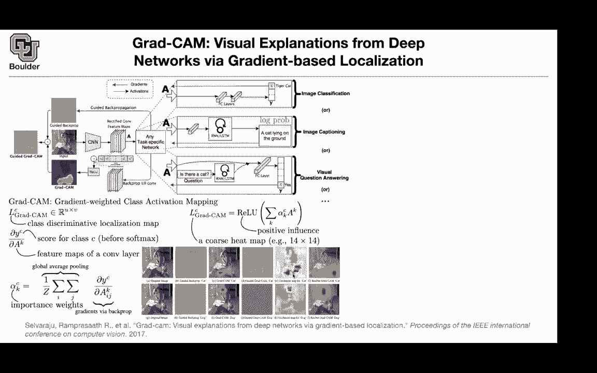
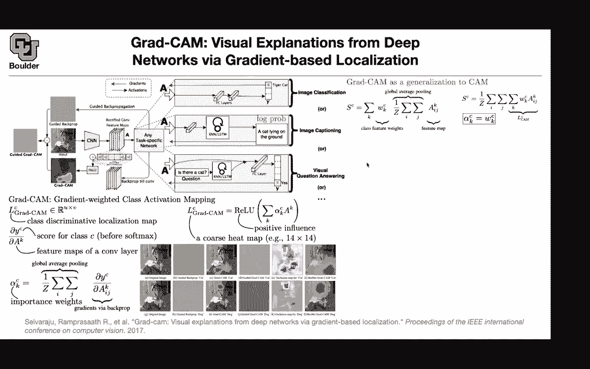

# 课程 P56：L28.2 - Grad-CAM 🧠

在本节课中，我们将要学习一种名为 **Grad-CAM** 的可视化技术。它能够帮助我们理解卷积神经网络在做出决策时，究竟关注了输入图像的哪些部分。与之前需要修改网络结构的方法不同，Grad-CAM 可以直接应用于任何已训练好的 CNN 模型，无需重新训练。

---

## 从 CAM 到 Grad-CAM

上一节我们介绍了 **类激活映射**。但为了获得类激活图，我们需要改变网络架构的最后几层，移除非线性激活，使其末端变为线性结构。这之后还需要进行一些微调。

然而，接下来要介绍的论文提出，你甚至不需要线性化网络的最后部分。即使在全连接层之后存在一系列非线性激活，你仍然可以进行可视化。

---

## 理解 Grad-CAM 原理

以下是 Grad-CAM 的工作原理：

1.  **输入图像**经过卷积神经网络，最终得到一组卷积特征图。
2.  对于图像分类任务，特征图之后通常会连接全连接层，输出每个目标类别的分类得分。
3.  选择一个目标类别，计算该类别得分相对于这些特征图的**梯度**。这是一个高维输入、标量输出的函数的导数，可以通过反向传播计算。
4.  反向传播至卷积特征图处，会得到一个与特征图尺寸相同的梯度张量。
5.  对每个梯度特征图进行**全局平均池化**，得到一组标量权重。
6.  用这些权重对**原始的特征图**进行加权线性组合。
7.  对组合结果应用 **ReLU** 激活函数，只保留对类别有正向影响的区域。
8.  最后，将得到的低分辨率热图（如 14x14）上采样到原始图像尺寸，即可得到最终的可视化结果。

**核心公式**可以概括为：

对于目标类别 `c`，Grad-CAM 热图 `L_Grad-CAM^c` 的计算如下：

1.  计算梯度：计算类别得分 `y^c` 对最后一个卷积层特征图 `A^k` 的梯度。
2.  计算权重：对每个特征图 `k` 的梯度进行全局平均池化，得到权重 `α_k^c`。
    `α_k^c = 1/Z * Σ_i Σ_j ∂y^c/∂A_ij^k`
3.  加权组合：将权重与原始特征图线性组合，并通过 ReLU。
    `L_Grad-CAM^c = ReLU( Σ_k α_k^c * A^k )`

---

## 为何使用 ReLU？

我们应用 ReLU 是因为我们只关心对目标类别有**正向贡献**的像素区域。负梯度意味着图像中该部分的存在会**降低**网络预测为该类别的概率。虽然负向证据也可能重要，但 Grad-CAM 默认聚焦于正向证据以实现清晰的定位可视化。

---

## Grad-CAM 效果展示

通过 Grad-CAM，我们可以看到网络准确地聚焦于图像中与类别相关的关键部分。例如，对于“虎斑猫”类别，热图会高亮显示猫的头部和身体区域。

Grad-CAM 还可以与其他可视化方法结合，例如**导向反向传播**。将 Grad-CAM 的热图与导向反向传播的逐像素显著性图进行逐点相乘，可以得到更精细的、同时具有高定位性和细节的 **导向 Grad-CAM** 可视化结果。

这种方法不仅适用于 VGG 网络，也适用于 ResNet 等其他架构，且**无需对模型进行重新训练**。

---

## Grad-CAM 是 CAM 的泛化

为什么说 Grad-CAM 是 CAM 的泛化呢？在 CAM 中，类别得分 `S_c` 是通过对特征图进行全局平均池化后线性加权得到的：
`S_c = Σ_k w_k^c * Σ_i Σ_j A_ij^k`
如果我们计算 `S_c` 对特征图 `A^k` 的梯度，并且网络从特征图到输出是线性的（即全局平均池化后直接线性分类），那么梯度计算出的权重 `α_k^c` 就会等于 CAM 中的权重 `w_k^c`。因此，在线性情况下，Grad-CAM 等价于 CAM。Grad-CAM 的优势在于它放松了线性限制，可适用于更普遍的、带有非线性的网络末端。

---

## 超越分类：图像描述与视觉问答

Grad-CAM 的思想可以扩展到更复杂的任务，如**图像描述**和**视觉问答**。

*   **图像描述**：模型生成描述句子的概率。我们可以取生成某个特定单词（如“风筝”）的对数概率，反向传播至卷积特征图，计算 Grad-CAM。这样就能看到模型在生成“海滩上有一群人在放风筝”这句话时，其注意力是否真的集中在图像中的风筝和海滩上。
*   **视觉问答**：模型根据图像和问题（如“这个人在做什么？”）输出答案（如“冲浪”）。我们可以针对答案“冲浪”的得分，反向传播至图像特征，得到 Grad-CAM 热图。这能揭示模型做出“冲浪”这个判断时，所依据的图像区域（如人和海浪）。

在这些任务中，进行可视化时，我们需要**指定一个目标**（如某个单词或答案），然后分析网络为何对该目标赋予高置信度。这让我们能够“打开黑箱”，理解神经网络决策的依据，而不仅仅是得到一个结果。

---

## 总结

本节课中我们一起学习了 **Grad-CAM** 技术。我们了解到它通过计算类别得分相对于卷积特征图的梯度，并利用梯度权重来生成类判别性定位热图。这种方法无需修改或重新训练模型，是 CAM 方法的强大泛化。我们还探讨了如何将 Grad-CAM 应用于图像分类、图像描述和视觉问答等多种任务，从而直观地解释神经网络的决策过程，使其不再是一个“黑箱”。