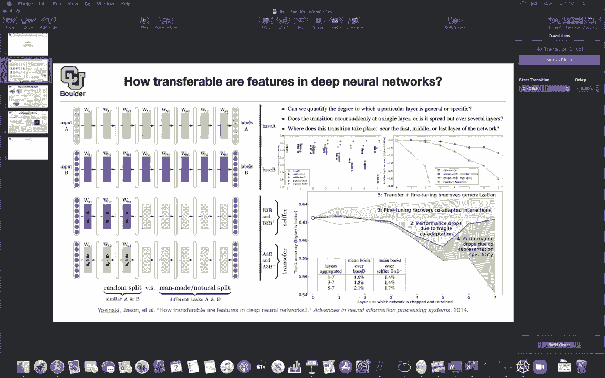
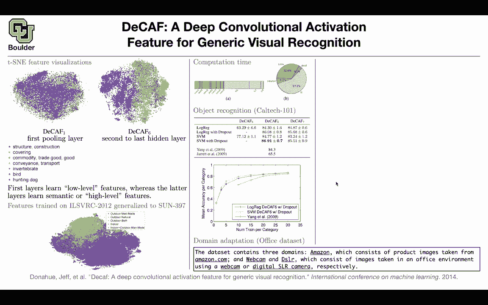

# 课程 P58：L29.1 - DeCAF 特征迁移学习 🚀

在本节课中，我们将学习一篇名为 DeCAF 的重要论文。这篇论文是计算机视觉领域早期探索迁移学习的代表作之一，它系统地研究了如何利用在大规模数据集（如 ImageNet）上预训练的神经网络所学习到的特征，并将其应用到新的、数据量可能很小的数据集或完全不同的任务上。

## 概述

上一节我们引入了迁移学习的概念。本节中，我们将深入探讨 DeCAF 这篇论文。它的核心思想是：一个在大数据集上训练好的深度卷积神经网络（CNN），其深层所提取的特征具有强大的通用性和可迁移性。我们可以将这些“冻结”的特征作为输入，用于训练新的、简单的分类器（如 SVM 或逻辑回归），从而高效地解决新问题。

## 特征可视化与层级理解

首先，论文通过 t-SNE 技术对网络不同层提取的特征进行了可视化。t-SNE 是一种将高维数据降维到2D或3D以便可视化的技术。

以下是观察到的现象：
*   在较浅的层（如第一个池化层，称为 **DeCAF1**），特征的可区分性较低，不同类别的图像在特征空间中混杂在一起。
*   在更深的层（如倒数第二个隐藏层，称为 **DeCAF6**），特征变得更具判别力。语义相似的类别（如不同品种的狗）会聚集在一起，并与差异较大的类别（如鸟类）明显分离。

这个可视化实验印证了一个重要结论：**CNN 的浅层学习的是低级特征（如边缘、颜色、纹理），而深层学习的是高级的、语义化的特征**。正是这些深层的高级特征，具备了被迁移到新任务的潜力。

## 特征在新数据集上的可迁移性

接下来，论文探究了这些特征在新数据集上的表现。研究人员将在 ImageNet 上训练得到的 DeCAF6 特征，直接应用到一个全新的室内外场景数据集上，**没有进行任何额外的训练**。

结果发现，这些特征依然具有很强的判别能力。例如，在特征空间中，“户外人造景观”和“户外自然景观”能够被清晰地分开，“室内”与“户外”场景也形成了明显的边界。这表明，从大规模数据集中学习到的通用视觉特征，确实可以有效地表征其他领域的图像。

> **注意**：在 t-SNE 可视化图中，点的绝对空间位置没有意义（因为投影可以旋转），有意义的是不同类别点云之间是否存在清晰的分离边界。

## 计算效率与特征提取点

有人可能会质疑，运行整个深度网络来提取特征计算成本很高。论文对此进行了分析：
*   在典型的 CNN（如 AlexNet）中，大部分的计算时间（约 **57%**）和内存消耗发生在全连接层。
*   DeCAF 方法的关键在于，我们可以在卷积层之后“切断”网络。例如，**DeCAF6** 特征是在最后一个全连接层之前提取的，**DeCAF5** 特征则是在全连接层之前提取的纯卷积特征。

因此，相比运行完整的网络进行分类，提取这些中间特征并交给一个轻量级分类器（如 SVM），在计算上是有优势的。

## 在新任务上的应用实践

论文在多个标准小数据集上测试了 DeCAF 特征的性能，例如 Caltech-101（仅有约每类30张图片）。

以下是实验设置与结果：
*   **特征来源**：提供了不同层的特征选项，如 DeCAF5、DeCAF6、DeCAF7。
*   **分类器**：在提取的特征上训练简单的分类器，如逻辑回归、支持向量机（SVM），有时结合 Dropout。
*   **核心发现**：
    1.  **DeCAF6 特征通常表现最佳**，在准确率上显著优于其他层特征和传统的非深度学习特征（如 SURF）。
    2.  **SVM 通常比逻辑回归表现更好**。
    3.  即使每类只有 **5-30** 个训练样本，使用 DeCAF 特征也能取得远超当时传统方法的性能。这完美解决了小数据集的训练难题。

> **核心概念澄清**：这里迁移的“特征”并非网络的权重参数，而是将一张输入图像通过网络前向传播，在特定层（如 DeCAF6）**输出的激活值张量**。这些值是该图像经过一系列卷积、非线性变换和池化操作后得到的高维表示。

## 域适应任务

论文进一步将 DeCAF 特征应用于更具挑战性的“域适应”任务。例如，有一个数据集包含来自三个不同领域的产品图片：亚马逊（Amazon）、网络摄像头（Webcam）和数码单反（DSLR）。图像质量和拍摄环境差异很大。

任务设定是：**仅在源域（如亚马逊）的数据上训练分类器，然后直接在目标域（如网络摄像头）的数据上进行测试**。

实验结果令人印象深刻：
*   使用 DeCAF 特征，即使没有在目标域上进行任何训练，分类准确率也获得了巨大提升。
*   如果两个域更相似（如 Webcam 和 DSLR），迁移效果会更好。t-SNE 图显示，DeCAF 特征能够将不同域中同一类别的物体（如剪刀）在特征空间中拉近。

这种方法同样在细粒度鸟类分类和场景识别等任务上取得了成功，证明了 DeCAF 特征的强大泛化能力。

## 总结

本节课我们一起学习了 DeCAF 这篇里程碑式的论文。它系统地展示了如何利用预训练深度神经网络的高层特征进行迁移学习。关键要点包括：
1.  深层 CNN 特征具有高级语义信息，可迁移性强。
2.  将这些固定特征与简单分类器（如 SVM）结合，能高效解决小样本学习问题。
3.  该方法在跨数据集和跨领域（域适应）任务上效果显著，为后续的迁移学习研究奠定了基础。

理解 DeCAF 有助于我们认识到，深度网络本身可以作为一个强大的“通用特征提取器”，这为处理实际中数据匮乏的问题提供了非常实用的工具。