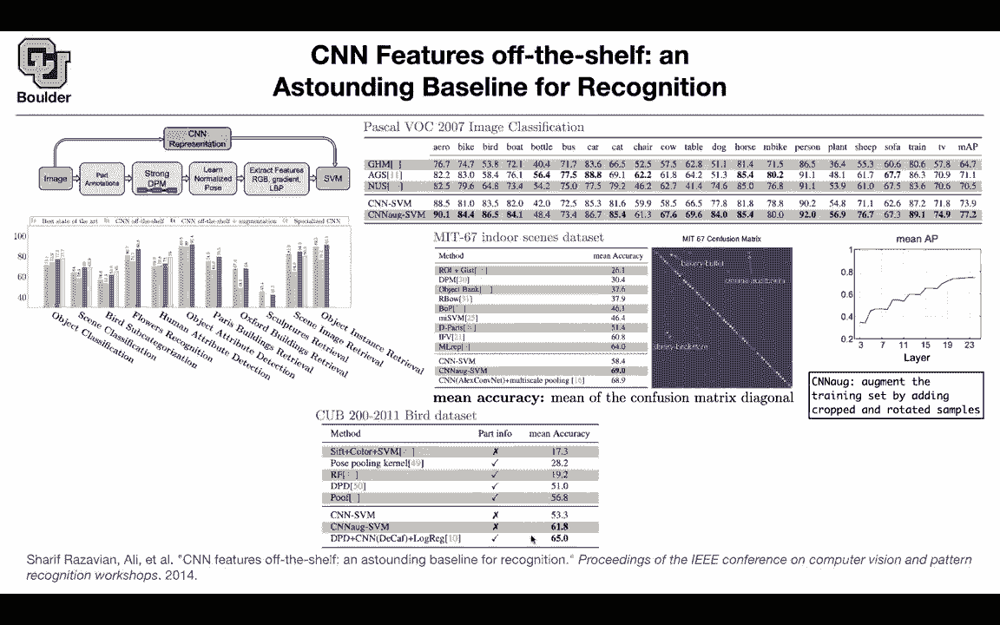
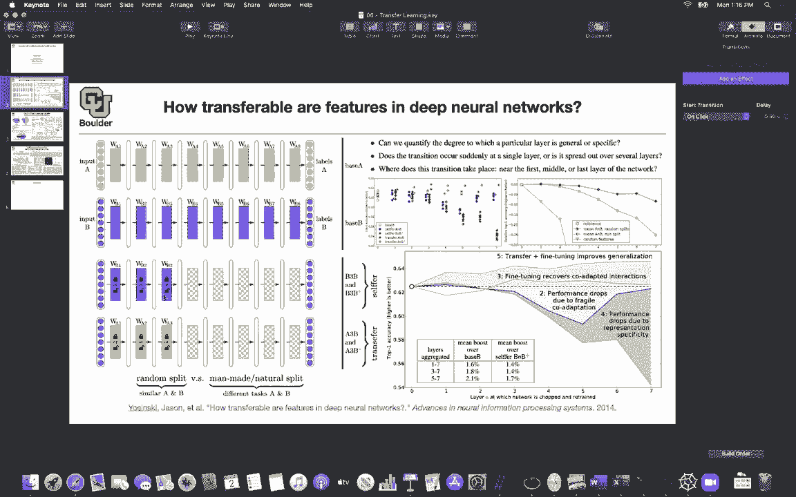

# 🧠 课程 P59：L29.2 - 卷积神经网络特征解析

在本节课中，我们将学习卷积神经网络（CNN）特征如何作为强大的通用视觉特征，应用于多种计算机视觉任务，而无需对网络进行微调。

---

## 🔍 CNN 特征概述

上一节我们介绍了CNN的基本结构。本节中我们来看看CNN特征如何作为通用特征提取器，迁移到其他视觉任务中。

CNN特征的核心思想是：使用在ImageNet数据集上预训练好的CNN模型，直接提取图像的特征表示，然后将这些特征输入到简单的分类器（如支持向量机）中，完成新任务。这种方法可以绕过传统方法中复杂的手工特征工程。

以下是CNN特征应用的关键优势：

*   **通用性强**：在ImageNet（物体分类任务）上学习到的特征，可迁移到其他领域。
*   **流程简化**：无需复杂的特征工程，流程简化为 `图像 -> CNN -> 特征 -> 分类器`。
*   **性能优异**：即使不微调，其性能也与许多针对特定任务精心设计的方法相当。

---

## 📊 CNN特征在不同任务上的表现

接下来，我们看看CNN特征在多个视觉任务上的具体表现。这些任务距离原始的ImageNet分类任务越来越远。

### 物体分类（PASCAL VOC数据集）

此任务与ImageNet略有不同，一张图像中可能包含多个类别的物体。评估指标采用**每类平均精度（Average Precision per category）**或**平均精度均值（mean Average Precision）**。

使用CNN提取特征，并结合支持向量机及数据增强（如裁剪、旋转）的方法，在几乎所有类别上都取得了最佳性能。

### 室内场景分类

室内场景分类对机器人应用很重要。同样，**CNN特征 + SVM + 数据增强**的方法表现最佳。

观察其混淆矩阵可以发现，即使分类错误，其错误也较为合理（例如将面包房误分类为自助餐厅，将电影院误分类为礼堂）。

### 鸟类子类别分类

在之前的论文中我们已经看到CNN特征在此任务上的有效性。此处，使用数据增强的CNN特征方法（未使用部件信息）与之前使用了部件信息的方法性能相当。

### 人体属性检测

此任务与ImageNet的物体类别截然不同，需要判断人物的属性，例如：
*   性别（男性/女性）
*   是否长发
*   是否戴眼镜
*   是否戴帽子
*   穿着（T恤、长袖、短裤、牛仔裤等）

### 物体实例检索

物体检索的任务是：给定一张查询图像，从数据集中找出所有与之相似的图像。

其流程是：
1.  将两张图像分别输入神经网络提取特征。
2.  计算两个特征向量之间的**L2距离**作为相似度度量。
3.  根据相似度对数据集中的图像进行排序。

CNN特征在多个检索数据集（如Oxford 5k, Paris 6k, Sculptures）上表现良好，超越了许多手工设计的特征。

---

## 🤔 特征来源与迁移学习

一个关键问题是：这些通用的CNN特征最初是从哪里学习到的？

答案是：所有这些案例中使用的特征提取器，都是在**ImageNet数据集**上，以**图像分类**为目标函数训练得到的CNN模型（例如AlexNet）。训练完成后，固定该网络的所有权重，将其作为一个固定的特征生成器，用于其他任务。

这属于**迁移学习**的一种形式。我们还可以选择不固定全部权重，而是释放一部分网络的参数，使其在新任务的数据上进行微调（Fine-tuning），这通常能带来性能提升。是否微调，就像是否对参数“上锁”一样，是一个可选择的策略。

---

## ✅ 课程总结

本节课中我们一起学习了：
1.  CNN特征可作为强大的通用视觉描述符。
2.  无需微调，CNN特征就能在多种视觉任务（如物体分类、场景分类、属性检测、图像检索）上提供有竞争力的基线性能。
3.  这些特征来源于在ImageNet上预训练的物体分类网络。
4.  通过结合数据增强或进行网络微调，可以进一步提升特征在这些迁移任务上的表现。