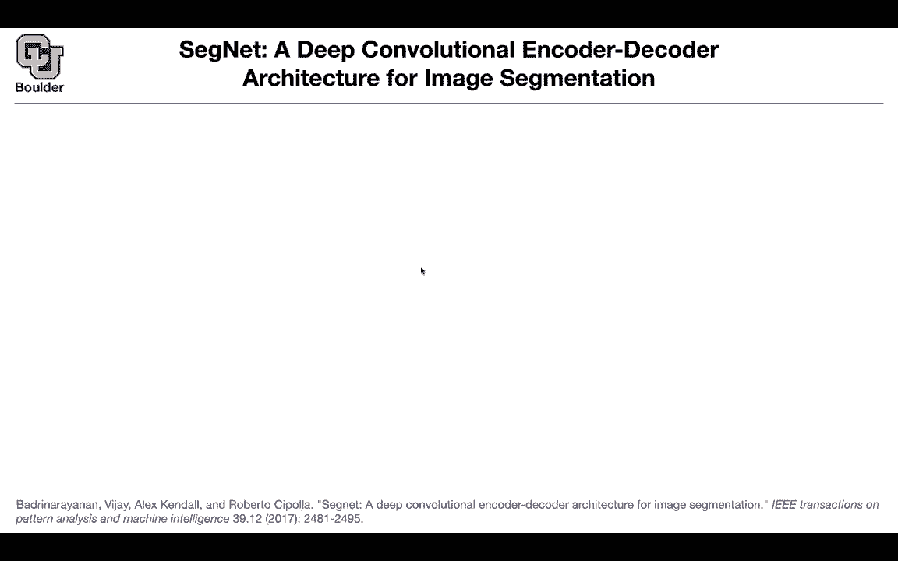
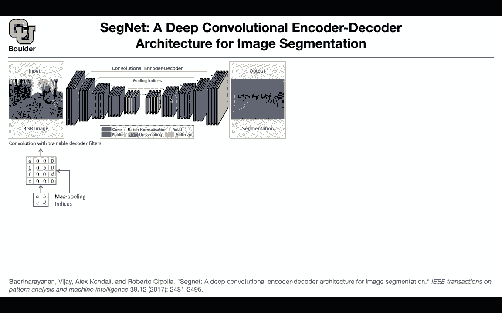
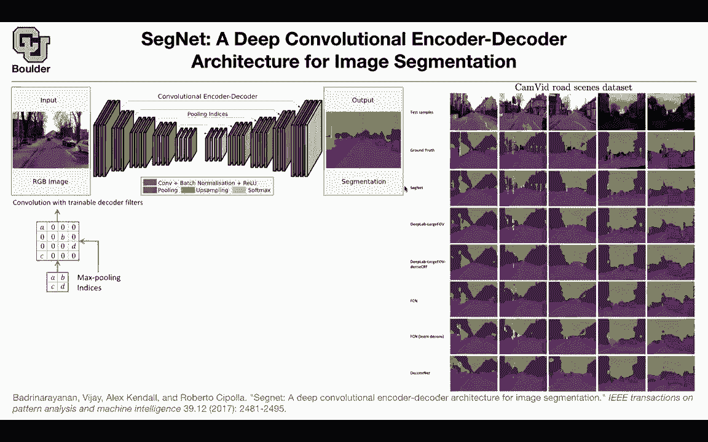

# 🧠 课程 P67：L32.2 - SegNet 架构详解

在本节课中，我们将要学习 SegNet 这一经典的语义分割网络架构。SegNet 的核心创新在于其独特的上采样方式，它通过记录池化过程中的索引位置，在解码阶段高效地恢复图像分辨率。我们将详细解析其工作原理，并与之前学过的其他方法进行对比。

---

## 🔄 上采样方法的演进

上一节我们介绍了多种上采样方法，本节中我们来看看 SegNet 提出的新思路。

目前，我们已掌握的上采样方法包括使用转置卷积（deconvolutions）或简单的线性插值，甚至是通过复制粘贴像素从低分辨率扩展到高分辨率。然而，还存在另一种从一层到下一层增加分辨率的方法，我们在之前进行网络可视化时曾见过类似思想。

第一篇关于可视化神经网络特征的论文中，我们通过记录前向传播中池化层的索引位置（即“开关”），在需要提高分辨率时，将输出复制粘贴到“开关”所指示的正确位置。SegNet 论文的核心思想与此非常相似。

以下是 SegNet 与 U-Net 等架构的关键区别：

*   SegNet 使用一系列卷积层（图中未着色部分）和池化层（绿色部分）进行下采样，这部分是标准的。
*   其独特之处在于上采样（解码）部分。它并非直接复制输入特征图的值，而是复制在对应下采样池化层中记录的**索引**。

---

## 📊 SegNet 上采样机制详解

为了更精确地理解，让我们看看具体发生了什么。这个过程的核心就是之前提到的“开关”机制。

假设经过某个卷积层后，我们得到特征值 `A, B, C, D`。紧接着的池化层（例如最大池化）会记录最大值所在的位置索引。在进行上采样时，我们并不复制 `A, B, C, D` 这些值本身，而是根据之前记录的池化索引，将当前层的输出值放置到高分辨率特征图中对应的位置。

**具体步骤如下：**
1.  记录下采样过程中每个池化操作选取最大值的位置索引。
2.  在上采样时，根据这些索引，将低分辨率特征图中的值填充到高分辨率特征图的对应位置。
3.  索引未指向的位置则用零填充。

因此，初始上采样得到的特征图是稀疏的。但网络后续会通过卷积层（这些卷积层拥有自己的权重和偏置等参数）对这些稀疏特征进行处理，最终输出不再稀疏的特征图。这是一个非常巧妙的设计，其思想源于早期的网络可视化工作。

与使用转置卷积的网络不同，SegNet 在解码器部分使用的是普通的卷积层。

---

## ✅ SegNet 的性能表现

这个简单的想法在实践中表现非常出色。

请看对比图，左侧是真实标注（Ground Truth），中间是 SegNet 的预测结果。至少从定性角度看，SegNet 完成了非常好的工作，甚至能捕捉到令人满意的细节精度。相比之下，右侧展示的其他网络（例如我们之前学过的全卷积网络 FCN）的结果则不尽如人意，存在树木、灯杆等物体缺失的情况。

在量化指标上，SegNet 的平均交并比（mean Intersection over Union, mIoU）达到了 **90.4%**，这是一个很高的分数。

SegNet 的应用场景主要包括自动驾驶和机器人视觉。在计算时间和硬件资源消耗方面，它与我们之前见过的其他网络具有可比性。特别值得一提的是，在 CPU 推理时的内存占用上，SegNet 表现最佳，因为它只需要存储和复制整数类型的池化索引，这非常节省资源。

---

## 📝 本节总结

本节课中，我们一起学习了 SegNet 语义分割网络。其核心创新在于利用池化索引进行高效上采样，而非传统的转置卷积或插值方法。我们详细剖析了这一过程：**在下采样时记录最大池化的位置索引，在上采样时依据这些索引放置特征值**。这种方法在保持精度的同时，降低了解码阶段的内存消耗。SegNet 在多个标准数据集上展现了优秀的性能，特别是在细节恢复和计算效率方面。