# 课程 P76：L35.1 - 空间金字塔池化 🧠

在本节课中，我们将学习目标检测领域的一个重要技术——**空间金字塔池化**。我们将了解它如何解决早期目标检测算法中的计算效率问题，并允许网络处理任意尺寸的输入图像。

---

## 概述

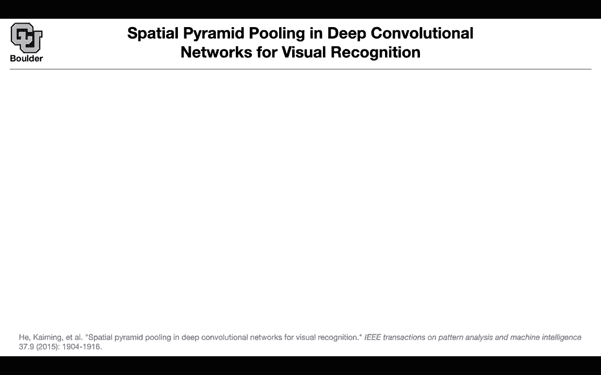

上一节我们介绍了R-CNN算法及其在计算成本上的局限性。本节中，我们将深入探讨**空间金字塔池化**技术，它通过共享卷积计算和生成固定长度的特征表示，显著提升了目标检测的效率。

## 从目标检测的应用说起

目标检测有广泛的应用。例如，在垃圾分类场景中，一个配备视觉系统的机械臂可以通过目标检测算法识别可堆肥与不可堆肥的物体，并进行分拣。这凸显了高效、准确的目标检测算法的重要性。

## 早期算法的局限性

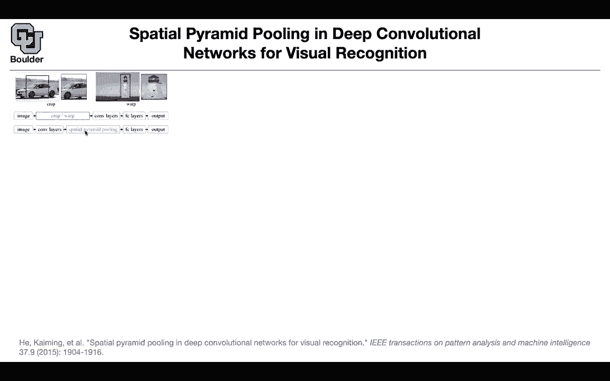

在R-CNN等早期算法中，存在两个主要问题：

1.  **图像变形问题**：从输入图像中提取的候选区域尺寸不一，而卷积神经网络通常要求固定尺寸的输入（如224x224像素）。因此，必须对每个候选区域进行裁剪或扭曲变形，这可能导致信息丢失。
2.  **高昂的计算成本**：算法需要对成千上万个候选区域分别进行卷积特征提取。由于卷积运算是计算密集型的，这个过程非常耗时。

## 空间金字塔池化的核心思想

空间金字塔池化提出了一种巧妙的解决方案。它不再在输入图像层面进行裁剪，而是在卷积层输出的**特征图**上进行操作。

以下是其工作原理：

1.  **单次卷积计算**：将整张输入图像一次性通过卷积神经网络，得到最终的特征图。这**共享了所有候选区域的基础卷积计算**，是节省计算量的关键。
2.  **区域投影**：对于每个候选区域（边界框），可以根据卷积的下采样比例，直接计算出它在最终特征图上对应的子窗口位置。
3.  **空间金字塔池化**：对特征图上的每个子窗口（即每个候选区域对应的区域），应用空间金字塔池化，将其转换为固定长度的特征向量。

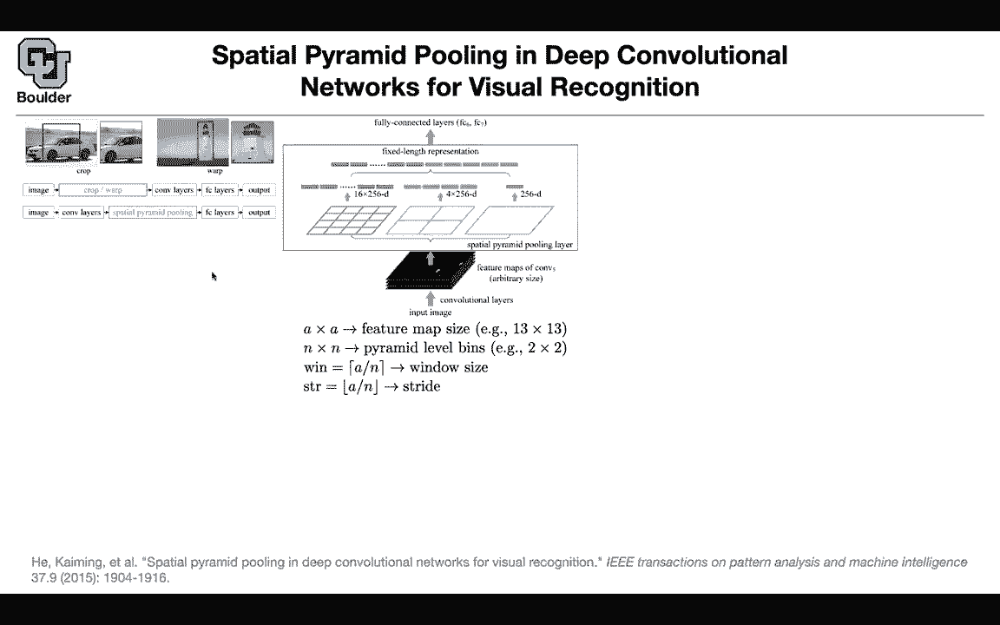

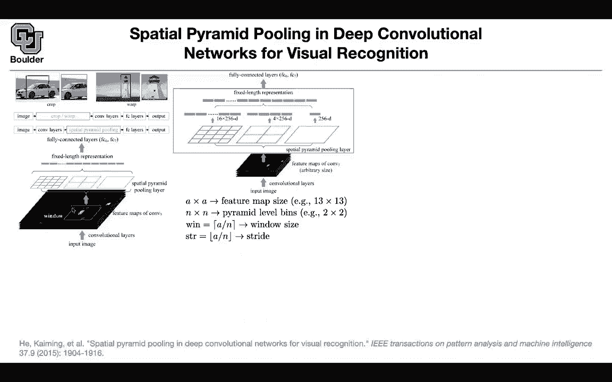

## 空间金字塔池化操作详解


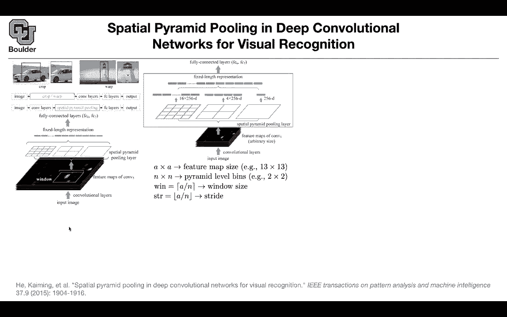


空间金字塔池化层对输入的特征图子窗口进行多尺度划分，并对每个划分后的格子进行池化操作。

具体步骤如下：
*   将特征图子窗口划分为不同尺度的网格，例如 **1x1**、**2x2**、**4x4**。
*   对每个网格内的特征值进行池化（通常使用**最大池化**）。
*   将所有网格的池化结果拼接起来，形成一个固定维度的特征向量。

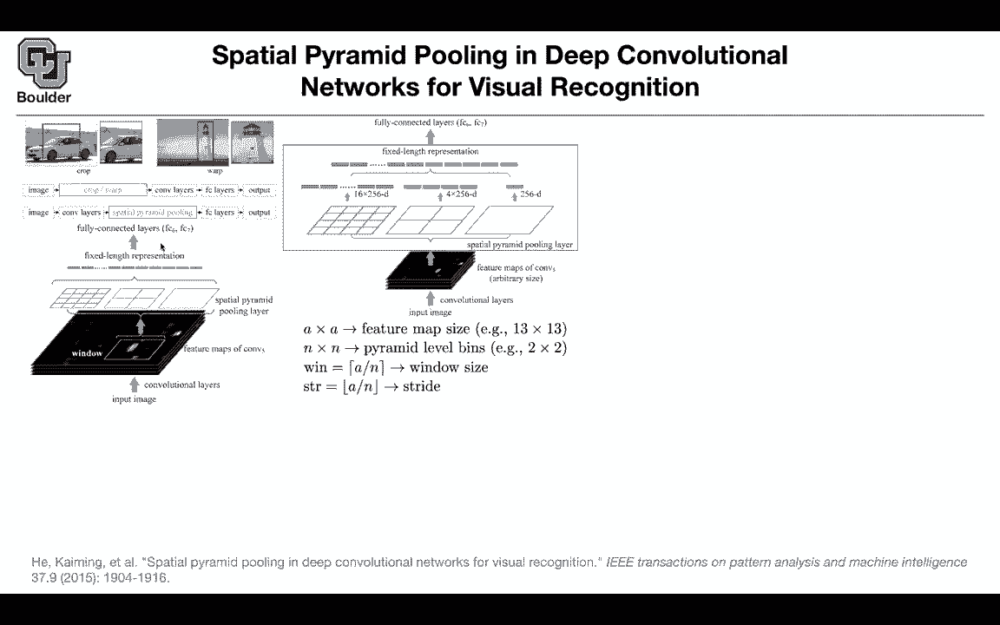

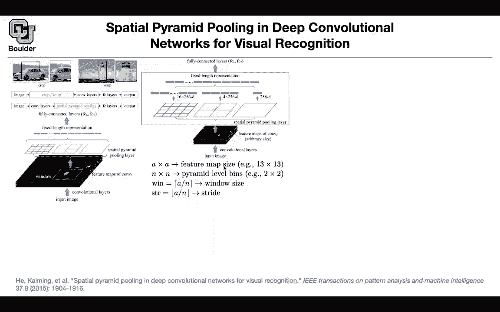

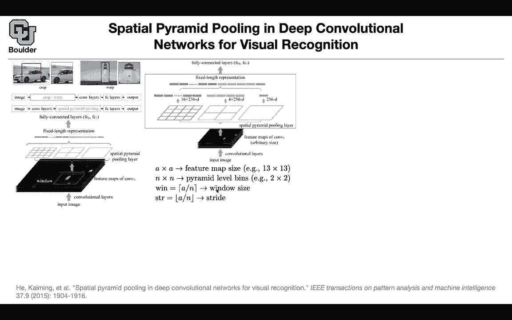

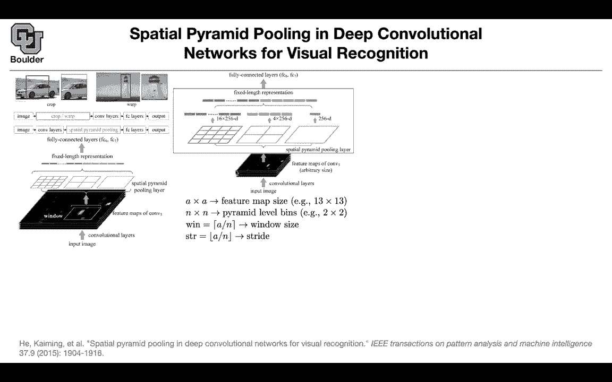

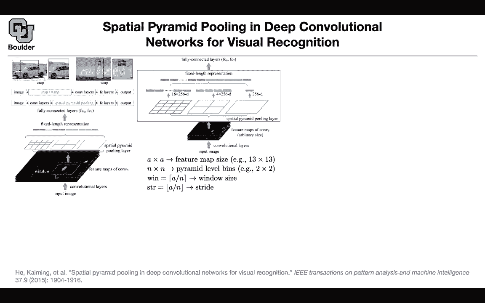

例如，如果特征图通道数为256，使用上述三种网格尺度，最终得到的特征向量维度为：
`(1x1 + 2x2 + 4x4) * 256 = 21 * 256 = 5376`

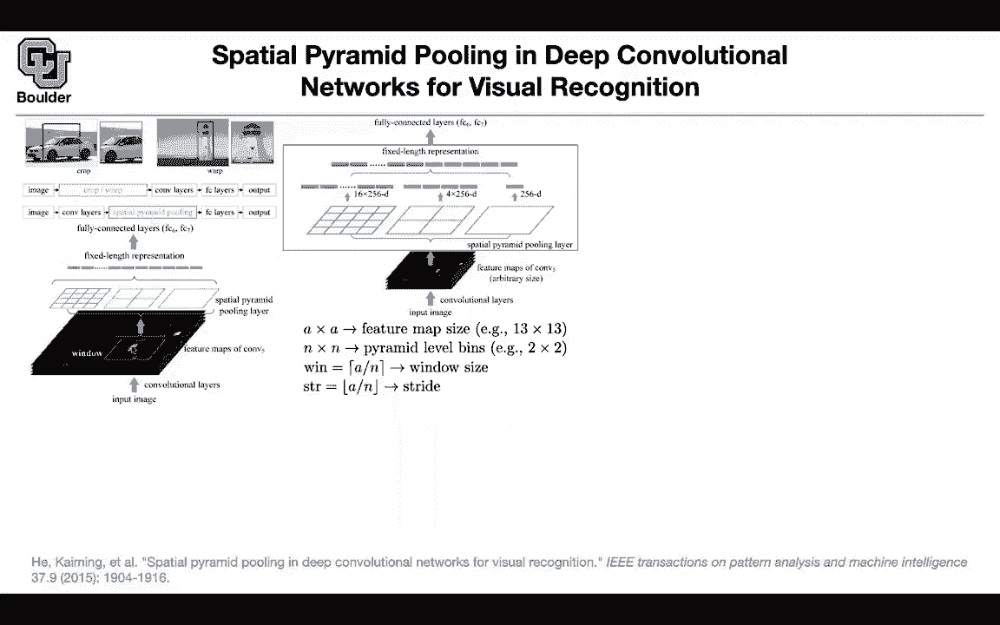

这个维度是固定的，与输入图像或候选区域的原始尺寸无关。其数学形式可以描述为，对于一个大小为 `a x a` 的特征图，要将其划分为 `n x n` 个格子，则每个池化窗口的大小 `win_size` 和步长 `stride` 可以计算为：
```
win_size = ceil(a / n)
stride = floor(a / n)
```

## 带来的优势

采用空间金字塔池化后，目标检测流程获得了以下关键改进：

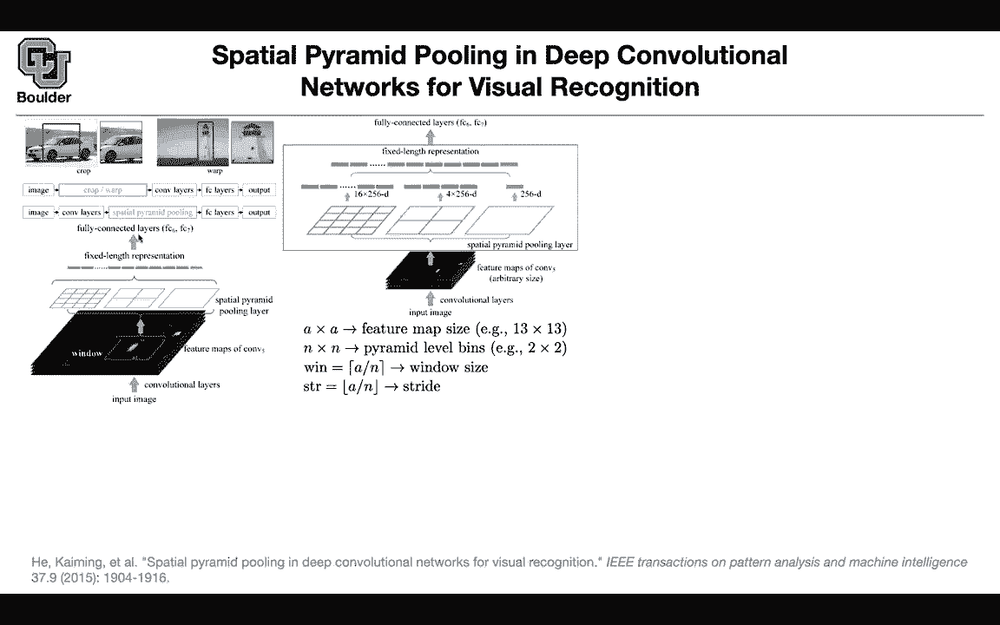

*   **计算效率大幅提升**：卷积操作只需在整图上执行一次，而非对每个候选区域重复执行。
*   **支持任意尺寸输入**：由于SPP层能输出固定长度的特征，网络可以接受任意长宽比的输入图像，灵活性更强。
*   **避免了图像变形**：特征提取在更抽象的特征图上进行，减少了对原始图像像素的扭曲操作。

## 性能与总结

实验表明，采用空间金字塔池化的算法在保持高**平均精度均值**的同时，检测速度相比R-CNN有数量级的提升。这使其更适用于视频流等需要实时处理的应用场景。

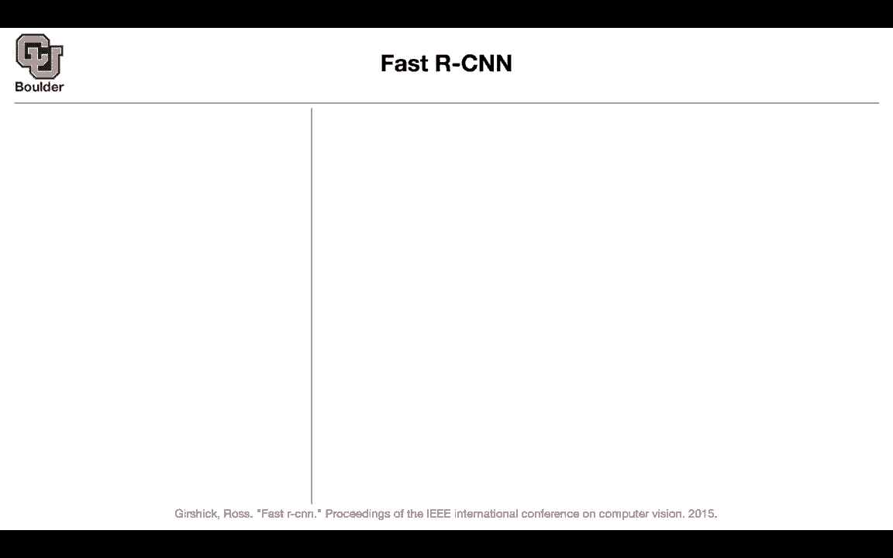

本节课中，我们一起学习了空间金字塔池化技术。它通过**在特征图上共享卷积计算**和**生成固定维度的特征表示**，巧妙地解决了早期目标检测算法计算成本高、输入尺寸固定的问题，为后续更快的检测算法（如Fast R-CNN）奠定了基础。下一节，我们将在此基础上，学习引入了**兴趣区域池化**的Fast R-CNN算法。