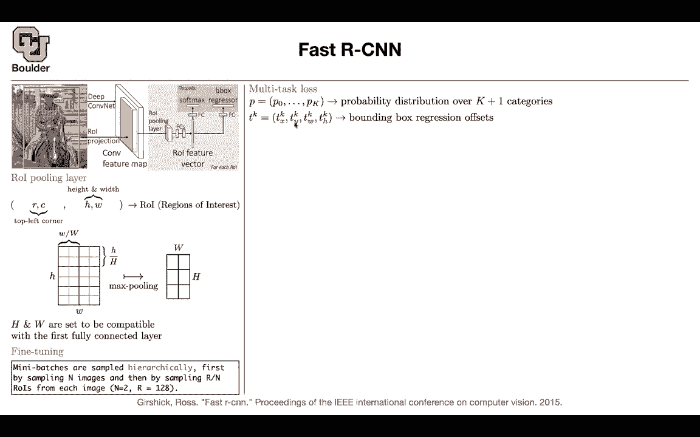
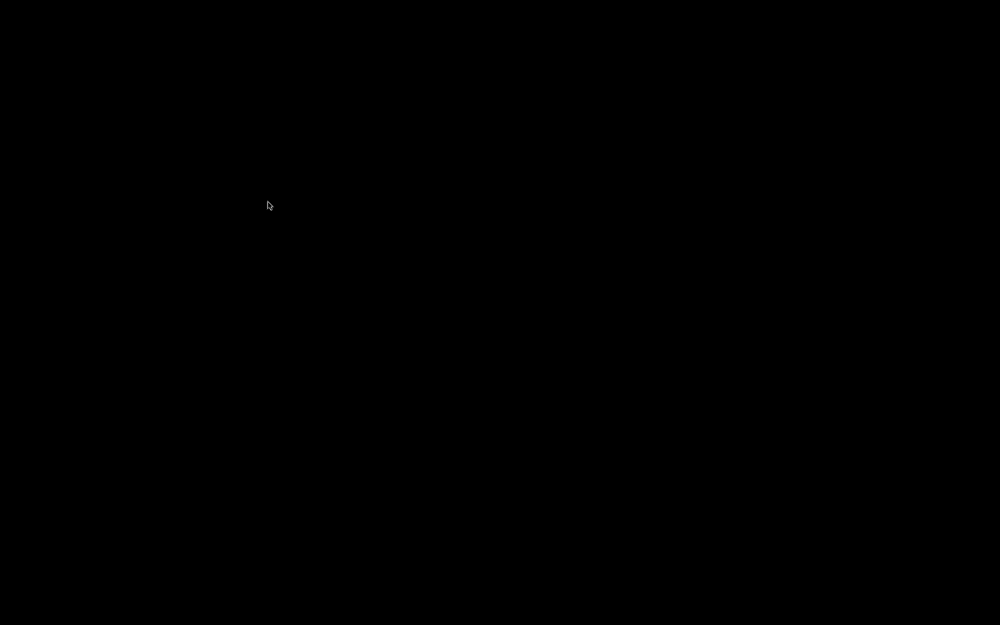
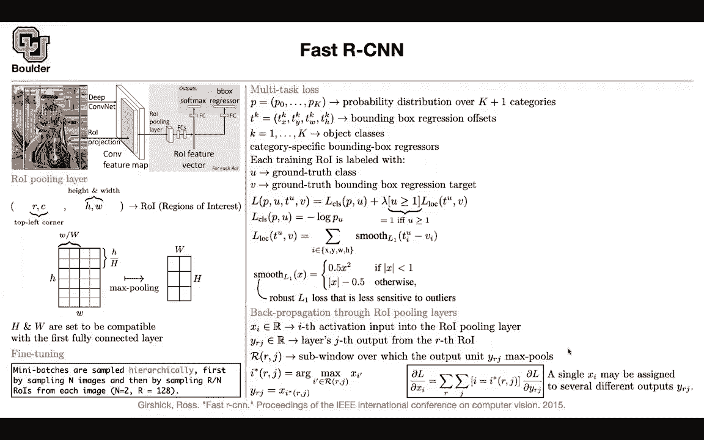

# 课程 P77：L35.2 - Fast R-CNN 🚀

在本节课中，我们将学习 Fast R-CNN 的核心思想与实现细节。Fast R-CNN 是目标检测领域的一个重要模型，它通过共享计算和端到端的训练，显著提升了 R-CNN 系列模型的效率与性能。

---

## 核心思想 💡

上一节我们介绍了 R-CNN 的计算冗余问题。本节中我们来看看 Fast R-CNN 如何解决这个问题。

其核心思想是，在特征图上进行大量计算前，可以节省大量计算。这可以通过空间金字塔池化（Spatial Pyramid Pooling）或 ROI 池化层（ROI Pooling Layer）来实现。

此外，R-CNN 中使用了**每个类别独立的 SVM 分类器**。Fast R-CNN 可以摒弃这部分，构建一个**端到端的系统**。该系统将为我们执行 **Softmax 分类** 和 **边界框回归**。

---

## ROI 池化层详解 🧩

让我们看看什么是 ROI 池化。

我们知道，存在一些区域提议算法会为我们提出候选区域。在原始图像上选取其中一个区域，然后通过投影，你可以在卷积特征图上得到一个对应的区域。

计算这个投影非常简单。我们知道所使用的卷积操作，因此可以轻松地找到这个框（或区域）在特征图上的坐标。**寻找坐标是直接的数学计算**。

最终，你会得到该区域的左上角坐标（例如 `(r, c)`）以及它的高度和宽度。这个区域被称为**感兴趣区域**。

以下是 ROI 池化的具体步骤：

1.  将你的感兴趣区域划分为固定数量的网格单元（bins）。这与之前的方法类似，但只执行一次，而之前的方法需要执行多次。
2.  你只需要指定划分后的网格高度 `h` 和宽度 `w`。
3.  剩余的操作就是**最大池化**。例如，将四个像素最大池化为一个像素，对其他四个像素执行相同操作，以此类推。
4.  这样就得到了 ROI 池化层的输出。

ROI 池化层输出的特征图具有固定的维度（总是 `h x w`）。你可以将其展平，然后输入到全连接网络中。最终，你会得到一组特征，可以将其输入到一个全连接层以获得 Softmax 分类结果，再输入到另一个全连接层以获得边界框回归结果。





这就是 ROI 池化。它非常类似于空间金字塔池化，但你只使用一个金字塔层级，并指定 `h` 和 `w`。`h` 和 `w` 的取值取决于你网络后续全连接层的维度要求。

---

## 网络训练与微调 🔧

现在，如何微调这个具有多个“头”（分类头和回归头）的网络？如何训练这些全连接网络？以及如何微调卷积层的权重和偏置以节省更多时间？

以下是训练策略：

*   采样两幅图像。
*   在每幅图像中，采样 `128 / 2 = 64` 个感兴趣区域。
*   这些区域共同构成你的**小批量**。

你可能会认为仅从两幅图像采样会带来很大偏差，但实践证明这是一个快得多的算法，并且最终在训练准确率（或损失）方面牺牲并不大。损失的下降模式与常规方法类似。

另一种方案是采样 128 幅图像，每幅图像只取一个感兴趣区域来构成小批量。虽然看起来偏差更小，但实践中，仅使用两幅图像和每幅图像 64 个样本的算法效果很好。

---

## 多任务损失函数 ⚖️

你的损失将是一个**多任务损失**。一部分损失来自分类，另一部分来自边界框回归。

在 R-CNN 中，你需要为每个类别配备支持向量机。现在，你可以只有一个**多类别预测器**，它将输出 `K+1` 个类别（`K` 个目标类别加上背景类别）。

同时，你将拥有一个边界框回归器。这些回归器会输出每个类别的边界框调整参数。

边界框回归器预测的是四个值：`t_x`, `t_y`, `t_w`, `t_h`。这是一个对起始框的微小变换。

```math
t_x, t_y, t_w, t_h
```

这与我们之前在 R-CNN 边界框回归器中看到的内容完全相同。每个类别都会预测一个边界框，因此总共会预测 `K` 个边界框。由于每个框由四个参数化，所以全连接网络最终预测 `4 x K` 个变量。这些是**类别特定的边界框**。

你需要为每个感兴趣区域标注标签。在我们的迷你批次中，有 128 个这样的区域。

我们如何标注它们？我们知道真实类别和真实边界框的坐标，这些是我们的目标。然后，我们将定义一个损失函数。

*   **分类损失函数**：在 Softmax 之后，使用标准的**交叉熵损失**。
*   **定位损失**：因为我们知道真实的边界框回归目标，所以可以计算定位损失。我们**只对非背景物体计算边界框回归损失**。如果一个物体被判定为背景（即 `u=0`），则不包含其回归损失。这是合理的，因为你不想为无数个你不感兴趣的框计算损失。
    *   当 `u=0` 时（对应背景类），忽略其回归损失。`p_0` 对应背景类的分类概率。

对于定位损失，我们使用 **Smooth L1 损失**。在局部它类似于 L2 损失，但当远离目标点时，它会变为 L1 损失。这对异常值更鲁棒，因为在回归时你会遇到很多异常值。原因是这些框的位置可能完全错误，其误差范围可能非常大。你不希望过度惩罚这些异常值，因此使用这种损失函数。

---

## 后向传播与输出理解 🔄

如何通过 ROI 池化层进行反向传播？

每个输入像素 `x_i` 对应特征图上的一个点。输出 `y_{r,j}` 对应 ROI 池化层后的第 `j` 个点，且位于第 `r` 个区域内。我们在这个子窗口 `R(r, j)` 内执行最大池化。

```math
y_{r,j} = \max_{i \in R(r, j)} x_i
```

我们选择该区域内的最大 `x` 值，并记录下提供最大值的那个像素的索引。然后，`y_{r,j}` 的值就是该特定位置 `x_i` 的值。

现在，我们想知道损失相对于 `x_i` 的梯度。问题是，同一个 `x_i` 可能贡献给多个不同的 `r` 和 `j`（因为区域可能有重叠）。我们通过求和来处理这种重叠：检查 `x_i` 是否是某个输出区域 `R(r, j)` 内最大值的索引。如果是，则梯度传递；如果不是，则贡献为零。这样我们就可以计算梯度并进行反向传播。

---

## 推理加速技巧 ⚡

训练完成后，我们进入推理阶段，并希望尽可能快。

有一个技巧：当你有全连接层的权重矩阵时，这些矩阵的值现在是固定的。你可以对它们进行**奇异值分解**，然后只保留主导的奇异值。这将减少计算量，帮助你加速全连接网络部分。卷积部分本身已经通过参数共享和计算共享实现了高效，因此加速效果更明显。

实际速度提升如何？
*   在训练阶段，速度提升了约 **3 倍**。
*   在测试阶段，使用 SVD 后，速度提升了 **98 倍** 到 **169 倍**。
速度提升如此显著，是因为卷积计算被大量共享。卷积部分只需计算一次，然后就可以用于所有区域。而 ROI 池化之后的部分是针对每个区域单独计算的。



---

## 总结 📝

本节课中，我们一起学习了 Fast R-CNN 模型。

1.  我们了解了其核心思想：**通过 ROI 池化层共享卷积计算**，并构建**端到端的分类与回归网络**。
2.  我们详细探讨了 **ROI 池化层** 的工作原理，它将可变大小的区域转换为固定大小的特征图。
3.  我们分析了网络的**训练策略**和**多任务损失函数**，该函数同时优化分类准确率和边界框定位精度。
4.  我们解释了如何通过 **Smooth L1 损失** 来处理回归中的异常值。
5.  最后，我们介绍了在推理阶段使用 **奇异值分解** 来进一步加速模型的方法。

Fast R-CNN 通过共享计算和端到端学习，在保持高精度的同时，极大地提升了目标检测的速度，为后续更快的模型（如 Faster R-CNN）奠定了基础。