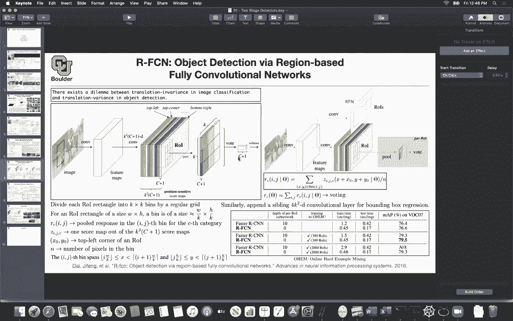
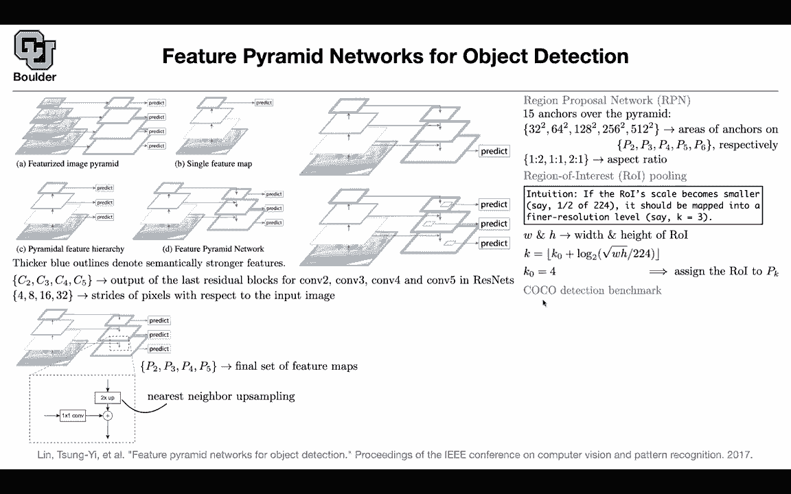

# 📚 课程 P80：L37.1 - 特征金字塔网络

在本节课中，我们将学习特征金字塔网络（Feature Pyramid Network， FPN）。这是一种用于提升目标检测模型性能，特别是检测不同尺度物体（如小物体）能力的重要技术。我们将回顾目标检测的发展脉络，理解多尺度检测的挑战，并深入探讨FPN的核心思想与实现细节。

---

## 🔍 回顾：目标检测的演进之路

上一节我们介绍了目标检测的基本框架。传统的两阶段检测器（如R-CNN系列）遵循“分而治之”的策略：首先生成候选区域（Region Proposals），然后对每个区域进行分类和边界框回归。

这个流程存在一些可以改进的地方：
*   无需对区域进行变形（Warping）操作。
*   无需使用支持向量机（SVM）进行分类。
*   无需依赖外部算法（如选择性搜索）来生成候选区域。

后续的系列研究逐一解决了这些问题：
1.  **Fast R-CNN**：通过共享卷积计算，避免了重复的特征提取，并引入了多任务损失函数，无需SVM。
2.  **Faster R-CNN**：使用区域提议网络（RPN）替代外部算法，实现了端到端训练。
3.  **R-FCN**：使用全卷积网络替代全连接层，进一步提升了计算效率。

尽管取得了巨大进步，但在处理**不同尺度的物体**时，模型仍面临挑战。算法可能漏检小物体，或对大物体的边界框定位不准确。这正是特征金字塔网络要解决的核心问题。

---

## 🏔️ 多尺度检测的挑战与思路

在图像中，物体可能以各种尺寸出现。一个直接的解决方案是构建**图像金字塔**：将同一张图像缩放成多个不同分辨率，分别输入网络进行预测。这种方法有效，但计算成本高昂。

实际上，深度卷积网络本身就会生成一个**特征金字塔**。随着网络层数加深，特征图的分辨率逐渐降低，但语义信息逐渐增强。浅层特征（如边缘、颜色）分辨率高但语义弱，深层特征（包含物体类别信息）分辨率低但语义强。

**关键问题**：我们能否直接利用网络内部这个天然的特征金字塔进行多尺度预测？

**初步想法**：在不同层级的特征图上直接进行预测。但深层特征虽然语义强，却因分辨率过低而丢失了小物体的细节信息；浅层特征虽有细节，但语义信息不足以进行准确分类。

因此，我们需要一种方法，能够**融合不同层级的特征**，使得最终用于预测的每个尺度特征图都同时具备**高分辨率**和**强语义**。

---

## 🧩 FPN 的核心架构：构建语义强的特征金字塔

特征金字塔网络（FPN）提供了一种优雅的解决方案。其核心思想是通过**自上而下（Top-down）的路径**和**横向连接（Lateral Connections）**，将深层特征的强语义信息传递到浅层，从而增强整个金字塔的语义表达能力。

以下是构建FPN的关键步骤：

1.  **定义基础特征层**：以前馈网络（如ResNet）的某些层输出作为基础特征。我们通常取最后几个残差块的输出，记为 **C2, C3, C4, C5**。它们的空间尺寸依次减半（例如，C2是输入的1/4，C5是输入的1/32）。

2.  **构建自上而下的路径**：
    *   从最深的 **C5** 开始，我们希望通过上采样（如最近邻插值）来增加其分辨率。
    *   为了将上采样后的特征与前一层的特征（如 **C4**）融合，我们需要先用 **1x1 卷积**调整 **C4** 的通道数，使其与上采样后的特征通道数一致。
    *   接着，将调整后的 **C4** 与上采样后的特征进行**逐元素相加**。这样就得到了一个既包含C5的强语义，又融合了C4较高分辨率信息的特征图，我们称之为 **P4**。
    *   这个过程递归进行，依次生成 **P3, P2**。

3.  **得到最终金字塔**：最终，我们得到一组新的特征金字塔 **{P2, P3, P4, P5}**。它们与原始的 {C2, C3, C4, C5} 空间尺寸一一对应，但每个 **P** 层的语义都得到了深层特征的增强。

**公式化描述融合过程**（对于第 `i` 层）：
`Pi = Conv1x1(Ci) + Upsample(P{i+1})`
其中，`Upsample` 通常为2倍上采样。

---

## ⚙️ FPN 与 Faster R-CNN 的结合应用

现在，我们来看看如何将FPN集成到Faster R-CNN这样的两阶段检测器中。

### 区域提议网络（RPN）中的锚点（Anchors）放置

在Faster R-CNN中，RPN需要在特征图上放置锚点框。在FPN中，我们不再只在一个特征图上放置锚点，而是在**所有金字塔层级（P2-P5）** 上都放置锚点。

以下是锚点的分配策略：
*   在 **P2** 上放置面积为 `32^2` 像素的锚点。
*   在 **P3** 上放置面积为 `64^2` 像素的锚点。
*   在 **P4** 上放置面积为 `128^2` 像素的锚点。
*   在 **P5** 上放置面积为 `256^2` 像素的锚点。
*   在每个层级上，使用3种不同的长宽比（如1:1， 1:2， 2:1）。
*   这样，每个位置总共有 `4层 * (5种面积? 此处应为3种长宽比) = 12` 个锚点？根据原文描述，是每层3种长宽比，共4层，所以是12个/位置？但原文提到“15 anchors”，可能包含了额外的P6层级或不同的配置。核心思想是：**将不同尺度的锚点分配到不同分辨率的特征图上**，让小锚点去高分辨率特征图（P2）上检测小物体，大锚点去低分辨率特征图（P5）上检测大物体。

### 区域兴趣（RoI）分配到特征层级

RPN会提出一系列候选区域（RoIs）。在第二阶段检测时，我们需要决定将每个RoI分配到哪个金字塔层级（P2-P5）上进行RoI池化（RoI Pooling）和后续预测。

分配规则基于RoI的尺寸。具体公式为：
`k = floor(k0 + log2(sqrt(w*h) / 224))`
其中：
*   `w` 和 `h` 是RoI的宽和高。
*   `224` 是ImageNet预训练的标准输入尺寸。
*   `k0` 是一个基准层级（例如，对于 `224x224` 的RoI，我们将其分配到 `P4`， 所以 `k0=4`）。
*   计算出的 `k` 值即代表目标层级（`Pk`）。

**直观理解**：如果一个RoI的面积较小，其 `k` 值会变小，从而被分配到更浅层（如P3、P2）的高分辨率特征图上，以便捕捉细节。反之，大面积的RoI会被分配到更深层的特征图上。

---

## 📊 性能表现与总结

在MS COCO数据集上的实验表明，FPN带来了显著的性能提升，尤其是在小物体和中等物体检测上。

与仅使用单一特征层（如C4）的Faster R-CNN基线模型相比，FPN：
*   **整体平均精度（AP）有显著提高**。
*   **在小物体（AP_s）和中等物体（AP_m）检测上的提升尤为明显**。这是因为FPN为小物体提供了高分辨率且语义强的特征。
*   在大物体（AP_l）上可能略有波动，但整体性能优势显著。
*   其性能甚至可以与那些需要输入多尺度图像（图像金字塔）的昂贵方法相媲美，而FPN**只处理单张输入图像**，效率更高。

**本节课总结**：
我们一起学习了特征金字塔网络（FPN）。我们回顾了目标检测模型在处理多尺度物体时的局限，理解了通过融合深层语义与浅层细节来构建强语义特征金字塔的必要性。我们详细剖析了FPN的自上而下架构和横向连接机制，并学习了如何将其与Faster R-CNN结合，通过将锚点分配到不同层级以及根据尺寸分配RoI，实现了高效且强大的多尺度目标检测。FPN以较低的计算成本，显著提升了对小物体的检测能力，成为现代目标检测系统中一个至关重要的组件。