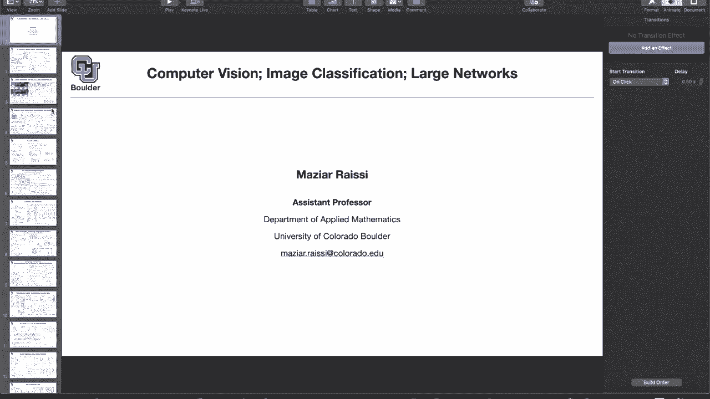
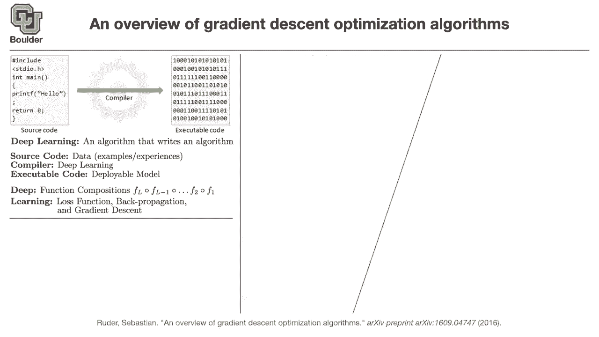

# 1：L1.1 - 深度学习概述 📚

在本节课中，我们将要学习深度学习的基本概念，特别是梯度下降算法。我们将从不同学科的视角来理解深度学习，并将其与传统的编程思想进行类比，以帮助初学者建立直观的认识。

## 🤔 理解深度学习的多种视角

看待深度学习的方式有多种，这取决于不同背景的人。

如果你是一名统计学家，你会将深度学习视为**特征提取器**。例如，你有一张图片或一段文本，深度学习可以帮助你从中提取出一系列特征。这就是统计学家的思考方式。

如果你是一名应用数学家，你会将深度神经网络视为**通用函数逼近器**。当你有一个想要逼近的函数时，深度神经网络可以完成这个任务，数学家会从基函数的角度来思考它。

如果你是一名计算机科学家，尤其是在硅谷工作的工程师，你可能会说深度学习是**算法之母**。那么，从计算机科学的角度来看，什么是算法呢？

## 💻 深度学习的算法视角

通常，编写算法时，你会先写一段源代码（例如C语言代码），然后将其交给编译器。编译器会编译这段源代码，并输出一个可执行文件（例如 `.exe` 文件）。这个可执行文件就是你可以运行的算法或软件。

深度学习也遵循类似的模式，但它本身就是一种算法。那么，深度学习的“源代码”是什么呢？

在深度学习中，**源代码就是你的数据**。这些数据以输入-输出对（即示例）的形式存在。你不再需要手动编写源代码，数据本身就是代码。

例如，在强化学习中，你的数据可以是智能体与环境交互所收集的经验。你不需要编写源代码，但你需要编写“编译器”——即如何编译（训练）这个模型。最终，你会得到一个可部署的模型。

## 📧 一个具体的例子：垃圾邮件检测器

假设你想构建一个垃圾邮件检测器。这是一个分类任务。

你的“源代码”就是大量的数据点：一封电子邮件及其对应的标签（是垃圾邮件或不是垃圾邮件）。你需要收集数百万个这样的输入-输出对。

这是一个艰巨的任务，因为很难用传统的编程规则（例如，哪些词出现就代表是垃圾邮件）来编写代码。因此，经典计算机科学技术在这里并不适用。

然后，你使用深度学习技术来“编译”这些数据。最终，你会得到一个模型，即一个可执行的代码。你可以将这个模型集成到产品中，例如Gmail账户，用于自动将邮件分类到垃圾邮件文件夹或收件箱。

这个模型是一个统计模型。考虑到任务的复杂性，除了使用数据驱动的方法，没有其他更好的选择。

## 🔗 深度学习的核心类比

因此，在深度学习和传统编程之间存在着一个清晰的类比：
*   **源代码** -> **数据**
*   **编译器** -> **深度学习训练过程**
*   **可执行文件** -> **训练好的模型**

我们可以将深度学习视为你的“编译器”。

## 🧠 分解“深度学习”一词

接下来，让我们分解“深度学习”这个词。

**“深度”意味着什么？**
“深度”意味着你有一系列的函数组合。你有输入 `x`，然后应用函数 `f1` 得到 `f1(x)`，再将其输入函数 `f2` 得到 `f2(f1(x))`，依此类推，直到第 `L` 层。

我们在编写传统源代码时也做同样的事情：我们将代码分解为函数，输入经过一系列我们编写的函数进行转换，直到最后输出结果。

深度学习酷的地方在于，这些函数 `f1`, `f2`, ... 的具体形式不是由你手动编写的。你只需要指定这些函数所属的函数族（例如，使用某种类型的神经网络层）。然后，**训练**的任务就是找出 `f1`, `f2` 等函数的具体参数。因此，你不再编写自己的源代码。

**“学习”在深度学习中意味着什么？**
要进行学习，你必须定义一个**损失函数**。这个函数衡量了你的模型预测与真实示例之间的误差。

没有**反向传播**，深度学习就无法存在。反向传播是一种计算损失函数相对于模型参数的导数（梯度）的方法。

一旦你有了梯度，你就可以执行**梯度下降**来优化你的损失函数。优化损失函数的过程就是学习的过程。最终，你会得到一个优化后的模型，即可执行代码。

## 🧪 模型测试与部署

然而，当你得到一个可执行代码（模型）后，不能直接将其投入生产环境。否则，如果模型表现不佳，你的客户会非常不满，你可能会失去客户。

你首先需要在**测试数据**上测试你的算法，确保它能正确工作。这些测试数据在你进行训练算法时是看不到的。

一旦你对算法在测试数据上的表现感到满意，它就可以准备投入生产了。

所以，首先你需要测试你的算法，确保没有“错误”。

## 🔧 调试：回到“源代码”

如前所述，深度学习的“源代码”就是你的数据。如果你的算法表现不正常，你必须回到你的数据中检查。

可能你的数据中存在一些异常值，可能需要清洗数据，或者可能需要向数据集中添加一些新的观测样本。

因此，**源代码就是我们的数据**。数据驱动着深度学习的发展。我们的“编译器”（训练算法）和模型架构是写在论文和教科书中的。这是目前唯一的算法思维方式。

## 📝 本课程的唯一代码

值得一提的是，这是本课程中**唯一一张**我们会实际写出类似算法伪代码的幻灯片。在接下来的课程中，我们将主要关注概念、原理和应用。

---

### 📌 本节课总结

在本节课中，我们一起学习了：
1.  从统计学家、应用数学家和计算机科学家等多个视角理解深度学习。
2.  通过**源代码-编译器-可执行文件**的类比，将深度学习过程与传统编程联系起来。
3.  理解了“深度”代表**函数的层级组合**，而“学习”的核心是**通过梯度下降和反向传播来优化损失函数**。
4.  认识到**数据是深度学习的“源代码”**，模型的训练与测试至关重要，并且当模型出现问题时，需要回溯并检查数据。

通过建立这些基本概念和直观类比，我们为后续深入探讨神经网络的具体结构、训练技巧和应用场景奠定了坚实的基础。