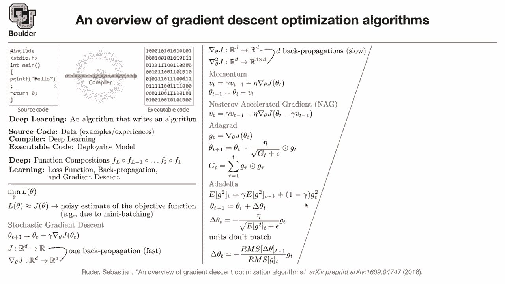

# 2：L1.2 - 梯度下降算法 🧠

在本节课中，我们将要学习深度学习中的核心优化算法——梯度下降。我们将从基本概念开始，逐步深入到其变种，并解释为什么在深度学习中我们通常使用随机梯度下降及其改进版本。

## 概述

在机器学习和深度学习中，我们通常有一个需要最小化的目标函数（损失函数）。由于数据集通常非常庞大，直接计算整个数据集的损失函数及其梯度非常昂贵。因此，我们引入了小批量（Mini-batch）的概念，这导致了随机梯度下降算法的诞生。本节课程将详细解释梯度下降的原理、其随机版本以及几种关键的改进算法。

## 目标函数与优化

在深度学习中，惯例是**最小化**一个损失函数。这有时等价于最大化似然函数。我们的目标是找到模型参数，使得损失函数的值尽可能小。

然而，损失函数通常基于庞大的数据集计算。评估整个数据集的损失函数及其梯度计算成本非常高。

## 小批量与噪声估计

为了解决计算成本问题，在深度学习中，我们使用**小批量**数据。这意味着我们只对数据的一个子集进行求和计算。

因此，我们总是只能获得损失函数的一个**噪声估计**。我们用 **J** 来表示这个目标函数的噪声估计。这种噪声通常来源于小批量采样。

由于我们使用的是损失函数的噪声估计，所以我们的梯度也是近似的、随机的。这就是为什么它被称为**随机梯度下降**。

## 梯度下降算法

我们的深度模型由一系列函数（如 f1, f2, ..., fL）组成，这些函数由一系列权重参数化。我们将所有这些参数放在一个列表 **θ** 中。

梯度下降的核心思想是沿着损失函数梯度的反方向更新参数，以减小损失值。其更新公式为：

**θ_{t+1} = θ_t - η ∇J(θ_t)**

其中：
*   **θ_t** 是第 t 次迭代时的参数。
*   **η** 是**学习率**，控制每次更新的步长。
*   **∇J(θ_t)** 是损失函数 J 在 θ_t 处的梯度。

由于公式中的负号，我们是在沿着梯度方向**下降**。又因为我们使用的是 J（噪声估计），所以这是**随机**梯度下降。

### 关于 J 的进一步说明

J 是目标函数的估计，因为我们只在一小部分数据上训练。例如，在回归问题中使用均方误差（MSE）时，完整的目标函数 F 是在整个数据集上对误差平方求和。

而 J 则是在数据集的**一个随机子样本**（即小批量）上的求和。在每次随机梯度下降迭代中，我们都会重新对数据集进行子采样（例如，每次抽取256个数据点），并计算这个小批量上的损失。这就是一个噪声估计。

### 为什么使用随机批量？

这里有一个基本假设：数据是**独立同分布** 的。因为数据点相互独立，所以似然函数是每个数据点似然的乘积。取对数后，乘积就变成了求和。为了使小批量能代表整体分布，我们希望样本是**随机**的。

当然，也存在一些特例，如**课程学习**，会有意地按难度顺序给模型喂数据，或者进行**难例挖掘**，专注于模型表现不好的困难样本。

## 反向传播与计算效率

上一节我们介绍了梯度下降的基本思想，本节中我们来看看其高效实现的关键——反向传播。

假设参数 **θ** 是 d 维的，损失 J 是一个标量值。那么函数 J 是从 d 维空间到一维空间的映射。

反向传播的巧妙之处在于，它可以非常高效地计算梯度。计算梯度的成本与进行一次前向传播评估模型的成本相当。只需一次反向传播，就能快速得到梯度向量 **∇J(θ)**。

## 为什么只用一阶导数？

有人可能会问，梯度下降只是沿着梯度方向走一步，这个算法看起来很“笨”。为什么不用更聪明的算法，比如使用二阶导数（海森矩阵）的牛顿法呢？

问题在于计算海森矩阵。海森矩阵是一个从 d 维空间到矩阵空间的函数。要计算它，需要进行 d 次反向传播。而深度神经网络的单次前向/反向传播已经非常昂贵，更不用说进行 d 次（d 通常是百万量级）了。

因此，二阶导数和二阶优化算法在深度学习训练中并不适用。我们只能依赖于一阶导数（梯度）。

## 梯度下降的改进算法

既然我们只能使用一阶导数，那么如何改进基础的梯度下降算法，使其更快、更稳定呢？

### 动量法

动量法的灵感来源于物理学。它引入了一个“速度”变量 **v**，在更新时不仅考虑当前梯度，还保留一部分上一时刻的速度。其更新公式如下：

**v_t = γ v_{t-1} + η ∇J(θ_t)**
**θ_{t+1} = θ_t - v_t**

其中 **γ** 是动量系数（例如0.9），它保留了之前90%的速度方向。这就像在山谷中滚动一个球，球会由于动量而加速，从而更快地通过平坦区域。动量法可以使梯度下降更快，但也可能因为速度太快而“冲过”最优点。

### Nesterov 加速梯度

Nesterov 加速梯度是对动量法的一种改进，它更加“谨慎”。其思想是：在根据当前动量“展望”一步之后的位置计算梯度，然后用这个“向前看”的梯度来更新。

其更新步骤如下：
1.  先进行“展望”：**θ_lookahead = θ_t - γ v_{t-1}**
2.  在展望点计算梯度：**∇J(θ_lookahead)**
3.  用这个梯度更新速度：**v_t = γ v_{t-1} + η ∇J(θ_lookahead)**
4.  更新参数：**θ_{t+1} = θ_t - v_t**

这样，算法在“决定”更新方向之前先“向前看”了一眼，通常能带来更稳定的收敛。

## 自适应学习率算法

到目前为止，我们讨论的算法都需要手动设置一个固定的学习率 **η**，并通过验证集来调整这个**超参数**（例如使用网格搜索）。这个过程计算成本很高。

因此，人们希望学习率能够**自适应**地调整。以下是几种常见的自适应学习率算法。

### AdaGrad

AdaGrad 试图为每个参数自适应地调整学习率。其核心思想是：累积历史梯度的平方，并用它来缩放当前的学习率。更新公式如下：

**θ_{t+1} = θ_t - (η / √(G_t + ε)) ⊙ g_t**

其中：
*   **g_t = ∇J(θ_t)** 是当前梯度。
*   **G_t** 是一个对角矩阵，其对角线元素是截至时间 t 所有历史梯度平方的累加和（即 **G_t = Σ_{τ=1}^{t} g_τ ⊙ g_τ**）。
*   **⊙** 表示逐元素乘法（Hadamard 积）。
*   **ε** 是一个很小的常数（如 1e-8），防止除以零。

这样，经常更新（梯度大）的参数学习率会变小，更新少的参数学习率会相对变大。

**AdaGrad 的问题**：
随着训练进行，**G_t** 中的累加和会越来越大，导致学习率不断衰减，最终可能变得极小，使得优化过程过早停止。

### AdaDelta / RMSProp

为了解决 AdaGrad 学习率持续衰减的问题，AdaDelta 和 RMSProp 不再累加全部历史梯度平方，而是使用**指数移动平均**来关注最近一段时间的梯度规模。

以下是 RMSProp 的核心思想（AdaDelta 在此基础上还消除了对初始学习率 η 的依赖）：

**E[g²]_t = γ E[g²]_{t-1} + (1 - γ) g_t ⊙ g_t**
**θ_{t+1} = θ_t - (η / √(E[g²]_t + ε)) ⊙ g_t**

其中 **E[g²]_t** 是梯度平方的指数移动平均值。这样，学习率就能根据最近梯度的幅度自适应调整，而不会无限衰减。

## 总结

本节课中我们一起学习了梯度下降算法及其在深度学习中的关键变种。我们从最小化损失函数的目标出发，解释了由于大数据集带来的计算挑战，从而引入了基于小批量的随机梯度下降。我们探讨了反向传播如何高效计算梯度，并分析了在深度学习中主要使用一阶优化方法的原因。

接着，我们介绍了几种重要的改进算法：**动量法**通过引入历史速度来加速收敛；**Nesterov 加速梯度**以更“前瞻”的方式改进了动量法；最后，我们学习了**自适应学习率**算法（如 AdaGrad 和 RMSProp/AdaDelta），它们能够为每个参数自动调整学习率，减少了对手动调参的依赖，并解决了传统 AdaGrad 学习率衰减过快的问题。这些算法构成了现代深度学习优化器的基础。